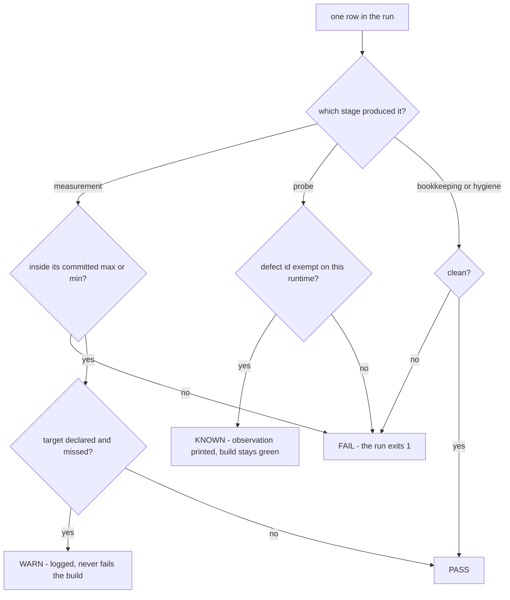

# dev-check — request-path cost and correctness, in seconds

`check.mjs` costs the request path and checks its behaviour **from source**: no
`pnpm build`, no 30-minute benchmark profile, no `results/` files to read. Measured
on a dev box, `bundle cold inproc probe` finishes in about **5 s on Bun** and **25 s
on Node**.

It exists because a performance claim that is expensive to reproduce gets reproduced
rarely, and a behaviour claim that is expensive to check gets checked by hand once and
then trusted forever. Both are how a request path quietly regresses.

---

## Quick start

```bash
# every stage except `profile` — the default
node apps/benchmark/scripts/dev-check/check.mjs

# only what changed
node apps/benchmark/scripts/dev-check/check.mjs probe
node apps/benchmark/scripts/dev-check/check.mjs cold inproc

# the runtime stages on Node instead of Bun
node apps/benchmark/scripts/dev-check/check.mjs all --rt node

# where the time actually goes (slow; opt-in)
node apps/benchmark/scripts/dev-check/check.mjs profile --entry inproc-nextrush
```

Prerequisites: `bun` (the bundler, and the default runtime), `node` >= 22, and `wrk`
only for the `wire` stage. `taskset` is used when present to keep `wrk` off the server's
cores.

The command exits **1** when the gate failed and **0** otherwise, so it is usable as a
CI step as-is. Every run writes `.out/last-run.<runtime>.json`, and the next run prints
the delta against it — so "before my change / after my change" is just running the same
command twice.

---

## Stages

Each stage answers one question and can run alone. `all` (and the default, no stage
arguments) means every stage except `profile`.

| Stage | Question it answers | Cost (measured, Bun) |
| --- | --- | --- |
| `bundle` | How many bytes does an app ship? | 0.4 s |
| `cold` | How long before the first request is served, at 25 and 1,000 routes? | 0.7 s |
| `inproc` | What does one request cost with no socket involved? | 4 s |
| `wire` | How many requests/second over a real socket? | 25 s (needs `wrk`) |
| `probe` | Does the request path still *behave* — errors answered, headers present, params faithful? | 0.6 s |
| `bookkeeping` | Is every known-failure exemption still backed by a probe? | 0.03 s |
| `hygiene` | Does a comment this change added explain the code, instead of pointing at a planning artifact? | 0.1 s |
| `profile` | Where does per-request time actually go? | minutes — opt-in only |

Two of them (`bookkeeping`, `hygiene`) never start a server or measure time, so they
answer identically every run and are safe as their own CI step. `profile` is
deliberately excluded from the default set: it answers "what should I change next",
not "is this change safe", which is what the budgeted stages are for.

---

## Reading a run

Sample output:

```
NextRush dev-check  runtime=bun  (5 s)

PASS   bundle.hello-nextrush-root.kb          27.7 KB (+0.0% vs last run)
PASS   cold.n1000.vs_hono                     0.41 (-4.7% vs last run)
INFO   cold.n1000.nextrush                    11.3 ms, 29.4 MB RSS
WARN   inproc.nextrush.vs_hono                2.11 (-1.4% vs last run)      target 1.3
KNOWN  probe.compression-gzip                 content-encoding=undefined    FB-03 - GET /big + Accept-Encoding: gzip

PASS 11  WARN 1  KNOWN 10  FAIL 0  INFO 11
```

Read it in three passes:

1. **The last line.** `FAIL 0` and exit code 0: nothing is broken. A non-zero `FAIL`
   names the reason — a breached budget, a probe failing with no declared exemption, an
   exemption that no longer covers anything, or an added comment pointing at a planning
   artifact.
2. **The `WARN` row.** A `WARN` means the metric is inside its committed `max`/`min` but
   has not reached its `target`. It never fails the build. Here per-request cost is
   `2.11×` Hono against a `target 1.3` — legal, and visibly not done.
3. **The `KNOWN` rows.** These are *observations of real defects*, printed with what was
   seen (`content-encoding=undefined`) and the id that exempts them. A `KNOWN` row
   disappearing is the interesting event: it means the defect is fixed and the id must
   be deleted in the same change, or the gate starts failing on a stale exemption.

`INFO` rows are measurements with no committed rule — context, not verdicts.

### What a status means



---

## Budgets and the ratios

`budgets.json` is the committed truth for every verdict. Each entry may set `max` (hard
fail above), `min` (hard fail below), and `target` (warn until reached).

Ratios are **NextRush ÷ the comparable baseline, measured in the same run** — the
comparison runs in the same process and the same minutes, so machine noise cancels
instead of accumulating across two separate benchmark sessions. **Below 1.0 is faster.**

| Key | Meaning | Rule |
| --- | --- | --- |
| `bundle.<entry>.kb` | Bundled size of one entry point | `max` 40–70 KB |
| `cold.n25.vs_hono` | Startup ms ÷ Hono's, at 25 routes | `max` 1.6 |
| `cold.n1000.vs_hono` | Startup ms ÷ Hono's, at 1,000 routes — where registration work shows up | `max` 1.2 |
| `inproc.nextrush.vs_hono` | Per-request µs ÷ Hono's, in-process | `max` 1.9, `target` 1.4 |
| `wire.nextrush.vs_hono` | Requests/s ÷ Hono's, over a socket (**above 1.0 is faster**) | `min` 0.5, `target` 0.85 |

`inproc` takes the best of three runs per entry. Two samples left a ~40% spread on a loaded
machine, and this ratio is a gate — three halves it for a few seconds of runtime. The committed
`max` was ratcheted from 2.5 to 1.9 only after five consecutive runs landed in 1.02–1.56 across
both runtimes, so it guards a real regression instead of describing the machine it ran on.

The three `INFO`-only numbers worth watching:

- **`inproc.raw.us`** — a bare fetch-style function that returns `Response.json(…)` with a
  real `Request` constructed per iteration. This is the floor: it is the cheapest a
  runtime-aware handler can be with no framework involved, so it is the number to compare
  a ratio against before declaring a framework cost "too high".
- **`inproc.nextrush.no-timeout.us`** and the printed difference — what the request
  timeout race costs per request. Useful when deciding whether a timeout design is
  affordable.
- **`cold.n*.nextrush` RSS** — startup memory, which grows with route count.

---

## Known failures

A real defect that is not fixed yet should stay *visible* without turning the build red:
the probe keeps running, keeps reporting what it observed, and is reported as `KNOWN`.

`knownFailures` maps a defect id to the runtimes it applies to — `"*"` for all, or a list
such as `["node"]` when the platform itself normalises the problem away on other
runtimes. That scoping is what keeps `KNOWN` honest: an exemption that cannot apply to a
runtime is not silently extended to it.

The mechanism rots in two ways, and the toolkit fails the run for both:

| Rot | Detected by | Why it matters |
| --- | --- | --- |
| An id no probe references | `bookkeeping` | The exemption outlives the probe that justified it, so nothing will ever turn red for it again |
| An id whose probes all **pass** on a runtime it applies to | `probe` (stale exemption) | The defect is fixed but the id stayed, so the probe silently stopped guarding anything |

The second is the important one, and it is why the rule is **delete the id in the same
change that fixes the defect**. A fixed defect's probe then becomes a permanent
regression guard instead of a permanent exemption.

---

## Adding a probe

Probes live in `lib/probe-registry.mjs`, one small object each: an `id`, the `bug` id it
is evidence for (or `null` if it guards behaviour rather than a specific defect), a
`desc` phrased as the expectation, and an async `run(ctx, port)` that returns
`[passed, note]`. Write the note as the observation (`status=500 timedOut=false`), not as
a restatement of the verdict.

Then serve whatever the probe needs from `entries/probe-server.ts`. A probe that
regresses a budget belongs in the stage that owns that measurement instead — probes are
for behaviour, not for cost.

Verified with `node apps/benchmark/scripts/dev-check/check.mjs probe`.

## Adding a stage

A stage gets its own module under `lib/stages/`, receives the context built by
`lib/harness.mjs` (reporting, bundling, and the child-process helpers), and is wired into
`check.mjs` behind a `want('<stage>')` check. Report a gated measurement through
`ctx.gate(name, value, rule)` so it appears in `budgets.json` and in the summary counts;
report context through `ctx.row('INFO', …)`.

Unit tests for the toolkit's own logic live in `lib/__tests__/` and run with
`pnpm --filter nextrush-benchmark test`.

---

## What this toolkit does not prove

Worth knowing before quoting a number from it.

- **In-process cost is not throughput.** `inproc` skips the socket, the HTTP parser, and
  the connection lifecycle. It measures framework tax cheaply and comparably; it does not
  predict requests/second. `wire` is the one that touches a real socket, and its client
  (`wrk`) can itself become the bottleneck — which is why the `raw` floor is printed next
  to it.
- **Allocation volume is not measured.** `inproc` reports time, not bytes. Both candidate counters were
  tested and rejected: sampled `heapUsed` reports ~5 B/request on Bun regardless of what the path
  allocates (JSC's reported heap does not move with transient allocation), and on Node the same sampling
  sums heap-growth events rather than allocations. A laziness claim is proven by counting the platform
  reads it avoids, in a test — not by a heap figure from here.
- **`probe` speaks raw HTTP on purpose.** Targets are sent exactly as written, because
  what a runtime does to a hostile path is part of what is being measured. A probe
  therefore sees platform behaviour (Bun normalises some dot segments before the
  application sees them) and has to state which runtimes it applies to.
- **It runs on Bun and Node only.** Deno, edge, and serverless adapters are covered by
  the cross-adapter conformance suite, not here.
- **Medians, not guarantees.** `cold` reports the median of 7 fresh processes; `inproc`
  and `wire` take the best of 2. A single run is evidence of direction, not a bound.
- **A committed `max` is a regression guard, not a goal.** `WARN` exists so that a number
  which is legal-but-unfinished stays visible without blocking unrelated work.

---

## Where things live

| Path | Role |
| --- | --- |
| `check.mjs` | Argument parsing, stage dispatch, summary, exit code |
| `budgets.json` | Every committed rule and exemption — the only place a verdict is defined |
| `lib/harness.mjs` | Reporting table, budget gate, bundler, child-process helpers |
| `lib/stages/` | One module per stage |
| `lib/probe-registry.mjs` | The probes, as data plus one predicate each |
| `lib/known-failures.mjs` | Exemption bookkeeping (orphans, stale exemptions) |
| `lib/hygiene.mjs` | Added-comment scanner |
| `entries/` | The tiny apps each stage bundles and runs |
| `lib/__tests__/` | Unit tests for the toolkit's own logic |
