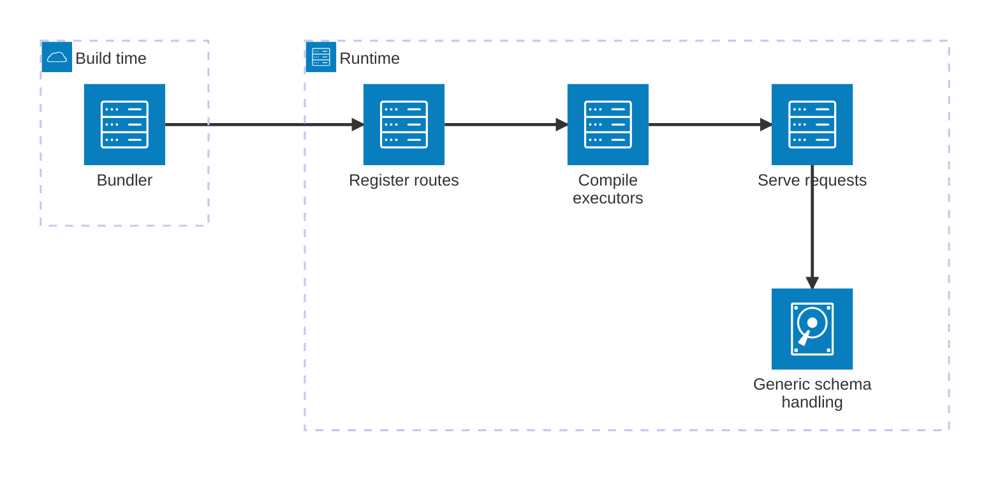
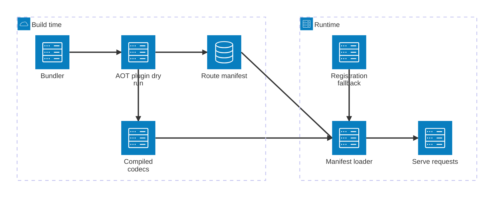
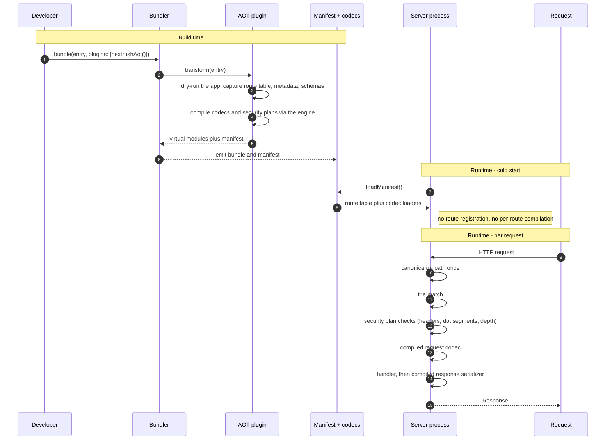

# RFC-040: Ahead-of-time compilation — precompiled routes and resource-footprint budgets

| Field                | Value                                                                 |
| -------------------- | --------------------------------------------------------------------- |
| **Status**           | `Draft`                                                               |
| **RFC number**       | `040`                                                                 |
| **Date**             | `2026-10-18`                                                          |
| **Author(s)**        | Framework maintainer (R&D audit session)                              |
| **Group**            | `runtime-adapters`                                                    |
| **Packages touched** | `@nextrush/aot` (new), `@nextrush/runtime`, `@nextrush/router`, `@nextrush/core`, `@nextrush/validation`, `@nextrush/adapter-{node,bun,deno,edge,serverless,nextjs}`, `@nextrush/adapter-conformance`, repo tooling |
| **Framework impact** | `Additive, non-breaking` — opt-in; with no manifest the framework behaves exactly as today |
| **Supersedes**       | `—`                                                                   |
| **Superseded by**    | `—`                                                                   |
| **Related**          | RFC-039, RFC-015, ADR-0021, ADR-0005, ADR-0010                         |

---

## Progress Tracker

**Overall:** `[░░░░░░░░░░░░░░░░░░░░]` 0% — 0 / 5 phases complete · Doc status: `Draft`

| Phase | Part / deliverable                              | Status         |
| ----- | ----------------------------------------------- | -------------- |
| P0    | Measurement foundation — budgets + Bun harness   | ⬜ Not started  |
| P1    | Manifest format + runtime loader + exec seam     | ⬜ Not started  |
| P2    | Build-time AOT plugin (bundler integration)      | ⬜ Not started  |
| P3    | Compiled schema codecs — two drivers, one engine | ⬜ Not started  |
| P4    | Subpath exports, docs, examples, adapter parity  | ⬜ Not started  |

---

## 0. Revision History

- **v1 (`2026-10-18`)** — Initial draft. Derived from the modernization audit (`report/architecture/architecture-modernization-audit.md`, findings F-01, F-02, F-03, F-04) and grounded in Elysia 2's published AOT architecture (Jul 2026).

---

## 1. Summary (TL;DR)

NextRush compiles routes at registration time and resolves everything else per request, so a cold start pays for the whole application's route table and every request pays for generic schema handling. Meanwhile the framework has no measurement of startup time, memory, or bundle size anywhere in the repository, so none of this is visible. This RFC introduces an **opt-in build-time compilation stage** — a bundler plugin that dry-runs the application, emits compiled route handlers and schema codecs as ordinary modules, and writes a runtime-neutral route manifest — plus **three CI budgets** (cold-start ms, peak RSS, minified bundle size) that make the cost of every future change visible. The single most important consequence: cold-start work moves out of the request lifecycle entirely, and for the first time the framework can state its own resource footprint.

---

## 1a. Terminology

`AOT artifact`
: The set of modules and the manifest emitted by the build-time plugin, replacing registration-time route compilation.

`Route manifest`
: A runtime-neutral JSON document describing the compiled route table, per-route codec references, and per-route security plan. Imports no runtime API and is identical in content across all adapters.

`Dry run`
: The build-time execution of the application's registration code inside the plugin, used to capture the route table, metadata, and schemas without serving traffic.

`Compilation engine`
: The single schema-and-route-to-artifact implementation shared by both drivers. It contains no `new Function` and no runtime-identity branch.

`Driver`
: A caller of the compilation engine. There are exactly two: the **build-time driver** (the AOT plugin, which emits source modules) and the **registration-time driver** (today's runtime path, which builds equivalent closures in memory).

`Fast path` / `Fallback path`
: The two request paths. The fast path serves from a manifest; the fallback path is today's registration-time path, used when no manifest is present.

`Exec seam`
: The narrow interface an adapter calls to execute a matched route. Both paths implement it, so an adapter does not know which one it is running and needs no change when AOT is enabled.

---

## 2. Decision Summary

- **Status:** `Draft`
- **Decision:**
  - _Introduce_ `@nextrush/aot` — a compilation engine, a route manifest format, and bundler plugins for Bun.build / Vite / esbuild / unplugin
  - _Introduce_ an **exec seam** in `@nextrush/runtime` that both the manifest fast path and the registration fallback implement
  - _Introduce_ three CI budgets — cold-start ms, peak RSS after a fixed loadtest, minified bundle size of a hello-world app
  - _Change_ `@nextrush/validation` and the response builder to accept compiled codecs produced by the shared engine
  - _Keep_ the registration-time path as the default when no manifest is present — the zero-config story is unchanged
  - _Prohibit_, as an architecture invariant, any runtime `new Function` / `eval` in the framework
- **Breaking:** `No` — additive and opt-in
- **Migration required:** `None` — a project that does not add the plugin behaves identically
- **Blast radius:** `medium` — every adapter, the router, core, and validation; no application source changes required

---

## 2a. Decision Drivers

Priority (highest → lowest):

1. **Runtime independence** — a manifest must be byte-identical in meaning across Node, Bun, Deno, and Edge; no runtime-identity branch may decide behavior
2. **No loss of security or correctness** — compiled paths must not bypass header grammar, dot-segment rejection, JSON depth bounds, or proxy-trust ordering
3. **Resource footprint** — startup, peak memory, and bundle size are the metrics serverless and edge platforms bill on, and the ones the ecosystem now competes on
4. **Zero-config default preserved** — a developer who adds no plugin must not be asked to configure anything new
5. **Single implementation** — one compilation engine, two drivers; never a second copy of the compilation logic
6. **Measurability** — every claim in this RFC is verified by a committed budget or a parity test, not by a benchmark prose sentence

---

## 3. Problem & Motivation

### 3.1 Current state (what exists today)

A graph query across the whole indexed repository for `codegen|aot|buildPlugin|compileRoute` returns **zero results**. There is no build-time compilation stage anywhere in NextRush.

Route compilation happens at registration, inside the segment trie:

```ts
// packages/router/src/segment-trie.ts (abridged — `autoHead` omitted)
export interface HandlerEntry {
  handler: RouteHandler;
  middleware: Middleware[];
  /** Pre-compiled executor for fast dispatch (no closure per request) */
  executor?: (ctx: Context) => Promise<void>;
  /**
   * Merged route metadata (from `validate()`, `endpoint()`, etc.), retained on
   * the entry so a parent router's `copyRoutes()` can re-emit it when this
   * route is copied by `mount()`. Registration-time state only — request
   * dispatch never reads it. `undefined` for metadata-free routes.
   */
  metadata?: RouteMetadata;
}
```

The framework's own comment states the gap this RFC targets: schema metadata is captured at registration and `request dispatch never reads it`. The information needed to compile is present at boot and unused.

Schema information is captured at registration and then never used to generate code:

```ts
// packages/middleware/validation/src/validate.ts:73 — the schema contributes itself to route metadata
Object.defineProperty(middleware, ROUTE_METADATA, {
  value: { request: schemas } satisfies MetadataContribution,
  enumerable: false,
});
```

```ts
// packages/router/src/router.ts:60 — and the router records that dispatch never reads it
//   "so request dispatch never reads metadata — only getRoutes() touches it."
```

The framework therefore knows every route's schema at boot, stores it, and compiles nothing from it. Collection lives in `packages/router/src/route-metadata.ts` and `packages/router/src/composition.ts`.

The default entry pulls a concrete adapter regardless of target runtime:

```ts
// packages/nextrush/src/index.ts:128
export { createHandler, listen, serve } from '@nextrush/adapter-node';
```

And the imports map exposes three subpaths only — `.`, `./class`, `./nextjs` — with no `nextrush/bun`, `nextrush/edge`, or `nextrush/websocket`.

### 3.2 The problems (enumerated)

1. **No build-time compilation stage.** All route compilation is registration-time (`segment-trie.ts` `compileExecutor`) or request-time. There is no bundler plugin, so a cold start executes the entire registration path — for every route, on every new instance. On serverless and edge, where instances are created per burst, this cost is paid repeatedly.

2. **Startup, memory, and bundle size are unmeasured and unguarded.** No file in `packages/` references `startupTime`, `bundleSize`, `peakMemory`, or `heapUsed` — **zero matches** across the framework source. The tokens appear in `apps/benchmark/` only inside the per-operation allocation harness (`scripts/alloc/`), which measures bytes allocated per call, not process footprint. `.github/workflows/ci.yml` sets `NODE_OPTIONS: --max-old-space-size=8192` — a build allowance, not a guard — and no workflow asserts startup time, peak RSS, or bundle size. The framework targets platforms that bill on exactly those three metrics and cannot state any of them.

3. **Runtime codegen is a dead end, and RFC-039 proposes to walk into it.** RFC-039 §P2/P3 propose compiled validators and serializers derived from boot-time metadata — i.e. runtime `new Function`. Cloudflare Workers forbid `new Function`; Bun 1.4.3 ships `--disallow-code-generation-from-strings` (verified locally against Bun 1.4.3 — under that flag `new Function` fails with *"Code generation from strings disallowed for this context"*, and the flag is functional though absent from `bun --help`). NextRush currently contains **zero** `new Function` / `eval` (verified), which is an advantage the framework would voluntarily surrender.

4. **Registration cost scales with application size, linearly and at boot.** Elysia's published numbers for the same class of work make the shape concrete: an application with 100,000 routes and schemas took **174,603 ms and 1,158 MB** to compile eagerly, versus **310 ms and 228 MB** when the same compilation was offloaded to build time. NextRush has the same eager-compile shape and no offload.

5. **The default entry charges every target for the Node adapter.** `packages/nextrush/src/index.ts:128` re-exports the 1,930-line `@nextrush/adapter-node` unconditionally, and the exports map offers no per-runtime subpath. A Bun-only or Workers-only application imports an adapter it can never execute, paying for it in bundle size and startup parse time.

### 3.3 Why now

Three forces converge:

- **The ecosystem moved.** Elysia 2 "DayDream" (30 Jul 2026) is a ground-up rewrite whose stated premise is precisely this: *"Memory usage, bundle size, startup time was a secondary concern"* — and its fix is AOT. Its own summary of the result: *"It's not likely that you will see a significant faster throughput with Elysia 2."* The frontier is startup, memory, and bundle — not throughput. Elysia also ships what this RFC proposes in P0: *"performance, memory usage report, bundle size hard guard per commit and pull request"*.
- **The constraint hardened.** Workers already ban `new Function`; Bun now ships a flag to ban it. A runtime-codegen design chosen today is a design that cannot run on a growing share of the deployment targets this framework exists to serve.
- **The framework is pre-1.0 and the maintainer has explicitly sanctioned rewriting bad architecture.** This is the cheapest moment this change will ever be. After 1.0 it becomes a breaking change to the authoring model rather than an additive opt-in.

---

## 4. Goals & Non-Goals

### 4.1 Goals

- A cold start served from an AOT artifact performs **no route registration and no per-route compilation** (maps to 3.2.1, 3.2.4).
- Compiled request validation and response serialization are available **without any runtime `new Function`** (maps to 3.2.3).
- Three resource budgets — cold-start ms, peak RSS, minified bundle size — are **measured and CI-enforced**, with a committed baseline (maps to 3.2.2).
- The AOT path and the registration fallback produce **identical observable behavior**, proven by a shared conformance suite that runs both (maps to 3.2.1).
- A project that adds no plugin is **unchanged in behavior and configuration** (drives §2's zero-config constraint).
- Adapters need **no AOT-specific code** — both paths implement one exec seam (maps to 3.2.5, indirectly, by keeping the adapter surface small).

### 4.2 Non-Goals

- **Sucrose-style source inference** — statically analysing arbitrary handler source to infer context usage. Excluded because correctness would then depend on a source-analysis pass correctly interpreting arbitrary TypeScript, and Elysia's own Sucrose has documented silent misses of exactly that kind (Elysia 2's bug list: *"Sucrose: handlers using optional chaining on the context (`ctx?.query`) did not infer the field"*). It is also a large cost — Elysia reports Sucrose plus its AOT compiler as roughly half of Elysia 2's bundle footprint. This RFC's dry-run captures *registered metadata*, never inferred handler internals. Deferred indefinitely.
- **Removing the registration-time path** — excluded so the zero-config story survives and so unbundled development (`tsx`, `bun run`, `node --experimental-strip-types`) keeps working. A follow-up RFC may reconsider once AOT is proven.
- **Replacing the router** — excluded; measured at ~4% of CPU in RFC-015's T017 evidence gate and not a demonstrated bottleneck.
- **Unifying the four forked adapter request runners** — a recommended predecessor (audit F-04), but a separate decision with a separate blast radius. Tracked in §17.
- **Changing the error wire format to RFC 9457** — explicitly out of scope; a follow-up RFC.
- **Any Rust component** — excluded; the measured floor is JavaScript allocation, not compute.

---

## 5. Impact

- **Affected packages:** `@nextrush/aot` (new), `@nextrush/runtime`, `@nextrush/router`, `@nextrush/core`, `@nextrush/validation`, `@nextrush/adapter-node`, `@nextrush/adapter-bun`, `@nextrush/adapter-deno`, `@nextrush/adapter-edge`, `@nextrush/adapter-serverless`, `@nextrush/adapter-nextjs`, `@nextrush/adapter-conformance`, plus repository CI configuration.
- **Affected audiences:** Application developers (new opt-in build step) · Middleware authors (codecs must be declareable) · Adapter authors (one new seam to implement, wired into the four runtime adapters — node, bun, deno, edge) · Contributors (new package, new test matrix).
- **Explicitly NOT affected:** Applications that do not add the plugin — no source change, no configuration change, no behavioral change. The functional `nextrush` entry keeps its current signatures. The `class` runtime, `di`, `errors`, and every middleware package are untouched. The `@nextrush/testing` surface is untouched.

---

## 6. Proposed Solution (overview)

| # | Problem (from §3.2)              | Solution (this RFC)                                                              |
| - | -------------------------------- | -------------------------------------------------------------------------------- |
| 1 | No build-time compilation stage  | `@nextrush/aot` bundler plugin: dry-run the app at build time, emit compiled modules + a manifest |
| 2 | Resource footprint unmeasured    | Three CI budgets with a committed baseline, established in P0 before any AOT code lands |
| 3 | Runtime codegen is a dead end    | One compilation engine with **two drivers** — build-time emits *source* (bundler-compiled); registration-time builds *closures*. Neither uses `new Function` |
| 4 | Registration scales with app size | The fast path loads a manifest and imports precompiled modules; zero per-route work at boot |
| 5 | Default entry charges every target | Per-runtime subpaths in P4 and a bundle budget that fails the build when an unused adapter is in the graph |

**The key idea.** There is exactly one implementation of "schema and route metadata to executable artifact" — the compilation engine — and it is called by two drivers. The build-time driver serializes its output as **ordinary source modules**, which the host bundler then compiles, tree-shakes, and minifies ahead of time. That is what makes this Workers-safe and what keeps `new Function` out of the runtime: nothing is generated *at* runtime; everything is generated *before* it. The registration-time driver calls the same engine and produces equivalent closures in memory, which is slightly slower per call but requires no build step and no dynamic code.

Both drivers are held to one behavioral contract by a shared conformance suite that runs the identical scenario list through the fast path and the fallback path and asserts identical responses — including the security checks, which remain on both paths.

---

## 6a. Trade-offs

### Benefits

- Cold start stops scaling with route count, because route compilation is not performed at runtime.
- Compiled validation and serialization become available without dynamic code, which keeps Workers and CSP-strict deployments viable.
- The framework gains its first quantified resource footprint, so every future change is judged against a number rather than an impression.
- Two drivers over one engine means the compiled and interpreted paths cannot drift, because they share the implementation and are tested against the same suite.
- Opt-in means zero risk to existing users and a clean rollback (§16).

### Costs

- A build step exists for projects that opt in. Opt-out is a config edit, but a build step is a build step.
- The AOT artifact inlines per-route code into the bundle, so bundle size grows modestly for large applications while peak memory falls. Elysia reports the same trade and accepts it.
- The plugin must dry-run the application, which means long-lived resources (database pools, Redis clients) will prevent the build from exiting unless the application short-circuits them. This is a real DX hazard and is why `Manifest.isCapturing()` exists in §8.1.
- Two request paths exist in the codebase permanently. The conformance suite that keeps them honest is itself a maintenance cost.
- The bundle budget will fail builds for legitimate reasons (an accidental import of an unused adapter). That friction is the point, but it is friction.

---

## 7. Architecture

### 7.1 Before



Every box in the runtime group is executed on every cold start. The generic schema handling box is executed per request.

### 7.2 After (opt-in)



The runtime group loses both `Register routes` and `Compile executors`. The fallback remains for projects without a manifest, and it feeds the same loader, so the serving path is one code path.

### 7.3 Why this architecture

Three constraints shaped this shape, in order of the §2a priority list:

1. **Runtime neutrality forces the manifest to be data, not code.** A manifest that contained runtime-specific structures would break the parity invariant the moment a Bun build were deployed to Node. So the manifest is a runtime-neutral JSON document, and the *code* it points to is ordinary modules the bundler resolved for the target.
2. **The `new Function` prohibition forces two drivers rather than one.** If compilation could only happen at runtime, Workers would be unreachable. If it could only happen at build time, the zero-config default would break. Two drivers over one engine satisfies both without duplicating the compilation logic — which is the failure mode this framework already exhibits elsewhere (audit F-05).
3. **Security must survive the fast path.** The compiled path is the path that skips runtime machinery, so it is the path most likely to skip a check by accident. The security plan is therefore an explicit, per-route, testable field in the manifest (§8.4) rather than an assumption that compiled routes are inherently safe.

---

## 7a. Architecture Invariants

Preserved:

- **Core imports no runtime API** (`AGENTS.md` §7). `@nextrush/aot`'s engine and manifest types import nothing platform-specific; the bundler plugins are separate entry points with the bundler as a peer dependency.
- **Behavior is decided by negotiated capabilities, never runtime identity.** The manifest carries no runtime field, and the loader performs no `if (runtime === …)` branch. The single capability-exempt runtime-identity branch that already exists (`packages/runtime/src/detection.ts`) is untouched; §8.6 records it as the only permitted one.
- **Cross-adapter observable behavior is identical** (`ADR-0010`). The manifest is runtime-neutral by construction, and the extended conformance suite runs both paths on all four runtime adapters (node, bun, deno, edge). The serverless and nextjs adapters delegate to these and inherit the seam unchanged.
- **Security checks stay at the boundary on every path** (`security-boundaries` capability). Header grammar, dot-segment rejection, JSON depth bounds, and proxy-trust ordering execute on the fast path exactly as on the fallback. The manifest encodes them explicitly so a compiled route cannot silently omit one.
- **`@nextrush/aot` ships no runtime dependency beyond the workspace** (`ADR-0005` tier rules). The engine is zero-dependency; bundler integrations are optional subpaths.
- **No runtime `new Function` / `eval`.** Currently true; this RFC makes it an enforced invariant with a CI check rather than an accident.

Explicitly changed:

- **Compilation is no longer exclusively a registration-time concern.** The invariant "the trie owns route compilation" becomes "the trie owns *matching*; the compilation engine owns *code generation*, and either driver may invoke it." Justification: the trie's executor is one artifact of a general process, and keeping code generation inside the router is what prevents the schema knowledge the router already holds from being used at build time. The trie keeps matching, ordering, and conflict detection unchanged.

---

## 8. Detailed Design

### 8.1 Public API / surface

```ts
// @nextrush/aot — build-time entry points, one per bundler.
// Each is a separate subpath so an unused integration is never in the graph.

import { aot } from '@nextrush/aot/bun';      // Bun.build plugin
import { aot } from '@nextrush/aot/vite';     // Vite plugin
import { aot } from '@nextrush/aot/esbuild';  // esbuild plugin
import { aot } from '@nextrush/aot/unplugin'; // rollup / rolldown / webpack / farm

interface AotOptions {
  /** The module that constructs and exports the Application. */
  entry: string;
  /** Emit human-readable compilation stats. Default: false. */
  verbose?: boolean;
  /** Treat an uncompilable route as a build error instead of a fallback. Default: false. */
  strict?: boolean;
}

// @nextrush/aot — runtime entry point, also exposed from @nextrush/runtime.
// Pure, synchronous, and zero-dependency: it reads a manifest and returns a loader.
function loadManifest(manifest: AotManifest): ManifestLoader;
```

```ts
// @nextrush/aot — the dry-run escape hatch, re-exported for application code.
// An application with a database pool calls this to short-circuit at build time.
import { Manifest } from '@nextrush/aot';

if (Manifest.isCapturing()) {
  // Skip connection setup that would prevent the build from exiting.
}
```

### 8.2 Internal components

| Component | Package | Single responsibility |
| --- | --- | --- |
| Compilation engine | `@nextrush/aot` | Route + metadata + schema → compiled artifact. Contains no `new Function`, no runtime branch. |
| Build-time driver | `@nextrush/aot` | Calls the engine during a dry run and serializes artifacts as source modules + manifest. |
| Registration-time driver | `@nextrush/router` | Calls the same engine with closure emission; produces today's `executor` plus optional codecs. |
| Manifest | `@nextrush/aot` | Runtime-neutral description of routes, codec references, ordering, and security plans. |
| Manifest loader | `@nextrush/runtime` | Manifest → lookup structure. Allocates once at boot; read-only per request. |
| Exec seam | `@nextrush/runtime` | The single interface adapters call to run a matched route. Both paths implement it. |
| Security plan | `@nextrush/aot` | Per-route declaration of the boundary checks that must run, encoded in the manifest and asserted by tests. |

No component above owns more than one concern, and the engine is the only place a compiled artifact is ever produced.

### 8.3 Request / execution flow



### 8.4 Data structures

The manifest is deliberately flat, ordered, and free of executable values so it can be diffed, cached, and shipped to any runtime.

```ts
interface AotManifest {
  /** Format version. A mismatch fails fast at boot (see §8.5). */
  version: 1;
  /** Content hash of the route table, for staleness detection. */
  routesHash: string;
  /** Ascending registration order — matching precedence is registration order. */
  routes: AotRoute[];
  /** Measured at build time; surfaced by the loader for budget reporting. */
  build: { routes: number; compiledAt: string };
}

interface AotRoute {
  method: HttpMethod;
  path: string;
  /** Import specifier of the emitted compiled handler module. */
  handler: string;
  /** Import specifiers of compiled codecs; absent means no schema for that source. */
  codecs?: { params?: string; query?: string; body?: string; headers?: string; response?: string };
  /**
   * The boundary checks that must run for this route. Encoded rather than
   * implied, so a compiled route cannot silently skip one, and so a test can
   * assert the set matches what the registration path performs.
   */
  security: {
    headerGrammar: true;
    dotSegmentReject: true;
    jsonDepthLimit: number;
    proxyTrust: boolean;
  };
}
```

`routes` is an **array**, not a map, because matching precedence in NextRush is registration order and a map would make that order implicit. Lookup by path is performed by the trie built from this array at load time, exactly as in the fallback path.

### 8.5 Error handling

All boot-time failures are fail-fast with actionable messages; no compiled-artifact error surfaces at request time.

| Condition | Behavior |
| --- | --- |
| No manifest found | Silent fallback to registration-time path. Not an error — the zero-config case. |
| Manifest `version` unsupported | Throw `NextRushError` at `loadManifest()`. Message names the found and supported versions and the `@nextrush/aot` version to install. |
| `routesHash` mismatch against the bundle's own route table | Throw at boot. Message: the manifest is stale relative to the bundle; re-run the build. |
| Manifest names a codec module that does not exist | Throw at boot, naming the route and the missing specifier. |
| `strict: true` and a route cannot be compiled | Build fails, naming the route and the reason. Default (`strict: false`) emits that route as a fallback entry and logs it. |
| Dry run cannot exit because of a long-lived resource | Build fails with a message naming the resource and pointing at `Manifest.isCapturing()`. |

No manifest content, route list, or file path is included in *request-time* error responses. Build errors are build output and may contain paths.

### 8.6 Edge cases

| Scenario | Behavior |
| --- | --- |
| Routes registered after the build (dynamic registration) | Not compiled. They run on the registration path and are dispatched through the same exec seam. Documented; a follow-up may forbid it under `strict`. |
| `mount()`ed sub-router | Flattened into the manifest at build time with the mount prefix applied, preserving registration order. |
| Two applications in one process | One manifest per application; `loadManifest` is pure and holds no global state. |
| Manifest present but the runtime differs from build target | Supported by design — the manifest is runtime-neutral. Covered by the conformance matrix. |
| Dev mode (`tsx`, `bun run`, type stripping) with no build | Fallback path. Unchanged from today. |
| Adapter selection | Served by the one capability-exempt runtime-identity branch (`packages/runtime/src/detection.ts`); unchanged by this RFC, and the only permitted platform query. |

### 8.7 Examples

```ts
// Build configuration — opt in.
import { aot } from '@nextrush/aot/bun';

const { outputs } = await Bun.build({
  entrypoints: ['src/index.ts'],
  outdir: 'dist',
  target: 'bun',
  plugins: [aot('src/index.ts')],
});
process.exit(0); // so a dry-run resource cannot hold the build open
```

```ts
// Application source — add the capture guard only if something is long-lived.
import { createApp, Manifest } from 'nextrush';
import { createPool } from 'pg';

const app = createApp();

if (!Manifest.isCapturing()) {
  const pool = createPool(process.env.DATABASE_URL);
  app.decorate('db', pool);
}

app.get('/health', (ctx) => ctx.json({ ok: true }));

export default app;
```

```ts
// Serving — unchanged for the developer.
import { serve } from 'nextrush/node'; // or nextrush/bun, nextrush/edge in P4
import app from './app';

serve(app, { port: 3000 });
```

---

## 9. Alternatives Considered

### 9.1 Runtime `new Function` codegen (RFC-039's P2/P3 as written)
Compile schemas into specialized functions at registration using `new Function`. **Why rejected:** it cannot run on Cloudflare Workers, and Bun 1.4.3 now ships `--disallow-code-generation-from-strings`. It would also require introducing into the framework the one dynamic-code capability it currently does not have. It is strictly worse than the build-time equivalent on the targets this framework exists to serve.

### 9.2 Full AOT-only (clone Elysia 2's decision to remove dynamic mode)
Delete the registration-time path and require a build step. **Why rejected:** Elysia could do this because its users were already using a bundler. NextRush's zero-config story (`tsx`, `bun run`, `node --experimental-strip-types` with no build) is a stated product feature (`AGENTS.md` §2, §8), and removing it would increase user work — the one thing this framework's philosophy forbids. The maintainer can reconsider once the AOT path is proven and measured; the decision is recorded in §19.

### 9.3 Sucrose-style static source analysis
Infer context usage by analysing handler source at build time — Elysia's Sucrose approach. **Why rejected:** it makes the framework's correctness depend on a source-analysis pass that must correctly interpret arbitrary TypeScript, and its failure mode is silent. Elysia 2's own bug list records exactly such a miss: *"Sucrose: handlers using optional chaining on the context (`ctx?.query`) did not infer the field."* It is also a large cost — Elysia reports Sucrose plus its AOT compiler as roughly half of Elysia 2's bundle footprint. Capturing *registered metadata* is a strictly smaller, verifiable surface, and a missed context field is structurally impossible because the route table, not an inference pass, is the source of truth.

### 9.4 Do nothing
Every cold start continues to compile the full route table; schema handling stays generic; startup, memory, and bundle stay unmeasured and unguarded. RFC-039's runtime-codegen plan proceeds and eventually collides with Workers and the Bun flag. The cost of the status quo is that the framework's resource footprint is unknown and unmanaged while the platforms it targets bill on exactly that.

---

## 10. Rejected Ideas

- **A single driver (build-time only, or runtime only).** Rejected — build-time-only breaks zero-config; runtime-only cannot satisfy the `new Function` prohibition.
- **Emitting an interpreted intermediate representation instead of source modules.** Rejected — it would add a per-request interpreter to the hot path to avoid a problem the bundler already solves for free. Source emission lets the host bundler tree-shake and minify, which is strictly better.
- **Committing the manifest to version control.** Rejected — the manifest is a build artifact keyed by `routesHash`; committing it invites staleness. It is emitted next to the bundle.
- **Making AOT the default in v1 of this RFC.** Rejected — the default must be proven by budgets (§14 P0) before it is chosen, not assumed.
- **Encoding the security plan as documentational text.** Rejected — as a machine-checked field, a test can assert that the fast path and the fallback path enforce the same set. As prose it would rot.
- **Putting compiled codecs in `@nextrush/validation`.** Rejected — validation is where the schema *declaration* lives; compilation is a cross-cutting concern that also covers serialization. The engine lives in `@nextrush/aot` and `validation` consumes it.
- **Waiting for the adapter unification (audit F-04) to land first.** Rejected as a blocker — the exec seam in §8.2 is the same seam unification would introduce, so this RFC creates it rather than waiting for it. Unification then becomes smaller, not larger.

---

## 11. Risks & Mitigations

| Risk | Mitigation | Likelihood | Impact |
| --- | --- | --- | --- |
| Compiled fast path silently omits a security check | Security plan is an explicit manifest field; a conformance test asserts fast-path and fallback-path check sets are identical; existing security suite runs on both paths | Low | High |
| Fast path and fallback path drift over time | One compilation engine, two drivers; a shared scenario list run through both, asserting identical responses | Medium | High |
| Dry run hangs the build on a database or cache connection | `Manifest.isCapturing()` documented in the plugin's error message; build fails with an actionable message rather than hanging silently | High | Medium |
| AOT artifact increases bundle size enough to breach the new budget | Budget is committed in P0 with the pre-AOT baseline recorded, so the trade is visible and deliberate rather than discovered | Medium | Medium |
| Resource budgets flake and get disabled | Reuse the allocation-benchmark technique already proven in-repo (cv ≤0.2%, median of N runs, pinned cores); budgets get a tolerance band, not an exact number | Medium | Medium |
| Manifest staleness ships a route table that does not match the code | `routesHash` verified at boot; mismatch throws before serving | Low | High |
| Added build-step complexity regresses developer experience (the §2 driver-4 violation) | AOT is opt-in and the zero-config path is unchanged; a docs example must show a working AOT setup in under 15 lines | Medium | Medium |
| Compiled codecs diverge from generic codecs on an untested input | Codec parity is a P3 exit condition: the same fuzz corpus must produce identical results through generic, closure, and source-emitted codecs | Medium | High |

---

## 12. Backward Compatibility & Migration

- **Compatibility:** Additive & non-breaking. No existing API changes signature, no behavior changes when no manifest is present.
- **Migration path (if breaking):** Not applicable — this RFC is additive. The one migration a user may choose to perform is opting in:

  ```ts
  // Before — no build step, routes compile at registration.
  // (no code change required)

  // After — opt in to AOT for faster cold start.
  // 1. add the plugin to the bundler config
  // 2. add `if (!Manifest.isCapturing())` around long-lived resource setup
  // 3. everything else is unchanged
  ```

- **Deprecation window:** Not applicable — nothing is deprecated. If a later RFC removes the registration path (§17), it will carry its own migration plan and major bump.
- **Invariant note:** the "no runtime `new Function`" property becomes CI-enforced. This is a *strengthening* of behavior, not a breaking change — the quantity of dynamic code in the framework today is zero.

---

## 13. Cross-Cutting Concerns

- **Security:** The fast path is the path that skips runtime machinery, so every boundary check is encoded per route (§8.4) and asserted by a test comparing fast-path and fallback-path check sets. Compiled codecs validate with the same rules as generic codecs, verified by a shared fuzz corpus. No route table, manifest content, or file path appears in request-time error responses. Build errors may contain paths; they are build output. This change reduces dynamic-code surface (it prohibits runtime `new Function` by CI gate).
- **Performance:** The primary purpose. Cold start drops by removing per-route compilation; steady-state throughput must not regress — the `json-serialize` marginal-cost comparison and the pinned floor-excess number are §14 metrics with explicit no-regression thresholds. Codec hot-path allocation is measured by the existing `bench:alloc:*` harness.
- **Runtime independence:** The manifest is runtime-neutral and carries no runtime field. No `if (runtime === …)` branch is introduced or permitted to decide behavior; the single capability-exempt runtime-identity branch that already exists (`packages/runtime/src/detection.ts`) is untouched. The engine and manifest types import no platform API. The conformance matrix runs both paths across node, bun, deno, and edge (`ADR-0010`).
- **Observability:** The loader reports the manifest's route count and build timestamp once at boot, at info level. Compilation statistics are emitted at build time (route count, compiled vs fallback, bytes emitted). Nothing sensitive is logged; the manifest contains route paths, which are already public in the bundle.
- **Zero-dependency rule:** `@nextrush/aot`'s engine, manifest types, and loader are zero-dependency. Bundler integrations are separate subpaths with the bundler as a **peer** dependency, so importing `@nextrush/aot` alone pulls nothing new. No runtime dependency is added to core, router, runtime, errors, types, adapters, or middleware.

---

## 14. Success Metrics

Baselines marked *unmeasured* are established by P0 before any AOT code is written — that is the point of P0, and stating a fabricated baseline here would be the exact failure this RFC exists to fix. The external column gives the frame of reference P0 is aiming at, from Elysia 2's published `bun build --minify` / startup measurements (verified against the primary source, §20).

| Metric | Baseline (today) | External reference | Target / threshold |
| --- | --- | --- | --- |
| Cold start, 25 routes (median of 5, pinned cores) | *unmeasured — P0 establishes* | Elysia 24 ms · Hono 21 ms · Fastify 90 ms | ≤ 0.5× baseline with AOT |
| Cold start, 1,000 routes | *unmeasured — P0 establishes* | Elysia 29 ms · Hono 23 ms · Fastify 108 ms | ≤ 0.3× baseline with AOT |
| Peak RSS after fixed loadtest | *unmeasured — P0 establishes* | Elysia 45.7 MB · Fastify 192.4 MB | ≤ 0.9× baseline with AOT |
| Hello-world bundle, minified | *unmeasured — P0 establishes* | Elysia 141 KB · Hono 21 KB · Fastify 729 KB | recorded; budget set so an unused adapter fails the build |
| Fetch-entry compile per cold start | *unmeasured — P0 establishes* | Elysia 0.851 ms → 0.046 ms with AOT | measured; must not grow with route count |
| Node `json-serialize` marginal cost | 2.19 µs (recorded in `ADR-0021`; source evidence in git history at `10d8fa38`) | — | no regression (> 5% fails) |
| Node floor excess vs Fastify @256 conns | 5.59 µs | — | no regression (> 5% fails) |
| Fast-path vs fallback-path behavioral differences | — | **zero** across the shared conformance scenario list |
| Codec parity (generic ≡ closure ≡ source-emitted) | — | **zero** differences across the shared fuzz corpus |
| Runtime `new Function` / `eval` occurrences | 0 | **0**, CI-enforced |
| Test coverage, `@nextrush/aot` | — | 90%+ lines/functions |
| AOT setup documented in a working example | — | ≤ 15 lines of configuration |

---

## 15. Phased Implementation Plan

| Phase | Goal (what ships) | Depends on | Exit condition (checkable) | Status |
| ----- | ----------------- | ---------- | -------------------------- | ------ |
| **P0** | Measurement foundation — CI budgets for cold-start ms, peak RSS, minified bundle size; a Bun harness arm including Elysia and raw `Bun.serve`; committed baseline. This mirrors Elysia's own *"performance, memory usage report, bundle size hard guard per commit and pull request"* | — | All three budgets run in CI and fail on regression beyond tolerance; the Bun arm produces the first NextRush-on-Bun number | ⬜ Not started |
| **P1** | Manifest format + `loadManifest` + exec seam; registration-time driver emits a manifest and the loader serves from it | P0 | Round-trip test green; an app served entirely from a registration-emitted manifest returns byte-identical responses to today's path | ⬜ Not started |
| **P2** | Build-time driver — `@nextrush/aot/{bun,vite,esbuild,unplugin}`; dry run; source emission; `routesHash` staleness check | P1 | A 1,000-route app boots from an AOT artifact with **zero** route registration calls (asserted by instrumentation); cold-start budget target met | ⬜ Not started |
| **P3** | Compiled schema codecs from one engine, both drivers | P2 | Codec parity suite green: generic ≡ closure ≡ source-emitted across the shared corpus; `json-serialize` and floor-excess budgets show no regression | ⬜ Not started |
| **P4** | Per-runtime subpaths, docs, examples, adapter parity matrix | P3 | Bundle budget passes with an unused adapter provably absent from a hello-world build; four-adapter conformance green on both paths; AOT example ≤ 15 lines and in the docs | ⬜ Not started |

### 15.1 Testing strategy

- **Unit:** the compilation engine's route and schema-to-artifact mapping, `routesHash` computation, manifest validation and every §8.5 error path. Pure, fast, many.
- **Integration:** a real bundler (starting with `Bun.build`, then Vite) building a real multi-route application and booting it from the emitted artifact.
- **Cross-adapter:** the existing conformance suite extended to run both the fast path and the fallback path across node, bun, deno, and edge, asserting identical observable behavior (`ADR-0010`).
- **Parity:** one scenario list executed through three codec implementations (generic, closure, source-emitted) asserting identical results — this is the test that makes "one engine, two drivers" true rather than aspirational.
- **Security:** the existing security suite runs against the fast path explicitly; a dedicated test asserts the fast path's enforced check set equals the fallback path's.
- **Guard:** a CI check asserting zero `new Function` / `eval` in the runtime packages.
- **Coverage:** 90%+ lines/functions for `@nextrush/aot`; no coverage decrease in touched packages.

---

## 16. Rollback Plan

- **Trigger:** a regression on any §14 metric beyond its tolerance; a fast-path vs fallback-path behavioral difference discovered in production; a cold start slower with AOT than without on any supported target.
- **Steps:**
  - Remove the `aot()` plugin from the bundler configuration. The application returns to the registration-time path with no source change — this is the whole rollback, and it is why opt-in was chosen.
  - If the defect is in the codec engine, publish `@nextrush/aot` with codec emission disabled; the manifest still accelerates startup while leaving validation on the generic path.
  - Retain the emitted manifest in the build output for diagnosis; it is inert once the plugin is removed.
  - Keep the P0 budgets in place regardless — they are independently valuable and are the mechanism that detected the problem.
- **State to clean up:** the build output directory (manifest + emitted modules) and the `@nextrush/aot` package version pin. No migration, no data, no published tag changes.

---

## 17. Future Work

- **Unify the four forked adapter request runners** (audit F-04) — a recommended predecessor in spirit, folded in as the exec seam here; the remaining work is collapsing `createBunRequestRunner` / `createRequestRunner` / the inline Deno and Node paths into one shared runner and propagating the Node synchronous fast path to Bun, Deno, and Edge. Follow-up RFC.
- **RFC 9457 Problem Details error responses** and a `defer` post-response queue (audit F-11). Follow-up RFC.
- **Removing the registration-time path** once AOT is default-proven. Requires a major and a migration plan; explicitly deferred (§9.2).
- **Adopting Bun's native static-route table** (`Bun.serve({ routes })`) behind a capability flag. Elysia's own measurement puts the benefit at 2–5% for dynamic routes and negligible for static, so it is low priority — but it interacts with the manifest, since the manifest already knows which routes are static and schema-less.
- **Multi-process / cluster-aware manifest loading** and per-worker memory reporting, extending the P0 budgets.
- **Compiled middleware chains** — the same engine applied to the middleware pipeline (audit F-05), which is where the remaining unexplained ~2.9 µs of floor excess is a candidate.

---

## 18. Open Questions

- [ ] Should the AOT plugin emit real files into a cache directory, or virtual modules only? Vite and esbuild handle virtual modules cleanly; Bun.build's support needs verification before P2 commits to one.
- [ ] What exact budget tolerances avoid flaking on a shared CI runner while still catching real regressions? (The in-repo allocation harness suggests cv ≤0.2% is achievable with pinned cores; CI may need a wider band.)
- [ ] Do we ship the closure-based codec path at all when the app is bundled, or use source-emitted codecs exclusively and keep closures only for unbundled dev? Shipping both is safer; shipping one is simpler.
- [ ] How should `strict: true` treat routes registered dynamically at runtime — build error, runtime throw, or a documented escape hatch?
- [ ] Should the exec seam be public (documented for adapter authors) or internal with a sealed surface (`ADR-0005`)?
- [ ] What happens to the manifest under `nextrush/dev` (SWC dev loader)? Does the dev server use AOT, or is it registration-path only until P4?

---

## 19. Decisions Log

| Question | Decision | Rationale |
| --- | --- | --- |
| Build-time vs runtime codegen | Build-time | Workers ban `new Function`; Bun ships a flag to ban it; runtime codegen would be a new capability the framework does not have |
| One driver or two | Two drivers, one engine | Build-time-only breaks the zero-config product feature; runtime-only is prohibited; two drivers over one engine avoids duplicating compilation logic |
| AOT as default or opt-in | Opt-in | The default must be chosen by measurement, and opt-in makes rollback a config edit |
| Manifest as data or code | Data (runtime-neutral JSON) | A runtime-specific manifest would break cross-adapter parity on the first cross-target deploy |
| Security plan as prose or field | Machine-checked manifest field | A test can assert fast-path and fallback-path check sets match; prose rots |
| Array vs map for routes | Array | Matching precedence is registration order; a map would make that order implicit |
| Wait for adapter unification | No — introduce the exec seam here | The seam is what unification would need anyway; creating it now makes unification smaller, not larger |
| Where the engine lives | `@nextrush/aot`, consumed by `validation` | Validation owns schema declaration; compilation is cross-cutting and also covers serialization |
| Committing the manifest | No | It is a build artifact keyed by `routesHash`; committing invites staleness |

---

## 20. References

- `report/architecture/architecture-modernization-audit.md` — the audit that produced this RFC (F-01, F-02, F-03, F-04, F-10)
- `docs/RFC/runtime-adapters/039-precompile-per-request-tax.md` — the per-request-tax study this RFC re-scopes toward build time
- `docs/RFC/runtime-adapters/015-router-radix.md` — T017 evidence gate (matcher ≈4% CPU; router is not the bottleneck)
- `docs/adr/ADR-0021-fast-property-request-containers.md` — fast-property containers; the measurement discipline this RFC's budgets follow
- `docs/adr/ADR-0010-cross-runtime-parity-hardening.md` — the parity invariant the conformance matrix enforces
- `docs/adr/ADR-0005-package-tiers-sealed-surface-deprecation.md` — package tiers and sealed-surface rules for the new package
- `apps/benchmark/` — the harness; `scripts/alloc/*` (24 deterministic allocation benches) and `scripts/run.js` (narrowable profile runner)
- Elysia 2 "DayDream" release notes, 30 Jul 2026, <https://elysiajs.com/blog/elysia-20> — AOT build plugin (`elysia/plugin/aot/*`), dry-run + `Manifest.isCapturing()`, `process.exit(0)` build guidance, bundler targets (Bun.build / vite / esbuild / rspack / unplugin). Figures cited in this RFC verified against the primary source: startup 0.851 ms → 0.046 ms; 100k-route+schema compile 174,603 ms / 1,158 MB → 310 ms / 228 MB; 100k distinct schema eager→AOT 4,110 ms / 1.65 GB → 775 ms / 400 MB; per-route memory 32.1 KB → 2.3 KB; hello-world `bun build --minify` 736 KB → 344 KB, 141 KB with AOT; peak RSS after loadtest 45.7 MB vs Fastify 192.4 MB; Cloudflare Workers `new Function` prohibition; per-commit/PR performance, memory, and bundle-size hard guards.
- Elysia 2's `aot: false` removal (same post, "Dynamic mode is now removed entirely replaced by AOT mode") — the decision §9.2 declines to copy, and the reason §12's zero-config path is preserved.
- Elysia GitHub issue #466, <https://github.com/elysiajs/elysia/issues/466> — *"Async Derive leaks request context to other requests if `aot:true`"*, opened Feb 2024 against 0.8.16, **closed as fixed in 1.0.0**; the repro itself uses `aot: false`. **This is an AOT-codegen context-leak bug in the compiled handler path, not a defect of Sucrose/source inference** — it must not be cited as evidence against source analysis (as RFC-039 §2.4 and §9 do). Sucrose's real documented limitation is the silent-inference miss quoted in §4.2 and §9.3.
- Elysia 1.3 release notes, 5 May 2025, <https://elysiajs.com/blog/elysia-13> — Bun System Router (`Bun.serve.routes`), verified verbatim: *"for static route, we didn't see much performance improvement but we found that dynamic routes perform 2-5% faster without any code changes."* Also the origin of the adapter-owned router rewrite ("we have to rewrite our internal compilation code to support custom router from adapter") that this RFC's exec seam echoes, and of moving static router code generation into the compile phase.
- Bun blog, "Rewriting Bun in Rust" (8 Jul 2026) — Bun 1.4 HTTP throughput, `node:http` on Bun, memory-leak elimination
- Bun 1.4.3 release notes — `--disallow-code-generation-from-strings`; verified locally against Bun 1.4.3 in this repo's environment (`new Function` rejected under the flag; flag functional but absent from `bun --help`)
- srvx (`srvx.h3.dev`) — the Web-standard server Elysia's Node adapter uses (with `crossws`), `FastResponse`
