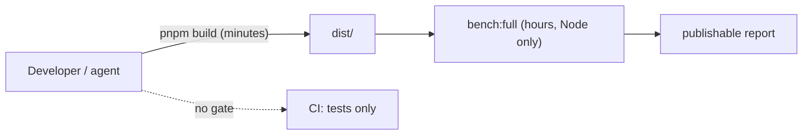
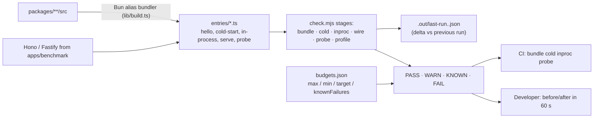
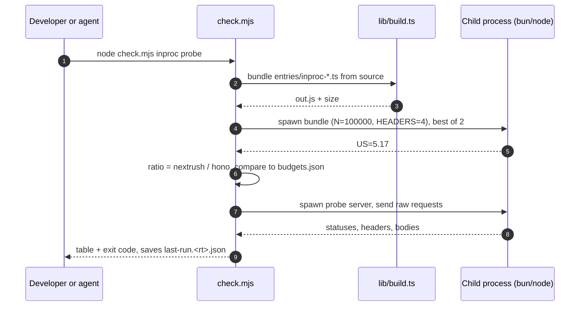

# RFC-040: Resource budgets and request-path footprint — measure first, gate AOT on evidence

| Field                | Value                                                                 |
| -------------------- | --------------------------------------------------------------------- |
| **Status**           | `Approved` — gates in use; footprint work (P2) in progress via `fix-request-path-and-response-contract` |
| **RFC number**       | `040`                                                                 |
| **Date**             | `2026-10-18`                                                          |
| **Author(s)**        | Framework maintainer (R&D audit session + validation session)         |
| **Group**            | `runtime-adapters`                                                    |
| **Packages touched** | `apps/benchmark` (dev-check toolkit), `@nextrush/runtime`, `@nextrush/adapter-{bun,deno,edge,node,serverless}` (footprint changes owned by RFC-039), CI configuration. **No new package.** |
| **Framework impact** | `Additive, non-breaking` — tooling and gates only; behaviour fixes are tracked in the fix briefs, not here |
| **Supersedes**       | v1 of this RFC (build-time AOT plugin). The AOT design is `Deferred` in §9.1 with explicit re-open criteria. |
| **Superseded by**    | `—`                                                                   |
| **Related**          | RFC-039, RFC-015, ADR-0010, ADR-0021, `report/architecture/architecture-modernization-audit.md`, `report/architecture/architecture-audit-validation-followup.md` |

---

## Progress Tracker

**Overall:** `[████████░░░░░░░░░░░░]` 40% — 2 / 5 phases complete (P2 in progress) · Doc status: `Approved`

| Phase | Part / deliverable                                                     | Status                    |
| ----- | ---------------------------------------------------------------------- | ------------------------- |
| P0    | `dev-check` toolkit (bundle / cold / inproc / wire / probe / profile) + committed budgets | ✅ Built and committed — see §15 |
| P1    | CI wiring of the deterministic stages (`bundle cold inproc probe`)     | ✅ Wired — `.github/workflows/ci.yml` request-cost job (Bun and Node) |
| P2    | Web-adapter footprint changes (RFC-039 P1: lazy headers / ip / timeout arm) judged by the gates | 🔄 In progress (task group 8) |
| P3    | Deno + Edge + Node-on-Web entries; optional Elysia arm                  | ⬜ Not started            |
| P4    | AOT re-evaluation gate (only if a §17 criterion trips)                 | ➖ Deferred               |

---

## 0. Revision History

- **v1 (`2026-10-18`)** — Proposed an opt-in build-time AOT stage (`@nextrush/aot`, manifest, four bundler plugins), derived from the modernization audit and Elysia 2's published design.
- **v2 (`2026-10-18`, same day)** — **Rewritten.** A 30-second measurement of NextRush against Hono, run from source, falsified v1's central premise (cold start and memory scale badly with route count). v1's P0 ("measurement foundation") was built first, as intended, and it answered the question. The RFC now owns the *measurement and gates* and defers AOT with evidence-based re-open criteria. v1's design holes are recorded in §9.1 so they are not rediscovered.
- **v3 (`2026-10-19`)** — **Approved.** The P0 toolkit and the P1 gate wiring are in use (runtime-scoped `knownFailures`, the stale-exemption invariant, probe badges), and P2 — the Web request-path footprint owned by RFC-039 Part A — is executed by `fix-request-path-and-response-contract` task group 8 under these gates. AOT stays `Deferred`; §9.1's re-open criteria are unchanged, so a later decision must still be evidence-triggered rather than premise-triggered.

---

## 1. Summary (TL;DR)

NextRush has no standard, fast way to compare itself with Hono / Fastify / Elysia, and no resource gate in CI. The first version of this RFC assumed that was hiding a startup problem and proposed a build-time compiler. When the measurement was finally taken it showed **no startup problem**: registering a route costs about 2.5 µs, 1,000 routes cold-start in 12 ms (Hono: 25 ms), and a servable hello-world bundles to 28–52 KB. The measurement did find the real gap: **on Bun, NextRush spends about 2× Hono's per-request time and serves about 0.56× Hono's throughput**, caused by per-request work the Web adapters do eagerly. This RFC therefore (1) standardises a 60-second `dev-check` with committed budgets, (2) hands the per-request fixes to RFC-039 with measured attribution, and (3) defers AOT until a stated criterion is met.

---

## 1a. Terminology

`dev-check`
: The toolkit in `apps/benchmark/scripts/dev-check/`. Bundles NextRush **from source** (no `pnpm build`), runs Hono and a raw-runtime floor beside it, and prints PASS / WARN / KNOWN / FAIL in about 30–60 s.

`Ratio budget`
: A limit on `NextRush ÷ Hono`, both measured in the same run on the same machine, so machine noise cancels. Preferred over absolute µs or rps.

`Floor`
: A framework-free implementation of the same endpoint (`Response.json` on Bun, `node:http` on Node). The cost no framework can beat.

`Known failure`
: A probe that fails today because of a tracked bug (`FB-nn`). Listed in `budgets.json → knownFailures`; the run stays green but prints `KNOWN`. Removing the id when the fix lands turns any regression red.

`Request-path footprint`
: Per-request CPU and allocations the adapter + context + response builder add on top of the floor.

---

## 2. Decision Summary

- **Status:** `Approved`
- **Decision:**
  - _Adopt_ `dev-check` as the standard "compare against other frameworks in development" tool and the first thing any perf claim or perf change must run
  - _Adopt_ ratio budgets (`budgets.json`) with `max`/`min` (hard) and `target` (warn) values, seeded from the §14 baseline
  - _Run_ the deterministic stages (`bundle`, `cold`, `inproc`, `probe`) in CI; keep `wire` informational because loopback throughput is noisy
  - _Defer_ `@nextrush/aot` (the v1 design) until a §17 re-open criterion trips
  - _Keep_ the invariant "no runtime `new Function` / `eval` in framework source" and enforce it with a CI grep guard
  - _Assign_ the request-path footprint changes (lazy headers, lazy client IP, lazy-armed timeout, one shared Web runner) to RFC-039; this RFC supplies the gates that accept or reject them
  - _Reject_ adapter-subpath exports as a bundle-size measure (measured: unnecessary); keep them as an open DX question (§18)
- **Breaking:** `No`
- **Migration required:** `None`
- **Blast radius:** `low` — a benchmark-app directory, one JSON file, CI

---

## 2a. Decision Drivers

1. **Evidence before architecture** — v1 shows the cost of designing first: a new package, four bundler plugins and a manifest format to remove a cost that measures at ~2.5 µs per route.
2. **Speed of the feedback loop** — the existing `bench:full` profile takes hours; a check that takes a minute gets run, one that takes hours does not.
3. **Usable by cheap models and humans** — one command, one table, explicit thresholds, no interpretation required.
4. **Parity is a gate, not an aspiration** — performance work in this repo already shipped one divergence between adapters; the check must fail when behaviour drifts, not only when speed does.
5. **Zero new runtime dependencies** — the toolkit lives in the private benchmark app.

---

## 3. Problem & Motivation

### 3.1 Current state (what exists today)

- `apps/benchmark` has a thorough harness (`bench:full/standard/quick`, wrk + autocannon, 24 deterministic allocation benches). Its comparison profiles take 10–20 hours (`full`) and its servers cover Node only: `nextrush-v3`, `fastify`, `hono`, `koa`, `express`, `raw-node`. There is no Bun arm.
- The workspace packages point at `dist/`, which does not exist in a fresh checkout, so any ad-hoc comparison first needs a build.
- No CI workflow asserts startup, memory, bundle size or per-request cost.
- `.github/workflows/ci.yml` sets a heap allowance for the build; that is not a guard.

### 3.2 The problems (enumerated)

1. **No fast, repeatable comparison.** Every perf conversation starts from "run the harness for hours" or from a one-off script, so claims are made from memory. v1 of this RFC and the audit it came from both made claims that a 30-second script falsified.
2. **v1's premise was wrong.** Measured on 2026-10-18 (§14): registration ≈ 2.5 µs/route (100k routes ≈ 250 ms, versus Elysia 1.4's 174 s), cold start at 1,000 routes 11.9 ms vs Hono 25.3 ms, RSS 29.4 MB vs 43.9 MB, root-entry hello-world 27.7 KB minified with the Node adapter tree-shaken away (`sideEffects: false`). Elysia's AOT removes *Elysia's* JIT and TypeBox compile cost; NextRush does not have that cost.
3. **The real gap is per-request, on Bun.** In-process: NextRush 5.17 µs vs Hono 2.41 µs vs raw floor 1.76 µs (4 request headers). Over the wire: 42k vs 76k rps (0.56×). A profile attributes the excess to the incoming-header copy (`Headers.forEach`, ~18 % total), the timeout race (`setTimeout` + `Promise.race` + `clearTimeout`, ~10 %) and an eager `server.requestIP()` call.
4. **Resource regressions are still invisible.** Nothing fails when bundle size, cold start or per-request cost regress.
5. **Perf work has no correctness gate.** The same session that measured the above found six behavioural defects (hang or empty response on `ctx.json` serialization errors, router left unmounted by `createHandler`, lower-cased `ctx.params`, adapter divergence). A speed-only check would have let any of them ship.

### 3.3 Why now

- RFC-039 is about to change the hottest code in the framework (context fill, timeout, headers). It needs a gate before the first change, not after.
- The competitive reference moved: Elysia 2 (beta, 30 Jul 2026) ships startup/memory/bundle guards per pull request, and Hono v5 (RC, Oct 2026) splits runtime adapters into separate packages. Matching the *practice* (guards) is cheap; copying the *mechanism* (AOT) is not justified by our numbers.
- The framework is pre-1.0, so budgets set now become the contract.

---

## 4. Goals & Non-Goals

### 4.1 Goals

- One command compares NextRush with Hono, Fastify and a raw floor in **≤ 60 s** on a developer machine, from source.
- The same command reports behavioural parity (correctness probes) next to the speed numbers.
- Budgets are committed, relative where possible, and CI-enforced for the deterministic stages.
- Every number in this RFC is reproducible with that command.
- AOT is reconsidered only against a written criterion.

### 4.2 Non-Goals

- **Building `@nextrush/aot`, a manifest format, bundler plugins, an exec seam or a second compilation driver.** Deferred (§9.1, §17).
- **Publishable benchmark numbers.** `dev-check` is directional; `bench:standard` / `bench:full` remain the publishable path.
- **Replacing `apps/benchmark` scripts.** `dev-check` sits beside them.
- **Changing the router, the context API or the error wire format.** Separate decisions (RFC-039, RFC-041 reserved for the response model, a future RFC 9457 RFC).
- **Any Rust component.**

---

## 5. Impact

- **Affected packages:** none at runtime. `apps/benchmark` (new directory, one `.gitignore` entry), CI.
- **Affected audiences:** maintainers and any agent doing perf or parity work.
- **Explicitly NOT affected:** every published package, public API, and behaviour.

---

## 6. Proposed Solution (overview)

| # | Problem (§3.2)                      | Solution (this RFC)                                                                 |
| - | ----------------------------------- | ----------------------------------------------------------------------------------- |
| 1 | No fast comparison                  | `dev-check`: source-bundled, Hono + raw floor beside NextRush, ~30–60 s              |
| 2 | v1 premise wrong                    | Defer AOT; record the evidence and the re-open criteria                             |
| 3 | Real gap is per-request on Bun      | Hand to RFC-039 P1 with attribution; gate with `inproc` + `wire` ratio budgets       |
| 4 | Regressions invisible               | Committed `budgets.json`; CI runs `bundle cold inproc probe`                         |
| 5 | No correctness gate for perf work   | Probe stage with `knownFailures` workflow (§8.4)                                     |

**The key idea.** Make comparison so cheap that it is the default step of every change, and make it check behaviour as well as speed. A gate that costs a minute changes how people work; a design that costs a quarter does not, and v1's design addressed a cost that does not exist.

---

## 6a. Trade-offs

### Benefits

- Perf claims become reproducible in under a minute.
- Prevents building a large subsystem on an unmeasured premise (v1).
- Catches parity drift (the failure class behind the Bun/Node divergences found in the validation follow-up).
- No runtime change, no dependency, trivially reversible.

### Costs

- Loopback numbers are noisy (raw `Bun.serve` varied 62k–92k rps across runs), so `wire` cannot be a hard CI gate.
- Source bundles differ from published `tsdown` output, so absolute KB are indicative; ratios and trends are what the gate uses.
- `dev-check` needs `bun` (bundler) on the machine, plus `wrk` for the wire stage.
- A second place to maintain next to `apps/benchmark/scripts`; mitigated by it being one script plus small entry files.

---

## 7. Architecture

### 7.1 Before



### 7.2 After



### 7.3 Why this architecture

1. **Source bundling removes the build step.** The only reason ad-hoc comparisons were slow was `dist/`. An alias plugin over `packages/**/src/index.ts` makes "dev mode" honest.
2. **Ratios against Hono cancel machine noise.** Absolute µs differ between laptops and CI; `NextRush ÷ Hono` measured in one process family does not.
3. **Raw sockets for probes.** `fetch` and `curl` normalise the request target, which hid the dot-segment divergence between adapters. Probes write the target byte-for-byte.

---

## 7a. Architecture Invariants

Preserved:

- Core imports no runtime API; capabilities, not runtime identity, decide behaviour (`AGENTS.md` §7).
- Zero runtime dependencies in published packages — `dev-check` lives in the private benchmark app.

Added:

- **No runtime `new Function` / `eval` / `AsyncFunction` constructor in framework source.** Currently true (verified by grep over `packages/**/*.ts` excluding tests). Enforced by a CI guard (P1).
- **A perf change is accepted only with a `dev-check` run showing no new FAIL and no ratio regression beyond 5 %.**

---

## 8. Detailed Design

### 8.1 Public API / surface

```text
node apps/benchmark/scripts/dev-check/check.mjs [stage...] [--rt bun|node] [--entry <name>]

stages   bundle | cold | inproc | wire | probe | profile      (no stage = all but profile)
--rt     runtime used to RUN the stages (default bun)
--entry  entries/<name>.ts to profile (profile stage only)
exit     1 if a budget fails or a probe fails that is not in knownFailures
```

No published API changes.

### 8.2 Internal components

| Component | File | Single responsibility |
| --- | --- | --- |
| Source bundler | `lib/build.ts` | Alias `nextrush` and `@nextrush/*` to source, bundle one entry, print size |
| Raw HTTP client | `lib/raw-http.mjs` | Send a request target byte-for-byte; never normalise |
| Entries | `entries/*.ts` | One tiny app per measurement (hello, cold-start N routes, in-process loop, wire server, probe server) |
| Runner | `check.mjs` | Run stages, apply budgets, print table, save `last-run.<rt>.json` |
| Budgets | `budgets.json` | Thresholds and `knownFailures` |

### 8.3 Request / execution flow



### 8.4 Data structures

`budgets.json`:

```json
{
  "bundleKb": { "hello-nextrush-root": { "max": 40 } },
  "ratios":   { "inproc.nextrush.vs_hono": { "max": 2.5, "target": 1.3 },
                "wire.nextrush.vs_hono":   { "min": 0.5, "target": 0.85 } },
  "knownFailures": ["FB-01", "FB-02"]
}
```

- `max` / `min` — hard limits (FAIL).
- `target` — aspirational (WARN until reached). Ratchet it down in the PR that improves the metric.
- `knownFailures` — bug ids. A failing probe tagged with a listed id prints `KNOWN` and does not fail the run. **The PR that fixes a bug removes its id**, which converts the probe into a regression guard.

`last-run.<rt>.json` is a flat `metric → number` map; the next run prints `(+x% vs last run)`.

### 8.5 Error handling

| Condition | Behaviour |
| --- | --- |
| `bun` missing | Runner exits with a clear message; CI installs Bun |
| `wrk` missing | `wire` stage prints `WARN skipped` |
| Entry fails to bundle | Throw with the bundler's log; no partial results |
| Server not listening in 8 s | Throw naming the port |
| Probe times out | Reported as a failed probe with `timedOut=true` (this is how the Node hang in FB-01 shows up) |

### 8.6 Edge cases

| Scenario | Behaviour |
| --- | --- |
| `dist/` exists | Ignored; `dev-check` always measures source |
| Noisy machine | `inproc` uses best-of-2; `cold` uses the median of 7; `wire` uses best-of-2 and is informational |
| Load client saturates (raw ≈ client limit) | Raw floor is printed as INFO; ratio vs Hono remains valid |
| Adding Elysia / another framework | Add `entries/*-elysia.ts` mirrors and one `row`; needs `bun add elysia@next` in `apps/benchmark` (network) |
| Deno / Edge | P3; entries reuse the same probe list with per-runtime expectations |

### 8.7 Examples

```bash
# 30-second before/after loop for a perf change
node apps/benchmark/scripts/dev-check/check.mjs inproc          # baseline
# ...edit code...
node apps/benchmark/scripts/dev-check/check.mjs inproc          # prints "(-12.3% vs last run)"

# Where does the time go?
node apps/benchmark/scripts/dev-check/check.mjs profile --entry inproc-nextrush

# Behaviour parity on both runtimes
node apps/benchmark/scripts/dev-check/check.mjs probe --rt bun
node apps/benchmark/scripts/dev-check/check.mjs probe --rt node
```

---

## 9. Alternatives Considered

### 9.1 Build-time AOT (`@nextrush/aot`) — v1 of this RFC — **Deferred**

An opt-in bundler plugin that dry-runs the app, emits compiled route handlers and schema codecs, and writes a runtime-neutral manifest, with a registration-time fallback and a shared exec seam. **Deferred, not rejected**, because:

1. **Nothing to compile at today's cost.** Registration is ≈ 2.5 µs/route; AOT's ceiling is therefore ≈ 2.5 ms per 1,000 routes. Elysia's win comes from moving its *handler-source analysis (Sucrose) and TypeBox compilation* to build time; NextRush has no handler-source codegen, and `validate()` forwards to the user's Standard Schema library, which owns its own compilation.
2. **The manifest contradicts the non-goals.** v1's `AotRoute.handler` was an "import specifier of the emitted compiled handler module". User handlers are runtime closures; emitting them requires either `fn.toString()` (loses captured scope) or forcing handlers to be exported module references, which is a new authoring model v1 never stated.
3. **The dry-run executes application code.** Database pools and timers keep the build alive; Elysia needs `Manifest.isCapturing()` and `process.exit(0)` for exactly this. Copying it moves a runtime hazard into the build.
4. **Permanent complexity.** Two drivers, four bundler plugins and a fast-path/fallback conformance matrix are maintained forever, for a gain that was never measured.
5. **The "unmeasured baseline" was measurable in minutes** (this RFC's §14). Approving a subsystem against "unmeasured" is the failure mode this RFC exists to prevent.

Re-open criteria are in §17.

### 9.2 Extend the existing `bench:*` profiles

Rejected: `bench:full` is hours and Node-only; adding a Bun arm to it does not fix the loop time. `dev-check` complements it (directional, fast) rather than replacing it (publishable, slow).

### 9.3 Do nothing

Per-request fixes proceed without a gate, resource regressions stay invisible, and the next audit again argues from memory.

---

## 10. Rejected Ideas

- **Adapter subpaths as a bundle-size fix.** Measured: the root entry already tree-shakes the Node adapter (0 `node:http` references). Subpaths remain a possible DX improvement (§18) but are not justified by size.
- **A single absolute-µs CI gate.** Machine-dependent; ratios against Hono in the same run are used instead.
- **Making `wire` a hard gate.** Loopback throughput varied by ±20 % between runs on the same box.
- **Committing generated bundles or `last-run.<rt>.json`.** `.out/` is git-ignored.

---

## 11. Risks & Mitigations

| Risk | Mitigation | Likelihood | Impact |
| --- | --- | --- | --- |
| Budgets flake in CI and get disabled | Ratios vs Hono in one run; best-of-N; `wire` informational; tolerance bands | Medium | Medium |
| `dev-check` bundles drift from the published build | Treat KB as relative; add an optional `--built` mode in P3 that measures `dist/` | Medium | Low |
| `knownFailures` becomes a permanent graveyard | Each id maps to a fix brief; review the list in every release checklist | Medium | Medium |
| Hono is not the right reference for every claim | Entries are small; Fastify, raw and (P3) Elysia sit beside it | Low | Low |
| Someone re-proposes AOT without data | §17 criteria and §9.1 reasons are the standing answer | Medium | Low |

---

## 12. Backward Compatibility & Migration

- **Compatibility:** fully additive; nothing published changes.
- **Migration path:** none.
- **Deprecation window:** not applicable.
- v1's status as an RFC is replaced by this version; no code ever shipped from v1.

---

## 13. Cross-Cutting Concerns

- **Security:** probes assert that thrown error messages never reach clients and that dot-segment handling is identical or explicitly documented per adapter. The `new Function` guard prevents a capability Workers and `--disallow-code-generation-from-strings` forbid.
- **Performance:** the primary purpose. Budgets in §14.
- **Runtime independence:** entries are runtime-neutral where possible (`typeof Bun` selects the adapter in server entries); per-runtime expectations are explicit in the probe list, never implicit.
- **Observability:** the runner prints deltas against the previous run.
- **Zero-dependency rule:** no published package gains a dependency.

---

## 14. Success Metrics

Baseline measured **2026-10-18** with `dev-check` (Bun 1.4.3, Node 26.12.0, Hono 4.13.0, Fastify 5.11.2, 8-core shared dev machine; directional only).

| Metric | NextRush | Hono | Reference | Budget (initial) |
| --- | --- | --- | --- | --- |
| Hello-world bundle, root entry (no adapter used) | 27.7 KB | 19.1 KB | Fastify 584.2 KB | `max 40` |
| Hello-world bundle, Bun adapter | 47.5 KB | 19.1 KB | — | `max 60` |
| Hello-world bundle, Node serve | 52.1 KB | 38.8 KB (+node-server) | — | `max 70` |
| Cold start, 25 routes (Bun) | 7.7 ms | 7.5 ms | — | ratio `max 1.6` |
| Cold start, 1,000 routes (Bun) | 11.9 ms | 25.3 ms | — | ratio `max 1.2` |
| RSS, 1,000 routes (Bun) | 29.4 MB | 43.9 MB | — | recorded |
| Registration cost | ≈ 2.5 µs / route (10k routes) | — | — | recorded |
| In-process µs/request, 4 headers (Bun) | 5.17 | 2.41 | raw 1.76 | ratio `max 2.5`, `target 1.3` |
| Wire throughput, hello (Bun, wrk 64 conns) | 42.4k rps | 75.7k rps | raw 96.2k | ratio `min 0.5`, `target 0.85` |
| Probe failures not in `knownFailures` | 0 | — | — | `0` |
| Runtime `new Function` / `eval` in framework source | 0 | — | — | `0`, CI guard |

Attribution from the profile (`profile` stage): incoming-header copy ≈ 18 % total, timeout race ≈ 10 %, URL parse ≈ 5 %; `Request`/`Response` construction is the platform/harness. In isolation `headersToRecord` costs ≈ 1.05 µs at 4 headers versus ≈ 0.07 µs for a lazy `headers.get`.

---

## 15. Phased Implementation Plan

| Phase | Goal (what ships) | Depends on | Exit condition (checkable) | Status |
| ----- | ----------------- | ---------- | -------------------------- | ------ |
| **P0** | `dev-check` + `budgets.json` + `.gitignore` entry | — | `node check.mjs` prints a table in ≤ 60 s on Bun; probes run on Bun and Node | ✅ Built (uncommitted) |
| **P1** | CI job running `bundle cold inproc probe`; `new Function` guard | P0 | Job fails on a seeded regression and on a seeded `new Function` | ⬜ |
| **P2** | RFC-039 P1 changes (lazy headers, lazy ip, lazy-armed timeout) | P0, RFC-039 | `inproc.nextrush.vs_hono` ≤ 1.6 and no new probe FAIL; `target` ratcheted | ⬜ |
| **P3** | Deno + Edge entries, `--built` mode, optional Elysia arm | P0 | Probe list green per runtime with per-runtime expectations | ⬜ |
| **P4** | AOT re-evaluation | a §17 criterion | A written decision (new RFC or Rejected) | ➖ Deferred |

### 15.1 Testing strategy

- **Unit:** none needed for the runner beyond a smoke test; `lib/raw-http.mjs` is covered by the probes themselves.
- **Self-test:** seed a probe failure and confirm exit code 1; add the bug id to `knownFailures` and confirm exit code 0 with `KNOWN`.
- **Parity:** the probe list runs on every supported runtime; divergences are encoded as per-runtime expectations, not skipped.
- **Guard:** CI grep for `new Function(`, `eval(`, `AsyncFunction` constructors under `packages/**/src` (excluding tests).

---

## 16. Rollback Plan

- **Trigger:** budgets flake or the toolkit costs more attention than it saves.
- **Steps:** remove the CI job (the toolkit stays for local use); loosen a budget by editing `budgets.json`. Nothing published depends on it.
- **State to clean up:** none.

---

## 17. Future Work

**AOT re-open criteria** (any one is sufficient to write a new RFC; none is true today):

1. `cold.n1000.vs_hono` > 1.5 or registration cost > 25 µs/route on Bun.
2. NextRush ships its **own** schema-compile engine (validation codecs or serializers) whose compile cost exceeds ≈ 20 ms at 1,000 routes.
3. A supported deploy target forbids registering routes at boot or bills cold start such that measured cold start exceeds the platform's stated threshold.
4. Real applications report > 10,000 routes.

Any future AOT design must first answer: how are closure handlers emitted (exported references only?), what is the dry-run side-effect policy, and how are fast-path and fallback proven identical.

Other follow-ups: Bun native `Bun.serve({ routes })` for static, middleware-free routes (Elysia measured 2–5 % on dynamic routes and ~0 on static); unbundled import-graph cost of the root entry on Bun/Deno/Node (not measured here); multi-process memory reporting.

---

## 18. Open Questions

- [ ] Should CI run on a pinned runner class, or rely purely on ratios? (Start with ratios; revisit if flakes appear.)
- [ ] Do we ship per-runtime subpaths (`nextrush/bun`, `nextrush/node`) for clarity even though bundle size does not need them? Hono v5 moved adapters to separate packages for maintenance and dependency reasons — measure the unbundled import graph before deciding.
- [ ] Which Elysia version is the P3 reference while 2.x is beta?
- [ ] Is `inproc` with 4 headers representative, or should CI also run 12 headers (`HEADERS=12`)? The header-copy cost grows with header count.

---

## 19. Decisions Log

| Question | Decision | Rationale |
| --- | --- | --- |
| Build AOT now? | No — Deferred with criteria | Measured registration ≈ 2.5 µs/route; nothing material to compile |
| Absolute or ratio budgets? | Ratio vs Hono, same run | Machine noise cancels |
| Is `wire` a CI gate? | No — informational | ±20 % loopback noise |
| Where do the footprint fixes live? | RFC-039 | One owner for per-request changes; this RFC owns the gate |
| Are subpaths needed for size? | No | Root entry tree-shakes the Node adapter (measured) |
| Keep "no runtime `new Function`"? | Yes, CI-enforced | Workers and `--disallow-code-generation-from-strings` |

---

## 20. References

- `apps/benchmark/scripts/dev-check/` — the toolkit (`check.mjs`, `budgets.json`, `lib/`, `entries/`)
- `.agents/skills/framework-profiling/SKILL.md` — how to run, read and extend it
- `report/architecture/architecture-modernization-audit.md` — the audit v1 of this RFC came from
- `report/architecture/architecture-audit-validation-followup.md` — validation of the audit, measured corrections, issue register
- `docs/RFC/runtime-adapters/039-precompile-per-request-tax.md` — owner of the request-path footprint changes
- `docs/RFC/runtime-adapters/015-router-radix.md` — the router is ≈ 4 % of CPU
- Elysia 2 "DayDream" release notes (30 Jul 2026, beta) — vendor-authored numbers; AOT design and `Manifest.isCapturing()`
- Hono v5 migration guide (RC, Oct 2026) — adapters split into separate packages
- Node.js 26.0.0 release notes (5 May 2026; LTS October 2026)
- Bun 1.4.3 `--cpu-prof-md` / `--heap-prof-md` (grep-friendly profiles)
