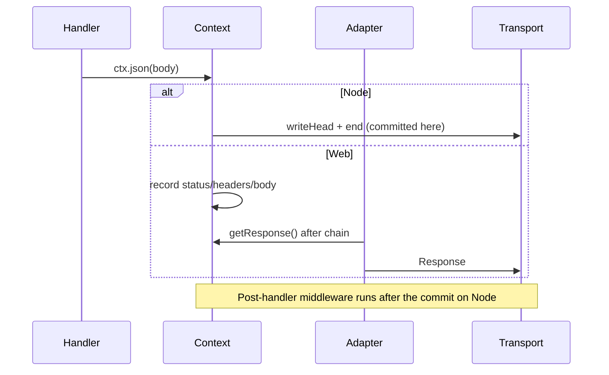
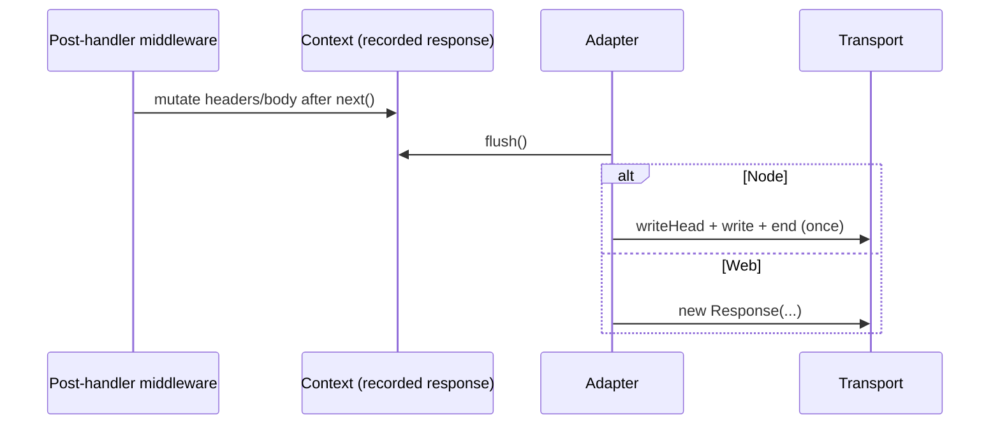

# RFC-041: A recorded response model — one outgoing response both adapter families can rewrite

| Field                | Value                                                                 |
| -------------------- | --------------------------------------------------------------------- |
| **Status**           | `Deferred` — gated on the §14 buffer-cost measurement |
| **RFC number**       | `041`                                                                 |
| **Date**             | `2026-10-19`                                                          |
| **Author(s)**        | Framework maintainer (R&D audit + request-path implementation session) |
| **Group**            | `runtime-adapters`                                                    |
| **Packages touched** | `@nextrush/runtime`, `@nextrush/types`, `@nextrush/core`, `@nextrush/adapter-node`, `@nextrush/adapter-{bun,deno,edge,serverless,nextjs}`, `@nextrush/compression`, `@nextrush/timer`, `packages/adapters/conformance` |
| **Framework impact** | `Breaking-adjacent` — a core response-contract change; behaviour that silently does nothing today starts working, and Node's write timing changes |
| **Supersedes**       | `—`                                                                   |
| **Superseded by**    | `—`                                                                   |
| **Related**          | RFC-039, RFC-040, RFC-018 (response serialization), ADR-0010 (adapter contract), RFC-030 (typed proxy trust), `fix-request-path-and-response-contract` (the change that measured and deferred this) |

---

## Progress Tracker

**Overall:** `[░░░░░░░░░░░░░░░░░░░░]` 0% — 0 / 4 phases complete · Doc status: `Deferred`

| Phase | Deliverable | Status |
| ----- | ----------- | ------ |
| P1 | Record the outgoing response in the shared context, both adapter families | ⬜ Not started |
| P2 | Node flushes the recorded response after the chain unwinds | ⬜ Not started |
| P3 | Compression and timer act on the recorded response on every adapter | ⬜ Not started |
| P4 | Remove the divergence flag from conformance and its documented limitations | ⬜ Not started |

---

## 0. Revision History

- **v1 (`2026-10-19`)** — Written as the durable record for a decision made and deliberately deferred inside `fix-request-path-and-response-contract`. Every claim about current behaviour below was measured in that change; the fix brief that first named the problem is `report/architecture/fix-briefs/fb-03-response-commit-model-and-compression.md`.

---

## 1. Summary (TL;DR)

Today there are two response models behind one `Context`. The Web adapters **record** a response
(status, headers, body) and materialise a `Response` after the middleware chain unwinds. The Node
adapter **commits** as it goes: the handler writes to `ServerResponse`, and by the time post-handler
middleware runs the response is on the wire.

That difference is not cosmetic. It is why `@nextrush/compression` compresses nothing on any shipped
adapter, why `@nextrush/timer` cannot write `X-Response-Time` on Node, and why a middleware that
post-processes a response works on four adapters and silently does not on the fifth. This RFC records
the model that fixes it once — a single recorded outgoing response in the shared context, flushed by
the adapter — and the measurement that must approve it before implementation.

---

## 1a. Terminology

- **Recorded response** — status + headers + buffered body held in the context, with no transport
  write yet.
- **Commit** — the moment the adapter hands bytes to the transport. After a commit, headers can no
  longer be written.
- **Post-handler work** — middleware code that runs after `await next()` and wants to change the
  response (compression, timing headers, caching headers, ETag).

---

## 2. Decision Summary

- **Status:** `Deferred` — not rejected. Adopt the recorded response model, but only after the
  buffer-cost measurement in §14 shows the per-request cost is acceptable on Node.
- **Decision (when unblocked):**
  - _Adopt_ one recorded response in the shared context: `status`, a header map, and a buffered body.
  - _Change_ the Node adapter to flush the recorded response after the chain unwinds, instead of
    writing inside the handler.
  - _Keep_ the streaming escape hatch: `sendStream`/`sse`/`ndjson` commit immediately and mark the
    response committed, so streaming never buffers.
  - _Delete_ the `honorsPostHandlerHeaderWrite` divergence once both families honour post-handler
    writes, and delete the corresponding README limitations.
- **Non-decision:** this RFC does not change the router, the context's public shape (beyond an
  internal response handle), or the error contract.

---

## 2a. Decision Drivers

1. **Silent no-ops are worse than missing features.** Compression is documented, configured, and does
   nothing; the only signal is a once-per-process warning added as an interim measure.
2. **Post-handler work is a documented middleware pattern.** Timer, compression, ETag, and cache
   headers all need it, and every one of them is adapter-dependent today.
3. **The divergence is now measured, not suspected.** Conformance scenario #29 asserts, per adapter,
   whether a post-handler header write lands: Node fails, the Web family lands. That scenario is the
   proof this RFC must delete.
4. **Buffering is not free.** Node writes 19791 bytes of a JSON body today with no extra copy. A
   recorded model holds the body first, so the cost has to be measured, not assumed.

---

## 3. Problem & Motivation

### 3.1 Current state (what exists today)

| Adapter family | Response model | Post-handler header write | Post-handler body rewrite |
| --- | --- | --- | --- |
| Node | Commit inside the handler (`res.writeHead`/`res.end`) | No — throws `ERR_HTTP_HEADERS_SENT`, and the adapter swallows it | No |
| Bun / Deno / Edge / serverless / Next.js | Record, then build `Response` after the chain | Yes | No — the record is private to the adapter |

`@nextrush/compression` reads a declared outgoing-response slot (`raw.res` with `getHeader`) that no
adapter populates, so it warns once and returns. It previously fell back to `ctx.body`, which is the
*parsed request body* — a measured data-leak-shaped bug fixed in `fix-request-path-and-response-contract`.

### 3.2 The problems (enumerated)

1. **Compression does nothing on every shipped adapter.** Measured: `content-encoding` undefined for a
   20 KB JSON response on both Node and Bun.
2. **Timer headers work on four adapters and not the fifth.** Measured: `x-response-time: 0.25ms` on
   the Web family, absent on Node; on Node the write throws and the throw aborts every outer
   middleware's post-`next()` work, which the adapter then swallows without a log.
3. **Two behaviours behind one API is a documentation tax.** Every middleware that wants to touch a
   response needs an adapter matrix in its README (compression and timer both now carry one).
4. **Conformance has to encode a permanent divergence.** `honorsPostHandlerHeaderWrite` exists only
   because the framework cannot decide this for itself.

### 3.3 Why now

The request path was just measured and made cheaper (RFC-039 Part A: 25–31% lower per-request cost in
`fix-request-path-and-response-contract`). That removes the argument that a response model change is
unaffordable *because* the framework is slow. It does not remove the need to measure the buffer cost.

---

## 4. Goals & Non-Goals

### 4.1 Goals

- One response model: a recorded response the adapter flushes.
- Post-handler header *and* body rewrites work on every adapter, including Node.
- Compression and timer work by default, with no adapter matrix in their docs.
- Streaming stays unbuffered and unchanged.

### 4.2 Non-Goals

- Changing the public `Context` method set (`json`/`send`/`html`/`redirect`/`set` unchanged).
- Changing the error contract or error bodies.
- Supporting response rewrites for streamed responses.
- Preserving Node's exact write timing (a header written from a `setHeader` call after `res.end`
  cannot be made to work; the write has to move earlier).

---

## 5. Impact

- **Behaviour:** compression and timer headers start working on Node; a post-handler header write no
  longer throws anywhere.
- **Performance:** Node gains one buffer copy per response that is later rewritten; the flush path must
  be measured against the current write path (§14).
- **Public surface:** one internal response handle; `honorsPostHandlerHeaderWrite` is removed from the
  conformance driver contract once both families honour it.
- **Docs:** compression and timer READMEs lose their limitation sections; the adapter pages lose the
  post-handler caveat.

---

## 6. Issue → Solution Mapping

| Issue | today | after |
| --- | --- | --- |
| Compression has no outgoing body | Declared slot no adapter fills; warns once, does nothing | Reads the recorded response; compresses on every adapter |
| Timer header absent on Node | Late write throws, chain aborts, error swallowed | Late write mutates the record; Node flushes it |
| Two response models | Encoded divergences and per-package adapter matrices | One model; divergence flag deleted |
| Streaming must not buffer | Already immediate | Unchanged: streaming commits and marks responded |

---

## 7. Architecture

### 7.1 Before



### 7.2 After



### 7.3 Why this architecture

Recording is already what four of five adapters do, and it is what post-handler middleware requires.
The change is to make it the *only* model and to make the record reachable by the middleware that
needs it — not to invent a new pipeline.

---

## 7a. Architecture Invariants

1. A response is committed exactly once, by the adapter, after the middleware chain unwinds.
2. A committed response is immutable; a later write is an error, not a silent no-op.
3. Streaming commits immediately and marks the response committed; nothing buffers a stream.
4. `ctx.body` is never an outgoing response (it is the parsed request body).

---

## 8. Detailed Design

### 8.1 Public API / surface

No new public methods. An internal `OutgoingResponse` handle (status, header map, body buffer) is
exposed to middleware through the context so post-handler work can mutate it — the exact accessor is
decided in P1 with the public-surface gate in mind.

### 8.2 Internal components

- `ResponseRecorder` (runtime): status, header map, buffered body, committed flag.
- `flush()` (adapter): materialise `Response` (Web) or write head + body + end (Node).
- Streaming path (unchanged): `sendStream`/`sse`/`ndjson` mark committed immediately.

### 8.3 Request / execution flow

`dispatch → handler → post-handler middleware (mutates record) → adapter flush → transport`.

### 8.4 Data structures

Header map must be case-insensitive with multi-value support (`set-cookie` arrays) and preserve
`ctx.set()` semantics. Body is `Uint8Array` or a string after serialization; the record stores the
serialized form so a rewrite never re-serializes.

### 8.5 Error handling

A write after commit throws a typed error naming the adapter and the reason (the opposite of today's
silent swallow). The never-unanswered guarantee still applies: a failure in the flush path answers with
the last-resort error body it can still construct.

### 8.6 Edge cases

- `HEAD` and bodyless statuses: no body flush, headers only.
- `Content-Length`: computed at flush time from the final body.
- `ctx.set` after flush from a detached promise: documented as outside the contract.
- A stream that has started: no rewrite, no buffer.

### 8.7 Examples

```ts
// Works on every adapter after this RFC.
app.use(async (ctx, next) => {
  await next();
  ctx.set('x-response-time', `${elapsed}ms`);
});
```

---

## 9. Alternatives Considered

### 9.1 Keep the divergence and document it per package

Cheapest, and it is what the interim change did. Rejected as the end state: it makes every
response-aware middleware adapter-dependent forever, and the divergence is invisible at the call site.

### 9.2 Record on the Web family only, special-case Node in each middleware

Rejected: it moves the divergence into every middleware's source instead of the adapter's, and the
Node special case cannot work at all for body rewrites.

### 9.3 Do nothing

Rejected: compression and timer are documented features that do not work; the framework should not ship
a capability that only appears in its docs.

---

## 10. Rejected Ideas

- **Write headers into Node's `ServerResponse` earlier and buffer only the body.** Does not fix body
  rewrites, and keeps two models.
- **A `res.on('pipe')` interception layer.** Transport-specific, unverifiable across runtimes, and it
  would still be too late for the Web adapters.
- **Buffering everything, including streams.** Removes the point of streaming and would break SSE.

---

## 11. Risks & Mitigations

- **Buffer cost on Node** → §14 measures bytes copied and per-request time; if the cost is not
  acceptable, keep the record lazy (record only when a post-handler middleware declares interest).
- **Memory pressure for large bodies** → keep the existing in-memory cap used by compression and make
  the record spill-free only under that cap; larger bodies stream as today.
- **Behaviour change for code that relied on Node committing early** → documented migration note; the
  commit point is not part of the public contract, but the timing changes.
- **Two copies for a response that is never rewritten** → mitigation in §14: allocate the record only
  when post-handler middleware exists on the chain, else write straight through.

---

## 12. Backward Compatibility & Migration

Additive for application code. The observable changes: compression and timer start working (a fix, not
a break); a post-handler header write stops throwing on Node; response headers that a handler used to
"lose" now appear. Documented in the migration page with a one-line note each. Internal adapter
implementations change; the adapter contract keeps its entry points.

---

## 13. Cross-Cutting Concerns

- **Observability:** the flush path logs a write-after-commit error with the adapter name.
- **Security:** header values are validated at set time (existing `assertHeaderSafe`) and again at
  flush; a recorded header cannot inject CRLF any more than a direct one can.
- **Performance:** §14 and RFC-040's gate decide acceptance.

---

## 14. Success Metrics (the gate for un-deferring)

1. `inproc.nextrush.vs_hono` does not regress beyond the committed `max` on either runtime (RFC-040).
2. Node buffer copy measured and recorded; ≤ 1 copy per response, and no copy for a response that no
   post-handler middleware touched.
3. `compression-gzip`, `timer-header`, and `server-timing-header` probes pass on **both** runtimes.
4. Conformance scenario #29 passes with `honorsPostHandlerHeaderWrite` removed from the driver contract.
5. Streaming scenarios (#streaming, SSE, NDJSON) still pass on every runnable adapter, unbuffered.

---

## 15. Phased Implementation Plan

| Phase | Work | Gate |
| --- | --- | --- |
| P1 | `ResponseRecorder` in the shared context; Web adapters flush it | Web conformance green, streaming unchanged |
| P2 | Node flushes after the chain; write-after-commit throws | Node conformance green, §14.2 measured |
| P3 | Compression and timer read the recorded response on every adapter | Probes green on both runtimes |
| P4 | Delete the divergence flag and the README limitations | Conformance #29 rewritten or removed |

### 15.1 Testing strategy

Per phase: unit tests for the recorder, conformance scenarios for the adapter behaviour, real Bun/Deno/
workerd runs for the Web family, and the dev-check probes for both runtimes. The probes are the
acceptance evidence, not the unit tests.

---

## 16. Rollback Plan

Each phase is independently revertible. P1–P2 are behind the adapter's own flush path, so reverting P2
restores Node's commit-inside-handler behaviour without touching the Web family. The divergence flag is
deleted only in P4, so a rollback at any earlier phase keeps the conformance suite honest.

---

## 17. Future Work

- ETag and conditional-request middleware become possible once the record is reachable.
- A `Response`-shaped public API (`ctx.response.headers`) could follow, decided separately.

---

## 18. Open Questions

- Should the record be allocated lazily only when a post-handler middleware is present on the chain?
  (§14.2's third clause assumes yes; P1 must confirm the detection is cheap.)
- Is `honorsPostHandlerHeaderWrite` worth keeping for adapters that genuinely cannot buffer (a
  hypothetical minimal runtime), or is buffering a requirement of the adapter contract from now on?
