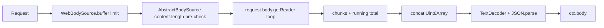
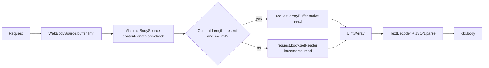

# RFC-043: Native body reads for provable-length Web requests

| Field                | Value                                                                                                                                                      |
| -------------------- | ---------------------------------------------------------------------------------------------------------------------------------------------------------- |
| **Status**           | `Approved`                                                                                                                                                 |
| **RFC number**       | `043`                                                                                                                                                      |
| **Date**             | `2026-10-19`                                                                                                                                               |
| **Author(s)**        | Framework maintainer (Bun POST performance investigation)                                                                                                  |
| **Group**            | `runtime-adapters`                                                                                                                                         |
| **Packages touched** | `@nextrush/runtime`, `@nextrush/adapter-bun`, `@nextrush/adapter-deno`, `@nextrush/adapter-edge`, `@nextrush/body-parser`, `packages/adapters/conformance` |
| **Framework impact** | `Internal-only, non-breaking` — body-reading implementation changes; observable behaviour is unchanged                                                     |
| **Supersedes**       | `—`                                                                                                                                                        |
| **Superseded by**    | `—`                                                                                                                                                        |
| **Related**          | RFC-017 (BodySource limit propagation), RFC-039, RFC-040, RFC-041, RFC-042, ADR-0029, ADR-0031                                                             |

---

## Progress Tracker

**Overall:** `[███████████████░░░░░]` 75% — 3 / 4 phases complete · Doc status: `Approved`

| Phase | Deliverable                                      | Status         |
| ----- | ------------------------------------------------ | -------------- |
| P0    | Decision record + measured baseline              | ✅ Done         |
| P1    | Native fast path with RED-first behaviour matrix | ✅ Done         |
| P2    | Cross-adapter parity and conformance             | ✅ Done         |
| P3    | After-profile, wire check, budget ratchet, docs  | 🔄 In progress  |

---

## 0. Revision History

- **v1 (`2026-10-19`)** — Initial draft. Records the Bun POST measurement, the platform-primitive isolation, the chosen fast-path boundary, and the before/after profiling gate.
- **v2 (`2026-10-19`)** — Approved; fast path implemented behind RED tests. Measured Bun POST 26.74 → 11.87 µs median (ratio 6.22 → 2.65), Deno 48.32 → 25.24 µs, Node control unchanged. Budget ratcheted to max 3.5 / target 3.0.

---

## 1. Summary (TL;DR)

Bun POST is 7.58× slower than Hono (30.50 µs vs 4.02 µs) while the same framework is 14% faster than Hono on Node (13.98 µs vs 16.34 µs). Almost the entire Bun gap is one function: `WebBodySource._buffer` drives `request.body.getReader()` through JS, and Bun's ReadableStream machinery plus `releaseLock` costs ~27 µs for a 1 KB body, versus ~0.3–1.4 µs for native `request.text()`/`arrayBuffer()`. This RFC proposes a native-read fast path only when an honest `Content-Length` proves the body fits the effective limit, keeping the incremental reader for chunked, absent, understated, and over-limit bodies.

The expected result is Bun POST in the 5–10 µs range with no observable behaviour change, no Node change, and the same fix benefiting Deno. The cost is a second read path inside `WebBodySource` and a stricter test matrix; the security boundary is unchanged because unprovable lengths stay incremental.

---

## 1a. Terminology

- **Native read** — one platform call (`request.arrayBuffer()` or `request.text()`) that materializes the body without a JS reader loop.
- **Provable length** — `Content-Length` is present and is less than or equal to the effective limit, so the whole body is known to fit before the read starts.
- **Incremental read** — the existing `getReader()` loop that counts bytes and cancels as soon as the running total exceeds the limit.
- **Fast path** — the native-read branch in `WebBodySource._buffer`.
- **Fallback** — the existing incremental read branch, unchanged.

---

## 2. Decision Summary

- **Status:** `In Review`
- **Decision:**
  - _Introduce_ a native `request.arrayBuffer()` read in `WebBodySource._buffer` when the length is provable.
  - _Keep_ the incremental `getReader()` path for chunked, absent, understated, and over-limit bodies.
  - _Keep_ `AbstractBodySource.buffer(limit)` as the sole owner of the content-length pre-check, `_consumed`, post-read length check, and cache.
  - _Keep_ `NodeBodySource` and its event-listener read mechanism unchanged.
- **Breaking:** `No`
- **Migration required:** `None`
- **Blast radius:** `Low–medium` — one runtime file, shared by Bun/Deno/Edge; Node untouched; no public API change.

---

## 2a. Decision Drivers

Priority (highest → lowest):

1. **Measured performance** — the Bun/Deno POST gap is the largest measured runtime gap.
2. **Security and correctness** — RFC-017 incremental limit enforcement must not weaken.
3. **Runtime independence** — the fix belongs in shared Web code, not a Bun-only branch.
4. **Minimal surface** — no public API, configuration, or dependency change.
5. **Measurement discipline** — before/after profiles and a ratcheted budget, not a guessed win.

---

## 3. Problem & Motivation

### 3.1 Current state (what exists today)

`WebBodySource` is shared by Bun, Deno, and Edge. Its `_buffer` method always takes the reader path when a body exists:

```ts
// packages/runtime/src/body-source.ts (today, abbreviated)
protected async _buffer(limit: number): Promise<Uint8Array> {
  if (!this.request.body) {
    const arrayBuffer = await this.request.arrayBuffer();
    return new Uint8Array(arrayBuffer);
  }

  const reader = this.request.body.getReader();
  const chunks: Uint8Array[] = [];
  let totalBytes = 0;
  try {
    for (;;) {
      const { done, value } = await reader.read();
      if (done) break;
      totalBytes += value.byteLength;
      if (totalBytes > limit) {
        await reader.cancel();
        throw new BodyTooLargeError(limit, totalBytes);
      }
      chunks.push(value);
    }
  } finally {
    reader.releaseLock();
  }
  // ... concatenate chunks
}
```

Node uses a separate `NodeBodySource` built on `req.on('data' | 'end' | 'error' | 'close')`. It is not affected by this problem and is out of scope.

Measured on Bun 1.4.3, same harness, 1 KB JSON body, both sides parse:

| Path                |     Cost |
| ------------------- | -------: |
| Bun POST, NextRush  | 30.50 µs |
| Bun POST, Hono      |  4.02 µs |
| Node POST, NextRush | 13.98 µs |
| Node POST, Hono     | 16.34 µs |
| Deno POST, NextRush | 40.70 µs |
| Deno POST, Hono     |  4.65 µs |

Isolated platform primitives on Bun (1 KB, 10k iterations):

| Operation                         |     Cost |
| --------------------------------- | -------: |
| `request.text()`                  |  0.33 µs |
| `request.arrayBuffer()`           |  1.40 µs |
| raw reader loop                   | 11.83 µs |
| raw reader loop + `releaseLock()` | 16.21 µs |
| `WebBodySource.buffer(1MB)`       | 18.65 µs |

Framework decomposition in the real adapter (same requests):

| Path                               |         Cost |
| ---------------------------------- | -----------: |
| GET framework only                 |      3.74 µs |
| POST, no body read                 |      3.06 µs |
| POST, `WebBodySource.buffer` only  |     29.89 µs |
| POST, native `arrayBuffer` only    |      7.61 µs |
| POST, native read + decode + parse | 5.00–6.60 µs |

The conclusion is unambiguous: the framework and router are not the Bun POST problem. The reader path is.

### 3.2 The problems (enumerated)

1. **Bun pays ~27 µs to read a 1 KB body.** The difference between “POST, no body read” (3.06 µs) and “POST, `WebBodySource.buffer` only” (29.89 µs) is almost entirely `_buffer`. The profile names the stream machinery: `onRSDefaultControllerStartFulfilled` 12.4%, `pull` 9.5%, `set` 9.5%, `_buffer` 16.0% + 6.0%, `drain` 3.7%, `releaseLock` 1.3%.
2. **The shared Web abstraction assumes a cheap reader.** Bun and Deno implement JavaScript `ReadableStream` differently from V8; a JS reader loop that is acceptable on one runtime is dominant on another. The abstraction is right, but the implementation choice is not portable in cost.
3. **We lose a benchmark we win on Node.** Node POST is 13.98 µs versus Hono's 16.34 µs. The Bun/Deno regression is not a framework-wide failure; it is a platform read-path mismatch. Leaving it unfixed makes the Bun target look worse than the framework actually is.
4. **The current gate only warns.** `inproc.post.nextrush.vs_hono` has a max of 9.0 and no explanation of the mechanism. The next change must attach a measured cause and a budget that prevents regression.

### 3.3 Why now

The performance program just closed RFC-039/040/041 with measured evidence: lazy headers and IP, a shared Web runner, runtime-scoped budgets, and a final closure report. AOT was deferred because no measurement justified it. The Bun POST path is the largest remaining measured gap, the platform primitives have been isolated, and the expected fix has been measured end-to-end at 5.0–6.6 µs. This is the right next change because it is small, evidence-backed, and independent of the unresolved GET/wire architectural questions.

---

## 4. Goals & Non-Goals

### 4.1 Goals

- Reduce Bun POST from 30.50 µs to ≤10 µs (target 5–10 µs) on the `dev-check` in-process gate.
- Reduce the Bun POST ratio from 7.58× to ≤2.0× (target ≤1.5×) with the same-run Hono control.
- Improve Deno POST with the shared `WebBodySource`, without a Node change.
- Preserve every observable body-reading behaviour and every RFC-017 limit guarantee.
- Leave a before/after profile and a ratcheted budget so the win cannot silently regress.

### 4.2 Non-Goals

- **Bun GET/wire allocation trims** — separate, profile-gated change (drain wrapper, IP closure, direct-route fast path).
- **`request.text()` fast path in the body parser** — potentially faster than `arrayBuffer()`, but `rawBody`, urlencoded, and binary parsers need bytes. Deferred until the after-profile shows decode dominates.
- **Changing `NodeBodySource`** — Node already wins POST; its event-listener mechanism is a separate contract (RFC-017).
- **Changing streaming reads** (`ctx.bodySource.stream()`) — untouched.
- **AOT, compiled validators, custom JSON serializers** — evidence-negative or rejected elsewhere.
- **Public API, configuration, or dependency changes** — none.

---

## 5. Impact

- **Affected packages:** `@nextrush/runtime` (`WebBodySource`), `@nextrush/adapter-bun`, `@nextrush/adapter-deno`, `@nextrush/adapter-edge` (shared source), `@nextrush/body-parser` (behaviour-matrix tests), `packages/adapters/conformance` (parity).
- **Affected audiences:** framework contributors and adapter maintainers; application developers see no API change.
- **Explicitly NOT affected:** `@nextrush/adapter-node` and `NodeBodySource`, the public `Context`/`BodySource` surface, streaming consumers, existing applications, and the functional `nextrush` entry.
- **Performance:** expected Bun POST 30.50 → 5–10 µs; Deno expected to improve; Node unchanged.
- **Docs:** `packages/runtime/ARCHITECTURE.md` and `packages/adapters/bun/ARCHITECTURE.md` gain the fast-path/fallback rule; the body-parser README changes only if a documented guarantee moves (it should not).

---

## 6. Proposed Solution (overview)

| #   | Problem (from §3.2)                               | Solution (this RFC)                                                                            |
| --- | ------------------------------------------------- | ---------------------------------------------------------------------------------------------- |
| 1   | Bun reader path costs ~27 µs for 1 KB             | Use `request.arrayBuffer()` when `Content-Length` proves the body fits                         |
| 2   | The shared Web abstraction assumes a cheap reader | Keep the incremental reader only where the length is not provable, and document the cost split |
| 3   | Bun/Deno lose while Node wins                     | Change only `WebBodySource`; leave `NodeBodySource` untouched                                  |
| 4   | The gate warns without a cause                    | Record the mechanism, compare before/after, and ratchet the Bun POST budget                    |

The key idea is a **provable-length boundary**. A body is read natively only when the request declares a `Content-Length` that is less than or equal to the effective limit. In that case the framework already knows the whole body fits, so a single native read cannot violate the memory bound. Every other case — chunked, absent, understated, or over-limit — keeps the incremental reader that cancels at the configured limit.

---

## 6a. Trade-offs

### Benefits

- Removes the dominant Bun POST cost with a small, local change.
- Keeps the security boundary intact: unprovable lengths still use incremental enforcement.
- Benefits Deno through the shared `WebBodySource`; Node is untouched.
- Adds no public API, dependency, configuration, or migration burden.

### Costs

- `WebBodySource._buffer` gains a second branch and must be tested on both paths on every Web runtime.
- The fast path buffers the whole body before returning, which is acceptable only because the declared length proves it fits; reviewers must keep that condition strict.
- The change does not address GET/wire overhead; it is deliberately narrow.
- The body parser still decodes and parses after the read, so the floor is the native read plus `TextDecoder`/`JSON.parse`, not zero.

---

## 7. Architecture

### 7.1 Before



Every body-bearing Web request pays the reader machinery, regardless of whether the length is known.

### 7.2 After



The fast path is chosen only when the declared length proves the body fits. The fallback is the existing loop, unchanged.

### 7.3 Why this architecture

The change stays inside `@nextrush/runtime` because that is where the shared Web body source lives. It does not reach into an adapter, so Bun/Deno/Edge keep one implementation and one test matrix. It does not touch `NodeBodySource`, preserving the RFC-017 Node contract and the event-listener mechanism. The fast path is a platform read selection, not a new abstraction; the `BodySource` surface is unchanged.

---

## 7a. Architecture Invariants

- **Package hierarchy:** `@nextrush/runtime` does not import an adapter; the change stays below the adapter boundary.
- **Runtime independence:** `WebBodySource` uses only Web-standard `Request`/`Uint8Array`; no `Bun`/`Deno` global and no `node:*` import.
- **BodySource contract:** `buffer(limit)` remains the single owner of the content-length pre-check, `_consumed`, post-read length check, and cache.
- **Node contract:** `NodeBodySource` keeps its event-listener read mechanism and its optional-limit semantics (RFC-017, node-adapter spec).
- **Observable behaviour:** status, headers, body, error shape, `rawBody`, and parsed values stay byte-identical.
- **No public API change:** no new export, option, or configuration key.

---

## 8. Detailed Design

### 8.1 Public API / surface

None. The change is internal to `WebBodySource`:

```ts
// Conceptual shape only; the public BodySource surface does not change.
protected async _buffer(limit: number): Promise<Uint8Array> {
  if (this.contentLength !== undefined && this.contentLength <= limit) {
    const arrayBuffer = await this.request.arrayBuffer();
    return new Uint8Array(arrayBuffer);
  }
  // existing incremental reader path, unchanged
}
```

`AbstractBodySource.buffer(limit)` continues to perform the content-length pre-check before `_buffer` is called, so an honest over-limit length still rejects before any read.

### 8.2 Internal components

- **`AbstractBodySource.buffer(limit)`** — contract owner: effective limit, pre-check, `_consumed`, post-read size check, cache.
- **`WebBodySource._buffer(limit)`** — platform read selector: native `arrayBuffer` when the length is provable, incremental reader otherwise.
- **`WebBodySource.text()` / `json()`** — unchanged: they delegate to `buffer()` and decode/parse.
- **`body-parser`** — unchanged: it calls `readBody`, which calls `bodySource.buffer(limit)` and then decodes/parses.
- **`NodeBodySource`** — unchanged.

### 8.3 Request / execution flow

```text
body-parser middleware
  -> readBody(ctx, limit)
    -> ctx.bodySource.buffer(limit)
      -> AbstractBodySource: content-length pre-check, _consumed = true
      -> WebBodySource._buffer(limit)
        -> length provable? -> request.arrayBuffer() -> Uint8Array
        -> otherwise       -> getReader loop -> chunks -> Uint8Array
      -> post-read length check, cache
    -> TextDecoder -> JSON.parse
  -> ctx.body
```

### 8.4 Data structures

No new structures. The fast path returns the same `Uint8Array` the reader path returns. The cache is the existing `_cachedBuffer` field on `AbstractBodySource`.

### 8.5 Error handling

- **Honest over-limit `Content-Length`** — rejected by the existing pre-check in `buffer()` before `_buffer` runs; `BodyTooLargeError` with the effective limit.
- **Chunked/understated over-limit body** — rejected by the existing running-total check in the reader path; `BodyTooLargeError` with the effective limit.
- **Native read rejection** — mapped through the existing `BodyReadError` path in `readBody`; no new error type.
- **Second read** — the existing `BodyConsumedError` when no cached buffer exists; a cached read stays a cache hit.
- **No internal paths or stack traces** leak into a response; the existing error contract is unchanged.

### 8.6 Edge cases

| Scenario                                               | Behaviour                                                                           |
| ------------------------------------------------------ | ----------------------------------------------------------------------------------- |
| Honest `Content-Length` ≤ limit                        | Native `arrayBuffer()`; bytes identical to the reader path                          |
| Honest `Content-Length` > limit                        | Rejected before any read; `BodyTooLargeError`                                       |
| Chunked body, no `Content-Length`                      | Incremental reader; cancels when the running total exceeds the limit                |
| Understated `Content-Length` that passes the pre-check | Native read; the post-read size check and the platform body cap remain the backstop |
| Empty body                                             | Existing empty-body branch; no reader, no native read                               |
| `buffer()` twice                                       | First read caches; second returns the cache, no `BodyConsumedError`                 |
| `stream()` after `buffer()`                            | Existing `BodyConsumedError`                                                        |
| `rawBody: true`                                        | Same bytes as today; the native path returns the same `Uint8Array`                  |
| Bun / Deno / Edge                                      | Same behaviour matrix; Node unchanged                                               |
| Body read failure                                      | Existing `BodyReadError` mapping                                                    |

### 8.7 Examples

No application-facing example: no API changes. The observable request/response behaviour is identical.

---

## 9. Alternatives Considered

### 9.1 Always use native `arrayBuffer()` and check the size afterwards

Rejected. A chunked or understated body could buffer far beyond the configured limit before the framework rejects it, violating RFC-017 and the body-parser requirement that peak buffering stays near the configured limit. The fast path must be gated on a provable length.

### 9.2 Change the body parser to call `request.json()` / `request.text()` directly

Rejected. It bypasses `BodySource` limit/cache/`rawBody` semantics, creates a second body-reading path outside the shared abstraction, and breaks parity with direct parser APIs and the other adapters. The body parser keeps using `bodySource.buffer()`.

### 9.3 Keep the reader and optimize `releaseLock()` / the loop

Rejected. `releaseLock()` alone measured ~4.4 µs, and the remaining reader machinery is ~12 µs; removing one call treats a symptom. The native read is 0.33–1.40 µs for the same body.

### 9.4 Do nothing

Rejected. Bun POST stays at 30.50 µs (7.58× Hono) and Deno at 40.70 µs (8.76×), while Node already wins. The largest measured runtime gap would remain unexplained and unguarded.

---

## 10. Rejected Ideas

- **A bespoke `BunBodySource`** — rejected: the shared `WebBodySource` is the right abstraction; duplicating it would reintroduce the adapter drift RFC-039 removed.
- **A `request.text()` fast path in the body parser now** — rejected for this change: `rawBody`, urlencoded, and binary parsers need bytes. Revisit after the after-profile if decode dominates.
- **Changing `NodeBodySource` to the same native pattern** — rejected: Node uses an event-listener mechanism that already wins; its contract is separate.
- **Changing streaming reads** — rejected: streaming must stay unbuffered and incremental.
- **A feature flag for the fast path** — rejected: the behaviour is identical; a flag would add configuration and a second code path to test for no user benefit.
- **Raising the Bun POST budget instead of fixing the path** — rejected: the gate exists to expose the gap, not to normalize it.

---

## 11. Risks & Mitigations

| Risk                                                          | Mitigation                                                                                                                                                       | Likelihood | Impact |
| ------------------------------------------------------------- | ---------------------------------------------------------------------------------------------------------------------------------------------------------------- | ---------- | ------ |
| A client declares a length that does not match the body       | Platform HTTP parser rejects framing mismatches; the adapter's `maxRequestBodySize` caps the read; the post-read length check remains; add a platform-layer test | Low        | Med    |
| Native read buffers a body the limit was meant to bound       | Fast path requires `length ≤ limit`; unprovable lengths stay incremental; document the boundary in the RFC/ADR and architecture docs                             | Low        | Med    |
| Bun and Deno diverge                                          | Run the same behaviour matrix and cross-adapter conformance on both                                                                                              | Med        | Med    |
| The in-process win does not translate to the wire             | Measure the wire POST path after the change; do not ratchet wire expectations if it does not improve                                                             | Med        | Med    |
| `arrayBuffer()` rejection changes the error shape             | Map through the existing `BodyReadError` path; add a failing-body test                                                                                           | Low        | Low    |
| The fast path accidentally double-reads or bypasses the cache | Keep `AbstractBodySource.buffer()` as the only owner; add cache/consumed tests                                                                                   | Low        | High   |
| Coverage drops because the fallback is less exercised         | Keep the existing chunked/understated tests; require both paths in the matrix                                                                                    | Med        | Low    |

---

## 12. Backward Compatibility & Migration

- **Compatibility:** Internal-only and non-breaking. No public API, option, response, or error-contract change.
- **Migration path:** None required.
- **Deprecation window:** Not applicable.

---

## 13. Cross-Cutting Concerns

- **Security:** The incremental limit path remains for every body whose size is not provable. The fast path is bounded by an honest `Content-Length <= limit` plus the adapter's platform body cap. RFC-017 semantics are preserved. No new input parsing, no new header trust.
- **Performance:** This is the purpose of the RFC. Expected Bun POST 30.50 → 5–10 µs; Deno improves through the shared source; Node unchanged. The after-profile and CPU-pinned A/B are required before the budget moves.
- **Runtime independence:** `WebBodySource` uses only Web-standard APIs; no runtime identity branch and no `Bun`/`Deno`/`node:*` import.
- **Observability:** No new logs or metrics. The existing `BodyTooLargeError`/`BodyReadError` signals are unchanged; no body content is logged.
- **Zero-dependency rule:** No new dependency.

---

## 14. Success Metrics

| Metric                                 | Baseline (today) | Target / threshold                                |
| -------------------------------------- | ---------------- | ------------------------------------------------- |
| Bun POST, in-process                   | 30.50 µs         | ≤10 µs (target 5–10 µs)                           |
| Bun POST ratio vs Hono                 | 7.58×            | ≤2.0× (target ≤1.5×)                              |
| Deno POST                              | 40.70 µs         | Materially lower; no regression                   |
| Node POST                              | 13.98 µs         | No regression beyond the baseline spread          |
| Cross-adapter body-reading conformance | Green            | Green on Node/Bun/Deno/Edge                       |
| Coverage (touched packages)            | Current          | ≥90% lines, no decrease                           |
| Wire POST                              | Not gated yet    | Measured before/after; recorded even if unchanged |

Measurements use the `apps/benchmark/scripts/dev-check` harness on the same machine and runtime versions, with a CPU-pinned A/B and three runs for the noise floor. The ratio is NextRush/Hono in the same run.

---

## 15. Phased Implementation Plan

| Phase  | Goal (what ships)                               | Depends on | Exit condition (checkable)                                                                         | Status         |
| ------ | ----------------------------------------------- | ---------- | -------------------------------------------------------------------------------------------------- | -------------- |
| **P0** | Decision record + baseline                      | —          | RFC-043 and ADR-0031 written; baseline report contains exact commands and Bun/Deno/Node numbers    | ⬜ Not started |
| **P1** | Native fast path with RED-first matrix          | P0         | Behaviour-matrix tests green; fast path selected only for provable lengths; fallback tests green   | ⬜ Not started |
| **P2** | Cross-adapter parity                            | P1         | Conformance green on Node/Bun/Deno/Edge; Node unchanged                                            | ⬜ Not started |
| **P3** | After-profile, wire check, budget ratchet, docs | P2         | After-profile shows the win above noise; budget ratcheted; docs updated; ADR records final numbers | ⬜ Not started |

### 15.1 Testing strategy

- **Unit:** `WebBodySource` with a stubbed `getReader` (fast path), chunked/understated bodies (fallback), cache/consumed semantics, and native-read failures.
- **Integration:** `body-parser` with 1 KB JSON, `rawBody`, a 10 KB limit over a chunked 900 KB body, and an honest over-limit `Content-Length`.
- **Cross-adapter:** `packages/adapters/conformance` on Node/Bun/Deno/Edge; observable status, headers, body, and error shape identical.
- **Coverage:** ≥90% lines/functions in the touched packages, no decrease.

---

## 16. Rollback Plan

- **Trigger:** a regression in the behaviour matrix or conformance, a Bun/Deno body-reading failure, or a measured regression on Node/Deno that exceeds the noise floor.
- **Steps:**
  - Revert the `WebBodySource._buffer` fast-path branch; the incremental reader is already the fallback in the same function.
  - Keep the tests and the baseline/after report; they remain useful evidence.
  - Revert the budget ratchet in the same change if the win is not reproducible.
  - No public API, migration, or stored state to clean up.

---

## 17. Future Work

- **`request.text()` fast path** in the body-parser layer if the after-profile shows decode dominating; it may beat `arrayBuffer()` but needs a bytes-preserving path for `rawBody`.
- **Bun GET/wire trims** — drain-wrapper removal, IP-closure removal, and the direct-route fast path; separate, profile-gated changes.
- **Wire POST gating** — decide whether a POST wire scenario belongs in `dev-check` or the full benchmark suite.
- **AOT and compiled validators** — remain deferred; no evidence in this RFC.

---

## 18. Open Questions

- [ ] Does the in-process win translate to a wire POST measurement? Answer in P3; do not change the shipped design if it does not.
- [ ] Is a `text()` fast path worth a follow-up after the after-profile? Answer with the decode share.
- [ ] What exact Bun POST max/target should the budget carry after the win? Answer from the P3 three-run spread, not from the baseline.

---

## 19. Decisions Log

| Question                               | Decision                                              | Rationale                                                                      |
| -------------------------------------- | ----------------------------------------------------- | ------------------------------------------------------------------------------ |
| Where does the fast path live?         | `WebBodySource._buffer`                               | Smallest change; shared by Bun/Deno/Edge; no adapter duplication               |
| When is the native read allowed?       | Honest `Content-Length` present and ≤ effective limit | Preserves RFC-017 incremental enforcement for unprovable bodies                |
| Which native primitive first?          | `request.arrayBuffer()`                               | `BodySource` returns bytes; `text()` is a possible follow-up, not a first step |
| Does Node change?                      | No                                                    | `NodeBodySource` already wins POST; its contract is separate                   |
| Does the public API change?            | No                                                    | Internal read selection only                                                   |
| Does this change any spec requirement? | No                                                    | Observable behaviour is unchanged; the change uses `skip_specs: true`          |
| What gates acceptance?                 | Before/after profile + CPU-pinned A/B + conformance   | Prevents a guessed win and a silent regression                                 |

---

## 20. References

- `docs/RFC/request-data/017-body-source-limit-propagation.md` — the incremental limit contract this RFC preserves.
- `docs/RFC/runtime-adapters/039-precompile-per-request-tax.md` — the performance program this change continues.
- `docs/RFC/runtime-adapters/040-resource-budgets-and-request-path-footprint.md` — measurement discipline and runtime-scoped budgets.
- `docs/RFC/runtime-adapters/041-recorded-response-model.md` — the shared Web adapter context this source sits behind.
- `docs/RFC/runtime-adapters/042-fixed-key-serializer-rejected.md` — the evidence-negative precedent for rejecting an unmeasured optimization.
- `docs/adr/ADR-0029-runtime-scoped-budgets-deferred-aot.md` — AOT stays deferred.
- `docs/adr/ADR-0030-recorded-outgoing-response.md` — the response model around the body source.
- `docs/adr/ADR-0031-web-native-body-read.md` — the terse decision record for this RFC.
- `packages/runtime/src/body-source.ts` — `AbstractBodySource.buffer`, `WebBodySource._buffer`.
- `packages/middleware/body-parser/src/parsers/reader.ts` — `readBody`.
- `apps/benchmark/scripts/dev-check/` — Bun POST gate and profile entries.
- `report/performance/bun-body-read-baseline.md` — the baseline/after report created by the change.
