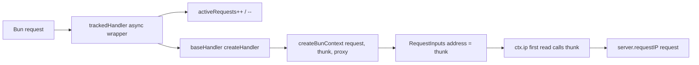

# RFC-044: Bun request-path trims — native drain accounting and thunk-free address resolution

| Field                | Value                                                                                                              |
| -------------------- | ------------------------------------------------------------------------------------------------------------------ |
| **Status**           | `Approved`                                                                                                         |
| **RFC number**       | `044`                                                                                                              |
| **Date**             | `2026-10-19`                                                                                                       |
| **Author(s)**        | Framework maintainer (Bun request-path performance investigation)                                                  |
| **Group**            | `runtime-adapters`                                                                                                 |
| **Packages touched** | `@nextrush/adapter-bun` (source, tests, ARCHITECTURE); `apps/benchmark` (one allocation harness)                    |
| **Framework impact** | `Internal-only, non-breaking` — no observable behaviour change; one additive optional factory parameter            |
| **Supersedes**       | `—`                                                                                                                |
| **Superseded by**    | `—`                                                                                                                |
| **Related**          | RFC-039, RFC-040, RFC-041, RFC-043, ADR-0028, ADR-0029, ADR-0030, ADR-0031                                         |

---

## Progress Tracker

**Overall:** `[████████████████████]` 100% — 4 / 4 phases complete · Doc status: `Approved`

| Phase | Deliverable                                   | Status        |
| ----- | --------------------------------------------- | ------------- |
| P0    | Baseline attribution + decision record        | ✅ Done        |
| P1    | Native drain accounting (RED → GREEN)         | ✅ Done        |
| P2    | Thunk-free client-address resolution          | ✅ Done        |
| P3    | After-profile, wire check, docs, ADR result   | ✅ Done        |

---

## 0. Revision History

- **v1 (`2026-10-19`)** — Initial draft. Records the measured baseline (wire, in-process, profiles, allocation deltas, CPU-pinned spread), the two accepted candidates with their evidence, the parking rule for inside-spread results, the rejected alternatives, and the before/after gate.
- **v2 (`2026-10-19`)** — Approved by the maintainer after review; no content changes.
- **v3 (`2026-10-19`)** — Implementation complete: both trims landed behind RED tests, conformance green on Node/Bun/Deno, allocation deltas reproduced; wire and in-process changes measured inside the spread and parked.

---

## 1. Summary (TL;DR)

Bun wire throughput is the largest measured runtime gap left after the POST body-read work: 34,513 rps for NextRush versus 42,330 for Hono (0.82×), with Elysia at 49,887 and the raw listener at 47,968 in the same run. The Bun in-process GET ratio sits at 1.29 (median of three CPU-pinned runs, spread 1.26–1.31) against a committed target of 1.3 and max of 1.9 — inside the hard gate and inside its own run-to-run noise.

Profiling attributes roughly 70% of request-path self-time to native `Request`/`Response`/`Headers` construction at the runtime boundary, and 10–13% total to the `createBunContext` construction tree. Two adapter-owned per-request costs were verified in code and measured directly: an `async` drain wrapper around every request (**392.4 B/req** removed) and a per-request `requestIP` resolver closure (**56.0 B/req** removed).

This RFC adopts both trims — the drain wait moves to `server.stop()`'s native promise (verified on pinned Bun 1.4.3 to hold while a request is in flight), and `ctx.ip` resolves from stored platform references on first read with no per-request closure. It also pins the acceptance discipline: wire-path claims require same-invocation before/after medians against the recorded spread, and anything inside the spread is parked. No wire budget row is added; the in-process ratio stays the gate.

---

## 1a. Terminology

- **Drain wrapper** — the `trackedHandler` async function in `serve()` that wraps the composed handler solely to maintain a JS in-flight counter for graceful shutdown.
- **Resolver thunk** — the per-request closure `() => server.requestIP(request)?.address ?? ''` created by `createBunRequestRunner` and consumed lazily by `RequestInputs`.
- **Parking threshold** — the recorded run-to-run spread of the acceptance metric (here 0.05 ratio points on `inproc.nextrush.vs_hono`, ≈3.9% of the median). A measured effect at or below it is reverted and recorded as parked.

---

## 2. Decision Summary

- **Status:** `Approved`
- **Decision:**
  - _Remove_ the per-request drain wrapper; drain waits on the native `server.stop()` promise with the existing bounded timeout and force-close path.
  - _Remove_ the per-request `requestIP` resolver thunk; `BunContext` holds the platform references and resolves `ctx.ip` on first read through a prototype getter.
  - _Keep_ graceful-shutdown semantics, `ctx.ip` laziness/parity, the `app.close` teardown order, and every public behaviour unchanged.
  - _Keep_ `wire` as INFO (never a budget row); add no `wire` budget.
  - _Adopt_ the evidence rule: wire-path work is judged by same-invocation before/after medians against the recorded spread; sub-noise trims are accepted on deterministic allocation evidence plus tests and conformance.
- **Breaking:** `No`
- **Migration required:** `None`
- **Blast radius:** `Low` — one adapter package plus one benchmark harness; no public behaviour change; Node untouched.

---

## 2a. Decision Drivers

Priority (highest → lowest):

1. **Measured performance** — every accepted change carries a profile or allocation number; nothing ships on intuition.
2. **Behavioural equivalence** — drain semantics, `ctx.ip` values, and conformance stay byte-identical.
3. **Runtime independence** — changes stay inside the Bun adapter; shared runtime and other adapters are untouched.
4. **Minimal surface** — no breaking API, no new configuration, no dependency.
5. **Measurement honesty** — wire is a shared-machine instrument; inside-spread results are parked, not claimed.

---

## 3. Problem & Motivation

### 3.1 Current state (what exists today)

`serve()` composes the shared handler and then wraps it only for drain accounting:

```ts
// packages/adapters/bun/src/adapter.ts (today)
const trackedHandler = async (
  request: Request,
  bunServer: ReturnType<typeof Bun.serve>
): Promise<Response> => {
  activeRequests++;
  try {
    return await baseHandler(request, bunServer);
  } finally {
    activeRequests--;
    if (activeRequests === 0 && drainResolve) {
      drainResolve();
    }
  }
};
```

`drainAndClose` stops accepting connections, then waits for the JS counter to reach zero (bounded by `shutdownTimeout`), then tears down extensions:

```ts
// packages/adapters/bun/src/adapter.ts (today, abbreviated)
void server.stop();
if (getActiveRequests() > 0) {
  await Promise.race([new Promise<void>((resolve) => setDrainResolve(resolve)), timeoutThenForceClose()]);
}
await app.close({ timeout: shutdownTimeout });
```

`createBunRequestRunner` allocates a resolver closure on every request, even though `ctx.ip` is usually never read:

```ts
// packages/adapters/bun/src/adapter.ts (today)
makeContext: (request, server) =>
  createBunContext(request, () => server.requestIP(request)?.address ?? '', proxy),
```

Measured baseline (same machine, pinned Bun 1.4.3, `report/performance/bun-request-path-baseline.md`):

| Instrument | Before |
| --- | --- |
| `wire.nextrush.rps` (median of three) | 34,513 rps (range 33,985–35,381) |
| `wire.hono.rps` | 42,330 rps (range 40,224–43,156) |
| `wire.elysia.rps` / `wire.raw.rps` | 49,887 / 47,968 |
| `inproc.nextrush.vs_hono` (pinned ×3) | 1.29 median (min 1.26, max 1.31) |
| Profile self-time | `Request` 36.1%, `Response` 20.7%, `Headers` 5.1%, `stringify` 3.3% |
| Profile total | `createBunContext` 10.4–13.3%, `BunContext` frames 8.7–11.6% |
| Drain wrapper allocation | 448.5 B/req current vs 56.1 B/req without wrapper → **392.4 B/req removed** |
| Resolver thunk allocation | 64.1 B/req current vs 8.1 B/req without thunk → **56.0 B/req removed** |

Platform facts probed live on pinned Bun 1.4.3:

- `server.pendingRequests` reports 1 while a request is in flight and 0 after it settles.
- `server.stop(closeActiveConnections?: boolean): Promise<void>`; the promise does **not** resolve while an in-flight request is pending and resolves after it completes.

### 3.2 The problems (enumerated)

1. **Bun wire lags Hono and Elysia.** 0.82× Hono and 0.69× Elysia in the same wire run. The gap is real and measured, but the profile does not attribute it to adapter code: native Web-object construction dominates.
2. **Every request pays an async frame for shutdown bookkeeping.** The wrapper exists only to maintain `activeRequests`; measured cost is 392.4 B/req of deterministic allocation plus one extra async execution per request, on the path that is already the slowest runtime.
3. **Every request allocates a closure most handlers never use.** `ctx.ip` is lazy by contract; paying the closure unconditionally is pure overhead (56.0 B/req measured).
4. **Acceptance is easy to fake.** The wire stage moves several percent between runs on a shared machine (pinned spread 3.9%), so a single-run delta proves nothing. Without a written rule, a noise-sized "win" can ship as progress.
5. **Profile shows no additional adapter-owned site.** The named candidates sit below the profile's print threshold; the remaining cost is platform object churn and the inherent context tree.

### 3.3 Why now

RFC-043 owns the POST body-read gap and leaves GET/wire explicitly deferred. The performance program closed RFC-039/040/041 with measured evidence and deferred AOT as evidence-negative. The Bun GET/wire path is now the largest measured gap, the two adapter candidates are already verified in code, and the allocation harness protocol exists to measure them without RPS noise. This is a small, evidence-backed change with a clear rollback.

---

## 4. Goals & Non-Goals

### 4.1 Goals

- Remove the drain wrapper's per-request async frame and counter mutations while keeping graceful-shutdown behaviour identical (opt-in signals, bounded wait, force-close only after timeout, unchanged `app.close` order).
- Remove the per-request resolver thunk while keeping `ctx.ip` lazy, memoized once, and byte-identical across trust modes.
- Record a same-invocation wire and in-process before/after, using the CPU-pinned spread as the parking threshold.
- Keep conformance, coverage, lint, and strict typecheck green; ratchet only what the evidence proves.
- Leave the measurement harness in-tree so the numbers are reproducible.

### 4.2 Non-Goals

- **No wire budget row** — `wire` stays INFO by design; the in-process ratio remains the gate.
- **No public API break, config, or dependency change** — one additive optional factory parameter only.
- **No shared-runtime change** — `RequestInputs`/`WebContextBase` are untouched; the lazy hook stays in the Bun adapter.
- **No Node adapter change** — Node already wins and its drain/address mechanisms are separate contracts.
- **No speculative serve-level rewrite** — native `Request`/`Response` cost is platform-owned; further wire attribution would need a serve/wire profile entry, which is future work.
- **No POST work** — owned by RFC-043.
- **No trust-mode closure removal** — the closure only exists when a proxy is configured; it is not the default hot path and is deferred.

---

## 5. Impact

- **Affected packages:** `@nextrush/adapter-bun` (`adapter.ts`, `context.ts`, tests, `ARCHITECTURE.md`); `apps/benchmark` (`scripts/alloc/` harness + README/package script).
- **Affected audiences:** framework contributors and adapter maintainers. Application developers see no API or behaviour change.
- **Explicitly NOT affected:** public `Context`/`ctx.ip` semantics, graceful-shutdown guarantees, other adapters, `@nextrush/runtime`, router/middleware, the functional entry, existing applications.
- **Performance:** 392.4 + 56.0 B/req of deterministic allocation removed from every Bun request; in-process and wire impact measured, not assumed.
- **Docs:** `packages/adapters/bun/ARCHITECTURE.md` describes the shipped drain and address mechanics; README changes only if a documented guarantee moves (it does not).

---

## 6. Proposed Solution (overview)

| # | Problem (from §3.2) | Solution (this RFC) |
| - | ------------------- | ------------------- |
| 1 | Wire lags Hono/Elysia | Measure before/after on the same wire invocation; claim only what exceeds the spread |
| 2 | Async drain wrapper per request | Delete the wrapper; wait on `server.stop()`'s promise with the existing bounded timeout |
| 3 | Resolver thunk per request | Store platform refs on the context; resolve `ctx.ip` on first read via a prototype getter |
| 4 | Acceptance easy to fake | Wire-stage medians + recorded spread; sub-noise trims accepted on allocation evidence |
| 5 | No further adapter site attributed | Accept exactly two candidates; record "no additional candidates" |

The key idea is **platform-owned signalling**. Bun 1.4.3's `stop()` already returns a promise that waits for in-flight requests, so the JS counter and its resolve slot are redundant state. The second idea is **prototype-level laziness**: `ctx.ip` can stay lazy without a per-request closure by storing the platform references and overriding the getter on the class prototype, memoizing the resolved string.

---

## 6a. Trade-offs

### Benefits

- Removes 448.4 B/req of deterministic allocation from every Bun request, with near-zero measurement variance.
- Deletes two pieces of mutable per-server/per-request state (the counter and the drain resolve slot), simplifying the shutdown path.
- Keeps every contract intact: drain behaviour, `ctx.ip` values and laziness, conformance, coverage.
- Adds no public API break, configuration, or dependency; each trim is independently revertible.

### Costs

- The drain path now depends on a verified platform promise semantic; the graceful-shutdown tests must pin it (stub plus real-Bun integration).
- `BunContext` gains a getter override and two fields; the base `RequestInputs` memoization is bypassed in platform mode, so memoization behaviour must be tested explicitly.
- An additive optional factory parameter broadens the exported surface slightly (non-breaking).
- The wire gap is not closed by this RFC; native object churn remains and is out of adapter scope.

---

## 7. Architecture

### 7.1 Before



Every request pays the async wrapper and allocates the thunk, whether or not `ctx.ip` is read or a shutdown ever occurs.

### 7.2 After

```mermaid
flowchart LR
  A[Bun request] --> B[baseHandler createHandler]
  B --> C[createBunContext request, proxy, server]
  C --> D[BunContext stores server + request refs]
  D --> E[ctx.ip first read: prototype getter]
  E --> F[server.requestIP request, memoized]
  G[shutdown] --> H[server.stop&#40;&#41; promise = drain wait]
  H --> I[app.close bounded teardown]
```



The request path has no wrapper and no closure. The drain wait uses the platform promise; the timeout path still force-closes and teardown order is unchanged.

### 7.3 Why this architecture

Both trims stay inside `@nextrush/adapter-bun`, preserving the dependency direction and keeping shared runtime/adapters untouched. The platform promise is the correct owner of "in-flight requests finished" because it observes the actual socket lifecycle; a JS counter duplicates that knowledge less accurately. Prototype getters are the only way to keep `ctx.ip` lazy without allocating per request, and they keep the value logic identical to the existing policy path.

---

## 7a. Architecture Invariants

- **Package hierarchy:** adapters depend on runtime/core; the change imports nothing upward and no adapter is imported by runtime.
- **Runtime independence:** all Bun-specific API usage stays inside `@nextrush/adapter-bun`; `RequestInputs`/`WebContextBase` keep only Web-standard types.
- **Graceful shutdown:** opt-in signal wiring, zero behaviour when omitted, bounded wait, force-close only after the timeout, `app.close({ timeout })` last — all preserved.
- **`ctx.ip` contract:** lazy (no platform lookup when unread), resolved once, identical values for untrusted/trusted modes across adapters (RFC-030 policy).
- **Observable behaviour:** status, headers, body, error shapes, and conformance results are byte-identical.
- **Public surface:** no breaking change; one additive optional parameter, documented.

---

## 8. Detailed Design

### 8.1 Public API / surface

Additive only:

```ts
// packages/adapters/bun/src/context.ts
export function createBunContext(
  request: Request,
  clientIp?: string | (() => string),
  proxy: ProxyTrust = false,
  server?: Server          // new, optional: platform address source
): BunContext;

export class BunContext extends WebContextBase {
  constructor(request: Request, clientIp?: string | (() => string), proxy?: ProxyTrust, server?: Server);
}
```

- The existing three-argument form behaves exactly as today (a function `clientIp` stays lazy and is called on first read).
- When `server` is provided and `clientIp` is not, the context resolves from the platform on first read.
- Precedence: an explicit `clientIp` always wins; `server` is only consulted when `clientIp` is `undefined`.

`createBunRequestRunner` calls the four-argument form, so the hot path never builds a closure.

### 8.2 Internal components

- **`serve()`** — composes `createHandler` directly into `Bun.serve({ fetch })`; no wrapper, no counter, no resolve slot.
- **`drainAndClose(server, app, shutdownTimeout)`** — stops accepting, awaits the native drain promise bounded by the timeout, force-closes on timeout, then `app.close({ timeout })`.
- **`createBunRequestRunner`** — passes the platform server reference; no address closure.
- **`BunContext`** — stores `#server`/`#request`/`#proxy` (existing object, no extra allocation); `get ip()` is a prototype getter with a memoized `#resolvedIp`.

### 8.3 Request / execution flow

```text
Bun.serve({ fetch: baseHandler })
  -> createHandler(app, { timeout, logger })
    -> createBunRequestRunner(...).makeContext(request, server)
      -> createBunContext(request, undefined, proxy, server)
        -> BunContext stores refs; passes a constant placeholder to super
    -> handler runs; ctx.ip read?
      -> yes: prototype getter -> memoize once -> server.requestIP(request)?.address ?? ''
             trust mode: getClientIp(request, direct, proxy) on first read
      -> no: nothing happens

shutdown (signal or close())
  -> server.stop()            // resolves when in-flight requests complete (verified 1.4.3)
  -> race(stopPromise, timeout)
       timeout -> server.stop(true)  // force-close, unchanged
  -> app.close({ timeout: shutdownTimeout })   // unchanged order
```

### 8.4 Data structures

- `BunContext` private fields: `#server?: Server`, `#request: Request` (or reuse a protected base field), `#proxy: ProxyTrust`, `#resolvedIp?: string`. Fields live on the already-allocated context object; no new object per request.
- Drain state: none. The JS counter and `setDrainResolve` slot are deleted; `drainAndClose` and `buildCloseWithGracefulShutdown` lose those parameters (module-private signatures).
- `createBunContext`'s fourth parameter is a reference, not a wrapper.

### 8.5 Error handling

- `server.requestIP(request)` returning `null`/`undefined` → `''`, identical to today's thunk.
- Trust-mode policy errors propagate exactly as today (first read, same call, same inputs).
- `server.stop()` never rejects in the probed version; a defensive `.catch` is unnecessary unless tests show otherwise.
- If the drain timeout fires, `server.stop(true)` runs exactly as today; `app.close` still runs within the same budget.
- No new error type, status, or response shape.

### 8.6 Edge cases

| Scenario | Behaviour |
| --- | --- |
| `ctx.ip` never read | No platform lookup, no closure allocated (allocation harness + trim test) |
| `ctx.ip` read twice | One platform lookup; second read returns the memoized value |
| `requestIP` returns `null` | `''`, identical to the current thunk |
| `proxy: false` (default) | Platform address used directly, identical to today |
| `proxy: number` / `string[]` | `getClientIp(request, direct, proxy)` on first read, identical policy result |
| Old three-argument `createBunContext(request, thunk, proxy)` | Unchanged: thunk stays lazy, called on first read |
| Graceful shutdown omitted | No signal handlers; `close()` still drains and tears down |
| In-flight request during shutdown | `stop()` promise resolves only after it completes; timeout still bounds the wait |
| Keep-alive idle connection at shutdown | `server.stop()` closes it; the timeout path remains the backstop |
| Multiple `close()` calls | Existing `drainPromise` memoization in `buildCloseWithGracefulShutdown` unchanged |
| Shutdown timeout exceeded | `server.stop(true)` force-closes; `app.close` runs within the same budget |

### 8.7 Examples

None. No application-facing API or behaviour changes.

---

## 9. Alternatives Considered

### 9.1 Keep the wrapper, make it cheaper

Rejected. Any `async` wrapper allocates a frame/promise and must still mutate shared counter state; the measured removal is 392.4 B/req precisely because the frame disappears. A non-async wrapper would need `.finally()` chaining, which allocates too, and still duplicates platform knowledge.

### 9.2 Poll `server.pendingRequests` on a timer

Rejected. `pendingRequests` is a metric, not a signal; polling adds a timer, latency granularity, and a second source of truth. The `stop()` promise already resolves exactly when drain completes (verified), so no polling is needed.

### 9.3 Resolve `ctx.ip` eagerly when the request arrives

Rejected. It pays `requestIP` on every request, including the majority that never read `ctx.ip`, and violates the documented laziness requirement.

### 9.4 Reuse one closure with a mutable request slot

Rejected. A single closure capturing `currentRequest` would be overwritten by overlapping requests; a lazily-read `ctx.ip` could then resolve another request's address. That is a correctness/security defect, not an optimization.

### 9.5 Extend the shared `ClientAddress` type with a resolver object

Rejected for this change. It would remove the closure but touch `@nextrush/runtime` (`RequestInputs`) and every adapter's type surface; the adapter-local getter override achieves the same allocation removal without a shared-runtime change. Revisit only if another adapter needs the same trim.

### 9.6 Do nothing

Rejected. The two overheads are unconditional on the slowest runtime, the allocation evidence is deterministic (cv ≤0.88%), and the change is small and revertible. Leaving them also leaves the largest measured gap without a recorded decision.

---

## 10. Rejected Ideas

- **A `wire` budget row** — rejected: socket results on a shared machine are not regression evidence; the in-process ratio stays the gate.
- **Counting only while a drain is pending** — rejected: requests already in flight when the signal arrives would be missed, under-draining.
- **A feature flag for either trim** — rejected: behaviour is identical; a flag adds configuration and a second path to test for no user benefit.
- **Removing the trust-mode closure in the same change** — rejected: only allocated when a proxy is configured; it has no measured baseline yet.
- **Speculative serve-level rewrites (keep-alive, socket batching)** — rejected: not attributed by the available profile entries; needs its own evidence.
- **Raising or adding budgets instead of trimming** — rejected: the gate exists to expose gaps, not normalize them.

---

## 11. Risks & Mitigations

| Risk | Mitigation | Likelihood | Impact |
| --- | --- | --- | --- |
| `stop()` promise semantics diverge under keep-alive/upgrades | Pin with graceful-shutdown tests (stub + real Bun), plus conformance; timeout path bounds any divergence | Low | Med |
| Double `stop()` / force-close race | Keep the existing single-path close memoization; tests cover timeout and in-flight cases | Low | Med |
| `ctx.ip` getter override diverges from base memoization | Parity matrix: untrusted, numeric proxy, list proxy, unread, repeated read; conformance on Bun/Deno/Edge | Med | High |
| Old three-argument factory behaviour changes | Explicit test: function `clientIp` stays lazy and is called once; constructor delegates to `super.ip` when no server is supplied | Low | Med |
| Wire result lands inside the spread | Park and revert; record the measurement honestly; never ratchet on in-process numbers alone | High | Low |
| Coverage drops because the wrapper is deleted | Replace wrapper-specific coverage with drain-mechanism tests; keep the full graceful-shutdown suite | Low | Low |
| Harness measured on Node/V8 understates JSC cost | Harness documents the limitation; the claim is structural (one async frame / one closure), direction is engine-independent | Low | Low |

---

## 12. Backward Compatibility & Migration

- **Compatibility:** Internal-only and non-breaking. One additive optional parameter on `createBunContext`/`BunContext`; existing call sites and behaviour are unchanged.
- **Migration path:** None required.
- **Deprecation window:** Not applicable.
- **Public behaviour:** unchanged status/headers/body/error shapes; `ctx.ip` values identical for every trust mode.

---

## 13. Cross-Cutting Concerns

- **Security:** Client-address trust decisions keep the RFC-030 policy path and inputs; the platform address is still the direct address, and trust mode still walks/validates the same hops on first read. No new input parsing, no header trust change, no address accepted from an untrusted source. Drain changes only affect shutdown timing, bounded by the same timeout.
- **Performance:** 448.4 B/req of deterministic allocation removed; wire/in-process measured before and after with the same invocation. No claim is made beyond the recorded spread.
- **Runtime independence:** all changes stay in `@nextrush/adapter-bun`; shared runtime keeps Web-standard types only; no runtime identity branch is introduced.
- **Observability:** no new logs or metrics; the existing shutdown and error signals are unchanged; no address or request content is logged.
- **Zero-dependency rule:** no new dependency.

---

## 14. Success Metrics

| Metric | Baseline (today) | Target / threshold |
| --- | --- | --- |
| Drain wrapper allocation | 448.5 B/req | Wrapper deleted; direct path 56.1 B/req |
| Resolver thunk allocation | 64.1 B/req | Thunk deleted; refs path 8.1 B/req |
| `inproc.nextrush.vs_hono` | 1.29 median (1.26–1.31 pinned) | No regression beyond the 0.05 spread |
| `wire.nextrush.rps` | 34,513 (33,985–35,381) | Measured before/after; claim only if beyond spread |
| Cross-adapter conformance | Green | Green on Node/Bun/Deno/Edge, byte-identical |
| Bun package tests | Green | Green, no skipped new tests |
| Coverage (touched packages) | Current | ≥90% lines, no decrease |
| Lint / strict typecheck | Clean | Zero errors, no new warnings |

The parking threshold for group-5 comparisons is the recorded 0.05 ratio-point spread (≈3.9%) from three CPU-pinned runs.

**Measured outcome (implementation complete):**

- Kept: drain-wrapper removal (389.8–392.4 B/req) and resolver-thunk removal (56.0 B/req); reproduced with cv ≤0.47%.
- In-process after: 1.28 single run; CPU-pinned median 1.32 (1.27–1.40) vs before 1.29 → +0.03, inside the 0.05 spread.
- Wire after: 36,632 rps (35,199–37,726) vs 34,513 (33,985–35,381), while Hono moved −5.4% and the raw floor +5.0% → inside the recorded machine drift; parked, no wire budget row.
- Budgets unchanged; Bun/Node/Deno gates all FAIL 0 with no new KNOWN; conformance green on Node/Bun/Deno.

---

## 15. Phased Implementation Plan

| Phase | Goal (what ships) | Depends on | Exit condition (checkable) | Status |
| --- | --- | --- | --- | --- |
| **P0** | Baseline attribution + decision record | — | Baseline report contains exact commands and all numbers; RFC-044 + ADR-0032 written and indexed | ✅ Done |
| **P1** | Native drain accounting | P0 | Drain tests RED for the platform-signal shape, then GREEN; graceful-shutdown suite green; wrapper gone | ⬜ Not started |
| **P2** | Thunk-free address resolution | P1 | Trim test RED then GREEN; `ctx.ip` parity matrix green; no per-request closure in the runner | ⬜ Not started |
| **P3** | After-profile, wire check, docs, ADR result | P2 | After numbers recorded next to baseline; inside-spread results parked; docs describe shipped mechanics; ADR states result | ⬜ Not started |

### 15.1 Testing strategy

- **Unit:** graceful-shutdown tests with an extended stub (`pendingRequests` + promise-returning `stop()`), drain in-flight/timeout/omitted cases; `ctx.ip` trim test (lazy, memoized, no closure) and the existing parity matrix.
- **Integration:** real Bun drain with an in-flight request; signal opt-in and force-close timing.
- **Cross-adapter:** `packages/adapters/conformance` on Node/Bun/Deno/Edge; observable parity.
- **Allocation:** the in-tree harness, 5 runs per variant, isolated `--expose-gc` child.
- **Coverage:** ≥90% lines/functions in touched packages, no decrease.

---

## 16. Rollback Plan

- **Trigger:** a drain regression (hang, early close, signal leak), a `ctx.ip` parity failure, a conformance difference, or a measured regression beyond the spread.
- **Steps:**
  - Revert the specific trim's commit; both are independent (wrapper back, or thunk back).
  - Keep the tests and the baseline/after report; they remain useful evidence.
  - Revert any budget ratchet made on the reverted trim.
  - No public API, migration, or stored state to clean up.

---

## 17. Future Work

- **Serve/wire-level profiling entry** — the dev-check `profile` stage has no serve/wire entry; wire attribution currently relies on the in-process profile plus the wire/in-process delta.
- **Trust-mode closure** — when a proxy is configured, `getClientIp` is still wrapped in a per-request closure; measure and trim separately if it matters.
- **Native object churn** — `Request`/`Response`/`Headers` construction is platform-owned; any further wire work needs evidence from a serve-level profile.
- **POST** — owned by RFC-043.

---

## 18. Open Questions

- [x] Does the wire median move beyond the 0.05 spread after both trims? **No** — 36,632 vs 34,513 with Hono/raw drifting in the same run; parked, no claim.
- [x] Does `server.stop()` hold its drain semantics with keep-alive idle connections? **Yes for the shipped path** — the graceful-shutdown suite (stub + real-Bun socket cases) is green; the timeout path bounds any platform divergence.
- [x] Does the in-process ratio move enough to justify a target ratchet? **No** — pinned median 1.32 vs 1.29 is inside the 0.05 spread; no ratchet.

---

## 19. Decisions Log

| Question | Decision | Rationale |
| --- | --- | --- |
| How is drain completion observed? | Native `server.stop()` promise | Verified on 1.4.3 to hold while a request is in flight; deletes the counter and resolve slot |
| How is `ctx.ip` kept lazy without a closure? | Prototype getter over stored platform refs | Zero per-request allocation; identical values; stays inside the adapter |
| Additive optional parameter or new factory? | Optional fourth parameter | One factory, backward-compatible, smallest surface |
| Which candidates are accepted? | Drain wrapper + resolver thunk | 392.4 + 56.0 B/req deterministic removal; both behaviour-preserving |
| Any additional candidate? | None | Profile attributes no further adapter-owned site above threshold |
| Wire budget row? | No | Wire is INFO by design; in-process ratio remains the gate |
| Wire result | Parked | After median inside the recorded machine drift; no claim |
| In-process ratchet | None | Pinned median 1.32 vs 1.29 is inside the 0.05 spread |
| Inside-spread result? | Park and revert | The spec delta pins this; noise must not ship as progress |
| Public API change? | Additive only, non-breaking | Existing callers and behaviour unchanged |

---

## 20. References

- `docs/RFC/runtime-adapters/039-precompile-per-request-tax.md` — registration-time vs request-time work.
- `docs/RFC/runtime-adapters/040-resource-budgets-and-request-path-footprint.md` — runtime-scoped budgets and measurement discipline.
- `docs/RFC/runtime-adapters/041-recorded-response-model.md` — the shared Web request/response model.
- `docs/RFC/runtime-adapters/043-web-native-body-read.md` — the sibling POST change; GET/wire deferred here.
- `docs/adr/ADR-0028-precompile-tiers-measured-evidence.md`, `ADR-0029`, `ADR-0030`, `ADR-0031` — adjacent measured-evidence decisions.
- `docs/adr/ADR-0032-bun-request-path-trims.md` — the terse decision record for this RFC.
- `packages/adapters/bun/src/adapter.ts` — `serve`, `trackedHandler`, `drainAndClose`, `buildCloseWithGracefulShutdown`, `createBunRequestRunner`.
- `packages/adapters/bun/src/context.ts` — `BunContext`, `createBunContext`.
- `packages/runtime/src/request-inputs.ts` — `ClientAddress`, `RequestInputs` memoized `ip`.
- `packages/runtime/src/web-context-base.ts` — `get ip()` delegation.
- `apps/benchmark/scripts/dev-check/` — wire and in-process stages, profile entries, budgets.
- `apps/benchmark/scripts/alloc/bun-request-path-alloc.js` — the allocation harness added by this change.
- `report/performance/bun-request-path-baseline.md` — the baseline/after report.
