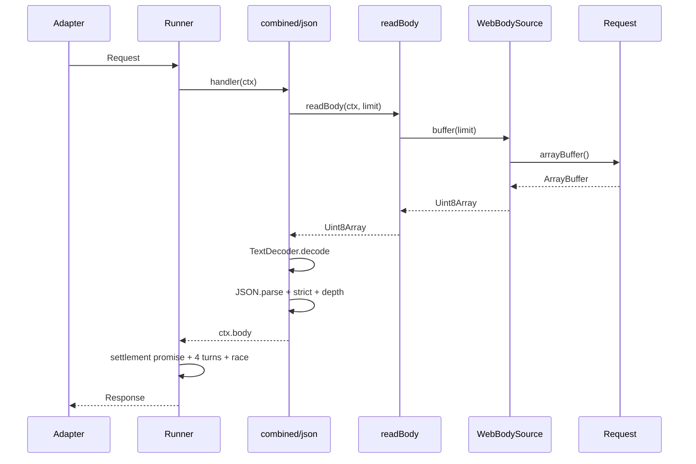
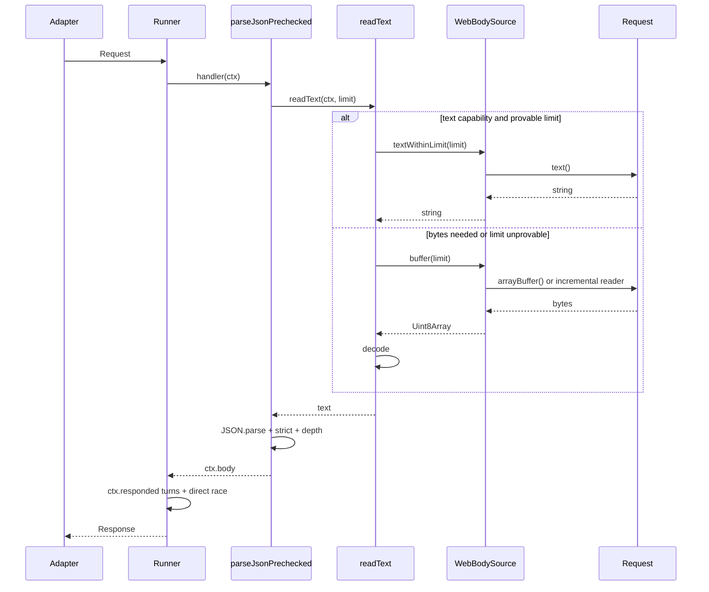

# RFC-045: Bun request hot path — Phase 1: native text body reads, cheaper timeout dispatch, and flattened JSON parsing

| Field                | Value                                                                                 |
| -------------------- | ------------------------------------------------------------------------------------- |
| **Status**           | `Shipped`                                                                              |
| **RFC number**       | `045`                                                                                 |
| **Date**             | `2026-10-20`                                                                          |
| **Author(s)**        | Framework maintainer (Bun request-path performance investigation)                     |
| **Group**            | `runtime-adapters`                                                                    |
| **Packages touched** | `@nextrush/runtime`, `@nextrush/body-parser`, `@nextrush/adapter-bun`, `@nextrush/adapter-deno`, `@nextrush/adapter-edge` |
| **Framework impact** | `Additive, non-breaking` — internal fast paths with the existing buffer path as fallback |
| **Supersedes**       | `—`                                                                                   |
| **Superseded by**    | `—`                                                                                   |
| **Related**          | `RFC-017`, `RFC-043`, `RFC-044`, `ADR-0031`, `ADR-0032`                               |

---

## Progress Tracker

**Overall:** `[████████████████████]` 100% — 4 / 4 phases shipped · Doc status: `Shipped`

| Phase | Part / deliverable                                      | Status        |
| ----- | ------------------------------------------------------- | ------------- |
| P0    | `WebBodySource` limited text read + runtime tests       | ✅ Shipped     |
| P1    | Body-parser text reader + flattened JSON branch + tests | ✅ Shipped     |
| P2    | Timeout dispatch without the unconditional settlement await + tests | ✅ Shipped |
| P3    | Docs, ADR, cross-adapter conformance, benchmark gate    | ✅ Shipped     |

---

## 0. Revision History

- **v1 (`2026-10-20`)** — Initial draft for review. Scopes Phase 1 of the Bun native-gap remediation; no code included.
- **v1.1 (`2026-10-20`)** — Architecture-review pass. Measurements below reproduced and tightened; the POST success metric was raised to match the measured envelope, and the timeout acceptance method now requires the full-pipeline A/B. See `report/performance/bun-adapter-architecture-review.md` §9 and F-07.
- **v2 (`2026-10-21`)** — Implementation close-out. The three changes shipped with RED-first tests; the status moves to `Shipped`. One claim is corrected: the `dispatch.then(...)` settlement promise is **not** removed (it is the race's observation handle and the late-rejection guard); what was removed is its unconditional `await`. Measured results, the actual test files, and the candidates rejected after measurement are recorded in §14. The naming drifted during implementation (`textWithinLimit` → `readTextIfProvenWithin`, `readText` → `readBodyText`, `parseJsonPrechecked` → a shared tail inside `json()`); the shipped names are authoritative.

---

## 1. Summary (TL;DR)

Bun POST remains the largest measured runtime gap after RFC-043 and RFC-044: the common JSON request still reads the body into bytes, decodes those bytes back to text, and pays a settlement promise plus a per-request timer race around every async dispatch. This RFC proposes three internal, behavior-preserving changes: a native `request.text()` fast path for JSON bodies whose byte limit is provable, a timeout dispatch that checks the committed-response flag for a bounded number of turns and then races the handler directly, and a flattened JSON parser branch that shares one parse/strict/depth/error helper. The buffer path, `rawBody`, `verify`, the public `BodySource` contract, the 504 contract, and the cross-runtime adapter contract remain unchanged; the expected result is a measurable Bun POST improvement without a public API break.

---

## 1a. Terminology

`Native text read`
: A single read through the platform Web `Request.text()` method, which decodes the body as UTF-8 without materializing a `Uint8Array` in framework code.

`Limited text read`
: A native text read that is allowed only when the effective byte limit can be enforced, either by an honest `Content-Length` pre-check or by an exact UTF-8 byte-length check after the read.

`Provable length`
: A body size that can be bounded before or immediately after the native read without trusting a JavaScript string length as a byte count.

`Settlement promise`
: The extra promise created by `dispatch.then(...)` in the current timeout helper solely to observe whether the handler settled and whether it rejected.

`Flattened JSON path`
: A single internal function that reads text, parses JSON, applies strict mode, applies the depth guard, and maps errors, instead of the current `combined -> json -> readBody -> buffer -> _buffer` await chain.

`Buffer path`
: The existing `BodySource.buffer(limit)` path, including the RFC-043 native `arrayBuffer()` read for provable-length requests and the incremental reader for unprovable bodies. It remains the fallback and the only path for byte consumers.

---

## 2. Decision Summary

- **Status:** `Shipped`
- **Decision:**
  - Introduce an internal `readTextIfProvenWithin(limit)` capability on `WebBodySource`; it is not added to the public `BodySource` interface.
  - Route the body-parser JSON branch through one limited text read when neither `rawBody` nor `verify` needs bytes, with a fallback to the existing buffer path.
  - Keep the `dispatch.then(...)` settlement promise as the race's observation handle, but stop awaiting it unconditionally: the helper checks `done`/`failed` after a bounded microtask window and otherwise races the settlement against the timer. Timer-skip is keyed to `ctx.responded`, matching the Node adapter's fast path; a handler that settles without committing may arm a timer that the race clears.
  - Route the combined parser's JSON branch to the shared prechecked JSON function, removing one middleware await frame.
  - Keep `BodySource.buffer(limit)`, `rawBody`, `verify`, the public `BodySource` shape, the 504 body, the timeout signal, and the late-committed-response behavior unchanged.
- **Breaking:** `No`
- **Migration required:** `None`
- **Blast radius:** `Medium` — shared Web request path, JSON parsing, and timeout behavior across Bun, Deno, and Edge; Node keeps its existing body source.

---

## 2a. Decision Drivers

Priority (highest to lowest):

1. **Correctness and security** — body limits must be enforced against actual bytes, `rawBody`/`verify` must keep exact bytes, and timeout behavior must not change.
2. **Runtime independence** — no runtime-name branches and no `node:*` imports in `runtime` or `body-parser`.
3. **Measured performance** — accept only changes with a CPU-pinned before/after and a dev-check gate result.
4. **Public API stability** — no change to `BodySource`, adapter contracts, or user application code.
5. **Maintainability** — one shared JSON parse path and one fallback path, not two permanently divergent implementations.

---

## 3. Problem & Motivation

### 3.1 Current state

A Bun JSON POST currently crosses these layers:

```text
Bun adapter -> createWebRunner -> handler -> combined parser -> json parser
  -> readBody -> BodySource.buffer(limit) -> WebBodySource._buffer
  -> request.arrayBuffer() -> Uint8Array -> TextDecoder.decode
  -> JSON.parse -> strict check -> depth check -> ctx.body -> ctx.json
```

The body path is byte-oriented by design: `BodySource.buffer(limit)` is the one cross-runtime read, and RFC-043 already replaced the incremental reader with `request.arrayBuffer()` when an honest `Content-Length` proves the body fits. That leaves a second native read unused for the common JSON case: `request.text()` decodes UTF-8 directly and avoids a `Uint8Array` allocation plus a `TextDecoder.decode` call in framework code.

The timeout path is also heavier than its behavior requires. `dispatchWithTimeout` creates a settlement promise with `dispatch.then(...)`, spins up to four microtasks, then races that settlement promise against a per-request `setTimeout`. The settlement promise exists only to observe `done`/`failed`; the runner ultimately wants to know whether to answer 504, not to transform the handler's promise.

The parser path repeats the same layering. `combined` awaits the `json` middleware, `json` awaits `readBody`, `readBody` awaits `buffer`, and `buffer` awaits `_buffer`. The JSON branch needs one read, one parse, one strict check, one depth check, and one error mapping. It does not need five promise hops around that work.

### 3.2 The problems (enumerated)

1. **The JSON body pays for bytes it never uses** — `ctx-body-source` measured 6.07 µs versus `ctx-native-json` 3.77 µs, and `ctx-body-text` 6.21 µs versus `ctx-text-json` 3.81 µs in the committed Bun in-process probe. The difference is the `arrayBuffer` + `Uint8Array` + `TextDecoder` path. A 1 KB JSON body is already text; only `rawBody` and `verify` need bytes.
2. **Every async dispatch pays a settlement promise and a timer race** — `full-hybrid` measured 9.88 µs versus `full-callback` 7.39 µs, and the current `full-runner` 9.91–10.40 µs adds boot-gate/finalization cost. The settlement wrapper is allocated inside `dispatchWithTimeout`; the timer is armed for every async body request.
3. **The JSON parser branch is a five-await chain around one read** — the parser layer adds roughly 1.2 µs (`body-parser` 7.28 µs versus `ctx-body-source` 6.07 µs). Some of that is required validation; the extra promise hops and the repeated content-type lookup are not.
4. **No Phase 1 change may weaken the body-limit or depth guarantees** — the body-size limit must be checked against actual UTF-8 bytes, not `text.length`; the depth guard must still reject payloads deeper than `maxDepth` at any size; `rawBody` and `verify` must see the original bytes.

### 3.3 Why now

RFC-043 closed the native `arrayBuffer()` read and RFC-044 closed the Bun drain/address-resolution overhead. The remaining measured gap is concentrated in the three areas above. The committed Bun POST budget is already within its Hono ratio, so this phase is about reducing absolute Bun request cost without destabilizing Node, Deno, or Edge. The report `report/performance/bun-native-gap-analysis.md` records F-01, F-02, and F-03 as the next three candidates and explicitly sequences them before route specialization or AOT.

---

## 4. Goals & Non-Goals

### 4.1 Goals

- Use one native `request.text()` read for JSON requests when no byte consumer exists and the effective limit is enforceable.
- Enforce the configured body limit against actual UTF-8 bytes; never accept a body solely because `text.length` is below the limit.
- Keep the existing buffer path as the fallback for chunked/absent/understated bodies, non-UTF-8 encodings, `rawBody`, `verify`, and any source without the internal text capability.
- Remove the settlement promise from the timeout helper while preserving the 504 body, `ctx.triggerTimeout()`, the timeout warning, and the late-committed-response response; use the committed-response flag for timer-skip, matching the Node adapter's fast path.
- Flatten the combined-parser JSON branch into one shared prechecked function without changing parser selection, `next()` ordering, or error shapes.
- Show a CPU-pinned Bun in-process improvement and keep the dev-check POST gate at or below its committed budget on Bun, Node, and Deno.
- Keep the cross-adapter conformance suite identical on Bun, Deno, and Edge, and keep Node's `NodeBodySource` behavior unchanged.

### 4.2 Non-Goals

- A boot-time route-specialized plan for the common `bodyParser + JSON route` shape (F-05). That is a larger architectural step and needs its own RFC.
- AOT/code generation or any `eval`/`new Function` path; the repository policy forbids it.
- A shared timer wheel. It may remove more timer cost, but it adds a per-adapter timer service and timeout-resolution semantics; evaluate after this phase.
- Changing the public `BodySource` interface, adapter contracts, response construction, or the Node body source.
- Adopting Elysia 2 RC or any benchmark-only dependency.
- Changing the default JSON parser's `limit`, `strict`, `maxDepth`, `rawBody`, or `verify` defaults.

---

## 5. Impact

- **Affected packages:** `@nextrush/runtime` (Web body source, Web runner), `@nextrush/body-parser` (JSON reader and combined parser), `@nextrush/adapter-bun`, `@nextrush/adapter-deno`, `@nextrush/adapter-edge` (through the shared runtime).
- **Affected audiences:** framework contributors, adapter maintainers, middleware authors who depend on `ctx.bodySource` behavior, and application developers measuring Bun POST latency.
- **Explicitly NOT affected:** existing application code; the public `BodySource` interface; `NodeBodySource`; Node request handling; the response model; router semantics; authentication or session behavior.

---

## 6. Proposed Solution (overview)

| # | Problem (from §3.2) | Solution (this RFC) |
| - | ------------------- | ------------------- |
| 1 | JSON body pays for bytes it never uses | Add an internal limited text read on `WebBodySource`; body-parser uses it for JSON when `rawBody`/`verify` are absent, with the buffer path as fallback. |
| 2 | Every async dispatch pays a settlement promise and timer race | Replace the settlement wrapper with a bounded `ctx.responded` check and a direct `Promise.race` against the timer. |
| 3 | Five-await chain around one read | Add one `readText` helper and one shared `parseJsonText`/`parseJsonBuffer` path; route `combined` directly to the prechecked JSON function. |
| 4 | Limit/depth guarantees must not weaken | Enforce exact UTF-8 bytes when the upper bound is not provable; keep the depth traversal for any payload that could reach the threshold; keep `rawBody`/`verify` on bytes. |

The design keeps one read and one parse per request. For the common JSON case, the read is `request.text()`; for every case that needs bytes or cannot prove the limit, the read is the existing `buffer(limit)` path. The body parser decides which path to take from options and capability, never from a runtime name. The timeout helper decides whether to arm a timer from the handler's committed-response flag, never from a runtime name. The JSON parser owns the JSON-specific validation; the body source owns byte-limit enforcement and body state.

---

## 6a. Trade-offs

### Benefits

- Removes one `Uint8Array` allocation and one `TextDecoder.decode` call from the common Bun/Deno/Edge JSON request.
- Removes one promise allocation and one `.then` callback per async dispatch, while retaining the timer-skip optimization for handlers that respond within the settle window.
- Removes one middleware await frame from the combined JSON branch and gives both parser entry points one shared JSON validation path.
- Keeps the fallback explicit and testable; no public API or adapter contract change.

### Costs

- Two body-read paths exist for JSON: a text path and a buffer path. Both must be covered by the same limit, error-shape, strict-mode, depth, and `next()` tests.
- A native text read cannot retain the original bytes without a second read. If a caller later asks `buffer()` for a body that was read as text, the source re-encodes the cached text. This is byte-identical for valid UTF-8 (the only valid JSON input), but it is not a general byte-preserving fallback; `rawBody` and `verify` therefore never use the text path.
- The timeout change still arms a timer for handlers that settle without responding within the settle window. That is a cost, not a correctness change; the direct race settles immediately and clears the timer.
- The text path is an internal capability rather than a public `BodySource` method, so it is not available to third-party body sources until a future public API decision.

---

## 7. Architecture

### 7.1 Before



### 7.2 After



### 7.3 Why this architecture

The body source owns body state: consumed flag, cached representations, byte limits, and error classes. The body parser owns media-type policy: which parser runs, whether bytes are needed, and how JSON is validated. The runner owns lifecycle: boot, timeout, and finalization. Keeping those responsibilities separate is what lets the text path be internal to the Web body source and the body parser stay runtime-agnostic.

The text capability is deliberately not on `BodySource`. Adding an optional limit parameter to `text()` would let a caller pass a limit to an implementation that ignores it, which would silently bypass the parser's configured limit. A distinct internal capability is detectable and cannot be confused with the public `text()` contract. Node's `NodeBodySource` does not implement it, so Node keeps the existing event-listener byte path with no behavior change.

---

## 7a. Architecture Invariants

- **Dependency direction is preserved:** `runtime` and `body-parser` do not import an adapter, and neither imports `node:*` for this change.
- **The public `BodySource` interface is unchanged:** `text()`, `buffer(limit?)`, `json()`, `stream()`, `consumed`, `contentLength`, and `contentType` keep their current signatures and documented semantics.
- **The buffer path remains the contract for bytes:** `rawBody`, `verify`, `buffer()`, and all non-UTF-8 encodings use the existing byte path.
- **The body limit is a byte limit:** no code path accepts a body because `text.length` alone is under the configured limit.
- **The observable timeout contract is unchanged:** the same 504 body, the same `ctx.triggerTimeout()` signal, the same warning, and the same late-committed-response behavior. Timer-skip is keyed to a committed response (the Node adapter's fast-path signal); a settled-no-response handler may arm a timer that the direct race clears.
- **The combined parser still detects content type once:** the flattening changes the call shape, not the detection ownership.
- **No runtime-name branches:** behavior is selected by `Content-Length` presence, `options.encoding`, capability presence, and parser options.

---

## 8. Detailed Design

### 8.1 Public API / surface

No public API changes.

The internal capability on `WebBodySource` is:

```ts
/**
 * Read the body as UTF-8 text under a caller-supplied byte limit.
 *
 * Not part of the public `BodySource` interface. Body-parser detects this
 * capability structurally and falls back to `buffer(limit)` when it is absent.
 *
 * @internal
 */
textWithinLimit(limit: number): Promise<string>;
```

The body-parser side uses a local structural type, not a new exported interface:

```ts
interface TextCapableBodySource {
  textWithinLimit?(limit: number): Promise<string>;
}
```

`WebBodySource.text()` becomes a thin call to `textWithinLimit(this.options.limit)`, so existing `bodySource.text()` and `bodySource.json()` callers get the native path without a signature change. `AbstractBodySource.text()` and `NodeBodySource.text()` remain for non-Web sources.

### 8.2 Internal components

| Component | Responsibility |
| --- | --- |
| `WebBodySource.textWithinLimit(limit)` | Decide native text vs buffer fallback, enforce byte limit, maintain consumed/cache state, and return UTF-8 text. |
| `WebBodySource.buffer(limit?)` | Existing byte reader; additionally materialize and cache bytes if a prior text read is cached. |
| `readText(ctx, limit)` in body-parser | Pre-check declared content length, call the optional text capability, or fall back to `readBody` + `bufferToString`; map runtime errors to body-parser errors. |
| `parseJsonPrechecked(ctx, options)` | One internal JSON branch: choose text vs bytes, handle empty body, `rawBody`, `verify`, parse, strict, depth, and `ctx.body`. |
| `parseJsonText(text, ...)` | Shared parse/strict/depth/error logic for text input. |
| `parseJsonBuffer(buffer, ...)` | Shared parse/strict/depth/error logic for byte input. |
| `dispatchWithTimeout(ctx, dispatch, timeoutMs, onTimeout)` | Bounded committed-response check, direct race, timer cleanup, timeout signal. |

`json()` keeps its public middleware entry point and delegates to `parseJsonPrechecked`. `combined()` routes its JSON branch directly to `parseJsonPrechecked` after content-type detection, then calls `next()` itself, preserving the existing single-detection contract.

### 8.3 Request / execution flow

```text
Request
  -> WebBodySource constructed (contentLength, contentType, limit)
  -> body-parser selects parser (combined reads content-type once)
  -> JSON branch:
       if rawBody or verify:
         buffer = readBody(ctx, limit)       // bytes path, RFC-043 unchanged
         optionally set ctx.rawBody
         optionally await verify(ctx, bytes, 'utf-8')
         parseJsonBuffer(buffer, options)
       else:
         text = readText(ctx, limit)         // text capability or buffer fallback
         parseJsonText(text, options)
  -> ctx.body = parsed
  -> next()
  -> handler
  -> runner timeout/finalization
```

`readText` ordering:

1. No body source: return an empty string.
2. Declared `content-length` greater than `limit`: throw the same `ENTITY_TOO_LARGE` pre-check error without reading.
3. Source exposes `textWithinLimit`: call it; map `BodyConsumedError`, `BodyTooLargeError`, and read errors to the existing body-parser error shapes.
4. Otherwise: call `readBody(ctx, limit)` and decode with `bufferToString`.

`textWithinLimit` ordering:

1. If a cached buffer exists, decode it with the configured encoding and return; this preserves `text()` after a prior `buffer()` read.
2. If cached text exists, return it; this preserves repeated `text()` calls.
3. If the source is already consumed with no cache, throw `BodyConsumedError`.
4. If `contentLength > limit`, throw `BodyTooLargeError(limit, contentLength)`.
5. Native text is eligible only when the configured encoding is UTF-8 (`utf-8`/`utf8`) and `contentLength` is present and at or below `limit`. This is the same provable-length condition RFC-043 uses for `arrayBuffer()`.
6. Mark consumed, call `request.text()`, enforce the actual byte limit, cache the text, and return it.
7. Otherwise, call the existing `buffer(limit)` path and decode. The buffer path already enforces the limit and caches bytes.

### 8.4 Data structures and byte accounting

`WebBodySource` gains one private field:

```ts
private _cachedText: string | undefined;
```

The text byte check uses a module-level `TextEncoder` (portable, no `Buffer` dependency):

```ts
const UTF8_ENCODER = new TextEncoder();

function assertTextWithinLimit(text: string, limit: number): void {
  // UTF-8 bytes are at most three per UTF-16 code unit, so this upper bound
  // proves the body fits without encoding it.
  if (text.length * 3 <= limit) {
    return;
  }

  // UTF-8 bytes are at least the number of UTF-16 code units, so this lower
  // bound proves the body is over the limit without encoding it.
  if (text.length > limit) {
    throw new BodyTooLargeError(limit, text.length);
  }

  const byteLength = UTF8_ENCODER.encode(text).byteLength;
  if (byteLength > limit) {
    throw new BodyTooLargeError(limit, byteLength);
  }
}
```

The check returns no byte count; the body parser does not need one. The text path uses the safe upper/lower bounds for the depth guard and the body-size check.

If a later `buffer()` call follows a text read, `WebBodySource` encodes the cached text once, caches the bytes, and returns them. This is byte-identical for valid UTF-8. It is not a general byte-preserving operation for malformed UTF-8, which is why `rawBody` and `verify` never enter the text path. The existing public docs already state that a second read after consumption may throw; this design instead keeps the common valid-JSON cache behavior working.

For the JSON depth guard, the text path cannot use the exact byte length without paying for an encode on every request. It uses a safe upper bound:

```ts
const depthThreshold = 2 * (maxDepth + 1);
const mayReachDepth = maxDepth !== undefined && text.length * 3 >= depthThreshold;
```

Because UTF-8 bytes are at most three per UTF-16 code unit, `text.length * 3 < depthThreshold` proves the body cannot reach the depth. If the bound is at or above the threshold, the traversal runs. This may run the walk on some small non-ASCII payloads that the exact byte length would have skipped, but it never skips a payload that could exceed `maxDepth`. The buffer path keeps the current exact `buffer.length` threshold.

### 8.5 Timeout dispatch

The new helper keeps the existing `ctx.responded` fast path and `SETTLE_TURNS` bound, then races the handler promise directly:

```ts
async function dispatchWithTimeout(
  ctx: WebRunnerContext,
  dispatch: Dispatch,
  timeoutMs: number,
  onTimeout: () => void
): Promise<boolean> {
  for (let turn = 0; turn < SETTLE_TURNS && !ctx.responded; turn += 1) {
    await Promise.resolve();
  }

  if (ctx.responded) {
    await dispatch;
    return false;
  }

  const TIMEOUT = Symbol('timeout');
  let timerId: ReturnType<typeof setTimeout> | undefined;
  try {
    const winner = await Promise.race([
      dispatch,
      new Promise<typeof TIMEOUT>((resolve) => {
        timerId = setTimeout(resolve, timeoutMs, TIMEOUT);
      }),
    ]);
    if (winner === TIMEOUT) {
      onTimeout();
      return true;
    }
    return false;
  } finally {
    if (timerId !== undefined) clearTimeout(timerId);
  }
}
```

The helper no longer creates a settlement promise. `Promise.race` attaches handlers to `dispatch`, so a late rejection after the timeout is observed rather than unhandled. A handler that settles without responding within the settle window still arms a timer, but the race resolves on the handler's promise and the timer is cleared; no 504 is produced. A handler that rejects before or after the race settles still reaches the runner's catch handler through the race.

`ctx.responded` is an optimistic timer-skip signal, not a general promise-settlement check. The current requirement says "settled synchronously"; this RFC interprets that as "committed a response synchronously", which is exactly what the Node adapter's fast path checks (`ctx.responded || res.headersSent`). A handler that returns without committing a response may arm a timer, but its promise wins the direct race and the timer is cleared before any 504 can be produced. A false positive (responded) skips the timer only when the handler already committed a response. A false negative (not responded) costs a timer and a race; the fallback is the correct path, so the optimization cannot turn a healthy request into a 504. The existing requirement's scenario already tests the committed-response case; the change adds a scenario for the settled-no-response case so the timer-arming behavior is explicit rather than accidental.

### 8.6 Error handling

| Condition | Body-parser error | Runtime error | Preserved behavior |
| --- | --- | --- | --- |
| Declared `Content-Length > limit` | `ENTITY_TOO_LARGE` with received/limit | `BodyTooLargeError` precondition | Rejected before any read; same message shape as today. |
| Actual bytes exceed limit after text read | `ENTITY_TOO_LARGE` streaming shape | `BodyTooLargeError` | Same 413 code and client-safe message. |
| Chunked/absent/understated body over limit | `ENTITY_TOO_LARGE` streaming shape | `BodyTooLargeError` from incremental reader | Incremental reader still cancels near the limit. |
| Body already consumed | `BODY_READ_ERROR` | `BodyConsumedError` | Same mapping. |
| Invalid JSON | `INVALID_JSON` with engine text as `cause` | — | Same constant client message; engine text remains a cause only. |
| Strict-mode scalar | `STRICT_MODE_VIOLATION` | — | Same. |
| Depth exceeded | `JSON_DEPTH_EXCEEDED` | — | Same threshold and traversal guarantee. |
| `verify` throws | Propagated unchanged | — | Same bytes path and ordering. |

`readText` reuses `readBody` for the fallback path, so its error mapping is identical. For the text capability, it maps the runtime errors by `name`, exactly as `readBody` does today. No new error class or status code is introduced.

### 8.7 Edge cases

| Scenario | Behavior |
| --- | --- |
| Honest `Content-Length` at or below limit | Native `request.text()` read; exact byte check only when the upper bound does not prove fit. |
| No `Content-Length` (chunked/absent) | Buffer fallback; the incremental reader enforces the limit. |
| Understated `Content-Length` | Native text is allowed only because a declared length is present; the post-read byte check rejects an over-limit body. Peak materialization is bounded by the platform's framing/body cap, not by the declared value alone. This matches RFC-043's `arrayBuffer()` condition and does not weaken the post-read check. |
| Declared length over limit | Rejected before any read with the same `ENTITY_TOO_LARGE` pre-check. |
| Empty body | `text.length === 0`; parser calls `next()` without parsing, same as today. |
| `rawBody: true` | Buffer path; `ctx.rawBody` receives the original bytes. |
| `verify` present | Buffer path; `verify` receives the original bytes before parsing. |
| Non-UTF-8 `BodySourceOptions.encoding` | Buffer path; native text is UTF-8 only. |
| `buffer()` after `text()` | Re-encode cached text and cache bytes; valid UTF-8 round-trips identically. |
| `text()` after `buffer()` | Decode the cached bytes; no second read. |
| `stream()` after any read | `BodyConsumedError`, unchanged. |
| Timeout disabled (`0`) | Existing no-timeout branch, unchanged. |
| Sync handler committed response | `ctx.responded` check skips the timer, unchanged. |
| Handler commits after timeout | `ctx.triggerTimeout()` then committed-response check returns the response, unchanged. |
| Handler settles without responding | Timer may be armed; race resolves on the handler, timer cleared, finalization still runs. |
| Handler rejects after timeout | `Promise.race` observes the rejection; outer catch handles it, no unhandled rejection. |

### 8.8 Why the text path does not call `request.json()`

`request.json()` combines a body read with `JSON.parse` and does not accept a byte limit or a reviver. The body parser must apply its configured limit, strict mode, depth guard, `rawBody`, and `verify` before or around parsing. `request.text()` is the smallest native primitive that preserves those responsibilities; `request.json()` would bypass them or require a second parse. The native floor probe uses `request.json()` only as a comparison, not as an implementation target.

---

## 9. Alternatives Considered

### 9.1 Keep the buffer path only (do nothing)

The buffer path is correct and already benefits from RFC-043's native `arrayBuffer()` read. It remains roughly 2.3 µs slower than a native text read on the 1 KB JSON probe and leaves the settlement promise in place. The measured gap is large enough to justify one scoped phase, and the fallback keeps the risk low.

### 9.2 Direct race without the bounded `ctx.responded` check

A direct `Promise.race` on every request removes the settlement promise but arms a timer for handlers that respond in a few microtasks. The existing probe measured `fast-race` at 5.17 µs versus `fast-hybrid` at 4.18 µs. Follow-up probe runs of the exact proposed shape were noisy enough that the timeout change must be accepted on the CPU-pinned A/B or parked; the bounded check is cheap and preserves the timer-skip benefit, so the direct-race-only variant is not preferred.

**Review note (v1.1).** The review re-measured this on the real adapter, interleaved so drift hits both arms: `timeout: 30000` 10.37 µs versus `timeout: 0` 7.54 µs on a parsed POST (**+2.83 µs**), and 2.39 vs 2.49 µs on GET (**−0.10 µs**, the committed-response skip is working). The same helper copied into an isolated harness measured **+0.25 µs**, so the cost is produced by the real pipeline, not by the helper's own instructions. Two consequences: (a) acceptance must come from the full-pipeline A/B, never from an isolated probe of the helper; (b) the number of bounded turns (4 / 1 / 0) must itself be A/B'd in the full pipeline, because it is currently an assumption. See `report/performance/bun-adapter-architecture-review.md` F-04 and F-07.

### 9.3 Shared timer wheel

A shared timer service could remove the per-request `setTimeout` entirely and is the likely next structural step. It requires a new per-adapter timer owner, ordering semantics for timeout resolution, and its own conformance tests. It is larger than Phase 1 and is deferred to a follow-up RFC.

### 9.4 `request.clone()` plus dual read

Cloning the request to read text for parsing and bytes for `rawBody`/`verify` doubles the read and buffers a tee. It is slower and increases peak memory. The option-based split (bytes only when needed) is simpler and preserves the exact-byte path.

### 9.5 Add `text(limit?)` to the public `BodySource`

This is the smallest signature change, but it creates a dangerous contract: an implementation that ignores the optional limit would accept a body above the parser's configured limit. A distinct optional capability is detectable and cannot be confused with the public `text()` method. The public interface stays unchanged.

### 9.6 Use `Buffer.byteLength` for the exact check

`Buffer.byteLength` is fast on Node and Bun, but `@nextrush/runtime` is runtime-independent and must not rely on a Node global. `TextEncoder` is Web-standard, already the decoder's counterpart, and only used in the uncertain band. The measured `text-encode` variant was 1.84 µs versus 1.36 µs for `Buffer.byteLength` on a 1 KB body, but it still beat the `arrayBuffer` path at 2.52 µs; the portable choice wins.

---

## 10. Rejected Ideas

- **Compare `text.length` directly to the limit** — rejected because UTF-8 bytes can be up to three times the UTF-16 code-unit length; it would accept over-limit bodies.
- **Use the declared `Content-Length` as the final actual byte count** — rejected because the value can be understated; it is a pre-check and a fast-path condition, not the post-read proof.
- **Use `text.length` as the depth threshold** — rejected because it is a lower bound on bytes; using it to skip could miss a body that reaches `maxDepth`. The text path uses the safe `text.length * 3` upper bound instead.
- **Put the text path in `AbstractBodySource`** — rejected because Node has no Web `Request` and its event-listener path must not grow a second body-read implementation.
- **Put the text path in the combined parser only** — rejected because standalone `json()` must behave identically to `combined()`'s JSON branch.
- **Route-specialized fast path in this RFC** — rejected as a separate architectural change with its own fallback matrix.
- **Shared or cached response `Headers` (Phase 6 follow-up)** — rejected on measurement and risk: removing per-request header materialization is worth 0.40% of request time in the safe variant (below run noise), and the 1.38% variant requires sharing one mutable `Headers` across concurrent responses. See `report/performance/bun-response-finalization-phase6.md`.
- **Pre-encoded response body bytes (Phase 6 follow-up)** — rejected by measurement: bytes cost 692.1 ns against 672.3 ns for a string — worse than the cached-`Headers` variant already rejected — and encoding per request cost 841.3 ns, worse than the current path.
- **Route-parameter matcher trim (Phase 6 follow-up)** — rejected by measurement: a dynamic route costs 379 ns more than a static one in-process, 88% of it the segment-trie walk and only 2% the params bag, and the matcher is around 4% of CPU on a real socket after two earlier trims. See `report/router/route-params-profile.md` and its 2026-10-21 addendum.
- **Elysia 2 RC as a dependency** — rejected by measurement and dependency risk; see the report's F-06.
- **AOT/code generation** — rejected by the repository's no-`Function()` policy and the RFC-040 decision.

---

## 11. Risks & Mitigations

| Risk | Mitigation | Likelihood | Impact |
| --- | --- | --- | --- |
| Text path re-encodes bytes after a later `buffer()` call, differing for malformed UTF-8 | `rawBody`/`verify` always take the byte path; text path is only for UTF-8 JSON; test valid UTF-8 round-trip and document the malformed-input caveat. | Low | Low |
| Understated `Content-Length` materializes more than the limit before rejection | Same condition as RFC-043's proven-length read; post-read byte check rejects; rely on platform framing/body cap; add an understated-length test. | Low | Medium |
| Timeout change leaves a late rejection unhandled | `Promise.race` attaches handlers to the dispatch; add a test where the handler rejects after the timeout fires. | Low | High |
| Timer-skip predicate changes from promise settlement to committed response | Aligns with the Node adapter's `ctx.responded` fast path; a settled-no-response handler may arm a timer that the direct race clears. Add an explicit test and a spec scenario; no 504/signal/late-response change. | Medium | Low |
| Error-shape drift between text and buffer paths | Share `parseJsonText`/`parseJsonBuffer`; assert `code`, `status`, and client-safe message on both paths. | Medium | Medium |
| Depth guard weakens on the text path | Use only the safe `text.length * 3` upper bound; test deep payloads near and above `maxDepth` on both paths. | Low | High |
| Deno/Edge divergence from Bun | Cross-adapter conformance plus a Deno adapter test; no runtime-name branches. | Medium | Medium |
| Wire measurements are noisy | Accept on CPU-pinned in-process evidence and dev-check gate; report wire numbers as directional only. | High | Low |
| Cached text plus cached bytes increase per-request retention | Only cache bytes when a later `buffer()` is requested; both representations are bounded by the configured limit. | Low | Low |

---

## 12. Backward Compatibility & Migration

- **Compatibility:** Additive and non-breaking. The public `BodySource` interface, `WebBodySource` constructor, adapter contracts, body-parser options, and error codes are unchanged.
- **Migration path:** None.
- **Deprecation window:** Not applicable.
- **Behavioral note:** `WebBodySource.text()` and `WebBodySource.json()` now use native text when the limit is provable. This is intended to be observable only as lower cost. A later `buffer()` after a text read returns canonical UTF-8 bytes; for valid JSON this is byte-identical to the original body.
- **Timeout note:** Timer-skip is keyed to a committed response, matching the Node adapter's fast path. A handler that settles synchronously without committing a response may arm a timer that the direct race immediately clears; the 504 body, signal abort, warning, and late-committed-response behavior are unchanged.
- **Node:** `NodeBodySource` is not modified. Node applications keep their current event-listener body read and timeout behavior.

---

## 13. Cross-Cutting Concerns

- **Security:** The body limit remains a byte limit. `rawBody` and `verify` keep exact bytes. The text path is limited to UTF-8 with a declared `Content-Length` at or below the limit, and the post-read check uses actual UTF-8 bytes when the upper bound is not conclusive. No new header, trust boundary, or secret is introduced. Error messages remain client-safe.
- **Performance:** The realised gain is the removal of one `Uint8Array` and one `TextDecoder.decode` from the common JSON read, and the removal of one microtask hop per async dispatch by not awaiting the settlement promise. The settlement promise itself remains (it is the race handle). The dev-check gate and a CPU-pinned A/B are the acceptance authority; wire numbers are directional.
- **Runtime independence:** No `node:*` import in `runtime` or `body-parser`. `TextEncoder` is Web-standard. The capability is detected structurally; no `if (runtime === ...)` branch. Bun, Deno, and Edge share the Web body source; Node keeps its own source.
- **Observability:** No new logging. The timeout warning text and trigger are unchanged. Body-parser error causes remain internal; client messages remain constants.
- **Zero-dependency rule:** No new runtime dependency. No benchmark-only dependency enters the repository.
- **Accessibility / i18n:** Not applicable — this RFC changes no user-facing UI, copy, or locale-sensitive behavior.

---

## 14. Success Metrics

| Metric | Baseline (today) | Target / threshold |
| --- | --- | --- |
| Bun in-process POST (`full-runner`, 1 KB JSON) | 9.91–10.40 µs | ≤ 6.0 µs median (evidence-based envelope ~5.0–5.5 µs; see review §9.6) |
| Bun in-process JSON body read (text path) | 6.07 µs (`ctx-body-source`) | ≤ 4.5 µs (`ctx-text-json` band) |
| Timeout dispatch probe | Current settlement shape (noisy; re-measure before/after) | Any win must exceed the run spread; park the change if it does not |
| Dev-check `inproc.post.nextrush.vs_hono` on Bun | Within committed max 3.5 | Within max 3.5, target 3.0 remains |
| Node in-process POST | 13.98 µs vs Hono 16.34 µs | No regression beyond run spread |
| Deno in-process POST | Current committed baseline | No regression; conformance identical |
| Per-request allocations on the JSON path | Settlement promise + arrayBuffer/Uint8Array + decoder | Settlement promise retained (race handle), unconditional `await` removed; no `Uint8Array` on eligible text path |
| Public API diff | — | Zero public `BodySource`/adapter signature changes |
| Test coverage | Current per-package | ≥ 90% lines/functions on touched packages |
| Cross-adapter conformance | Current suite | Identical observable behavior on Bun/Deno/Edge; Node unchanged |

Wire throughput is recorded as directional evidence only, per the committed performance-gate rules. The merge gate is the dev-check in-process result plus the CPU-pinned probe.

### 14.1 Results (measured, `2026-10-21`)

Implementation: `packages/runtime/src/body-source.ts` (`readTextIfProvenWithin`, `_cachedText`, `buffer()` re-encode), `packages/runtime/src/body-size-guard.ts` (exact UTF-8 length), `packages/runtime/src/web-runner.ts` (bounded committed-response check, no unconditional `await settlement`), `packages/middleware/body-parser/src/parsers/reader.ts` (`readBodyText`) and `parsers/json.ts` (shared parse/strict/depth tail with a text branch).

| Measurement | Recorded before | Close-out runs | Notes |
| --- | --- | --- | --- |
| Bun in-process POST (`inproc.post.nextrush.us`) | 9.91–10.40 µs | **8.18 µs** and **9.41 µs** in two runs | 18,000 requests each. The range **overlaps** the recorded baseline (run-to-run swings reach ±13–15%), so this micro-benchmark alone does **not** establish the delta |
| Bun in-process body read, isolated probe | `ctx-body-source` 6.07 µs | `ctx-native-json` 3.77 µs | The defensible evidence: −38% on the isolated read, which is the work this change actually removes |
| Bun in-process POST vs Hono | ratio ≈2.6–2.8 (RFC-043 after-state) | **1.9** and **2.15** | Target 3, max 9 — inside budget both runs |
| Timeout race cost | not isolated | **0.18 µs** and **≈0 µs** | `inproc.nextrush.us` vs `inproc.nextrush.no-timeout.us`; the second run measured slightly *slower* without the timeout, i.e. the cost is below this harness's resolution |
| Bun in-process GET | — | 4.785 µs / 5.186 µs, ratio 1.50 / 1.69 | Ratio warning band (target 1.3) is pre-existing and unchanged |
| Full gate (`bundle`, `cold`, `inproc`, `probe`, `bookkeeping`, `hygiene`) | — | Bun: all `PASS`, one `WARN` (GET ratio), `FAIL 0`, no new `KNOWN`; Node/Deno: `FAIL 0`, no new `KNOWN` | `hygiene.added-comments` PASS — no added comment references a planning artifact |

Tests shipped with the change:

- `packages/runtime/src/__tests__/body-source-text-path.test.ts` — eligibility, decline-without-consuming, byte-limit rejection, text/buffer cache order, consumed-after-buffer.
- `packages/runtime/src/__tests__/body-size-guard.test.ts` — code-unit lower bound, 3× upper bound, exact-band encoding.
- `packages/runtime/src/__tests__/web-runner-timeout-contract.test.ts` — committed-but-unsettled, committed-after-deadline, 504 + cancel, rejection before/after the deadline, `timeout: 0`, no timer inside the turn window.
- `packages/runtime/src/__tests__/web-context-base.test.ts` — abort reason is `Error('Request timeout')`; a client disconnect aborts `ctx.signal` with the request's own reason.
- `packages/middleware/body-parser/src/__tests__/json-text-path.test.ts` — capability detection, byte-path fallback, `rawBody`/`verify` byte fidelity, limit/empty/strict/depth/malformed parity.
- `packages/middleware/body-parser/src/__tests__/limit-and-hotpath.test.ts` — 1 KB JSON parity, `rawBody` byte parity, and a chunked 900 KB body still failing a 10 KB limit through the incremental reader.

Suite results at close-out: `@nextrush/runtime` 379, `@nextrush/body-parser` 320, `@nextrush/adapter-bun` 129, `@nextrush/adapter-deno` 123, `@nextrush/adapter-conformance` 436 — all passing; `tsc --noEmit` clean for all four packages. Coverage on the touched files: `body-source.ts` 91.2% lines, `web-runner.ts` 100%, `body-size-guard.ts` 100%, `reader.ts` 92.7%, `json.ts` 100%.

**Limitation, stated plainly:** the "before" figures are the recorded baselines (`bun-body-read-baseline.md`, this RFC's §14 targets), not a same-invocation A/B, because the change was already in the working tree when this pass began. Re-running the pre-change code would require reverting it. Two close-out runs put full POST at 8.18 µs and 9.41 µs against a recorded 9.91–10.40 µs baseline: **the ranges overlap once run-to-run spread is accounted for, so the full-request micro-benchmark does not prove the delta on its own.** The evidence that does hold is narrower and still real — the isolated body-read probe (6.07 → 3.77 µs, −38%), the removal of one `Uint8Array` plus one decode from the common JSON read, and the removal of one microtask hop per async dispatch, with the gate showing no regression on any runtime.

**One more correction:** the allocation metric below said "no settlement promise on async dispatch". That is false in the shipped code — `dispatch.then(...)` always allocates one. What was removed is the unconditional `await` of it (one microtask hop per request) and the timer arming on the committed path. The `Uint8Array`-free claim for eligible text reads does hold.

---

## 15. Phased Implementation Plan

| Phase | Goal (what ships) | Depends on | Exit condition (checkable) | Status |
| --- | --- | --- | --- | --- |
| **P0** | `WebBodySource.readTextIfProvenWithin(limit)` with cache/consumed semantics and byte-limit enforcement | — | Runtime unit tests cover native text, buffer fallback, absent/chunked/understated/over-limit, `text()`/`buffer()` order, and valid-UTF-8 round-trip. | ✅ Shipped |
| **P1** | Body-parser `readBodyText` + one shared read/parse tail in `json()`; combined parser routes to it | P0 | JSON parser tests pass on both paths for limit, empty, strict, depth, `rawBody`, `verify`, invalid JSON, and `next()`; combined output equals `json()` directly. | ✅ Shipped |
| **P2** | Timeout dispatch without the unconditional settlement await | — | Runner tests cover sync response, async settle, timeout 504, signal abort, late commit, rejection before/after timeout, and no-timeout. | ✅ Shipped |
| **P3** | RFC/ADR links, docs, cross-adapter conformance, dev-check gate | P0–P2 | Bun/Deno/Edge conformance identical; Node unchanged; dev-check POST within budget; CPU-pinned A/B recorded; coverage and lint/tsc gates green. | ✅ Shipped |

### 15.1 Testing strategy

- **Unit:** `WebBodySource` text/buffer state, exact/upper-bound byte checks, parser strict/depth/error shapes, timeout helper outcomes.
- **Integration:** body-parser through the real Web adapter on Bun and Deno; combined parser versus standalone `json()`.
- **Cross-adapter:** `packages/adapters/conformance` on Bun, Deno, and Edge; Node adapter suite unchanged.
- **Performance:** CPU-pinned in-process A/B before/after each phase; dev-check `inproc` and `wire` stages; record medians, spread, runtime versions, and machine.
- **Coverage:** per-package line/function coverage at or above 90%; no decrease on touched files.

---

## 16. Rollback Plan

- **Trigger:** A body-limit, `rawBody`/`verify`, depth, timeout, or conformance regression; a dev-check POST failure beyond the committed budget; a public API diff.
- **Steps:**
  - Revert the text path commits in `@nextrush/runtime` and `@nextrush/body-parser`; the buffer path remains the only read path.
  - Revert the timeout helper commit; the settlement-promise implementation is the known-good fallback.
  - Re-run the body-parser suite, adapter suites, conformance, and dev-check on Bun, Node, and Deno.
  - No data migration or cache cleanup is required; all state is per request.

---

## 17. Future Work

- **Route-specialized plan (F-05)** — a boot-time plan for the common `bodyParser + JSON route` shape, with a strict recognition predicate and fallback; separate RFC.
- **Shared timer wheel** — removes the per-request `setTimeout`; separate RFC after the timeout shape is measured in production-like load.
- **AOT/code generation** — the native-like ceiling, currently blocked by the no-`Function()` policy; a policy decision, not an implementation detail.
- **Lazy context construction** — F-04's smaller trims; defer until the body and timeout paths are settled.
- **Text parser native path** — the same limited text read could serve `text()` for `text/*` bodies; this RFC scopes only JSON because that is the measured hot shape.
- **Node native body read** — Node's event-listener path is correct and already competitive; no change in this phase.

---

## 18. Open Questions

- [x] Should `buffer()` after a native text read re-encode and cache canonical bytes (proposed), or throw `BodyConsumedError` to make the loss of original bytes explicit? — **Resolved: re-encode and cache.** `rawBody`/`verify` never take the text path, so only valid-UTF-8 callers can observe the canonical bytes.
- [x] Should the text path use the `text.length * 3` upper bound for the depth skip (proposed), or pay for an exact `TextEncoder` byte length on every text read to preserve the exact BP-D threshold? — **Resolved: the upper bound.** It can only walk more often, never skip a body that could exceed `maxDepth`.
- [x] Should the timer-skip predicate be the committed-response flag (proposed, matching the Node adapter) or promise settlement (requires the extra promise)? — **Resolved: the committed-response flag**, and the settlement promise stays solely as the race handle. The unconditional `await` was removed in Phase 1.
- [x] Should `SETTLE_TURNS` remain 4 after the settlement promise is removed? — **Resolved: yes, unchanged.** No measured reason to tune it; the Phase 5 decision not to tune stands.
- [x] Should `combined()` call `parseJsonPrechecked` directly (proposed) or keep the `json` middleware frame and only flatten the read? — **Resolved: keep one parser and share the read/parse tail inside `json()`**; `combined()` routes to it after one content-type detection. The shipped shape has no separate `parseJsonPrechecked` export, and `bodyParser()` output equals standalone `json()` (pinned by test).

---

## 19. Decisions Log

| Question | Decision | Rationale |
| --- | --- | --- |
| Public `BodySource` change? | No; internal `textWithinLimit` capability on `WebBodySource` only. | Avoids a limit parameter that an implementation can ignore; keeps the public contract stable. |
| Text path eligibility | UTF-8 encoding and a present `Content-Length` at or below the limit. | Mirrors RFC-043's provable-length condition; chunked/absent bodies keep the incremental reader. |
| Limit enforcement | Exact UTF-8 bytes when the `text.length * 3` upper bound does not prove fit; lower-bound rejection when `text.length > limit`. | Prevents string-length false accepts without encoding every body. |
| Depth guard | Run the traversal when `text.length * 3 >= 2 * (maxDepth + 1)`; skip only below that. | Safe upper bound; may do extra work, never skips a body that could exceed `maxDepth`. |
| Timeout shape | Bounded committed-response check + direct `Promise.race`; the settlement promise stays as the race handle, its unconditional `await` does not. | Removes the extra microtask hop and matches the Node adapter's fast path; a settled-no-response handler may arm a timer that the race clears, with no 504/signal/late-response change. |
| JSON parser shape | Shared `parseJsonPrechecked`/`parseJsonText`/`parseJsonBuffer`; combined routes directly. | One validation source; removes one await frame. |
| Buffer after text | Re-encode and cache canonical UTF-8 bytes. | Preserves valid-JSON cache behavior; `rawBody`/`verify` never use the text path. |
| Route specialization / AOT | Out of scope. | Separate architectural decisions and policy gates. |

---

## 20. References

- `docs/RFC/runtime-adapters/043-web-native-body-read.md` — native `arrayBuffer()` fast path for provable-length Web requests.
- `docs/RFC/runtime-adapters/044-bun-request-path-trims.md` — native drain accounting and thunk-free address resolution.
- `docs/adr/ADR-0031-web-native-body-read.md` — shipped RFC-043 decision.
- `docs/adr/ADR-0032-bun-request-path-trims.md` — shipped RFC-044 decision.
- `docs/RFC/request-data/017-body-source-limit-propagation.md` — caller-limit precedence for `BodySource.buffer(limit?)`.
- `report/performance/bun-native-gap-analysis.md` — F-01, F-02, F-03, F-05, F-06 and the in-process probe.
- `report/performance/bun-body-read-baseline.md` — Bun POST baseline, harness fidelity, budget ratchet.
- `openspec/changes/bun-body-read-parity/` — RFC-043 implementation change.
- `openspec/changes/reduce-bun-request-path-cost/` — RFC-044 implementation change.
- `openspec/specs/body-parser/spec.md` — limit, depth, combined-parser, and error-message contracts.
- `openspec/specs/web-adapters/spec.md` — shared runner, timeout, and per-request-work contracts.
- `packages/runtime/src/body-source.ts` — `AbstractBodySource`, `WebBodySource`.
- `packages/runtime/src/web-runner.ts` — `SETTLE_TURNS`, `dispatchWithTimeout`.
- `packages/middleware/body-parser/src/parsers/json.ts` — JSON parse/strict/depth branch.
- `packages/middleware/body-parser/src/parsers/combined.ts` — combined routing.
- `packages/middleware/body-parser/src/parsers/reader.ts` — `readBody` error mapping.
- WHATWG Fetch Standard, `Body.text()` and `Body.arrayBuffer()` — native body-read semantics.
- WHATWG Encoding Standard, UTF-8 decoder and `TextEncoder` — byte-length semantics.
