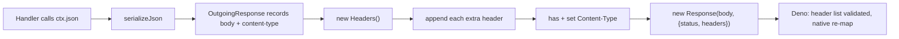
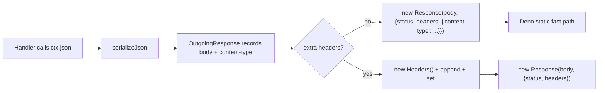

# RFC-046: One JSON media type, and a plain init record for the Web response

| Field                | Value                                                                 |
| -------------------- | --------------------------------------------------------------------- |
| **Status**           | `Approved`                                                            |
| **RFC number**       | `046`                                                                 |
| **Date**             | `2026-10-21`                                                          |
| **Author(s)**        | `NextRush performance campaign`                                       |
| **Group**            | `runtime-adapters`                                                    |
| **Packages touched** | `@nextrush/runtime`, `@nextrush/adapter-node`, `@nextrush/adapter-bun`, `@nextrush/adapter-deno`, `@nextrush/adapter-edge`, `@nextrush/adapter-serverless`, `@nextrush/adapter-conformance` |
| **Framework impact** | `Breaking (wire media type; major + migration note)`                  |
| **Supersedes**       | —                                                                     |
| **Superseded by**    | —                                                                     |
| **Related**          | `RFC-041`, `ADR-0030`, `ADR-0034`                                     |

---

## Progress Tracker

**Overall:** `[████████████████████]` 100% — 4 / 4 phases complete · Doc status: `Approved`

| Phase | Part / deliverable                     | Status         |
| ----- | -------------------------------------- | -------------- |
| P0    | Foundation primitive / internal core   | ✅ Done        |
| P1    | Engine / internal abstraction          | ✅ Done        |
| P2    | Public API surface                     | ✅ Done        |
| P3    | Docs + examples + adapter parity       | ✅ Done        |

---

## 0. Revision History

- **v1 (`2026-10-21`)** — Initial draft, written with the implementation it governs.

---

## 1. Summary (TL;DR)

NextRush builds every Web response through a `Headers` instance and labels every JSON body
`application/json; charset=utf-8`. Both cost something: the instance is per-request garbage, and the
parameterised media type misses the one construction Deno can build without validating and re-mapping
the header list. This RFC changes the framework's JSON media type to `application/json` — which is
what RFC 8259 §8.1 defines, and what Hono and Express already send — and builds the response from a
plain init record when it carries nothing but a content type. Together they cut Deno's server CPU per
request by 16.6 % on GET and 8.1 % on POST, with no regression on Bun or Node. The cost is a
wire-visible header value change, which is why this RFC exists.

---

## 1a. Terminology

`Plain init record`
: The object literal passed as a `Response`'s `init` — `{ status, headers }` — where `headers` is
  itself a plain object with one `content-type` key, rather than a `Headers` instance.

`Static response fast path`
: The branch inside Deno's `Response` constructor (`ext/fetch/23_response.js`) that skips
  header-list validation and the native header re-map. It is entered only for a `200` status, an
  empty status text, a string or `Uint8Array` body, and a plain init record whose single
  `content-type` value is one of three literals Deno hard-codes.

---

## 2. Decision Summary

- **Status:** `Approved`
- **Decision:**
  - _Change_ the framework's JSON media type from `application/json; charset=utf-8` to
    `application/json`, on every adapter, through the one shared helper.
  - _Build_ the Web response from a plain init record when the recorded response carries no header
    beyond its content type, keeping the `Headers` path for every other response.
  - _Keep_ every non-JSON media type, the multi-value `Set-Cookie` behaviour, and the byte-identical
    body, status, and `Content-Length` guarantees unchanged.
- **Breaking:** `Yes` — the `Content-Type` value of a JSON response changes on the wire. See §12.
- **Migration required:** one line — update any assertion on the exact header string. See §12.
- **Blast radius:** `medium` — the wire header value of every JSON response, on every adapter.

---

## 2a. Decision Drivers

Priority (highest → lowest):

1. _Correctness against the standards the framework claims to implement_ — RFC 8259 §8.1 defines no
   `charset` parameter for `application/json`.
2. _Measured per-request cost_ — a decision that cannot be measured is a preference.
3. _Cross-adapter uniformity_ — one value on every adapter, produced by one shared helper.
4. _Runtime independence_ — one construction, no runtime branching (AGENTS.md §4).
5. _Ecosystem parity_ — the frameworks this repository benchmarks against.

---

## 3. Problem & Motivation

### 3.1 Current state

```ts
// packages/runtime/src/response-builder.ts — today
const headers = new Headers();
for (const [name, value] of record.extraHeaders()) headers.append(name, value);
const contentType = record.contentType;
if (contentType !== undefined && !headers.has('Content-Type')) headers.set('Content-Type', contentType);
return new Response(suppressBody ? null : (stream ?? record.body), { status, headers });
```

```ts
// packages/runtime/src/response-builder.ts — the media type every JSON body carries
const JSON_CONTENT_TYPE = 'application/json; charset=utf-8';
```

### 3.2 The problems

1. **A `Headers` instance is allocated per response, for nothing.** For the dominant response shape
   — a JSON body, no other header — the instance is populated by zero `append` calls, one `has`, and
   one `set`, and then thrown away. An isolated Deno probe of the construction alone measures
   **1.019 µs** for the `Headers` shape against **0.230 µs** for the plain init record.
2. **The media type misses Deno's static fast path.** Deno's constructor skips header-list
   validation and the native re-map only for a plain init record whose single `content-type` value
   is exactly `"application/json"` (or one of two text literals). The framework passed a `Headers`
   instance *and* the parameterised value, so no JSON response ever entered the fast path.
3. **The media type is not what the framework claims to implement.** RFC 8259 §8.1 registers
   `application/json` with no parameters. Hono 4.13.0 (`c.json()`) and Express 5.2.1 (`res.json()`)
   send the bare value; only Fastify 5.11.2 sends the parameterised form.
4. **The archived rule that pinned the parameterised value protected the wrong thing.** The
   runtime-platform parity change (F-05) required `application/json; charset=utf-8` on every
   adapter because Edge and Bun's server-level error path emitted a bare `application/json` while the
   shared helper emitted the parameterised form. The rule was written to stop adapters drifting
   apart; it did not decide which value was correct.

### 3.3 Why now

The performance campaign had two open threads that turned out to be the same thread: a per-request
allocation in the response path, and a missing fast path in the platform. The archived spike
(`openspec/changes/archive/2026-10-19-bun-response-cost/design.md`, D8) had measured the
construction shapes on Bun and Node and concluded that no single shape wins on both runtimes — a
conclusion that was true for the *allocation* metric on those two runtimes, and that was never
tested against Deno, where the fast path exists. Deno's own constructor source names the accepted
literals, and the framework's value was not among them. Both threads close with one decision.

---

## 4. Goals & Non-Goals

### 4.1 Goals

- The framework's JSON responses carry one media type, `application/json`, on every adapter
  (maps to 3.2.3, 3.2.4).
- A content-type-only Web response is constructed without a per-request `Headers` instance
  (maps to 3.2.1).
- A JSON response reaches Deno's static fast path (maps to 3.2.2).
- Measured per-runtime evidence: server CPU per request, paired, on Bun, Node, and Deno, for a GET
  and a JSON POST, with no regression on any runtime.
- Cross-adapter conformance on Node, Bun, Deno, Edge, serverless, and real `workerd`.

### 4.2 Non-Goals

- **Changing any non-JSON media type.** `text/plain; charset=utf-8` and
  `text/html; charset=utf-8` stay — the RFC 8259 argument does not apply to them, and Deno's fast
  path does not accept them either.
- **Removing the `Headers` path.** Multi-value headers (`Set-Cookie`) need it, and the archived
  spike measured that both Bun and Node silently join a repeated field supplied through an object
  literal.
- **Changing the static-file MIME table.** `packages/middleware/static/src/utils.ts` maps `.json` to
  `application/json; charset=utf-8` for files served from disk; that is a separate surface from a
  framework-generated response, and it is deliberately left alone.
- **Runtime-specific construction.** One code path for every runtime, per AGENTS.md §4.

---

## 5. Impact

- **Affected packages:** `@nextrush/runtime`, `@nextrush/adapter-node`, `@nextrush/adapter-bun`,
  `@nextrush/adapter-deno`, `@nextrush/adapter-edge`, `@nextrush/adapter-serverless`,
  `@nextrush/adapter-conformance`.
- **Affected audiences:** Application developers (the wire header value changes); Adapter authors
  (the shared media type is now a contract); Contributors.
- **Explicitly NOT affected:** request parsing, routing, middleware ordering, `ctx.next()`, body
  limits, raw-body bytes, UTF-8 correctness, caching, streaming, error status mapping, the
  `Set-Cookie` multi-value behaviour, and every non-JSON media type.

---

## 6. Proposed Solution (overview)

| # | Problem (from §3.2)        | Solution (this RFC)                                   |
| - | -------------------------- | ----------------------------------------------------- |
| 1 | Per-response `Headers`    | Plain init record when only the content type is set; the `Headers` path stays for everything else |
| 2 | Deno's fast path missed   | Same change plus the bare media type — both conditions, together |
| 3 | Media type not per RFC    | `application/json`, defined once in the shared helper and used by every adapter |
| 4 | Uniformity rule protected the wrong value | Re-point the rule at one shared value, so adapters cannot drift apart again |

The two code changes are complementary, and the RFC keeps them together for that reason: the fast
path requires the plain-object *shape* and the accepted *value*, and neither alone is worth keeping
(§14).

---

## 6a. Trade-offs

### Benefits

- **16.6 % less server CPU per request on Deno GET**, 8.1 % on Deno POST, measured and paired.
- One media type that RFC 8259 defines and that two of the three compared frameworks already send.
- One fewer per-request allocation on every Web adapter, on every response shape.

### Costs

- **A breaking wire change.** Applications that assert the exact header string must update it.
- The `Headers` path now has two entry conditions instead of one — a response with extra headers
  takes a different construction than one without, so the two paths must stay behaviourally
  identical (the conformance suite pins this).
- The `declare` change is kept on a structural argument rather than a measured one (§8.2), because
  its effect is below the measurement floor.

---

## 7. Architecture

### 7.1 Before



### 7.2 After



### 7.3 Why this architecture

The hot path is the response construction, and the platform — not the framework — decides what a
response costs. Deno's `Response` constructor exposes two shapes with very different prices
(1.019 µs versus 0.230 µs, measured), so the framework's job is to hand the platform the cheapest
shape it can while keeping one construction for every runtime. The `Headers` path is retained
because the platform's own literal form cannot represent a repeated header field, and the framework
must not lose a `Set-Cookie`.

---

## 7a. Architecture Invariants

- **Runtime independence (AGENTS.md §4).** Preserved: one construction for every runtime; no
  `if (runtime === 'x')` branch was introduced.
- **Core imports no runtime API.** Preserved: the change touches string constants and a
  `Response` construction inside `@nextrush/runtime`; nothing runtime-specific was added.
- **One implementation per contract.** Preserved: the media type is defined once per package and
  reached through the shared helpers; no adapter grew its own literal.
- **No silent behaviour change for multi-value headers.** Preserved: the `Headers` path is
  unchanged for every response that carries extra headers.

---

## 8. Detailed Design

### 8.1 Public API / surface

No public API changes. The observable change is the `Content-Type` value of a JSON response.

### 8.2 Internal components

```ts
// packages/runtime/src/response-builder.ts
/**
 * JSON is always UTF-8 and RFC 8259 §8.1 defines no `charset` parameter for it,
 * so the bare media type is the correct value. It is also the only value Deno's
 * `Response` constructor accepts for its static-response fast path — the
 * parameterised form costs ~1µs per request there (header-list validation and a
 * native re-map) while `application/json` skips both.
 */
const JSON_CONTENT_TYPE = 'application/json';
```

```ts
// packages/runtime/src/response-builder.ts — the two constructions
const body = suppressBody ? null : (stream ?? (record.body as BodyInit | null));
const extraHeaders = record.extraHeaders();
const contentType = record.contentType;

// Hot path: nothing but the body method's content type. Handing the platform a
// plain init record lets it build its own header list once, instead of
// allocating a `Headers`, validating every append, and then copying that into
// the response — measured at ~1.6µs per request on Deno, against ~0.1µs here.
// Any extra header (including a HEAD Content-Length above) takes the general
// path below, so multi-value fields such as `set-cookie` keep their entries.
if (extraHeaders.length === 0) {
  return contentType === undefined
    ? new Response(body, { status })
    : new Response(body, { status, headers: { 'Content-Type': contentType } });
}

const headers = new Headers();
for (const [name, value] of extraHeaders) headers.append(name, value);
if (contentType !== undefined && !headers.has('Content-Type')) headers.set('Content-Type', contentType);
return new Response(body, { status, headers });
```

The context's constructor-assigned fields are declared, so `useDefineForClassFields` does not emit a
per-instance define that the constructor immediately overwrites:

```ts
// packages/runtime/src/web-context-base.ts
declare readonly method: HttpMethod;
declare readonly url: string;
declare readonly path: string;
// …fourteen fields in total
```

### 8.3 Request / execution flow

```text
handler → ctx.json(data) → serializeJson → record.setBody(text, 'application/json')
        → flush → extraHeaders.length === 0 ?
              yes → new Response(body, { status, headers: { 'content-type': 'application/json' } })
              no  → new Headers() + append + set → new Response(body, { status, headers })
```

### 8.4 Data structures

None added. The plain init record is a short-lived object literal; the `Headers` instance it
replaces was equally short-lived, and one fewer is allocated per response.

### 8.5 Error handling

Unchanged. The framework's `404`/`500`/`504` envelope is still `{ error: <message> }`, produced
through the one shared `jsonErrorResponse` helper, which now carries the same bare media type as
every other JSON response.

### 8.6 Edge cases

| Scenario                    | Behaviour                                                                 |
| --------------------------- | ------------------------------------------------------------------------- |
| Response with no headers at all | `new Response(body, { status })` — no headers key, so the platform adds none |
| Response with one extra header | Falls back to the `Headers` path; the extra header and the content type both appear |
| Two `Set-Cookie` values     | Falls back to the `Headers` path; both entries survive as separate headers |
| An explicit `Content-Type`  | Wins over the framework's JSON media type, before or after the body method  |
| HEAD / 204 / 304            | Body suppressed exactly as before; the HEAD `Content-Length` takes the `Headers` path |
| A body that cannot serialize | Unchanged: `TypeError` before the response is committed                    |

### 8.7 Examples

```ts
// Before — the response header was:
//   content-type: application/json; charset=utf-8
// After:
//   content-type: application/json
app.get('/users/:id', (ctx) => ctx.json({ id: ctx.params.id }));
```

---

## 9. Alternatives Considered

### 9.1 Keep the parameterised media type and take only the plain init record

The shape change alone is worth something — Deno's construction drops from 1.019 µs to 0.674 µs —
but it forfeits the fast path entirely, keeps a media type RFC 8259 does not define, and leaves the
framework sending a header value that Express and Hono do not send. Rejected.

### 9.2 Keep the media type and change only the construction's shape for Deno

Runtime branching would let every runtime take its cheapest path. Rejected: AGENTS.md §4 forbids
behaviour that depends on runtime identity, and one construction that is non-negative everywhere is
preferable to a faster construction on one runtime.

### 9.3 Use the `pairs` construction (`headers: [['content-type', value]]`)

The archived spike measured `pairs` as the best Bun allocation shape (−10.9 B). Rejected: a sequence
init is not a plain object, so it cannot enter Deno's fast path (0.230 µs is unreachable), and the
same spike measured it as Node's worst `default` shape (+127 B).

### 9.4 Send both `application/json` and a `charset` parameter

Rejected: it produces a media type no client expects, and re-enters the slow path.

### 9.5 Do nothing

The status quo costs 0.79 µs of construction per JSON response on Deno alone — about 16 % of a Deno
request's server CPU — and keeps a media type the framework's own stated standards do not define,
against the convention of the framework it is benchmarked against.

---

## 10. Rejected Ideas

- **A runtime capability flag for "fast response path".** Rejected: the capability would be a
  property of the runtime's `Response` implementation, which is exactly the runtime-identity branch
  AGENTS.md §4 rules out — and the shared construction is already the fastest shape on Deno and
  non-negative on Bun and Node.
- **Changing the static-file MIME table in the same change.** Rejected: unrelated surface, and it
  would widen a wire-visible change without evidence for the change.
- **A `charset` compatibility header.** Rejected with §9.4.

---

## 11. Risks & Mitigations

| Risk                     | Mitigation                                                                 | Likelihood | Impact |
| ------------------------ | -------------------------------------------------------------------------- | ---------- | ------ |
| An application asserts the exact old header string | Documented as breaking, with the migration note in §12 and the changeset; the value is now identical on every adapter, so one assertion update covers all of them | Low | Low |
| The plain init record drops a repeated header | The path is taken only when the recorded response has zero extra headers; the multi-value path is unchanged and pinned by the multi-`Set-Cookie` conformance scenario | Low | High |
| A future change reintroduces the `Headers` instance on the hot path | The conformance scenario pins the media type; the campaign report pins the measurement and its protocol | Low | Medium |
| Deno changes its accepted literals | The change degrades to the current cost, not below it: the plain init record with a non-accepted value (0.674 µs) is still cheaper than the `Headers` shape (1.019 µs) | Low | Low |

---

## 12. Backward Compatibility & Migration

- **Compatibility:** _Breaking — requires a major bump._
- **What changes:** the `Content-Type` of every framework-generated JSON response, on every adapter:
  `application/json; charset=utf-8` → `application/json`.
- **What does not change:** the status, the body bytes, `Content-Length`, the header set, the
  multi-value `Set-Cookie` behaviour, and every non-JSON media type.

```ts
// Before — an application asserting the exact string:
expect(res.headers.get('content-type')).toBe('application/json; charset=utf-8');
// After:
expect(res.headers.get('content-type')).toBe('application/json');
```

- **Migration guidance:** applications that only *parse* the media type are unaffected — `JSON`
  parsing keys off the `application/json` type, and the `charset` parameter was never required for
  it. Only an exact-string comparison needs updating.
- **Deprecation window:** none — the value is wrong today by the framework's own standards, so it
  changes at the major boundary rather than being deprecated first.

---

## 13. Cross-Cutting Concerns

- **Security:** the media type is unchanged in meaning; a `charset` parameter that JSON does not
  define is removed, which removes a (theoretical) charset-confusion surface rather than adding one.
  The security boundary that matters — body size limits, UTF-8 decoding, raw-body bytes — is
  untouched and verified by the existing suites.
- **Performance:** quantified in §14. The response construction drops from 1.019 µs to 0.230 µs on
  Deno; end-to-end Deno GET CPU per request drops 16.6 %.
- **Runtime independence:** one construction for every runtime; no runtime-named branch introduced.
  Conformance passes on Node, Bun, Deno, Edge, serverless, and real `workerd`.
- **Observability:** nothing new is logged; the change is invisible to logs by design.
- **Zero-dependency rule:** no new dependency.

---

## 14. Success Metrics

Measured on the campaign's paired protocol: server pinned to physical core 0, `wrk` on physical
cores 1 and 3, 3 s warmup and 8 s measurement per arm, arms alternating with the order flipped every
pair, primary metric = the server's CPU time per request from `/proc/<pid>/stat`. The statistic is
the paired delta per pair.

| Metric                        | Baseline (HEAD) | Target / threshold                                    | Measured                    |
| ----------------------------- | --------------- | ----------------------------------------------------- | --------------------------- |
| Deno GET — server CPU/req     | 14.74 µs        | no regression; a win is a bonus                        | **12.29 µs (−16.6 %)**, 4/4 pairs faster |
| Deno POST — server CPU/req    | 44.06 µs        | no regression                                          | **40.50 µs (−8.1 %)**, 4/4 pairs faster |
| Bun GET — server CPU/req      | 14.13 µs        | no regression                                          | 13.37 µs (−5.3 %), 3/4 pairs faster |
| Bun POST — server CPU/req     | 27.36 µs        | no regression                                          | 27.13 µs (−0.8 %), 4/4 pairs faster |
| Node GET — server CPU/req     | 23.13 µs        | no regression                                          | 22.92 µs (−0.9 %), 2/4 pairs faster (noise) |
| Node POST — server CPU/req    | 42.81 µs        | no regression                                          | 42.15 µs (−1.5 %), 3/4 pairs faster |
| Deno `Response` construction | 1.019 µs        | the fast path's price                                 | **0.230 µs** (measured in isolation, 5 rounds) |
| Gap to Hono — Deno GET        | 1.51×           | no regression                                          | **1.21×** (same session, same workload) |
| Conformance                   | —                | identical observable behaviour on every runtime        | 436/436 in-process; 56/56 real Bun; 56/56 real Deno; 16/16 real workerd |
| Test suites                   | —                | all pass, coverage not decreased                       | runtime 382/382, node 301/301, bun+deno 252/252, edge+serverless+nextjs 477/477 |

---

## 15. Phased Implementation Plan

| Phase | Goal (what ships)                     | Depends on | Exit condition (checkable)                     | Status         |
| ----- | ------------------------------------- | ---------- | ---------------------------------------------- | -------------- |
| **P0** | The media type and the construction, with their characterization tests | — | The new tests pass and the old value is gone | ✅ Done |
| **P1** | The `declare` change on the context fields | P0 | The bundle no longer defines those fields per instance | ✅ Done |
| **P2** | The conformance suite and every package's tests on the new value | P0 | Every package suite green (1412 tests across five packages) | ✅ Done |
| **P3** | The real-runtime runners, the measurement record, the report, and the migration note | P2 | Real Bun/Deno/`workerd` conformance green; the report and the changeset are committed | ✅ Done |

### 15.1 Testing strategy

- **Unit:** the response builder's two constructions, the media type, the multi-value `Set-Cookie`
  case, and the explicit-content-type-wins case.
- **Integration:** the Node adapter's `writeHead` merge and body suppression.
- **Cross-adapter:** the shared conformance suite — 436 in-process scenarios plus the real-runtime
  runners on Bun, Deno, and `workerd`.
- **Coverage:** 90 %+ lines/functions per package, not decreased.

---

## 16. Rollback Plan

- **Trigger:** an application or an adapter reports that the new media type breaks a client; or the
  measured per-runtime cost regresses on any runtime in a later run.
- **Steps:**
  1. Revert the media type constant in `@nextrush/runtime` and `@nextrush/adapter-node` and restore
     the conformance expectation — the media type is two constants plus one expectation.
  2. The plain init record and the `declare` change are independent of the media type and can stay;
     reverting them is a separate, smaller revert.
  3. No state is migrated, no cache is invalidated, and no published tag depends on the value.

---

## 17. Future Work

- **The static-file MIME table** (`packages/middleware/static/src/utils.ts`) still maps `.json` to
  `application/json; charset=utf-8`. It is a separate surface with no measured cost attached; if the
  framework wants one JSON media type everywhere, it deserves its own evidence and its own change.
- **`text/plain; charset=utf-8` and `text/html; charset=utf-8`** are outside Deno's accepted
  literals, so those responses still take the slow path. Changing them is a different RFC — the RFC
  8259 argument does not apply to text.

---

## 18. Open Questions

- [ ] Should the framework also send `application/json` for the static-file MIME table, or is a
      served file's media type a separate concern from a generated response? — deferred to §17.

---

## 19. Decisions Log

| Question                                             | Decision                                                            | Rationale                                                                 |
| ---------------------------------------------------- | ------------------------------------------------------------------- | ------------------------------------------------------------------------- |
| Which JSON media type?                              | `application/json`, no `charset` parameter                          | RFC 8259 §8.1 defines none; Hono and Express send it; it unlocks Deno's fast path |
| Keep the parameterised value and take only the shape change? | No                                                           | Forfeits the fast path and keeps a value the framework's standards do not define |
| Branch on the runtime to take the cheapest path?      | No                                                                 | AGENTS.md §4 forbids runtime identity in behaviour |
| Drop the `Headers` path entirely?                    | No                                                                 | A repeated field supplied through an object literal is joined by Bun and Node |
| Keep the `declare` change although it is unmeasurable? | Yes                                                             | It removes a provably dead per-instance write and no measurement showed a cost |
| Is the media-type change breaking?                   | Yes, at a major boundary                                           | The header value is observable by clients |

---

## 20. References

- `docs/RFC/runtime-adapters/041-recorded-response-model.md`
- `docs/adr/ADR-0030-recorded-outgoing-response.md`
- `docs/adr/ADR-0034-json-media-type-and-response-construction.md`
- `openspec/changes/json-media-type-and-response-construction/`
- `report/performance/json-media-type-and-response-construction.md`
- `report/performance/web-response-materialization.md` (the earlier, Bun-only investigation this supersedes)
- `openspec/changes/archive/2026-10-19-bun-response-cost/design.md` (D8 — the allocation spike)
- RFC 8259 §8.1 — https://www.rfc-editor.org/rfc/rfc8259#section-8.1
- Deno `ext/fetch/23_response.js` — the static fast path and its accepted literals
