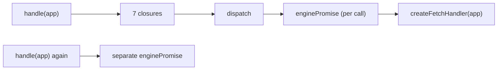
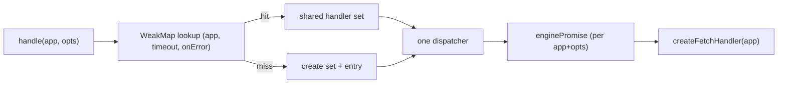

# RFC-049: `@nextrush/adapter-nextjs` — callable-and-destructurable route-handler set

| Field                | Value                                                                 |
| -------------------- | --------------------------------------------------------------------- |
| **Status**           | `Approved`                                                            |
| **RFC number**       | `049`                                                                 |
| **Date**             | `2026-10-28`                                                          |
| **Author(s)**        | Tanzim Hossain                                                        |
| **Group**            | `runtime-adapters`                                                    |
| **Packages touched** | `@nextrush/adapter-nextjs`, `nextrush` (`./nextjs` subpath)           |
| **Framework impact** | Additive, non-breaking                                                |
| **Supersedes**       | `—`                                                                   |
| **Superseded by**    | `—`                                                                   |
| **Related**          | `RFC-024`, `ADR-0014`, issue #60                                      |

---

## Progress Tracker

**Overall:** `[░░░░░░░░░░░░░░░░░░░░]` 0% — 0 / 4 phases complete · Doc status: `Approved`

| Phase | Part / deliverable                                   | Status        |
| ----- | ---------------------------------------------------- | ------------- |
| P0    | Callable handler set + shared-init cache             | ⬜ Not started |
| P1    | Public type + surface lock                           | ⬜ Not started |
| P2    | Next.js 14/15/16 `next build` matrix                 | ⬜ Not started |
| P3    | Docs, changeset, conformance parity                  | ⬜ Not started |

---

## 0. Revision History

- **v1 (`2026-10-28`)** — Initial draft. Verified against `packages/adapters/nextjs/src/index.ts`
  on `feat/response-args-and-middleware-fastpath`; issue #60 and its `draft-proposal.md`.

---

## 1. Summary (TL;DR)

`handle(app)` returns a plain object, so the natural Next.js idiom
`export const GET = handle(app)` exports an object where Next requires a function, failing the
generated route-type check (TypeScript) or at request time (JavaScript). This RFC makes the returned
value **callable** while keeping the seven named handlers as properties, and makes repeated
`handle()` calls for the same app and options **share one engine** — which also fixes a latent
defect where a route module using direct assignment would silently initialize seven engines. The
change is additive; destructuring continues to work unchanged.

---

## 1a. Terminology

`Handler set`
: The value returned by `handle()`: one callable Next.js route handler that also exposes `GET`,
  `POST`, `PUT`, `PATCH`, `DELETE`, `HEAD`, and `OPTIONS` as properties.

`Dispatcher`
: The adapter's method-agnostic function that resolves the engine and forwards the request; the
  NextRush engine, not the adapter, selects the route by `request.method`.

`Engine`
: The fetch handler produced by `@nextrush/adapter-edge`'s `createFetchHandler`, created once per
  resolved app and option set.

---

## 2. Decision Summary

- **Status:** `Approved`
- **Decision:**
  - Introduce a callable `NextRouteHandlerSet` return value (`NextRouteHandler & NextRouteHandlers`).
  - Point the callable and all seven named properties at one dispatcher.
  - Share one handler set per `(app source, effective options)` via a `WeakMap`.
  - Keep the existing `handle(app, options?)` entry point and destructuring unchanged.
- **Breaking:** `No`
- **Migration required:** `None`
- **Blast radius:** `low` — one adapter package plus its `nextrush/nextjs` type re-export.

---

## 2a. Decision Drivers

Priority (highest → lowest):

1. Developer experience — the form users naturally write must work.
2. Correctness — one engine per route module, not one per export.
3. Public API clarity — one entry point, one obvious pattern.
4. Backward compatibility — existing destructuring consumers must not change.
5. Maintainability — no global object cache, no unbounded state.

---

## 3. Problem & Motivation

### 3.1 Current state (what exists today)

`handle()` builds seven closures and returns them as an object
(`packages/adapters/nextjs/src/index.ts:171-176`):

```ts
const handlers = {} as NextRouteHandlers;
for (const method of METHODS) {
  handlers[method] = (request: Request, context?: NextRouteContext) =>
    dispatch(request, context);
}
return handlers;
```

The `method` variable is never read: every closure calls the same `dispatch`. Each `handle()` call
also creates its own `memoizeAppSource` and lazy `enginePromise` (`index.ts:91-112`).

### 3.2 The problems (enumerated)

1. **Direct assignment exports an object** — `export const GET = handle(app)` hands Next.js an
   object. TypeScript projects fail the generated route-type validator at `next build`; JavaScript
   projects fail at request time with
   `Function.prototype.apply was called on #<Object>, which is an object and not a function`.
   Hono's `handle(app)` returns a function, so migrants expect this form to work.
2. **Repeated `handle()` multiplies engines** — the form in (1) requires one `handle()` call per
   export, and each call builds a separate engine. A seven-method route module would initialize
   seven engines. This defect exists today but is masked because (1) fails loudly in TypeScript.
   Making (1) work without fixing this would convert a loud failure into silent waste.
3. **Seven identical closures** — the per-method loop allocates seven closures that differ in no
   observable way.

### 3.3 Why now

The issue is filed against the shipped adapter (`v1.1.0`) and the Hono-parity expectation is
concrete. Fixing (1) without (2) is a regression, so both must land together.

---

## 4. Goals & Non-Goals

### 4.1 Goals

- `typeof handle(app) === 'function'`; each named property is a function (solves 3.2.1).
- Seven direct exports initialize one engine (solves 3.2.2).
- Destructuring and direct assignment dispatch identically.
- One dispatcher reference for all eight slots (solves 3.2.3).

### 4.2 Non-Goals

- Changing NextRush routing, middleware, timeout, `after()`, or the dev 404 diagnostic — those are
  `RFC-024` contracts and stay byte-identical.
- A second public factory (`createHandler`) — adds surface without solving (1).
- A global object cache — rejected in §9.3.
- Guaranteeing HEAD body stripping — that is existing engine/Next behavior, only pinned by tests.

---

## 5. Impact

- **Affected packages:** `@nextrush/adapter-nextjs`, `nextrush` (`./nextjs` type re-export).
- **Affected audiences:** Application developers using the Next.js adapter.
- **Explicitly NOT affected:** other adapters; the functional (`nextrush`) entry; existing
  destructured route modules; the edge engine.

---

## 6. Proposed Solution (overview)

| # | Problem (from §3.2)              | Solution (this RFC)                                             |
| - | -------------------------------- | --------------------------------------------------------------- |
| 1 | Direct assignment exports object | Return a callable function with the seven handlers as properties |
| 2 | Repeated calls multiply engines  | `WeakMap<AppSource, entries[]>` shares one set per app + options |
| 3 | Seven identical closures         | One dispatcher reference; each property is the same function     |

The key idea: dispatch is already method-agnostic, so "the callable" and "the named handler" are
the same function. That makes the callable form truthful rather than a compatibility shim. Sharing
the set by `(app, options)` then makes the extra calls free.

---

## 6a. Trade-offs

### Benefits

- Both idiomatic Next.js export styles work with no runtime rewrite.
- One engine per route module regardless of export style.
- Fewer closures and one less object per `handle()` call.

### Costs

- A function-with-properties is less conventional than a plain object (jQuery-style shape).
- `handle(app) === handle(app)` becomes true, and a factory app is resolved once across calls.
- Options must be matched by value/identity; an inline `onError` per call does not share.

---

## 7. Architecture

### 7.1 Before



### 7.2 After



### 7.3 Why this architecture

The adapter must stay a thin bridge (`RFC-024`): it owns only dispatch plumbing and delegates to
the edge engine. Sharing state at the adapter boundary — not inside the engine — keeps the engine
contract untouched and keeps the cache scoped to one module instance per isolate. A `WeakMap`
keyed on the app source gives HMR- and serverless-safe semantics without a global registry.

---

## 7a. Architecture Invariants

- **Runtime independence preserved:** no `node:*`, `process`, `Buffer`, `Deno`/`Bun` global is
  introduced; the package stays Web-standard (`AGENTS.md` §4).
- **Adapter depends on core/edge, never the reverse** — preserved.
- **`handle()` remains the single public entry point** — preserved.
- **Deliberately changed:** the return type broadens from `NextRouteHandlers` to
  `NextRouteHandlerSet`. A function is still an object with those properties, so destructuring
  annotations keep compiling; the broadened type is additive.

---

## 8. Detailed Design

### 8.1 Public API / surface

```ts
export type NextRouteHandler = (request: Request, context: NextRouteContext) => Promise<Response>;

export interface NextRouteHandlers {
  GET: NextRouteHandler; POST: NextRouteHandler; PUT: NextRouteHandler;
  PATCH: NextRouteHandler; DELETE: NextRouteHandler; HEAD: NextRouteHandler;
  OPTIONS: NextRouteHandler;
}

export type NextRouteHandlerSet = NextRouteHandler & NextRouteHandlers;

export function handle(app: AppSource, options?: NextHandlerOptions): NextRouteHandlerSet;
```

### 8.2 Internal components

- `createHandlerSet(app, options)` — owns the app memoization, lazy engine, diagnostic, and the
  single dispatcher; returns the callable with seven properties.
- `sharedSets` — `WeakMap<AppSource, SharedEntry[]>`; `SharedEntry = { timeout, onError, handlerSet }`.
- `resolveSharedSet(app, options)` — scans the entry list for an option match, otherwise delegates
  to `createHandlerSet` and pushes.

`boot.ts` and `diagnose.ts` are unchanged.

### 8.3 Request / execution flow

```text
handle(app, options)
  → entries = sharedSets.get(app) ?? []
  → match entry on (timeout ===, onError ===)?
      hit  → return entry.handlerSet
      miss → createHandlerSet(app, options) → push → return
request → handlerSet(request, context)
  → dispatch → ensureEngine() → engine(request, execCtx)
```

### 8.4 Data structures

`SharedEntry[]` is a tiny array (usually length 1) scanned linearly; option sets per app are
few, so a linear scan beats a composite-key map that cannot hash function identity. `WeakMap`
keys are weakly held, and values that reference the key are handled by ephemeron semantics, so a
discarded app (e.g. after HMR) is collectable.

### 8.5 Error handling

Unchanged. The shared entry owns the existing `enginePromise` reset-on-rejection, so a failed boot
is retried on the next request and never cached as failure.

### 8.6 Edge cases

| Scenario                              | Behaviour                                        |
| ------------------------------------- | ------------------------------------------------ |
| Factory rejects, later succeeds       | Next request retries; no poisoned cache          |
| Same app, `{}` and default options    | Share one set                                    |
| Same app, different `timeout`/`onError` | Distinct sets                                  |
| HMR replaces the app module           | New app identity → new set; old entry collectable |
| Direct assignment and destructuring   | Identical status/headers/body                    |
| HEAD request                          | Existing engine semantics, pinned by test        |

### 8.7 Examples

```ts
// Either style works:
const handlers = handle(app);
export const { GET, POST, PUT, PATCH, DELETE, HEAD, OPTIONS } = handlers;

// Or, Hono-style — one shared engine:
const handlers = handle(app);
export const GET = handlers;
export const POST = handlers;
```

---

## 9. Alternatives Considered

### 9.1 A separate `createHandler(app)` factory
Adds a second public entry point for the same dispatcher and does not make `handle(app)` work.
Rejected: larger surface, no DX gain beyond documentation.

### 9.2 Keep the object and document `handle(app).GET`
Zero code change, but leaves `export const GET = handle(app)` failing, which is the reported
problem. Rejected.

### 9.3 A global cache keyed only by the application object
Would merge incompatible option sets and does not handle factories. Rejected in favor of
`(app, timeout, onError)` matching.

### 9.4 Do nothing
Direct assignment stays a build/runtime error and the seven-engine defect stays latent. Rejected.

---

## 10. Rejected Ideas

- **Per-method wrappers that record the method name** — rejected because dispatch ignores the
  method and the engine routes on `request.method`; wrappers add allocation and imply a distinction
  that does not exist.
- **Serializing options to build a cache key** — rejected because `onError` is a function.
- **A `Map` instead of `WeakMap`** — rejected; it would retain app objects.

---

## 11. Risks & Mitigations

| Risk                                        | Mitigation                                            | Likelihood | Impact |
| ------------------------------------------- | ----------------------------------------------------- | ---------- | ------ |
| Next validator rejects extra properties      | Prove with real `next build` on 14/15/16              | Low        | High   |
| Shared identity surprises a caller           | Document; additive and intended                       | Low        | Low    |
| Inline `onError` prevents sharing            | Document identity matching                            | Med        | Low    |
| Module-level state grows unbounded           | `WeakMap` + tiny per-app arrays; no strong retention   | Low        | Low    |

---

## 12. Backward Compatibility & Migration

- **Compatibility:** Additive & non-breaking. A function is an object with the seven properties, so
  destructuring and `NextRouteHandlers` annotations keep compiling. Existing consumers need no
  change.
- **Migration path (if breaking):** not applicable.
- **Deprecation window:** not applicable.

---

## 13. Cross-Cutting Concerns

- **Security:** No new input surface; no header/body changes; nothing logged.
- **Performance:** Removes six closures per `handle()` and prevents up to seven engines per module.
  No hot-path work added — the cache is consulted once per `handle()` call, not per request.
- **Runtime independence:** No runtime-specific API; package remains Web-standard.
- **Observability:** Unchanged; the dev diagnostic still logs the same message.
- **Zero-dependency rule:** No new dependency.

---

## 14. Success Metrics

| Metric                         | Baseline (today)                              | Target / threshold              |
| ------------------------------ | --------------------------------------------- | ------------------------------- |
| Engines per seven-method module | 7 with direct assignment (errors before reaching this) | 1                    |
| `typeof handle(app)`            | `"object"`                                    | `"function"`                    |
| Destructured request behavior   | parity                                        | byte-identical                  |
| `next build` (14/15/16)         | direct assignment fails type check            | all pass                        |
| Test coverage                   | —                                             | ≥ 90% lines/functions           |

---

## 15. Phased Implementation Plan

| Phase | Goal (what ships)                         | Depends on | Exit condition (checkable)                              | Status        |
| ----- | ----------------------------------------- | ---------- | ------------------------------------------------------- | ------------- |
| **P0** | Callable set + shared-init cache          | —          | Adapter unit tests green; parity test green             | ⬜ Not started |
| **P1** | Public type + surface lock                | P0         | `typecheck` clean; surface test green                   | ⬜ Not started |
| **P2** | Next.js 14/15/16 build matrix             | P1         | All three `next build` runs pass (direct + destructured) | ⬜ Not started |
| **P3** | Docs, changeset, conformance              | P2         | `docs:validate` passes; conformance `nextjs` parity green | ⬜ Not started |

### 15.1 Testing strategy

- **Unit:** callable shape, shared identity, option matching, retry, parity, HEAD.
- **Integration:** real `next build` on the three deploy-verification fixtures.
- **Cross-runtime:** conformance `nextjs` driver under node/workerd/deno/bun.
- **Coverage:** ≥ 90% lines/functions for the package.

---

## 16. Rollback Plan

- **Trigger:** a supported Next version rejects the callable export, or conformance parity breaks.
- **Steps:**
  - Revert the adapter return value to the plain object (destructuring path only).
  - Remove the shared cache; it is internal and has no public surface.
  - Keep the surface test and the `next build` fixtures as regression guards.

---

## 17. Future Work

- Wire the three `next build` fixtures into CI (currently manual).
- Consider a shared engine cache for other adapters if the same pattern appears.

---

## 18. Open Questions

- [ ] Whether to recommend direct assignment as the primary style in docs, or keep destructuring
  primary. Deferrable; both are supported and equally cheap after P0.

---

## 19. Decisions Log

| Question                                   | Decision                              | Rationale                                    |
| ------------------------------------------ | ------------------------------------- | -------------------------------------------- |
| Callable object vs second factory?         | Callable object                       | Keeps one entry point; makes the reported form work |
| Share engines across `handle()` calls?     | Yes, `WeakMap` by app + options       | Prevents silent 7× initialization            |
| Match options how?                         | `timeout` value, `onError` identity   | Functions cannot be serialized               |
| One dispatcher or per-method wrappers?     | One dispatcher                        | Dispatch is already method-agnostic          |

---

## 20. References

- `docs/RFC/runtime-adapters/024-adapter-nextjs.md`
- `docs/adr/ADR-0014-adapter-nextjs-prepend-only.md`
- Issue #60 — RFC: support callable and destructurable Next.js adapter handlers
- `packages/adapters/nextjs/src/index.ts`, `packages/adapters/nextjs/src/boot.ts`
- `openspec/specs/web-adapters/spec.md` — Next.js mount requirement
