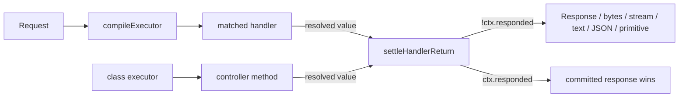

# RFC-050: Route handlers and class controllers settle their returned value into the response

| Field                | Value                                                                 |
| -------------------- | --------------------------------------------------------------------- |
| **Status**           | `Approved`                                                            |
| **RFC number**       | `050`                                                                 |
| **Date**             | `2026-10-29`                                                          |
| **Author(s)**        | Tanzim Hossain                                                        |
| **Group**            | `runtime-adapters`                                                    |
| **Packages touched** | `@nextrush/router`, `@nextrush/class`, `@nextrush/adapter-nextjs` (docs only) |
| **Framework impact** | Additive for documented `void` handlers; narrow behavioural change for accidental returns |
| **Supersedes**       | `—`                                                                   |
| **Superseded by**    | `—`                                                                   |
| **Related**          | `RFC-024`, `RFC-041`, `RFC-046`, `RFC-049`                            |

---

## Progress Tracker

**Overall:** `[░░░░░░░░░░░░░░░░░░░░]` 0% — 0 / 4 phases complete · Doc status: `Approved`

| Phase | Part / deliverable                              | Status        |
| ----- | ----------------------------------------------- | ------------- |
| P0    | Shared settlement helper (router)               | ⬜ Not started |
| P1    | Router executor wiring + class delegation       | ⬜ Not started |
| P2    | Conformance + Next.js real-server proof         | ⬜ Not started |
| P3    | Docs, README contract, changelog                | ⬜ Not started |

---

## 0. Revision History

- **v1 (`2026-10-29`)** — Initial draft. Behaviour verified against the built workspace packages
  through the Next.js adapter entry (`@nextrush/adapter-nextjs`), the router executor
  (`packages/router/src/segment-trie.ts`), and the class executor
  (`packages/class/src/runtime/handler.ts`).

---

## 1. Summary (TL;DR)

A handler that returns a value today produces a `200` with an empty body: route dispatch never
reads the resolved value, and the class executor reads it but JSON-serializes anything that is not
a plain object. This RFC makes both executors settle a returned value into the response with one
shared table — a `Response` is adopted, bytes/streams are forwarded, strings are text, arrays and
objects are JSON, primitives are stringified — while a response the handler already committed
still wins. Documented `void` handlers keep their exact behaviour and synchronous fast path.

---

## 1a. Terminology

`Settlement`
: Turning a handler's resolved return value into response state (status, headers, body) when the
  handler has not already committed a response.

`Committed response`
: A response a handler produced through a response method (`ctx.json`, `ctx.send`, `ctx.redirect`,
  streaming methods); `ctx.responded` is true and settlement is a no-op.

`Matched handler`
: The final route handler the router selected for the request — not application or route-level
  middleware.

---

## 2. Decision Summary

- **Status:** `Approved`
- **Decision:**
  - Introduce `settleHandlerReturn(ctx, value)` in `@nextrush/router` with a fixed settlement table.
  - Wire it into `compileExecutor` for the matched handler's resolved value.
  - Make the class-controller executor delegate to the same helper.
  - Keep middleware returns ignored, keep committed responses authoritative, keep the `void` fast path.
- **Breaking:** `No` for documented APIs (`RouteHandler` stays `void | Promise<void>`); behavioural
  change for handlers that returned a value and relied on the dropped return.
- **Migration required:** None — return `undefined` (or `ctx.send('')`) where an empty success was
  intended.
- **Blast radius:** `low` — two packages plus docs and proof harnesses; no adapter code change.

---

## 2a. Decision Drivers

Priority (highest → lowest):

1. Correctness — a resolved value must never be silently discarded or corrupted.
2. Developer experience — the form users naturally write (`return rows`) must mean what it says.
3. Consistency — functional handlers and class controllers must settle the same way.
4. Performance — the documented `void` path must not gain a microtask or a branch it cannot skip.
5. Package hierarchy — no new dependency edge for the router.

---

## 3. Problem & Motivation

### 3.1 Current state (what exists today)

Router dispatch settles nothing. `compileExecutor` returns the handler's promise and never looks
at the resolved value (`packages/router/src/segment-trie.ts`, both the `len === 0` fast path and
the `len >= 1` tail). The class executor reads the value but serializes everything object-like:

```ts
// packages/class/src/runtime/handler.ts (today)
if (result !== undefined && !ctx.responded) {
  if (typeof result === 'object') {
    ctx.json(result);
  } else {
    ctx.send(String(result));
  }
}
```

### 3.2 The problems (enumerated)

1. **Array and object returns are dropped by route dispatch** — through the built Next.js adapter
   entry, `router.get('/x', () => [{ id: 1 }])` answers `200`, empty body, no `Content-Type`.
   The same holds for `Promise<[...]>` and `return Response.json([...])`, and for every other
   adapter because the executor is shared.
2. **The class executor corrupts non-plain returns** — `return Response.json([{ id: 1 }])` answers
   `200 {}`; `return new Uint8Array([…])` answers a digit-keyed JSON object;
   `return new ReadableStream(…)` answers `{}`. All are success statuses, so nothing alerts the
   developer.
3. **Documentation teaches a response pattern that cannot work** — the wiki quick start writes
   `ctx.body = { id: 1, ...task }` as the response. `ctx.body` is the parsed request body; the
   client receives an empty `200`.

### 3.3 Why now

The "Next.js array response fail" reproduced during the Next.js 16 real-server work:
documented paths (`ctx.json([...])`, `ctx.send([...])`, class `return [...]`) pass end-to-end, so
the defect is in dispatch and was misattributed to the adapter. It affects every adapter and every
user who writes a Hono-style or service-style `return`.

---

## 4. Goals & Non-Goals

### 4.1 Goals

- A returned value settles the response on every adapter (solves 3.2.1).
- Non-plain objects keep their intended representation: `Response`, bytes, streams (solves 3.2.2).
- Functional and class execution share one settlement table (solves 3.2.1 + 3.2.2).
- Docs stop teaching `ctx.body =` as a response (solves 3.2.3).
- `void` handlers keep byte-identical responses and the synchronous fast path.

### 4.2 Non-Goals

- Hono-style middleware short-circuit — middleware returns stay ignored; adopting them would
  change onion semantics for `return next()`-style code.
- A type change to `RouteHandler` — settlement is a runtime courtesy on an already permissive
  return type.
- Repurposing `ctx.body` — it stays the request body (validation overwrites it by design).
- Auto-flattening arrays at registration (`compat()` keeps its explicit rejection).

---

## 5. Impact

- **Affected packages:** `@nextrush/router`, `@nextrush/class`; `@nextrush/adapter-nextjs` and
  other adapters inherit through the shared executor.
- **Affected audiences:** Application developers (functional and class APIs); adapter authors via
  the shared contract.
- **Explicitly NOT affected:** documented `void` handlers; middleware ordering; redirect handling;
  the `setNext(NOOP_NEXT)` termination; error handling; existing `ctx.json`/`ctx.send` responses.

---

## 6. Proposed Solution (overview)

| # | Problem (from §3.2)                        | Solution (this RFC)                                            |
| - | ------------------------------------------ | -------------------------------------------------------------- |
| 1 | Route dispatch drops returned values       | Settle the matched handler's resolved value in `compileExecutor` |
| 2 | Class executor corrupts non-plain returns  | Delegate to the same settlement helper                          |
| 3 | Docs teach `ctx.body =` as a response      | Correct the quick start; document the return contract          |

The key idea: settlement is already half-implemented in the class runtime and completely absent
in the router. Moving the table into one helper used by both executors removes the inconsistency
instead of adding a second, different one.

---

## 6a. Trade-offs

### Benefits

- `return rows`, `return Response.json(rows)` and `return new Response(...)` mean what they say on
  every adapter and in class controllers.
- One table, one test suite; the class corruption bug disappears as a side effect.
- No new dependency, no type change, no adapter code change.

### Costs

- A handler that returned a value by accident now sends that value instead of an empty `200`
  (documented migration: return `undefined`).
- The executor carries one extra `result !== undefined` branch per request (predictable, always
  false for `void` handlers).
- Returning a `Response` buffers its body through `arrayBuffer()`; streaming responses should use
  `ctx.send(stream)` / `ctx.stream()`.
- A promise-returning handler gains one derived promise and one microtask, because settling its
  resolved value requires observing it. The previous promise-identity guarantee
  (`Promise.resolve(p) === p`, NF-1) no longer holds for that path; the synchronous `void` path
  still returns the canonical `RESOLVED_PROMISE` and allocates nothing.

---

## 7. Architecture

### 7.1 Before

```mermaid
flowchart LR
  R[Request] --> E[compileExecutor]
  E --> H[matched handler]
  H -->|"returned value"| X[dropped]
  C[class executor] --> H2[controller method]
  H2 -->|"typeof === object"| J[ctx.json → {} for Response/bytes/stream]
```

### 7.2 After



### 7.3 Why this architecture

Settlement is dispatch behaviour, so it lives in the router — the layer that already invokes the
matched handler. The router depends only on `@nextrush/types`; placing the helper in
`@nextrush/runtime` would add a router→runtime edge and pull response machinery into router-only
installs, while `@nextrush/types` must stay contract-only. The class runtime already depends on the
router, so it can import the helper without a new edge.

---

## 7a. Architecture Invariants

- Router keeps its single dependency on `@nextrush/types` — preserved.
- Class depends on router, never the reverse — preserved.
- No runtime-specific API (`process`, `Buffer`, `Deno`/`Bun`) in the helper; it uses Web-standard
  `Response`/`Headers`/`ReadableStream` and the `Context` methods — preserved.
- Documented handler return contract (`void | Promise<void>`) — preserved.
- Deliberately changed: the class executor's observable output for `Response`/bytes/stream returns.

---

## 8. Detailed Design

### 8.1 Public API / surface

```ts
// @nextrush/router — exported for the class runtime; not part of the app-facing golden path.
export function settleHandlerReturn(ctx: Context, value: unknown): void;
```

`RouteHandler` and `Middleware` types are unchanged.

### 8.2 Internal components

- `packages/router/src/settlement.ts` — the table; one responsibility: map a value to `ctx` response
  state, no-op when `ctx.responded`.
- `compileExecutor` — calls the helper on the final handler's resolved value in both branches.
- `packages/class/src/runtime/handler.ts` — calls the helper behind its existing guard.

### 8.3 Request / execution flow

```text
request → router match → executor
  → guards → controller instance → args → handler
  → result = handler(...)
  → result === undefined ? unchanged
  → thenable ? Promise.resolve(result).then(settle)
            : settle synchronously; DISPATCH_SETTLED_SYNC marker
  → settle: ctx.responded ? stop : table lookup → ctx.json / ctx.send / Response adoption
```

### 8.4 Data structures

| Returned value                                                   | Settlement                                    |
| ---------------------------------------------------------------- | --------------------------------------------- |
| `undefined`                                                      | nothing                                       |
| `Response`                                                       | adopt status, headers (`getSetCookie()`), body |
| `string`                                                         | `ctx.send(value)`                             |
| `Uint8Array` / `ArrayBuffer` / `ReadableStream` / Node readable  | `ctx.send(value)`                             |
| `null`                                                           | `ctx.json(null)`                              |
| object or array (incl. class instances)                          | `ctx.json(value)`                             |
| other primitives                                                 | `ctx.send(String(value))`                     |

### 8.5 Error handling

Settlement errors follow the existing boundary: an unrepresentable JSON value (BigInt, cycle) keeps
its typed `TypeError` and becomes the framework's `500`; a failed `Response` body read rejects like
a handler throw; nothing is logged with request data.

### 8.6 Edge cases

| Scenario                                            | Behaviour                                              |
| --------------------------------------------------- | ------------------------------------------------------ |
| Handler commits then returns a value                | Committed response wins; return ignored                |
| Middleware returns a value                          | Ignored; only the matched handler settles              |
| Handler returns `next()`'s promise                   | Resolves `undefined`; nothing settles                  |
| Non-Promise thenable resolving to an array          | Adopted, then settled                                  |
| `Response` with two `Set-Cookie` headers            | Both cookies preserved                                 |
| `Response` with a `null` body                       | Status and headers only; bodyless response             |
| HEAD request with a returned array                  | Body derived as for `ctx.json`; HEAD strips the body   |
| 204 handler returning `undefined`                   | Unchanged: status only, no body                        |

### 8.7 Examples

```ts
// Before (empty 200 today)
router.get('/rooms', () => listRooms());

// After — JSON array, application/json
router.get('/rooms', () => listRooms());

// Explicitly supported, unchanged
router.get('/rooms', (ctx) => ctx.json(listRooms()));
```

```ts
@Controller('/users')
class UserController {
  @Get()
  findAll() {
    return Response.json([{ id: 1, name: 'Alice' }]); // now the array, not {}
  }
}
```

---

## 9. Alternatives Considered

### 9.1 Dev-only warning when a handler returns a value

Cheaper, but the response still ships empty and the failure stays silent in production. Rejected:
it does not fix the reported failure.

### 9.2 Support only `Response` returns (Hono-style)

Keeps the mental model smallest but leaves `return rows` broken — the exact form the class runtime
already accepts. Rejected: it would preserve the inconsistency between the two APIs.

### 9.3 Duplicate the table in `@nextrush/class`

Avoids exporting a helper, but two copies drift — that drift is today's bug. Rejected.

### 9.4 Do nothing

Every `return`-style handler stays a silent empty `200`, and the class corruption stays. Rejected.

---

## 10. Rejected Ideas

- **Settling application middleware returns too (Hono short-circuit)** — reinterprets existing
  `return next()`/`return ctx.set(...)` code and changes onion semantics. Rejected.
- **Making `ctx.body = value` send a response** — collides with request-body validation, which
  overwrites `ctx.body` by design. Docs corrected instead.
- **Buffering streamed `Response` bodies** — accepted only for returned `Response` objects;
  streaming stays on `ctx.send`/`ctx.stream`.
- **Changing `RouteHandler`'s type** — settlement is runtime courtesy; no type break.

---

## 11. Risks & Mitigations

| Risk                                                      | Mitigation                                                        | Likelihood | Impact |
| --------------------------------------------------------- | ----------------------------------------------------------------- | ---------- | ------ |
| Accidental returns now send a body                        | Document the behavioural change; return `undefined` restores it   | Med        | Low    |
| Double settlement when returning a response method's value | `!ctx.responded` guard plus a dedicated test                      | Low        | Low    |
| Multiple `Set-Cookie` headers lost on adoption            | `getSetCookie()` first, `forEach` fallback, test with two cookies | Low        | Med    |
| Class behaviour drift for previously corrupted kinds      | Characterization tests for plain values; RED tests for the corrupt kinds | Low  | Med    |
| Router hot path regresses                                  | `undefined` branch stays first; `bench:validate` gate             | Low        | Med    |

---

## 12. Backward Compatibility & Migration

- **Compatibility:** No type or API break. Behavioural change only for handlers that returned a
  value without committing a response (previously an empty `200`).
- **Migration path:**

  ```ts
  // Before — relied on the dropped return for an empty 200
  app.get('/health', () => doWork());

  // After — be explicit
  app.get('/health', () => { doWork(); });
  // or app.get('/health', (ctx) => ctx.send(''));
  ```

- **Deprecation window:** Not applicable — no API is deprecated.

---

## 13. Cross-Cutting Concerns

- **Security:** No new input surface. Returned `Response` headers are copied verbatim (the response
  author already controls them); JSON failures keep the existing sanitized error envelope.
- **Performance:** One `result !== undefined` comparison on the matched-handler path; synchronous
  `void` handlers keep the canonical `RESOLVED_PROMISE` with no microtask or allocation.
  Promise-returning handlers pay one derived promise and one microtask to observe the resolved
  value (NF-1's promise-identity probe is superseded — see §6a). `bench:validate` asserts
  identical bodies/content types.
- **Runtime independence:** Uses only Web-standard `Response`, `Headers`, `ReadableStream`, and
  `Context` methods; Node readable detection is duck-typed exactly as `prepareBody` already does.
- **Observability:** Unchanged; no new logging.
- **Zero-dependency rule:** No new dependency.

---

## 14. Success Metrics

| Metric                                        | Baseline (today)              | Target / threshold                       |
| --------------------------------------------- | ----------------------------- | ---------------------------------------- |
| `return [...]` body through Next.js adapter   | empty, no `Content-Type`      | JSON array + `application/json`          |
| Class `return Response.json([...])`           | `{}`                          | the array                                |
| `void` handler response bytes                 | byte-identical                | byte-identical (no regression)           |
| Adapters with identical settlement behaviour  | 0                             | all (node/bun/deno/edge/nextjs)          |
| Test coverage (`router`, `class`)             | —                             | ≥ 90% lines/functions                    |

---

## 15. Phased Implementation Plan

| Phase  | Goal (what ships)                                          | Depends on | Exit condition (checkable)                              | Status        |
| ------ | ---------------------------------------------------------- | ---------- | ------------------------------------------------------- | ------------- |
| **P0** | `settleHandlerReturn` + RED/GREEN router tests             | —          | Router unit tests green; table rows covered             | ⬜ Not started |
| **P1** | Executor wiring + class delegation + class tests           | P0         | Class RED tests green; characterization green           | ⬜ Not started |
| **P2** | Cross-adapter conformance + Next.js real-server proof      | P1         | Conformance green on drivers; `next start` assertions pass | ⬜ Not started |
| **P3** | Router/Next.js/weekly docs, changelog                      | P2         | Docs match tests; gates green                           | ⬜ Not started |

### 15.1 Testing strategy

- **Unit:** every table row, committed-wins, middleware exclusion, thenable adoption, sync marker,
  settlement errors.
- **Characterization:** plain class returns (`array`, `object`, `string`, `null`, `undefined`) and
  the commit-then-return case.
- **Integration:** the Next.js 16 fixture over `next build` + `next start`, asserting returned-array
  and returned-`Response` routes over HTTP.
- **Cross-adapter:** conformance drivers (node/bun/deno/edge/nextjs) assert identical results.
- **Coverage:** ≥ 90% lines/functions for `@nextrush/router` and `@nextrush/class`.

---

## 16. Rollback Plan

- **Trigger:** a confirmed application regression caused by an accidental return, or a conformance
  divergence.
- **Steps:**
  - Remove the settlement call from `compileExecutor` (router) and restore the class executor's
    previous branch.
  - Keep the RED/characterization tests as documentation of the intended contract.
  - No state, cache, or migration to clean up.

---

## 17. Future Work

- Consider a dev-time diagnostic for handlers that assign `ctx.body` inside a handler and never
  commit a response (the docs pattern this RFC stops teaching).
- Evaluate settling middleware returns behind an explicit opt-in, if users ask for Hono-style
  short-circuiting.

---

## 18. Open Questions

None.

---

## 19. Decisions Log

| Question                                        | Decision                                   | Rationale                                  |
| ----------------------------------------------- | ------------------------------------------ | ------------------------------------------ |
| Settle or warn?                                 | Settle                                     | Warning leaves the silent empty response   |
| Which values?                                   | Full table incl. `Response` and streams    | Matches class behavior and user expectation |
| Where does the helper live?                     | `@nextrush/router`                         | Dispatch owns it; no new dependency edge   |
| Middleware returns?                             | Ignored                                    | Preserves onion/`next()` semantics         |
| Class executor?                                 | Delegate to the same helper                | Removes the corruption and the drift       |
| `RouteHandler` return type?                     | Keep `void \| Promise<void>`; document a cast | Settlement is a runtime courtesy; the typed path stays `ctx.json`/`ctx.send` (2026-10-29 review) |

---

## 20. References

- `openspec/changes/handler-return-settlement/proposal.md`, `design.md`
- `packages/router/src/segment-trie.ts` — `compileExecutor`
- `packages/class/src/runtime/handler.ts` — controller executor
- `packages/runtime/src/response-body.ts` — `prepareBody` value support
- `packages/runtime/src/serialize-json.ts` — JSON failure semantics
- `docs/RFC/runtime-adapters/041-recorded-response-model.md`
- `docs/RFC/runtime-adapters/046-json-media-type-and-response-construction.md`
