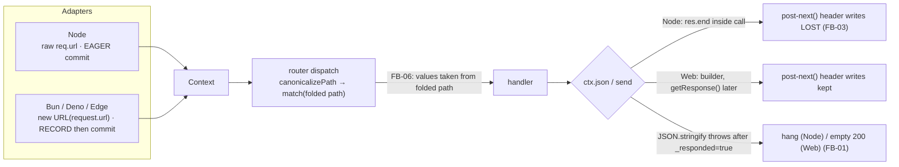
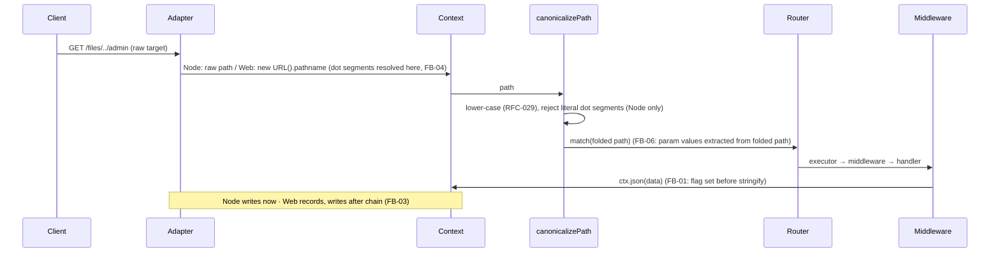

# Architecture — Audit Validation Follow-up (measured corrections, bug register, fix plan)

| Field           | Value                                                              |
| --------------- | ------------------------------------------------------------------ |
| **Report type** | `Architecture` + `Performance` + `Security (parity)`               |
| **Scope**       | Validation of `architecture-modernization-audit.md`, RFC-039, RFC-040 against the code, Hono 4.13 / Fastify 5.11 on Bun 1.4.3 and Node 26.12 |
| **Date**        | `2026-10-18`                                                       |
| **Reviewer(s)** | AI agent (validation session)                                      |
| **Commit / ref**| `6bbb3d0d` + uncommitted working tree on `feat/rfc-039-precompile-tax` |
| **Status**      | `Draft`                                                            |
| **Related**     | `report/architecture/architecture-modernization-audit.md`, `docs/RFC/runtime-adapters/039-…`, `040-resource-budgets-and-request-path-footprint.md`, `fix-briefs/` |

---

## Progress Tracker

**Remediation:** `[░░░░░░░░░░░░░░░░░░░░]` 0% — 0 / 8 briefs resolved (RFC-039/040 rewritten; toolkit built)

| Brief | Addresses | Priority | Status |
| --- | --- | --- | --- |
| FB-06 | Params lower-cased | P0 | ⬜ Open |
| FB-01 | `ctx.json` hang / empty 200 | P0 | ⬜ Open |
| FB-02 | `createHandler` boot trap | P0 | ⬜ Open |
| FB-05 | Error body contract | P1 | ⬜ Open |
| FB-04 | Dot-segment parity | P1 | ⬜ Open |
| FB-03 | Response commit model / compression | P1 | ⬜ Open (Stage 0 first) |
| FB-07 | Bun request footprint | P1 | ⬜ Open |
| GP-01…09 | Architectural gaps | P1–P3 | ⬜ Open |

---

## 1. Executive Summary

The audit's **method was good and its facts were accurate** (line counts, the unconditional timeout race, zero `new Function`, the external Elysia/Hono/Node data). Its **conclusions were mostly not supported** once measured: NextRush's cold start, memory and bundle are already at or better than Hono's. The real problems are elsewhere — a **per-request cost on Bun about 2× Hono** and **six behavioural defects** the audit declared absent ("request path is correct").

**Top findings**
1. **`ctx.params` are lower-cased on every request** with the default router options (`/users/ABC123` → `abc123`). Silent data corruption. — P0 (FB-06)
2. **`ctx.json()` with `BigInt`/circular/`undefined` hangs the request on Node and returns an empty 200 on Bun/Deno/Edge.** — P0 (FB-01)
3. **`Bun.serve({ fetch: createHandler(app) })` — the documented pattern — serves empty 200s for every URL**; the router is never mounted. — P0 (FB-02)
4. **Two response models behind one `Context`** (Node commits eagerly, Web records) make the same middleware behave differently, and `@nextrush/compression` is a no-op everywhere. — P1 (FB-03)
5. **The RFC-029 dot-segment guarantee only holds on Node**; every Web adapter normalises the path first. — P1 (FB-04)
6. **Error bodies are not a stable contract**: wrong `code` on 4xx, engine-specific text, no 415. — P1 (FB-05)
7. **Bun per-request cost** ≈ 5.2 µs vs Hono 2.4 µs; wire throughput 0.56×. Largest items: header-record copy, eager `requestIP`, timeout race. — P1 (FB-07)

**Headline recommendation:** fix FB-06, FB-01, FB-02 first (three small, independent PRs), keep `dev-check` as the gate, and **defer AOT** (RFC-040 v2).

---

## 2. System Understanding

NextRush is a runtime-independent framework: a `Context` abstraction, a segment-trie router, an `Application` that composes middleware, and per-runtime adapters (Node subclass of a 746-line `NodeContext`; Bun/Deno/Edge share a 349-line `WebContextBase`). The design choice that explains most findings: **correctness and parity are claimed by a conformance suite that runs in-process**, while performance work (HP-/F- tickets) optimised individual paths. Each optimisation was locally reasonable; two of them regressed behaviour (FB-06 came from the F-10 `preNormalized` shortcut) without a test that exercises the real dispatch path.

(Full architecture description: audit §2–§4.)

---

## 3. Architecture Overview

---

## 4. Data Flow — where the divergences enter

---

## 5. Backend / Logic

The seven items above. Details, root causes with `file:line`, fixes and acceptance criteria are in `fix-briefs/`.

---

## 6. Database / State

_Not applicable — stateless framework._ (Per-process state is limited to the router's walk pool and the single-entry canonical-path memo; neither was found defective.)

---

## 7. Frontend / API Surface

- **No typed routes or client** (`ctx.body: unknown`, `params` string map; no typed-client code in the repo) versus Hono `hc` and Elysia Eden. GP-02.
- **Error wire format** is bespoke; Elysia 2 moved to RFC 9457. GP-03.
- **Node-only packages:** `static`, `websocket`; `compression` has no Web path. GP-05.

---

## 8. UX

- **DX trap (FB-02):** the documented `createHandler` example silently produces empty 200s. Principle: *error prevention / fail loudly* — a configuration the framework can detect should throw, not serve nothing.
- **Surprise (FB-03 docs):** `serverTiming()` JSDoc promises a header the default options never send.
- **Feedback loop:** the audit's own finding (hours-long benchmark) is solved by `dev-check` (≈ 30–40 s, source-bundled).

---

## 9. Performance

Measured with `dev-check` (Bun 1.4.3, Node 26.12.0, Hono 4.13.0, Fastify 5.11.2; shared 8-core dev machine; directional, noise up to ±20 % on wire numbers).

| Metric | NextRush | Hono | Other |
| --- | --- | --- | --- |
| Hello bundle, root entry (no adapter used) | 27.7 KB | 19.1 KB | Fastify 584 KB |
| Hello bundle, Bun adapter | 47.5 KB | 19.1 KB | |
| Hello bundle, Node serve | 52.1 KB | 38.8 KB | |
| Cold start 25 routes (Bun) | 7.7 ms | 7.5 ms | |
| Cold start 1,000 routes (Bun) | 11.9 ms | 25.3 ms | |
| Cold start 1,000 routes (Node 26) | 64.4 ms | 113.6 ms | (run once, earlier harness) |
| RSS 1,000 routes (Bun) | 29.4 MB | 43.9 MB | |
| Registration cost | ≈ 2.5 µs / route | | 100k routes ≈ 250 ms |
| In-process µs/request, 4 headers (Bun) | 5.17 | 2.41 | raw 1.76 |
| Wire rps, hello (Bun, wrk 64 conns) | 42.4k | 75.7k | raw 96.2k |

Profile attribution (Bun, NextRush in-process): `Headers.forEach` ≈ 18 % · timeout race ≈ 10 % · `new URL` ≈ 5 % · `JSON.stringify` ≈ 3.5 %. Router matching is not a top row (consistent with RFC-015's ≈ 4 %).

**Not measured:** Elysia (not installed; no network), Deno, Edge, POST/middleware-stack profiles, RSS after load, unbundled import time, 12-header requests. See GP-08.

---

## 10. Security

- **Parity gap (FB-04):** RFC-029's dot-segment rejection protects only Node; encoded dots (`%2e%2e`) are accepted everywhere. On Bun/Workers the platform normalises before the app runs, so a proxy ACL on `/admin` can be bypassed with `/files/../admin`. Medium; documented-limit plus fixes in the brief.
- **Info leak (FB-05):** JS engine parse text is echoed in 400 bodies and differs by runtime.
- **Confirmed fine:** thrown error messages are masked (probe `throw-masked`), JSON depth limit works (`65 exceeds 64`), `constructor` key dropped from query, `X-Forwarded-For` ignored when proxy trust is off, malformed percent-encoding does not crash routing.
- No exploit beyond the above was attempted; GP-09 lists items still to probe.

---

## 11. Maintainability

- Policy drift and file-size violations: GP-06 (measured LOC vs the stated package limits; six files over 300 lines).
- Test architecture is the root cause of the escaped bugs (GP-04).
- Duplicate runners (Bun/Deno/Edge) already let a fix land once and miss three times — FB-07 consolidates.

---

## 12. Findings (register)

Every defect and error found, with status. The nine-field detail for each lives in its brief.

| Id | Finding | Severity | Evidence | Brief |
| --- | --- | --- | --- | --- |
| F-V01 | `ctx.params` lower-cased (dispatch `preNormalized` path) | Critical | probe `param-case-preserved`; `dispatch.ts:60-75`, `match-route.ts:89-91,125` | FB-06 |
| F-V02 | `ctx.json` sets `_responded` before `JSON.stringify` → hang (Node) / empty 200 (Web); error handler's `ctx.json` no-ops | High | probes `json-*`; `node/context.ts:323-328`, `response-builder.ts:192-201` | FB-01 |
| F-V03 | Bun/Deno `createHandler` never `ready()`s → router unmounted → empty 200 for all URLs | High | probe `createhandler-without-ready`; `application.ts:619`, `bun/adapter.ts:196-246`; docs README:135, `bun.mdx:185` | FB-02 |
| F-V04 | Node eager commit vs Web record: `timer`/`serverTiming` headers lost on Node | Med–High | probes `timer-header`, `server-timing-header` (Node only) | FB-03 |
| F-V05 | `compression` is a no-op on Node and Bun (reads request `ctx.body`, nonexistent `res.body`) | Med–High | probe `compression-gzip`; `compression/middleware.ts:168-184` | FB-03 |
| F-V06 | Dot-segment rejection Node-only; Web adapters use `new URL().pathname`; encoded dots accepted | Medium | probes `dot-segment-*`; `web-context-base.ts:171-173`, `canonicalize.ts:48-65` | FB-04 |
| F-V07 | 4xx errors report `code: "INTERNAL_ERROR"` | Medium | probe `error-code-4xx`; `core/error-handler.ts:51` | FB-05a |
| F-V08 | Engine-specific JSON parse text in the body; differs Bun vs Node | Medium | probe `error-no-engine-text`; `body-parser/errors.ts:117-118` | FB-05b |
| F-V09 | Unknown content type → 200 with `ctx.body === undefined` (no 415) | Low–Med | probe `unsupported-content-type`; `combined.ts:176-190` | FB-05c |
| F-V10 | Bun per-request footprint ≈ 2× Hono (header copy, eager `requestIP`, timeout race, `new URL`) | Perf | `check.mjs inproc wire profile` | FB-07 |
| F-V11 | `timer`/`serverTiming` default `exposeHeader:false` but JSDoc says it sets the header | Low (docs) | `timer/src/middleware.ts` | FB-03 Stage 0 |
| F-V12 | `static` Node-only (`ctx.raw.res.end()`), `websocket` Node-only | Med (parity) | READMEs; `static/src/index.ts:239` | GP-05 |
| F-V13 | No typed routes / client | Gap | repo search | GP-02 |
| F-V14 | Package LOC policy 3–5× violated; version in instructions stale | Low | LOC counts | GP-06 |
| F-V15 | Escaped-bug root cause: mock-based middleware tests, `match()`-level router tests, in-process conformance | Process | compression/router tests | GP-04 |

Info only (no action): JSON body keeps an own `__proto__` key (standard `JSON.parse`; harmless unless merged unsafely); `ctx.path` is published lower-cased by design (RFC-029; `ctx.originalPath` is raw); 405/`OPTIONS` answers require `router.allowedMethods()` (opt-in), unknown methods otherwise 404.

---

## 13. Risks

| Risk | Likelihood | Impact | Mitigation |
| --- | --- | --- | --- |
| Users already depend on lower-cased params (workarounds) | Medium | Medium | CHANGELOG + docs; behaviour was never documented as lower-casing |
| Perf work re-breaks parity | High (it already happened) | High | `dev-check probe` in CI (RFC-040 P1), GP-04 |
| RFC-041 (response model) regresses Node throughput | Medium | High | `inproc` ≤ 3 % gate, `bench:alloc:*` |
| `knownFailures` becomes permanent | Medium | Medium | Each id maps to a brief; release-checklist review |

---

## 14. Recommendations (prioritised)

| # | Recommendation | Addresses | Priority | Effort |
| - | - | - | - | - |
| 1 | Fix param case (FB-06) | F-V01 | P0 | S |
| 2 | Fix JSON commit order + never-unanswered safety net (FB-01) | F-V02 | P0 | S |
| 3 | Self-booting `createHandler` + loud `callback()` guard (FB-02) | F-V03 | P0 | S |
| 4 | Error body contract (FB-05) | F-V07–09 | P1 | S–M |
| 5 | Raw-target path + encoded dot rejection + capability (FB-04) | F-V06 | P1 | M |
| 6 | Stage 0 of FB-03 now; write RFC-041 | F-V04/05/11 | P1 | S then L |
| 7 | Execute FB-07 behind `dev-check` | F-V10 | P1 | M |
| 8 | Wire `dev-check` into CI; start GP-04 | F-V15 | P1 | S |
| 9 | GP-02 typed routes RFC; GP-03; GP-05; GP-06 | F-V12–14 | P2 | L |
| 10 | Defer AOT; keep RFC-040 re-open criteria | — | — | — |

---

## 15. Migration Strategy

1. **Week 1 (parallel, 3 agents):** FB-06, FB-01, FB-02. Each PR removes its id from `knownFailures`.
2. **Week 2:** FB-05, FB-04, FB-03 Stage 0, CI wiring of `dev-check` (RFC-040 P1).
3. **Weeks 3–4:** FB-07 (four PRs, each measured), RFC-041 drafting.
4. **Then:** RFC-041 implementation; GP-02 RFC; GP-03/05 as capacity allows.

**Deliberately out of scope:** Rust, replacing the router, AOT until a RFC-040 §17 criterion trips.

---

## 16. Conclusion

NextRush's footprint is already competitive; its *correctness harness* is the weak point. The most valuable thing built in this session is not a design but a 30-second check that finds problems like these. Fix the three small P0 bugs, make the check a CI gate, and let measurements — not comparisons to a beta competitor's release notes — decide what is built next.

### Corrections to statements made earlier in this review session

So the record is straight:
1. An early probe read suggested param case was preserved — **wrong**; the value is lower-cased (FB-06).
2. An early test suggested `timer` was broken on Bun — **wrong**: it used the default `exposeHeader:false`. With `exposeHeader:true` it works on Bun and is missing on Node (FB-03).
3. Dot-segment handling was first attributed to Bun only — **incomplete**: all Web adapters, including Deno, resolve via `new URL().pathname`.

---

## Checklist

- [x] Filename scope-first, in `report/architecture/`.
- [x] System explained (§2) before judgement.
- [x] Findings cite file:line or a reproducible probe id.
- [x] Measurements reproducible with `node apps/benchmark/scripts/dev-check/check.mjs`; limits stated (§9).
- [x] Every recommendation maps to a finding and a brief.
- [x] Progress Tracker matches §14.
- [x] Sections that don't apply say so (§6).
- [x] Decisions spun off as RFCs (039 corrected, 040 rewritten, 041–044 reserved), not duplicated here.
