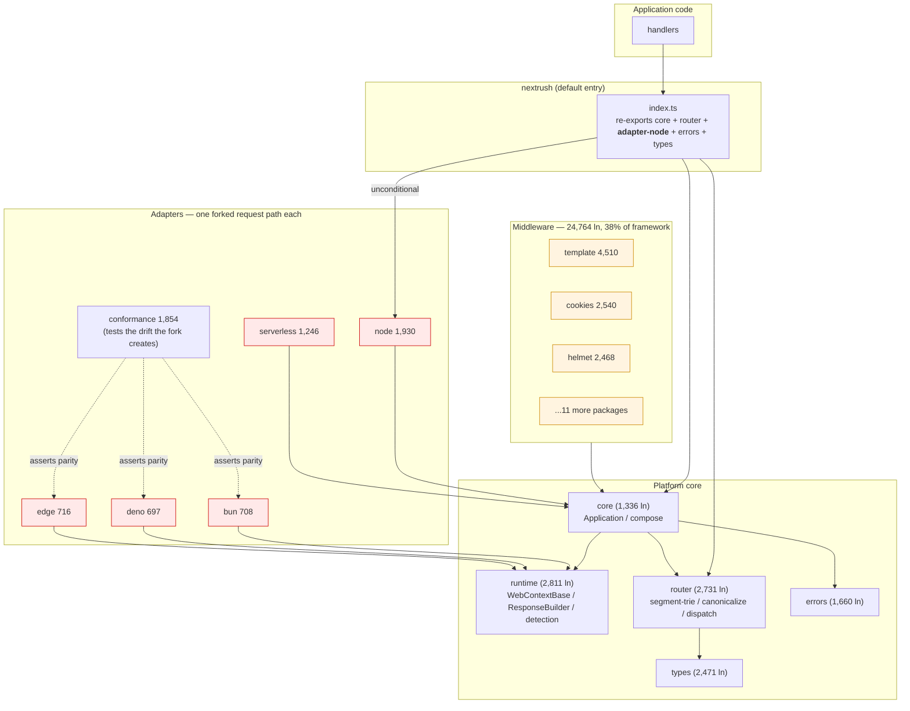
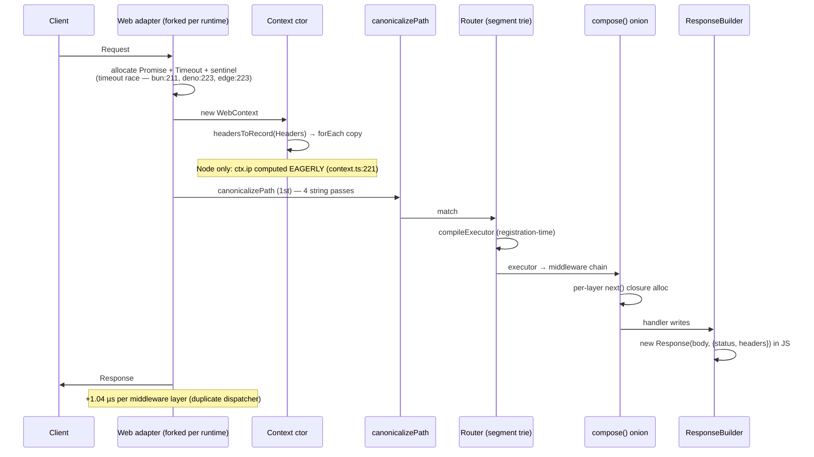

# Architecture — Modernization Audit (Build-Time Compilation, Resource Footprint, Adapter Unification)

| Field           | Value                                                              |
| --------------- | ------------------------------------------------------------------ |
| **Report type** | `Architecture`                                                     |
| **Scope**       | Whole framework — `packages/*` (17 pkgs + 7 adapters + 4 extension/interop), `apps/benchmark` |
| **Date**        | `2026-10-18`                                                       |
| **Reviewer(s)** | AI agent (R&D audit session)                                        |
| **Commit / ref**| `d8fa871f` (branch `feat/rfc-039-precompile-tax`)                   |
| **Status**      | `Draft`                                                            |
| **Related**     | `docs/RFC/runtime-adapters/039-precompile-per-request-tax.md`, `docs/RFC/runtime-adapters/015-router-radix.md`, `docs/adr/ADR-0021-fast-property-request-containers.md`, `report/architecture/architecture-performance-remediation-backlog.md` |

> **Validation notice (2026-10-18).** This audit was validated against the code and measured with `apps/benchmark/scripts/dev-check`. Facts and line counts hold; several conclusions do **not**: F-01/F-02/F-03 (startup, memory, bundle) are not gaps — NextRush cold-starts at or below Hono's time, registration costs ≈ 2.5 µs/route, and the root entry tree-shakes the Node adapter (27.7 KB). §5/§10 ("no correctness bugs") is wrong — six defects were reproduced. See [`architecture-audit-validation-followup.md`](architecture-audit-validation-followup.md) and [`fix-briefs/`](fix-briefs/README.md). RFC-040 was rewritten accordingly.

---

## Progress Tracker

**Remediation:** `[░░░░░░░░░░░░░░░░░░░░]` 0% — 0 / 11 recommendations resolved

| Rec | Addresses | Priority | Status  |
| --- | --------- | -------- | ------- |
| 1   | F-01      | P0       | ⬜ Open  |
| 2   | F-02      | P0       | ⬜ Open  |
| 3   | F-04      | P0       | ⬜ Open  |
| 4   | F-03      | P1       | ⬜ Open  |
| 5   | F-10      | P1       | ⬜ Open  |
| 6   | F-05      | P1       | ⬜ Open  |
| 7   | F-08      | P1       | ⬜ Open  |
| 8   | F-06      | P1       | ⬜ Open  |
| 9   | F-07      | P2       | ⬜ Open  |
| 10  | F-09      | P2       | ⬜ Open  |
| 11  | F-11      | P2       | ⬜ Open  |

---

## 1. Executive Summary

NextRush is a well-built framework with a **2020-shaped architecture running into a 2026 market**. Its engineering discipline is genuinely above average — capability negotiation instead of runtime-identity branching, a cross-adapter conformance suite, measured allocation benchmarks, ADR/RFC governance. None of that is the problem.

The problem is what it chooses to optimize. The framework is currently investing in **per-request constant factors** (RFC-039: lazy context, compiled validators, compiled serializers) while leaving the **three larger constants — startup time, peak memory, and bundle size — completely unmeasured and unengineered**. A repository-wide search for `startupTime`, `bundleSize`, or `heapUsed` across `packages/`, `apps/benchmark/`, and `tools/` returns **zero matches**. There is no CI gate on any of them.

Meanwhile the throughput leader in this ecosystem published, in July 2026, that its ground-up rewrite is **explicitly not about throughput**:

> *"It's not likely that you will see a significantly faster throughput with Elysia 2."* — Elysia 2 "DayDream", 30 Jul 2026

Elysia moved route compilation to **build time** and now competes on startup (0.851 ms → 0.046 ms), peak memory (45.7 MB vs Fastify 192.4 MB), and bundle size (736 KB → 344 KB, minified 141 KB). NextRush has no build-time compilation stage at all — a graph search for `codegen|aot|buildPlugin|compileRoute` returns nothing.

**Top findings:**
1. **No build-time AOT stage exists** — everything is registration-time or request-time. This is the single largest structural gap. — **P0**
2. **Startup, memory, and bundle are unmeasured and unguarded** — no metric, no CI gate, in a framework that targets serverless and edge. — **P0**
3. **Four forked request runners across adapters, with drift already shipped** — Node received a synchronous-response fast path that Bun, Deno, and Edge still lack. — **P0**
4. **The default entry unconditionally pulls the 1,930-line Node adapter** into every app's import graph, including Bun-only and edge-only apps. — **P1**
5. **The middleware layer is 24,764 lines — 38% of the framework** — including a 4,510-line template engine and a 2,468-line Helmet, in-tree, on the default surface. — **P1**

**Headline recommendation:** stop optimizing per-request factors, add the measurement layer that makes resource footprint visible, then add the build-time compilation stage. Detail in §14.

---

## 2. System Understanding

NextRush is a modular TypeScript HTTP stack that runs on Node, Bun, Deno, Cloudflare Workers/Vercel Edge, and serverless platforms. Its stated mission (`AGENTS.md`) is to eliminate accidental complexity from backend development, with developer experience as a product feature.

**How it is put together today.** The framework is a pnpm monorepo of many small, independently-versioned packages:

- **Platform core:** `types`, `errors`, `runtime`, `router`, `core`, `di`, `stream`, `extensions`, `interop`, `testing`
- **Adapters (7):** `node` (1,930 lines), `conformance` (1,854), `serverless` (1,246), `edge` (716), `bun` (708), `deno` (697), `nextjs` (324)
- **Middleware (17 packages):** ~24,764 lines — `template` (4,510), `cookies` (2,540), `helmet` (2,468), `rate-limit` (2,229), `body-parser` (2,178), `compression` (2,098), and eleven more
- **Runtime-independent core:** ~63,561 lines of source in total

**How a request flows.** An adapter constructs a runtime-specific `Context` (Node subclasses a 746-line `NodeContext`; the Web adapters subclass the 349-line shared `WebContextBase`), canonicalizes the path once, matches it against a pre-compiled segment trie, runs the matched entry's `executor`, which runs the onion-composed middleware chain, which finally invokes the handler. The handler writes into a `ResponseBuilder` which materializes one `new Response(...)`.

**Why the current design likely made sense — and largely still does.** Three deliberate decisions explain almost everything I found:

1. **Runtime independence over per-runtime optimization** (`AGENTS.md` §7). Core imports no runtime API; behavior is chosen by negotiated capability, never runtime identity. This is a real, defensible differentiator — NextRush genuinely does run identically on five platforms, and the 1,854-line conformance suite proves it rather than asserting it.
2. **Composition over a monolith** (§9). Small packages with one purpose each, so a team can adopt `router` without `template`.
3. **A very high documentation and governance bar** (§13, §21). The indexed graph is 26,343 nodes of which roughly half are documentation structure. That is unusual discipline.

The audit below does **not** argue against runtime independence or modularity. It argues that the *shape* chosen to deliver them — a forked request path per runtime, and no build step — now costs more than it returns, and that the measurement layer needed to prove it either way does not exist.

---

## 3. Architecture Overview

**Reading the diagram.** Red = one forked request path per runtime, plus a conformance suite whose job is to detect what the fork creates. Amber = 38% of the framework is optional feature surface. Note the `IDX -->|unconditional| N` edge: the default entry pulls the Node adapter regardless of target runtime.

---

## 4. Data Flow

Where the framework spends its per-request budget today, on the Web adapters (Bun/Deno/Edge) — verified in source, not inferred:

Two full canonicalizations per request occur on prefix-mounted apps — `dispatch.ts:60` and the mount prefix test at `router.ts:252`/`265` — against a **single-entry** memo (`canonicalize.ts:86-89`) that misses under 256 concurrent distinct paths.

---

## 5. Backend / Logic

The request path is correct and its security posture is strong. Verified: header field/value grammar enforced on every write (`response-builder.ts:145`), dot-segment path rejection at 400 rather than local resolution (`canonicalize.ts`), prototype-pollution-safe containers, JSON depth bounds, explicit proxy-trust chain. No `new Function` or `eval` exists anywhere in the repo — which, as §9 explains, is now a **competitive advantage** rather than an oversight.

The logic-level problems are structural, not correctness bugs, and are detailed as F-01 through F-11 in §12.

---

## 6. Database / State

_Not applicable — NextRush is a stateless HTTP framework. The only state concerns are per-request context objects and the single-entry path memo, both covered in §5 and §9._

---

## 7. Frontend / API Surface

The public API surface is **larger than the framework's own governance rule intends**. `AGENTS.md` §5 states "Smaller public APIs create more stable frameworks," yet:

- The default entry (`packages/nextrush/src/index.ts:128`) re-exports `createHandler`, `listen`, `serve` from `@nextrush/adapter-node` unconditionally.
- The exports map is coarse — three subpaths only (`.`, `./class`, `./nextjs`). There is no `nextrush/bun`, `nextrush/edge`, or `nextrush/websocket` subpath, so an app cannot express "I run on Bun" at the import boundary.
- `errors` is a separate package (1,660 lines) re-exported wholesale — 24 named error classes plus factory functions plus middleware — into the default entry.

Elysia 2's comparable surface is `elysia`, `elysia/websocket`, `elysia/plugin/aot/{bun,vite,esbuild,rspack}`, `elysia/adapter` — each independently tree-shakeable, with the compiler and TypeBox removable entirely if unused. See F-03.

---

## 8. UX

Developer-experience findings, grounded in named principles:

**F-8.1 — The measurement feedback loop violates the Doherty Threshold by three orders of magnitude.** The only comparative throughput instrument is `--profile full`, which the maintainer reports takes 10–20 hours. Doherty's Threshold (~400 ms) describes the interaction latency above which a tool stops feeling like a tool. A 10–20 hour feedback loop is not a feedback loop; it is a quarterly event. *Visible trigger:* RFC-039 §P0 schedules "profiles" as a phase rather than as a 30-second inner loop. Mitigation already exists in the repo (`pnpm bench:alloc:*` — 24 deterministic allocation benches, cv ≤0.2%, seconds) and is not being treated as the primary instrument.

**F-8.2 — Hick's Law violation in the entry surface.** A new user deciding how to start must choose among `nextrush`, `@nextrush/core`, `@nextrush/router`, `@nextrush/runtime`, and seven adapter packages before writing a line. Elysia 2 reduced this to "import Elysia, pick an adapter". Hick's Law: decision time grows logarithmically with the number of choices *when the choices are not obviously differentiated*. The golden-path section of the docs mitigates this; the package layout does not.

**F-8.3 — The `ip` inconsistency is a discoverability trap.** `bodySource`, `state`, and `raw` are all lazy on Node; `ip` alone is eager (`context.ts:221`). A user reading the context class learns one rule and then meets an exception with no comment explaining it. This is a documentation-of-behavior defect as much as a performance one.

No dark patterns found.

---

## 9. Performance

All numbers below are either this repo's own pinned measurements or the cited vendors' published numbers. **No new profile was run in this session** — see F-10 for why that is itself the finding.

### 9.1 The repo's own measured position (pinned, `2026-07-31T05-36-51`)

| Metric | Value |
| --- | --- |
| Floor excess vs Fastify @256 conns | **5.59 µs** |
| Attributed and since removed | 2.65 µs (timeout race ~1.6 + drain wrapper ~1.1) |
| Still unattributed | **~2.9 µs** |
| NextRush `json-serialize` marginal | **2.19 µs** vs Fastify **4.97 µs** |
| Scenarios where NextRush beats Fastify on marginal cost | **7 of 9** |
| Cost to send *nothing* vs serialize+send JSON | 30.48 µs vs 30.99 µs (**0.51 µs** difference) |

That last row is the decisive one: NextRush costs almost the same to send an empty response as a JSON response, while Fastify's empty response is **5.44 µs cheaper** than its hello-world. The deficit is a **fixed floor**, not work.

### 9.2 The floor grows with concurrency, and nobody can explain why

Floor excess rises **2.53 µs → 5.59 µs** from 1 → 256 connections. The timer hypothesis was explicitly **refuted** (its per-request cost *falls* as the list grows: 466 ns → 162 ns). There is no accepted explanation for the growth.

### 9.3 The industry baseline moved (published, 2026)

| Server | Bun v1.3.14 | Bun v1.4.0 | Δ |
| --- | --- | --- | --- |
| `Bun.serve` (raw) | 169.6k | 177.7k | +4.8% |
| `node:http` (on Bun) | 103.8k | **108.5k** | +4.5% |
| Elysia (on Bun) | 158.9k | 163.3k | +2.8% |
| Fastify (on Bun) | 91.5k | 95.9k | +4.8% |
| Express (on Bun) | 64.5k | 66.6k | +3.2% |

| Server | Node |
| --- | --- |
| Fastify 5.10 | **101,360** |
| Elysia 2 | 93,845 |
| Hono 4.12 | 86,129 |
| Koa 3.2 | 43,294 |

Two conclusions that reframe RFC-039:

1. **The runtime is a bigger multiplier than the framework.** Bun roughly doubles every framework; framework spread is ~7% on Node and ~25% on Bun.
2. **Fastify on Node beats Elysia on Node.** A well-optimized Web-standard framework on Node caps near 100k. Elysia needed `srvx` + `FastResponse` to reach 93.8k.

**Consequence for NextRush:** its Bun deficit is very likely *larger* than its 5.59 µs Node deficit, because Bun amplifies framework differences — and it has never been measured, because the harness contains no Bun and no Elysia.

### 9.4 The `new Function` landmine

RFC-039's P2/P3 propose compiled validators and serializers derived from boot-time metadata — i.e. runtime `new Function` codegen. Simultaneously:

- Elysia's AOT documentation states Cloudflare Workers **forbid `new Function`**, which is why it moved compilation to build time.
- Bun 1.4.3 ships **`--disallow-code-generation-from-strings`**.
- NextRush currently contains **zero** `new Function` / `eval` — a genuine advantage it would voluntarily give up.

RFC-039 would introduce, at boot, the one capability that edge runtimes ban and modern Bun can now flag off — while the ecosystem leader spent a full rewrite removing it from the runtime.

---

## 10. Security

Security posture is a **strength**; no vulnerabilities found in this audit. Relevant to the recommendations:

- No `new Function` / `eval` anywhere — keeps the framework compatible with CSP `unsafe-eval`-free deployments, Cloudflare Workers, and Bun's `--disallow-code-generation-from-strings`.
- Header write grammar, dot-segment rejection, prototype-pollution-safe containers, JSON depth bounds, and an explicit proxy-trust chain are all verified present.
- The security risk of the recommendations in §14 is **neutral-to-positive**: build-time AOT removes rather than adds dynamic-code capability, and unifying the forked adapters reduces the surface on which a security fix can be applied to three of four platforms and missed on the rest (which is precisely the class of failure F-04 already produced).

---

## 11. Maintainability

| Signal | Value | Concern |
| --- | --- | --- |
| Total source | 63,561 lines | — |
| Middleware share | 24,764 lines (**38%**) | Optional features dominate the framework |
| Adapter forks | node 1,930 / serverless 1,246 / edge 716 / bun 708 / deno 697 | ~2,100 lines of near-duplicated Web request path |
| Conformance suite | 1,854 lines | Exists to catch fork drift |
| Files over the project's own 300-line cap | `application.ts` 874, `template/compiler.ts` 845, `template/helpers.ts` 809, `node/context.ts` 746, `node/adapter.ts` 677, `template/parser.ts` 651 | Six violations of `code-structure.md` |
| Duplicate dispatchers | `compose` + `compileExecutor` | Two hand-synchronized implementations of the same pipeline |

**Double-cost observation:** the adapter fork is paid for twice — once in ~2,100 lines of forked request path, and again in a 1,854-line conformance suite whose entire purpose is detecting the drift the fork creates. A single shared Web-standard request runner plus a thin per-runtime binding deletes *both* costs and removes the failure class by construction.

---

## 12. Findings (detailed)

### F-01 — No build-time AOT stage exists  ·  Priority `P0`

- **Current situation:** A graph search across the whole index for `codegen|aot|buildPlugin|compileRoute` returns **0 results**. Route compilation happens at registration (`segment-trie.ts` `compileExecutor`) or per request. No bundler plugin exists for Bun.build, Vite, esbuild, or unplugin.
- **Impact:** The framework structurally cannot reach Elysia-2-class startup, memory, or bundle numbers — those gains come almost entirely from moving compilation to build time. Also blocks any compiled validator/serializer design that is edge-safe (see §9.4).
- **Benefits (of today's design):** Zero build-step requirement is a genuine DX win — `nextrush` runs from `tsx`/`bun run` with no plugin configuration. Everything is debuggable at runtime because nothing is generated.
- **Drawbacks:** Startup cost is paid on every cold start, which is the dominant cost on serverless and edge. Schema-derived work (validation/serialization) either stays generic or must be done with runtime `new Function` (banned on Workers).
- **Long-term risk:** The gap compounds. Every schema feature added increases the cold-start penalty, and the eventual migration becomes a breaking change to the *authoring model*, not just an internal refactor.
- **Recommendation:** Add an **optional** build-time AOT stage, shaped like Elysia 2's: a bundler plugin that dry-runs the app and emits per-route compiled handlers, compiled request/response schema codecs, and a route manifest — with the existing registration-time path retained as the fallback for unbundled runs. Never runtime `new Function`.
- **Trade-offs:** Gains Elysia-2-class startup/memory and edge compatibility. Costs a build step *when opted in*, plus the risk Elysia documented (long-running resources during dry-run must be skippable — their escape hatch is `Manifest.isCapturing()`). Opt-in preserves the current zero-config story.
- **Priority:** P0 — largest single structural gap.
- **Migration difficulty:** Hard — new build-time subsystem, but additive and opt-in, so it ships without breaking anything.

### F-02 — Startup, memory, and bundle are unmeasured and unguarded  ·  Priority `P0`

- **Current situation:** `grep -rn "startupTime|bundleSize|peakMemory|heapUsed"` across `packages/`, `apps/benchmark/`, and `tools/` returns **zero matches**. `.github/workflows/` contains `ci.yml`, `deploy-website.yml`, `docs-pages.yml`, `release.yml` — none reference performance, memory, or size.
- **Impact:** The framework targets serverless and edge, where startup and memory are the *billed* metrics, and cannot state either number. Any regression in them is invisible until a user reports it. RFC-039's success criteria are conformance-green and "benchmarks report mean ± stddev" — no resource target at all.
- **Benefits (of today's design):** Zero measurement infrastructure to maintain; all effort goes into correctness and throughput.
- **Drawbacks:** You cannot improve what you do not measure. Elysia 2 ships startup, memory, and bundle-size **hard guards per commit and per pull request**, plus a rise from 2,800 to 10,000+ expect calls.
- **Long-term risk:** Resource regressions accumulate silently and are discovered as production incidents on billed platforms.
- **Recommendation:** Add three CI gates with committed budgets: **cold-start ms** (time from process start to first request served, at 25 and 1,000 routes), **peak RSS before/after a fixed loadtest**, and **minified bundle size of a hello-world app**. Fail the build on regression beyond a stated tolerance.
- **Trade-offs:** ~30 lines of CI plus a baseline file. Requires an investment in stability of the measurement (same machine class, median of N runs) or it will flake — but the repo already solved this pattern for allocation benchmarks (cv ≤0.2%), so the technique exists in-house.
- **Priority:** P0 — cheap, and it unlocks every other finding.
- **Migration difficulty:** Trivial.

### F-03 — The default entry unconditionally pulls the Node adapter  ·  Priority `P1`

- **Current situation:** `packages/nextrush/src/index.ts:128` — `export { createHandler, listen, serve } from '@nextrush/adapter-node';`. The exports map offers only `.`, `./class`, `./nextjs`. There is no `nextrush/bun`, `nextrush/edge`, or `nextrush/websocket`.
- **Impact:** A Bun-only, Deno, or Cloudflare Workers app importing `createApp` from `nextrush` drags the **1,930-line Node adapter** into its import graph. Bundle size and startup pay for an adapter the app can never execute.
- **Benefits (of today's design):** One import does everything on Node — the most common case. Predictable DX; no adapter selection required to get started.
- **Drawbacks:** Every non-Node target pays for the Node adapter. This is the mechanism by which NextRush's bundle/startup numbers diverge from Elysia's, which ships `elysia/websocket` and `elysia/adapter` as separate subpaths.
- **Long-term risk:** Bundle grows monotonically as adapters and extensions are added, for all users, regardless of target.
- **Recommendation:** Move every adapter binding behind an explicit subpath (`nextrush/node`, `nextrush/bun`, `nextrush/edge`) and make the root entry runtime-neutral. Keep a default only if a measured single-import convenience is worth the bytes.
- **Trade-offs:** A one-line import change for existing users (acceptable — the framework is pre-1.0 and the maintainer explicitly permits rewriting bad architecture). Gains proportional bundle and startup for every non-Node target.
- **Priority:** P1.
- **Migration difficulty:** Trivial technically; requires a docs/examples sweep.

### F-04 — Four forked request runners; drift already shipped  ·  Priority `P0`

- **Current situation:** Each adapter owns its own request path. Verified by the identical unconditional timeout race at three sites:

  | Adapter | Per-request `Promise.race` + `setTimeout(30 s)` + sentinel |
  | --- | --- |
  | `node/src/adapter.ts:295` | ✅ synchronous-response fast path shipped |
  | `bun/src/adapter.ts:211-229` | ❌ unconditional |
  | `deno/src/adapter.ts:223` | ❌ unconditional |
  | `edge/src/adapter.ts:223` | ❌ unconditional |

  Distinct runner implementations exist: `createBunRequestRunner` (`bun:196`), `createRequestRunner` (`edge:163`), plus inline logic in `deno` and `node`. The web adapters are 697–716 lines each.
- **Impact:** Every Bun, Deno, and Edge request allocates a `Promise`, a `Timeout` object, and a sentinel comparison before any framework work runs — for a 30-second default timeout almost no request reaches. More seriously, this is **proof that a fix can land on one platform and be missed on three**, in a framework whose central promise is identical cross-runtime behavior.
- **Benefits (of today's design):** Each adapter is independently readable and can be shaped to its host's idioms without an abstraction negotiating between them.
- **Drawbacks:** ~2,100 lines of forked Web request path. The conformance suite (1,854 lines) exists specifically to detect the drift the fork creates — the cost is paid twice. Correction cost is 4×.
- **Long-term risk:** Drift compounds; the conformance suite grows with the fork count; cross-runtime parity becomes an assertion maintained by tests rather than a property guaranteed by construction.
- **Recommendation:** Extract **one** shared Web-standard request runner (context construction, timeout policy, finalize/error path, response materialization) into `runtime`, and reduce each adapter to a thin host binding: `Bun.serve({ fetch })`, a Deno listener, a Workers export. Then propagate the Node synchronous fast path to the shared runner once.
- **Trade-offs:** Gains one implementation, one fix site, and a materially smaller conformance suite. Costs an abstraction layer the runtimes must satisfy — but capability negotiation already exists in `runtime/detection.ts`, so the seam is present. Elysia 2's Adapter v2 (a plain function/object, not stringified code) is the reference shape.
- **Priority:** P0 — it is both a live performance defect on the target runtime and a proven correctness-drift mechanism.
- **Migration difficulty:** Moderate — mechanical, covered by the existing conformance suite, which becomes the regression gate for the refactor.

### F-05 — Two hand-synchronized dispatchers  ·  Priority `P1`

- **Current situation:** `compose()` (`core/src/middleware.ts`) and the trie's `compileExecutor` both build a middleware invocation pipeline. `compose` carries a `len === 1` fast path that `compileExecutor` lacks. Measured cost: **+1.04 µs per middleware layer**.
- **Impact:** Permanent 2× maintenance tax on the hottest code in the framework, plus a per-layer cost paid on 100% of requests. Divergence between the two is a silent correctness risk.
- **Benefits (of today's design):** A closure-free executor is meaningfully faster than a generic compose, so the duplication bought real performance when it was introduced.
- **Drawbacks:** Two implementations of one concept; known behavioral asymmetry; every middleware-semantics change must be made twice and tested twice.
- **Long-term risk:** Silent divergence in an area — middleware ordering and `next()` semantics — where divergence is very hard to observe.
- **Recommendation:** Unify on one compiled pipeline, taking the closure-free executor as the base and porting `compose`'s single-layer fast path into it. This is RFC-gated (it is a core contract), and it is worth more than RFC-039's compiled validator/serializer: it applies to 100% of requests and is a maintenance defect, whereas compiled validation helps only Tier-2 routes.
- **Trade-offs:** Small up-front performance risk during unification, covered by the existing pipeline suite. Gains one implementation and removes a per-layer cost.
- **Priority:** P1.
- **Migration difficulty:** Moderate.

### F-06 — Middleware scope: 38% of the framework is optional surface  ·  Priority `P1`

- **Current situation:** `packages/middleware/` is **24,764 lines** across 17 packages — `template` 4,510 (a complete template engine: `compiler.ts` 845, `helpers.ts` 809, `parser.ts` 651, `engine.ts` 434), `cookies` 2,540, `helmet` 2,468, `rate-limit` 2,229, `body-parser` 2,178, `compression` 2,098, plus eleven more.
- **Impact:** 38% of the framework is feature surface that a hello-world app must not pay for. Elysia 2's entire minified bundle is **141 KB** and it ships no template engine and no Helmet. Every one of these packages is a long-term maintenance commitment (`AGENTS.md` §9: "Avoid packages becoming collections of unrelated features").
- **Benefits (of today's design):** Batteries-included DX — `template`, `helmet`, and `cookies` are genuinely useful to the target audience, and keeping them in-repo lets the framework guarantee quality and compatibility rather than delegating to third parties.
- **Drawbacks:** Dilutes the "smaller public APIs create more stable frameworks" rule; expands the maintenance and documentation surface; risks the default entry pulling them in (compounding F-03).
- **Long-term risk:** The framework's own velocity drops as feature-package maintenance competes with core work — the exact failure Elysia's author described as "technical debt piling up."
- **Recommendation:** Do not delete features — **isolate** them. Keep `template`, `helmet`, `cookies`, `rate-limit`, and `compression` as separately installable, tree-shakeable packages that are provably absent from the default entry, and add a **bundle-size gate that fails if any of them appears in a hello-world build**. Consider extracting `template` (4,510 lines, the largest single subsystem outside adapters) into an independently governed package.
- **Trade-offs:** Costs a small DX step for users who currently get everything at once. Gains a lean default bundle and a defensible boundary between "framework" and "ecosystem."
- **Priority:** P1.
- **Migration difficulty:** Trivial if the packages are already separate (they are) — the work is the exports map, the default entry, and the gate.

### F-07 — Six files exceed the project's own 300-line hard cap  ·  Priority `P2`

- **Current situation:** `core/src/application.ts` 874, `middleware/template/src/compiler.ts` 845, `middleware/template/src/helpers.ts` 809, `adapters/node/src/context.ts` 746, `adapters/node/src/adapter.ts` 677, `middleware/template/src/parser.ts` 651. `code-structure.md` sets a 300-line hard cap and ~80 lines for a route handler.
- **Impact:** Cognitive load, merge conflicts, and reduced testability in exactly the files that change most.
- **Benefits (of today's design):** Cohesion — `application.ts` holds the whole app lifecycle in one readable place, which is genuinely navigable for a newcomer.
- **Drawbacks:** Violates the repo's own hard gate; `code-structure.md` states a violation "is corrected immediately, same weight as any other engineering-standard violation."
- **Long-term risk:** Growth without a split point; each file becomes progressively harder to change safely.
- **Recommendation:** Split to the repo's own caps, test-first (characterize existing behavior before moving code, per `tdd-workflow.md`).
- **Trade-offs:** Mechanical churn; needs characterization tests before any move.
- **Priority:** P2 — real, but the framework's own rule and not a market gap.
- **Migration difficulty:** Trivial per file.

### F-08 — Web adapters pay eager per-request costs Node already eliminated  ·  Priority `P1`

- **Current situation:** Verified in source:
  - Timeout race on Bun/Deno/Edge (F-04).
  - `headersToRecord()` (`runtime/src/headers.ts:36`) performs a `Headers.forEach` copy into a fresh null-prototype bag on **every** request — on the Bun path this is unconditional.
  - On Node, `ctx.ip` is the only context field computed eagerly (`context.ts:221`: `this.ip = this.getClientIp(req, options.proxy ?? false)`) while `bodySource`, `state`, and `raw` are all memoized lazily. With `proxy: true` this walks the forwarded-header chain on every request even when no handler reads `ctx.ip`.
- **Impact:** These are the per-request constant factors the framework *can* move today, and the ones the user's target runtime pays on 100% of traffic.
- **Benefits (of today's design):** Eager `ip` means one predictable code path with no getter indirection; `headersToRecord` guarantees a stable, security-checked bag rather than a live view of a mutable `Headers`.
- **Drawbacks:** Work performed for data most requests never read; inconsistency between fields teaches the wrong mental model (F-8.3).
- **Long-term risk:** Low individually, but they are the visible symptom of the deeper issue (no resource measurement), so they will keep reappearing.
- **Recommendation:** (a) Propagate the Node synchronous fast path into the shared runner per F-04. (b) Make `ctx.ip` lazy, consistent with the other three lazy fields. (c) Make the header bag lazy on the Web adapters, materialized on first access. Ship each behind the existing parity suite.
- **Trade-offs:** Lazy access adds one branch on first read. All three are behavior-preserving and independently revertible.
- **Priority:** P1 — highest value-per-line available today.
- **Migration difficulty:** Trivial.

### F-09 — `canonicalizePath` runs twice per request against a single-entry memo  ·  Priority `P2`

- **Current situation:** Called at `router/src/dispatch.ts:60` and again for the mount prefix test at `router/src/router.ts:252` and `:265`. The memo (`canonicalize.ts:86-89`) holds exactly one entry, so under 256 concurrent requests on distinct paths it misses every time.
- **Impact:** Two full canonicalizations — each four string passes — per request on prefix-mounted apps. A candidate contributor to the unexplained floor growth in §9.2.
- **Benefits (of today's design):** A single canonical definition of "the same path" (RFC-029 / SEC-02, SEC-09, SEC-15) — the correct security decision, and the memo helps the pathological repeated-path case.
- **Drawbacks:** The memo is defeated by realistic concurrency; the second call exists only because the first result is not threaded forward.
- **Long-term risk:** Low, but it is uncompensated work on the hot path.
- **Recommendation:** Thread the canonical result from dispatch into the mount test rather than recomputing. Keep the memo for the repeated-path case.
- **Trade-offs:** Slightly more plumbing through the mount boundary. No behavioral change.
- **Priority:** P2.
- **Migration difficulty:** Trivial.

### F-10 — The harness cannot see the target runtime, and the only comparative instrument is unusable  ·  Priority `P1`

- **Current situation:** `apps/benchmark/servers/` contains `nextrush-v3`, `nextrush-v3-class`, `fastify`, `hono`, `koa`, `express`, `raw-node` — **no Bun and no Elysia**, and `README.md`/`config/*.js` contain no reference to either. The comparative instrument is `--profile full` (6 frameworks × 6 scenarios × 3 levels × 5 runs), reported at 10–20 hours. Meanwhile 24 deterministic allocation benches (`pnpm bench:alloc:*`, cv ≤0.2%, seconds) exist and are not the primary loop.
- **Impact:** "We want Bun-native speed, and Elysia is faster there" cannot be evaluated at all. The one number that matters most — the Bun deficit — does not exist, and the instrument that could produce it is too slow to use while developing.
- **Benefits (of today's design):** `full`/`standard` profiles produce publishable-grade numbers with stddev and CV on a pinned host; the allocation benches give noise-free structural signals.
- **Drawbacks:** The dev-time loop is unusable, so in practice nothing is measured during development; and the harness lacks the comparison that motivates the work.
- **Long-term risk:** Optimal — the team optimizes the measured thing (Node throughput) rather than the important thing (Bun/edge resource footprint).
- **Recommendation:** (a) Adopt `bench:alloc:*` as the per-change loop and `run.js --scenario X --frameworks A,B --connections 256 --time 5 --runs 3 --pin 2-7 --client-pin 0-1` as the ~2-minute directional loop; reserve `full` for releases. (b) Add a Bun arm with **Elysia, raw `Bun.serve`, and NextRush's own Node adapter running on Bun** — the last of these is newly interesting because Bun 1.4 accelerated `node:http` by 4.5%. (c) Use `bun --cpu-prof-md` / `--heap-prof-md` for hotspot identification.
- **Trade-offs:** Directional numbers from a dev box are not publishable — they must be labelled as such in the report output.
- **Priority:** P1 — it makes every other recommendation falsifiable.
- **Migration difficulty:** Moderate (new server drivers + a Bun runner).

### F-11 — Missing modern primitives: `defer`, RFC 9457 errors, fine-grained subpaths  ·  Priority `P2`

- **Current situation:** No post-response hook exists (graph search for `defer|afterResponse` returns 0 results); error responses use a bespoke shape rather than RFC 9457 `application/problem+json`; exports maps are coarse (F-03).
- **Impact:** Users implement post-response cleanup manually; error payloads are non-standard so clients and gateways cannot treat them generically; no subpath granularity.
- **Benefits (of today's design):** A smaller runtime surface; error shape is simple and stable.
- **Drawbacks:** Divergence from what the ecosystem is standardizing on — Elysia 2 adopted RFC 9457 and added `defer` explicitly.
- **Long-term risk:** Low correctness risk; a migration cost later if the framework waits until after 1.0.
- **Recommendation:** Add a `defer`-style post-response queue; adopt RFC 9457 for error bodies; introduce fine-grained subpaths. All three are cheaper before 1.0 than after.
- **Trade-offs:** RFC 9457 changes the error wire format — a breaking change, which the maintainer has explicitly sanctioned for pre-1.0 architecture.
- **Priority:** P2.
- **Migration difficulty:** Trivial to Moderate.

---

## 13. Risks

| Risk | Likelihood | Impact | Mitigation |
| --- | --- | --- | --- |
| Adapter drift produces a second cross-runtime behavioral divergence | High | High | F-04 — unify the request runner; conformance suite becomes the refactor's gate |
| Resource regressions ship silently on billed serverless/edge platforms | High | Medium | F-02 — startup/memory/bundle CI gates with committed budgets |
| Framework invests further in per-request micro-optimization while the market moved to build-time compilation | High | High | F-01 — add the build-time AOT stage; re-scope RFC-039 |
| RFC-039's runtime `new Function` design ships and breaks Workers / `--disallow-code-generation-from-strings` | Medium | High | F-01 / §9.4 — build-time codegen only; keep the repo's zero-`new Function` property |
| Bundle grows monotonically as adapters and middleware accumulate in the default entry | Medium | Medium | F-03 + F-06 — subpaths and a bundle-size gate |
| Effort spent maintaining 24,764 lines of optional middleware at the expense of core | Medium | Medium | F-06 — isolate, gate, and govern `template` separately |

---

## 14. Recommendations (prioritised)

| # | Recommendation | Addresses | Priority | Effort | Status |
| - | - | - | - | - | - |
| 1 | Ship startup / peak-memory / bundle-size budgets as CI hard gates | F-02 | P0 | S | ⬜ Open |
| 2 | Add an optional build-time AOT stage (bundler plugin emitting compiled routes + schema codecs); never runtime `new Function` | F-01 | P0 | L | ⬜ Open |
| 3 | Extract one shared Web-standard request runner; reduce Bun/Deno/Edge to thin bindings; propagate the Node sync fast path once | F-04 | P0 | M | ⬜ Open |
| 4 | Move adapter bindings behind explicit subpaths; make the root entry runtime-neutral | F-03 | P1 | S | ⬜ Open |
| 5 | Add a Bun arm to the harness (Elysia, raw `Bun.serve`, NextRush-Node-on-Bun); adopt `bench:alloc:*` + narrow `run.js` as the dev loop | F-10 | P1 | M | ⬜ Open |
| 6 | Unify `compose` and `compileExecutor` into one compiled pipeline (RFC-gated) | F-05 | P1 | M | ⬜ Open |
| 7 | Propagate the timeout fast path to the shared runner; make `ctx.ip` lazy; make the Web header bag lazy | F-08 | P1 | S | ⬜ Open |
| 8 | Prove every middleware package is absent from a hello-world build; extract `template` to independent governance | F-06 | P1 | S | ⬜ Open |
| 9 | Split the six files over the project's own 300-line cap (test-first) | F-07 | P2 | S | ⬜ Open |
| 10 | Thread the canonical path from dispatch into the mount test; drop the second canonicalization | F-09 | P2 | S | ⬜ Open |
| 11 | Add a `defer` post-response queue, RFC 9457 error bodies, fine-grained subpaths | F-11 | P2 | M | ⬜ Open |

---

## 15. Migration Strategy

Ordered so that each step makes the next one measurable. The framework is pre-1.0 and the maintainer has sanctioned rewriting bad architecture, so no step is gated on backward compatibility.

**Step 0 — make the invisible visible (Rec 1, ~1 day).** Ship the three CI budgets plus a Bun harness arm (Rec 5). Nothing else in this report can be validated until resource footprint and the Bun baseline are numbers. Cheap, reversible, and it converts every later claim from assertion to measurement.

**Step 1 — stop paying the known per-request costs (Rec 3, 7, 10, ~1 week).** Unify the Web request runner, propagate the synchronous fast path, make `ctx.ip` and the header bag lazy, and remove the duplicate canonicalization. Each change is behavior-preserving and covered by the existing 1,854-line conformance suite — which becomes the refactor's regression gate rather than a permanent standing cost.

**Step 2 — fix the import boundary (Rec 4, 8, ~1 week).** Subpath the adapters, neutralize the root entry, and add the bundle gate that fails when optional middleware leaks into a hello-world build. This is where the bundle number from Step 0 starts moving.

**Step 3 — unify the dispatcher (Rec 6, RFC-gated, ~2 weeks).** Take this before the AOT work: it applies to 100% of requests and removes the duplicate implementation that the AOT stage would otherwise have to target twice.

**Step 4 — add the build-time AOT stage (Rec 2, the large item).** Design it as additive and opt-in: a bundler plugin with a manifest and a dry-run that can be short-circuited, plus the existing registration-time path as the unbundled fallback. This is the only step that changes the framework's shape, and it should land after Steps 0–3 have given it a measurable target and a leaner core to compile against.

**Step 5 — modernize the remaining surface (Rec 11, 9).** `defer`, RFC 9457, subpaths, and the file splits. Cheapest before 1.0.

**Deliberately out of scope — and why:**
- **Rust rewrite of any part.** The measured floor is JavaScript allocation, not compute. Bun's own Rust rewrite bought 2–5%; the same effort in NextRush would buy less and cost the framework's runtime-independent, adapter-based identity.
- **Cloning Sucrose-style source inference.** RFC-039 already correctly rejects this (Elysia issue #466 — context leak under `aot: true`). Build-time AOT via an explicit plugin and a manifest is the safe shape of the same idea.
- **Replacing the router.** Both the repo's pinned measurement and RFC-015's T017 agree the router is ~4% of CPU.

---

## 16. Conclusion

NextRush is not slow because its router is slow, and it is not behind because its per-request code is careless — its pinned measurements show it beating Fastify on marginal cost in seven of nine scenarios. It is behind because it is optimizing a constant while leaving the three constants that the market now competes on — startup, memory, and bundle — unmeasured, and because its architecture has no build-time compilation stage in a year when the ecosystem leader rewrote itself specifically to add one.

The most important next step is not a code change. It is **Recommendation 1**: ship startup, memory, and bundle budgets in CI, and add a Bun harness arm with Elysia in it. Everything else in this report — the AOT stage, the adapter unification, the subpath refactor, the dispatcher unification — is a bet on a number that does not currently exist. Make it exist first.

---

## Checklist

- [x] Filename is scope-first and in the right `report/<domain>/` folder (`report/architecture/architecture-modernization-audit.md`).
- [x] System explained (§2) BEFORE any judgement — no opening with an issue list.
- [x] The system was mapped with codebase-memory-mcp, not manual grep/glob for code discovery.
- [x] Every significant finding uses all nine §12 fields and has an F-ID + priority.
- [x] Every finding cites concrete evidence (file:line, metric, graph result) — no "feels".
- [x] Performance findings use measured numbers from `apps/benchmark` and cited vendor numbers; no new profile was run, and that limitation is stated in §9 and F-10.
- [x] UX findings name the principle/law and the visible trigger (§8).
- [x] No dark patterns found (stated explicitly in §8).
- [x] Every recommendation (§14) maps to an F-ID and a real, stated problem.
- [x] Progress Tracker (top) matches §14 recommendation Status column.
- [x] Sections that don't apply are "Not applicable — reason" (§6), not deleted.
- [x] Spawned decisions noted as RFC-gated where applicable (Rec 6) rather than duplicated.
- [x] All guidance blocks removed.
