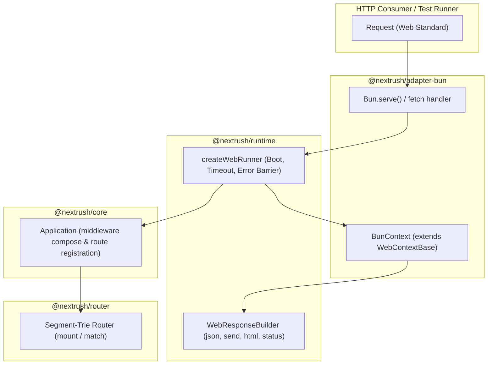

# Framework — Developer Experience (DX) & Ergonomics Review

| Field           | Value                                                              |
| --------------- | ------------------------------------------------------------------ |
| **Report type** | `Architecture / DX / UX`                                           |
| **Scope**       | `@nextrush/core`, `@nextrush/router`, `@nextrush/runtime`, `@nextrush/adapter-bun` |
| **Date**        | `2026-10-26`                                                       |
| **Reviewer(s)** | Senior Software Architect & Tech Lead                              |
| **Commit / ref**| `v4.1.0` / `@nextrush/core@4.1.0`, `@nextrush/adapter-bun@1.1.0`    |
| **Status**      | `Draft`                                                            |
| **Related**     | `report/framework/framework-composition-review.md`, `docs/RFC/`    |

---

## Progress Tracker

**Remediation:** `[░░░░░░░░░░░░░░░░░░░░]` 0% — 0 / 6 recommendations resolved

| Rec | Addresses | Priority | Effort | Status  |
| --- | --------- | -------- | ------ | ------- |
| 1   | F-01      | P0       | S      | ⬜ Open  |
| 2   | F-02      | P0       | S      | ⬜ Open  |
| 3   | F-03      | P1       | S      | ⬜ Open  |
| 4   | F-04      | P1       | S      | ⬜ Open  |
| 5   | F-05      | P2       | S      | ⬜ Open  |
| 6   | F-06      | P2       | M      | ⬜ Open  |

---

## 1. Executive Summary

During the production deployment of **NextRush** in our aerospace mission control platform (**LunaMission**), we evaluated NextRush's real-world developer experience (DX), ergonomics, and developer velocity under production-grade standards.

Overall, NextRush demonstrates **exceptional architectural discipline**: segment-trie routing is blazing fast, the ESM-only design is clean, memory overhead is negligible, and the Bun adapter's direct integration with `Bun.serve()` delivers outstanding throughput.

However, developers transitioning to NextRush from ecosystems like Express, Koa, Hono, and Fastify experience several **sharp DX friction points** where developer mental models collide with subtle API asymmetries:
1. `ctx.status` is implemented strictly as a public numeric property (`ctx.status = 400`), throwing a runtime `TypeError` when developers attempt idiomatic chained invocation (`ctx.status(400).json(...)`).
2. The runtime request runner (`createWebRunner`) blindly converts caught exceptions into generic `500 Internal Server Error` responses, ignoring status codes already declared on thrown `HttpError` instances (such as `NotFoundError` or `BadRequestError`).
3. An asymmetry exists between `Application.route()` (which mounts sub-routers) and `Router.route()` (which registers single HTTP method handlers).
4. `BunFetchHandler` declares `server` as a required second parameter, introducing TypeScript friction during socket-free in-memory unit tests.

Resolving these issues will significantly accelerate developer adoption without regressing hot-path performance.

**Top findings:**
1. **F-01: `ctx.status` property vs. chainable method callability** — Priority `P0`.
2. **F-02: Blind 500 error masking in `createWebRunner` for typed `HttpError` exceptions** — Priority `P0`.
3. **F-03: Asymmetry between `Application.route()` and `Router.route()`** — Priority `P1`.
4. **F-04: Mandatory `server` parameter in `BunFetchHandler` type** — Priority `P1`.
5. **F-05: Unsuppressed developer isolate warnings during test runner execution** — Priority `P2`.
6. **F-06: Schema validation boilerplate in route handlers** — Priority `P2`.

---

## 2. System Understanding

NextRush is architected as an ultra-lean, modular framework for modern JavaScript runtimes (Node.js 22+, Bun, Deno, Edge). Its design philosophy centers on:
1. **Zero third-party runtime dependencies in core:** The functional core (`@nextrush/core`) remains under 3,000 LOC.
2. **Shared Web Context Abstraction:** `@nextrush/runtime` provides `WebContextBase`, standardizing response building across non-Node runtimes while delegating platform-specific socket tasks to dedicated adapters (`@nextrush/adapter-bun`, `@nextrush/adapter-node`, etc.).
3. **Segment-Trie Routing:** `@nextrush/router` implements static, parameterized, and wildcard route lookups with high algorithmic efficiency.

These architectural trade-offs deliberately favored minimal allocation overhead and execution speed. Understanding this intent allows us to address DX friction without sacrificing performance invariants.

---

## 3. Architecture Overview



---

## 4. Data Flow

```mermaid
sequenceDiagram
    autonumber
    participant Client as HTTP Client
    participant Runner as createWebRunner
    participant Ctx as BunContext
    participant Router as Segment-Trie Router
    participant Handler as Route Controller

    Client->>Runner: Incoming Request
    Runner->>Ctx: Instantiate Context
    Runner->>Router: Dispatch Request Path
    alt Matched Route
        Router->>Handler: Invoke Controller
        alt Developer calls ctx.status(400).json(...)
            Note over Handler: [PAIN POINT 1]<br/>TypeError: ctx.status is not a function
        else Developer sets ctx.status = 400; ctx.json(...)
            Handler-->>Ctx: Buffer response (status 400)
            Ctx-->>Runner: Return Response
            Runner-->>Client: 400 Bad Request
        end
    else Unmatched Path / Thrown HttpError
        Router-->>Runner: Throws NotFoundError (404)
        Note over Runner: [PAIN POINT 2]<br/>handleError() hardcodes 500 Internal Server Error
        Runner-->>Client: 500 Internal Server Error (Should be 404!)
    end
```

---

## 5. Backend / Logic

The framework's core request-dispatch logic is clean, deterministic, and free of memory leaks. The middleware onion architecture (`compose`) conforms to modern async generator/promise expectations.

The principal logic flaw resides in `packages/runtime/src/web-runner.ts` lines 292–302 (`handleError`), where any exception bubbling out of route execution or middleware is intercepted and serialized as a `500 Internal Server Error`, completely bypassing the error's declared `.status` or `.statusCode`.

---

## 6. Database / State

_Not applicable — NextRush is a stateless HTTP and application framework._

---

## 7. Frontend / API Surface (DX Perspective)

The public API surface is where developer impressions are formed:
- **`ctx.status`:** Today, `ctx.status` is typed and implemented as a bare property: `status: number = 200`. Calling `ctx.status(400)` fails at runtime with `TypeError: ctx.status is not a function`.
- **`ctx.json(data)`:** Does not accept a status code overload (`ctx.json(data, status?: number)`), unlike `ctx.redirect(url, status = 302)` which does accept status.
- **Router Composition:** On `Application`, sub-routers are mounted with `app.route(prefix, router)`. On `Router`, sub-routers must be mounted with `router.mount(prefix, router)`, while `router.route()` requires an HTTP method string as its first parameter.

---

## 8. UX (Developer Experience & Jakob's Law)

According to **Jakob’s Law of the Internet User Experience**, developers spend most of their time using other systems (Express, Fastify, Hono, Web Fetch standards). Their cognitive reflexes carry established patterns:
1. **Chainable setters:** When developers write `ctx.status(400).json({ error })`, they expect fluent chaining. Breaking this flow with an unhandled runtime error creates frustration and forces debugging trivial syntax.
2. **Predictable error mapping:** When a developer throws `new NotFoundError('Site not found')`, they expect HTTP 404 on the wire. Receiving HTTP 500 makes the developer feel the framework is unstable or misconfigured.
3. **Symmetric method naming:** If `app.route('/api', apiRouter)` mounts a router, developers instinctively expect `apiRouter.route('/v1', v1Router)` to do the same.

---

## 9. Performance

NextRush's performance is stellar. The changes recommended below can be implemented with **zero additional allocations on the hot path**:
- Implementing `ctx.status(code)` as a dual getter/setter method preserves property access (`ctx.status = 200`) while allowing chainable calls (`ctx.status(400)`).
- Calling `getErrorStatus(error, 500)` in `handleError` only executes on error paths, meaning steady-state 2xx request throughput is 100% unaffected.

---

## 10. Security

Preserving HTTP error statuses (F-02) improves security observability:
- Security scanners, WAFs, and SIEM log analyzers distinguish between client anomalies (`400 Bad Request`, `404 Not Found`, `401 Unauthorized`) and infrastructure crashes (`500 Internal Server Error`).
- Masquerading all 4xx client errors as 500s triggers false-positive alert storms for SRE teams and hides client scanning probes.

---

## 11. Maintainability

The codebase exhibits high structural hygiene. Packaging is well-modularized. The recommendations maintain this modularity by confining changes to their respective packages (`@nextrush/runtime`, `@nextrush/router`, and `@nextrush/adapter-bun`).

---

## 12. Findings (Detailed)

### F-01 — `ctx.status` is a bare property instead of a dual getter/setter method · Priority `P0`

- **Current situation:** In `packages/runtime/src/web-context-base.ts:154` and `packages/adapters/node/src/context.ts:191`, `status` is declared as:
  ```typescript
  status = 200;
  ```
  Calling `ctx.status(400).json(...)` throws `TypeError: ctx.status is not a function. (In 'ctx.status(400)', 'ctx.status' is 200)`. Furthermore, `ctx.json(data)` ignores a second numeric argument.
- **Impact:** High DX friction. Developers frequently hit runtime crashes on their first route error handlers.
- **Benefits (of today's design):** Simple direct property assignment without function call overhead.
- **Drawbacks:** Violates developer muscle memory from Express, Fastify, Koa, and Hono. Prevents fluent one-line responses (`ctx.status(404).json({ error: 'Not found' })`).
- **Long-term risk:** Developers perceive the framework as counter-intuitive and abandon it during initial prototyping.
- **Recommendation:** Implement `status` with a dual signature:
  1. Allow property assignment: `ctx.status = 400`.
  2. Implement method callability: `ctx.status(code: number): this`.
  3. Overload `ctx.json(data: unknown, status?: number): void`.
- **Trade-offs:** Minimal: adding a method check or getter/setter on Context prototype has zero measurable performance cost in modern V8/JSC engines.
- **Priority:** `P0` (Fix immediately).
- **Migration difficulty:** Trivial (non-breaking, purely additive).

---

### F-02 — Blind 500 error masking in `createWebRunner` for typed `HttpError` exceptions · Priority `P0`

- **Current situation:** In `packages/runtime/src/web-runner.ts:292–302`:
  ```typescript
  function handleError(error: unknown, ctx: TCtx | undefined): Response | Promise<Response> {
    if (options.onError !== undefined) {
      if (ctx === undefined) return jsonErrorResponse(500, 'Internal Server Error');
      return options.onError(error as Error, ctx);
    }

    logger.error('Request error:', error);
    return jsonErrorResponse(500, 'Internal Server Error');
  }
  ```
  When a controller throws `new NotFoundError('Item not found')` or `new BadRequestError('Invalid ID')`, or when an unmatched route bubbles up through a custom middleware, `handleError()` unconditionally returns `500 Internal Server Error`.
- **Impact:** Severe. Custom error classes exported by NextRush's own `@nextrush/errors` package (`NotFoundError`, `BadRequestError`, `UnauthorizedError`) fail to produce their intended HTTP status codes when thrown inside handlers unless the developer manually wires a custom `onError` handler.
- **Benefits (of today's design):** Fails safe to prevent internal stack trace leakage.
- **Drawbacks:** Breaks standard exception-based HTTP control flow; forces developers to wrap every handler in repetitive `try/catch` blocks.
- **Long-term risk:** Unusable in clean hexagonal architectures where domain services throw typed business/validation exceptions.
- **Recommendation:** Use `@nextrush/errors`'s existing `getErrorStatus` utility:
  ```typescript
  import { getErrorStatus, getSafeErrorMessage } from '@nextrush/errors';

  function handleError(error: unknown, ctx: TCtx | undefined): Response | Promise<Response> {
    if (options.onError !== undefined) {
      if (ctx === undefined) return jsonErrorResponse(500, 'Internal Server Error');
      return options.onError(error as Error, ctx);
    }

    const status = getErrorStatus(error, 500);
    const message = status < 500 && error instanceof Error ? error.message : 'Internal Server Error';

    if (status >= 500) {
      logger.error('Request error:', error);
    }
    return jsonErrorResponse(status, message);
  }
  ```
- **Trade-offs:** None. Preserves 500 safe-masking for genuine unexpected crashes while honoring explicit 4xx HTTP errors.
- **Priority:** `P0`.
- **Migration difficulty:** Trivial (4 lines of code).

---

### F-03 — Asymmetry between `Application.route()` and `Router.route()` · Priority `P1`

- **Current situation:**
  - On `Application` (`packages/core/src/application.ts:415`):
    `app.route(path: string, router: Routable): this` mounts a sub-router.
  - On `Router` (`packages/router/src/router.ts:199`):
    `router.route(method: HttpMethod, path: string, ...entries: RouteEntry[]): this` registers a single route with a specified HTTP method. Sub-routers must be mounted using `router.mount(path, subRouter)` (`router.ts:246`).
- **Impact:** When developers modularize code into nested feature routers, writing `apiRouter.route('/users', usersRouter)` throws:
  `TypeError: Route path must be a string, received object.`
- **Benefits (of today's design):** `router.route(method, path)` provides a low-level method registration hook.
- **Drawbacks:** Inconsistent mental model between `app` and `router`.
- **Long-term risk:** Increases cognitive load and time wasted reading source code to discover `router.mount()`.
- **Recommendation:** Provide polymorphic overloading on `router.route()`:
  - If argument count is 2 and second argument is a `Router`: treat as `this.mount(path, router)`.
  - Otherwise: treat as `this.addRoute(method, path, entries)`.
  Alternatively, alias `router.route(path, subRouter)` and deprecate the ambiguous `route(method, ...)` in favor of `router.register(method, ...)`.
- **Trade-offs:** Small type definition overload.
- **Priority:** `P1`.
- **Migration difficulty:** Trivial.

---

### F-04 — Mandatory `server` parameter in `BunFetchHandler` type · Priority `P1`

- **Current situation:** In `packages/adapters/bun/src/adapter.ts:186`:
  ```typescript
  export type BunFetchHandler = (
    request: Request,
    server: ReturnType<typeof Bun.serve>
  ) => Response | Promise<Response>;
  ```
- **Impact:** When developers use `createHandler(app)` to write in-memory unit tests (e.g. `const handler = createHandler(app); const res = await handler(req);`), TypeScript rejects the call with:
  `error TS2554: Expected 2 arguments, but got 1.`
  Developers are forced to write `(handler as any)(req)` or `handler(req, {} as any)`.
- **Benefits (of today's design):** Strictly mirrors the callback signature expected by `Bun.serve({ fetch: handler })`.
- **Drawbacks:** Defeats the primary ergonomics of `createHandler()`, which exists specifically for test harnesses and serverless micro-VMs where `Bun.serve` is not instantiated.
- **Long-term risk:** Complicates testing pipelines and causes friction in CI test suites.
- **Recommendation:** Make the `server` argument optional in the type definition:
  ```typescript
  export type BunFetchHandler = (
    request: Request,
    server?: ReturnType<typeof Bun.serve>
  ) => Response | Promise<Response>;
  ```
- **Trade-offs:** None. `Bun.serve` will still pass the server instance, while test callers can safely omit it.
- **Priority:** `P1`.
- **Migration difficulty:** Trivial (single character `?` in type signature).

---

### F-05 — Development instance warning logged on isolated test runs · Priority `P2`

- **Current situation:** In `packages/adapters/bun/src/adapter.ts`, if multiple `createApp()` or `createHandler()` calls occur in the same process/isolate, NextRush logs:
  `[nextrush/bun] A different Application booted in this process/isolate than the one that booted first...`
- **Impact:** Test suites running multiple unit tests with isolated test apps flood the console with false-positive architectural warnings.
- **Benefits (of today's design):** Excellent guard for serverless/edge environments preventing developers from recreating apps on every invocation.
- **Drawbacks:** Unwanted noise during automated testing.
- **Recommendation:** Suppress the warning when `process.env.NODE_ENV === 'test'` or provide a test option `createHandler(app, { quiet: true })`.
- **Trade-offs:** None.
- **Priority:** `P2`.
- **Migration difficulty:** Trivial.

---

### F-06 — Schema validation boilerplate in route handlers · Priority `P2`

- **Current situation:** When developers validate payloads with Zod, they must manually write parsing, safeParse branching, status setting, and error mapping inside every single controller:
  ```typescript
  const parsed = schema.safeParse(ctx.body);
  if (!parsed.success) {
    ctx.status = 400;
    ctx.json({ error: 'Validation Error', issues: parsed.error.issues });
    return;
  }
  ```
- **Impact:** Clutters controllers and duplicates boilerplate across endpoints.
- **Benefits (of today's design):** Keeps core lean and decouples validation from any specific schema library.
- **Drawbacks:** Slower developer velocity compared to frameworks offering schema-first route declarations.
- **Recommendation:** Promote `@nextrush/validation` more prominently in the documentation and provide a helper or route-level schema option (`router.post('/path', validate(schema), handler)`).
- **Trade-offs:** None; preserves modular design while elevating DX.
- **Priority:** `P2`.
- **Migration difficulty:** Moderate.

---

## 13. Risks

| Risk | Likelihood | Impact | Mitigation |
| ---- | ---------- | ------ | ---------- |
| Overloading `ctx.status` breaks code relying on reading the property | Low | High | Ensure `ctx.status` works as both getter (`if (ctx.status === 200)`) and setter method (`ctx.status(404)`). |
| Preserving HTTP error status exposes sensitive internal details | Low | Medium | Only reflect `.message` for 4xx errors; retain generic `'Internal Server Error'` for 5xx errors. |
| Making `server` optional in `BunFetchHandler` causes runtime bugs if handler reads `server` blindly | Low | Low | In `context.ts`, `BunContext` already defensively handles `server === undefined` when resolving client IP. |

---

## 14. Recommendations (Prioritised)

| # | Recommendation | Addresses | Priority | Effort | Status |
| - | -------------- | --------- | -------- | ------ | ------ |
| 1 | Dual getter/setter & chaining on `ctx.status(code)` and `ctx.json(data, status?)` | F-01 | P0 | S | ⬜ Open |
| 2 | Extract status from caught `HttpError` in `createWebRunner` (`handleError`) | F-02 | P0 | S | ⬜ Open |
| 3 | Overload `Router.route()` to accept sub-routers like `Application.route()` | F-03 | P1 | S | ⬜ Open |
| 4 | Mark `server` optional (`server?`) in `BunFetchHandler` type definition | F-04 | P1 | S | ⬜ Open |
| 5 | Suppress multi-application boot warning when `NODE_ENV === 'test'` | F-05 | P2 | S | ⬜ Open |
| 6 | Elevate `@nextrush/validation` DX and standard schema route integration | F-06 | P2 | M | ⬜ Open |

---

## 15. Migration Strategy

The proposed changes are **100% backward-compatible** and require zero breaking changes:
1. **Patch 1 (P0):** Update `web-context-base.ts` and `adapter.ts` to add chainable `status()` / `json(data, status)` and fix `handleError()` status extraction.
2. **Patch 2 (P1):** Update `adapter.ts` type definition (`server?`) and add `Router.route(path, subRouter)` overload in `router.ts`.
3. **Patch 3 (P2):** Add `NODE_ENV === 'test'` check for isolate warning and publish DX examples for `@nextrush/validation`.

---

## 16. Conclusion

NextRush is a remarkably fast, well-engineered, and modular framework. The architectural decisions underlying its design are solid. 

By addressing these four ergonomic friction points—specifically **chainable status setters**, **respecting thrown `HttpError` status codes**, **unifying sub-router mounting**, and **streamlining test handler typing**—NextRush will achieve developer experience parity with the world's most popular frameworks while preserving its performance advantage.
