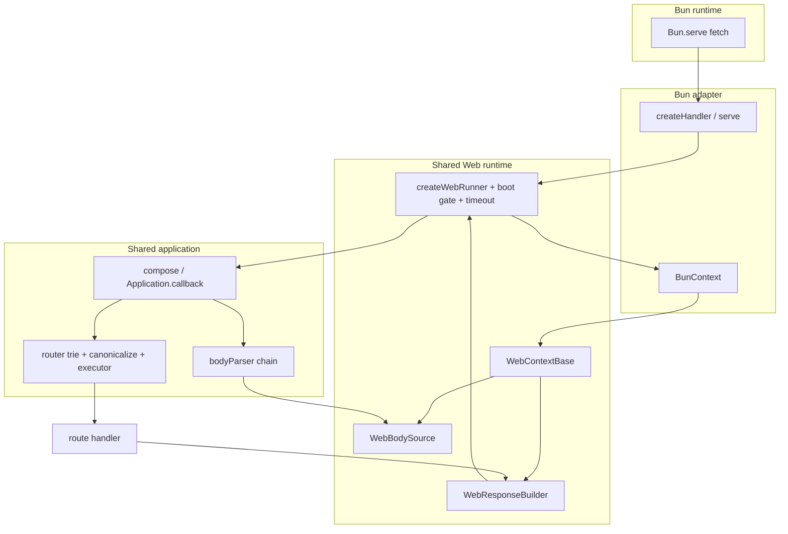
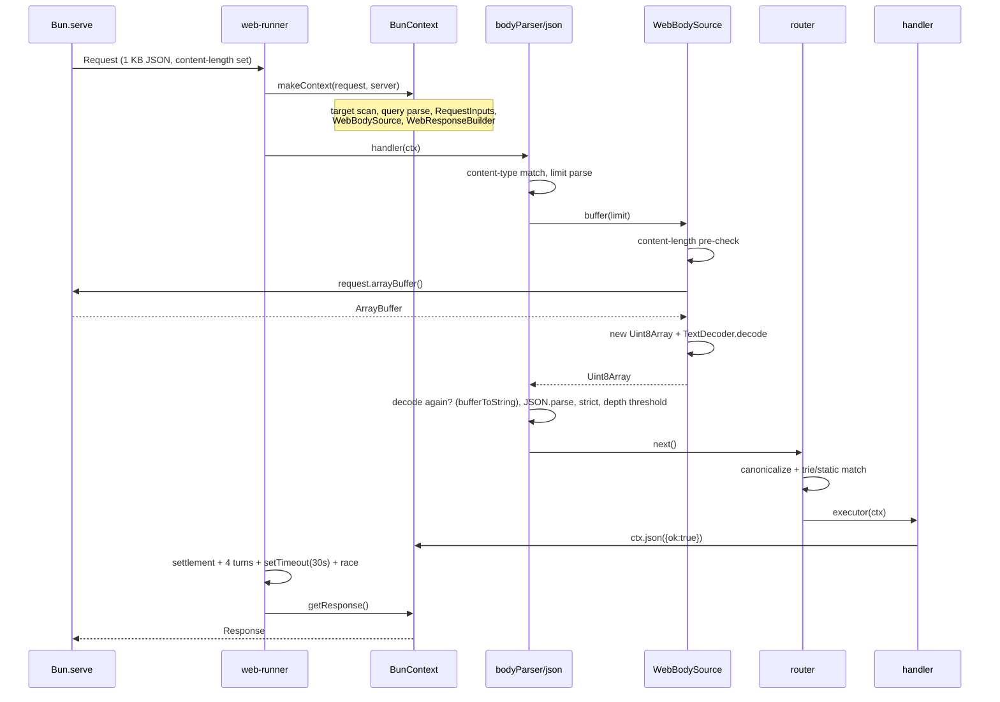

# Performance — Bun Adapter Architecture Review

| Field            | Value                                                                                      |
| ---------------- | ------------------------------------------------------------------------------------------ |
| **Report type**  | `Architecture` / `Performance`                                                              |
| **Scope**        | Bun adapter request path, shared Web runtime, body source, body parser, router, response    |
| **Date**         | 2026-10-20                                                                                  |
| **Reviewer(s)**  | Software engineering agent                                                                  |
| **Commit / ref** | `b5387bde` (`perf/bun-body-read-parity`, working tree includes uncommitted benchmark edits) |
| **Status**       | `Draft`                                                                                     |
| **Related**      | RFC-043, RFC-044, RFC-045, ADR-0031, ADR-0032, `report/performance/bun-native-gap-analysis.md`, `report/performance/bun-body-read-baseline.md` |

---

## Progress Tracker

**Remediation:** `[░░░░░░░░░░░░░░░░░░░░]` 0% — 0 / 8 recommendations resolved

| Rec | Addresses    | Priority | Status |
| --- | ------------ | -------- | ------ |
| 1   | F-04, F-07   | P0       | ⬜ Open |
| 2   | F-02         | P0       | ⬜ Open |
| 3   | F-03         | P1       | ⬜ Open |
| 4   | F-01         | P1       | ⬜ Open |
| 5   | F-05, F-08   | P2       | ⬜ Open |
| 6   | F-06         | P2       | ⬜ Open |
| 7   | F-01         | P2       | ⬜ Open |
| 8   | F-07         | P1       | ⬜ Open |

---

## 1. Executive Summary

NextRush's Bun GET path is healthy. A parsed JSON POST is not: it costs **10.27 µs/req against
Hono's 3.66 µs** in the project's own in-process gate, a ratio of **2.80** against a `max` of 3.5
and a `target` of 3.0. That single row is the entire performance problem in this review. There is
no evidence that the *Bun adapter* is the cause, and no remaining Bun-specific API that would fix
it.

The cost is in **shared Web runtime code**, in three places, measured here by interleaving variants
so machine drift hits every row:

1. **The timeout branch costs 2.0–2.8 µs on a dispatch that is pending on I/O** (POST), while
   costing ~0 on a synchronously-committed response (GET). The primitives are not the problem — a
   direct `Promise.race` with one `setTimeout`/`clearTimeout` measures ~0.55 µs. The cost is the
   wrapper *shape*: a per-request settlement promise plus four unconditional microtask turns around
   a dispatch that is already waiting on a socket.
2. **`WebBodySource`'s buffer path costs ~2.55 µs more than native `request.text()`** for a 1 KB
   JSON body (6.11 µs vs 3.56 µs for the same context + parse + response). This confirms the
   direction of the earlier gap analysis, but attributes it to the wrapper (arrayBuffer + copy +
   decode + repeated limit checks), not to `arrayBuffer()` itself: at the raw API the gap is only
   ~0.5–1.0 µs.
3. **The `bodyParser()` chain adds ~1.5 µs** over a direct body-source read (7.66 vs 6.11), through
   repeated content-type/limit detection and a four-`await` chain around one read.

Elysia's advantage is real but narrower and less transferable than it appears. Its default path
registers routes with `Bun.serve({ routes })`, so **route matching runs in Zig, not JavaScript**,
and it compiles one handler per route with `Function()` (AOT). Disabling AOT empties the native
route table and drops it back to a generic `fetch` handler. NextRush already pre-compiles a
per-route executor at registration using closures, and its routing semantics (case-insensitive by
default, non-strict trailing slash, 405/`Allow`, dot-segment rejection, mount composition) cannot
be expressed in Bun's native route table. The transferable part is the *shape of the remaining
work*, not the mechanism.

**Verdict:** Bun-specific optimization at the adapter boundary is exhausted for this path. The
justified change is **Option A — optimize the shared Web runtime** where the cost actually lives,
in two P0 steps (timeout dispatch, body read) and one P1 step (parser flattening), each gated by
the existing `inproc.post.nextrush.vs_hono` budget and the cross-runtime conformance suite.
Option B (a Bun-only execution path) is rejected: the costs are not Bun-specific, so it would
duplicate the pipeline for no measured gain. Option C (boot-time route specialization) is deferred:
the executor is already specialized; what remains is ~1.1 µs of trie walk and canonicalization.

Realistic target, evidenced by a prototype of the post-change path: **POST 10.2 → ~5.0–5.5 µs**,
i.e. ~1.4–1.5× Hono, with GET unchanged. The prototype row (4.16 µs, 4.71 µs with a race) excludes
the router and parser, so treat ~5.0–5.5 as the envelope, not a promise.

**Evidence conventions used in this report:** *observed* = read in source at the cited location;
*measured* = produced in this review on Bun 1.4.3, this machine, with the method in §9.1;
*inference* = reasoned from both; *hypothesis* = proposed, not yet proven.

---

## 2. System Understanding

### 2.1 What the Bun request path does today

*Observed.*

```
Bun.serve({ fetch, error, maxRequestBodySize, development })
  └─ createHandler(app, { timeout, logger })          packages/adapters/bun/src/adapter.ts:198
      └─ createWebRunner(app, { label, timeout, makeContext })
          ├─ createBootGate(app)                       packages/runtime/src/boot-gate.ts
          ├─ steady state: handler(ctx) read from closure, no promise hop
          ├─ if ctx.responded after the call → await dispatch, no timer
          └─ else dispatchWithTimeout(...)             packages/runtime/src/web-runner.ts:118
              ├─ settlement = dispatch.then(...)
              ├─ 4 × await Promise.resolve()           SETTLE_TURNS
              ├─ Promise.race([settlement, setTimeout(30s)])
              └─ on timeout: ctx.triggerTimeout() → 504 (unless already committed)
  └─ ctx = BunContext extends WebContextBase           packages/adapters/bun/src/context.ts
      ├─ method/url/path/query from requestTargetFromUrl + parseQueryString
      ├─ RequestInputs (lazy headers + ip)
      ├─ WebBodySource (unless GET/HEAD/OPTIONS)
      └─ WebResponseBuilder
  └─ app.callback() → compose(middlewareStack)         packages/core/src/application.ts:698
      ├─ compose has a single-middleware fast path      packages/core/src/middleware.ts
      ├─ bodyParser() → combined → json → readBody → bodySource.buffer()
      └─ router.routes() → canonicalize → match → executor(ctx)
  └─ ctx.getResponse() → new Response(body, { headers })   packages/runtime/src/response-builder.ts
```

The single-middleware fast path in `compose` (HP-6) and the pre-compiled router executor
(`compileExecutor`, `packages/router/src/segment-trie.ts:93`, created at registration in
`registration.ts:216`) are already in place. Two dispatch engines are no longer nested per request:
the router middleware is the one middleware, and its executor bakes in the route's own chain.

### 2.2 Why each abstraction exists

| Layer | Why it exists | Required for |
| --- | --- | --- |
| `WebContextBase` + `WebResponseBuilder` | one context/response state machine for Bun/Deno/Edge; lazy `raw`/`signal`/`headers` | portability, identical response semantics |
| `WebBodySource` | enforces body limits *before* and *after* materialization; supports `rawBody`/`verify`; streams with incremental limits | security, cross-runtime parity |
| `bodyParser()` chain | content-type routing, strict mode, depth limit, custom `verify`, parser error shapes | public API, DX |
| `compose` | ordering, `next()` semantics, double-next guard, sync-throw conversion | public contract |
| router trie + canonicalization | case-insensitive default, non-strict trailing slash, params/wildcards, 405/`Allow`, dot-segment rejection | public contract |
| `dispatchWithTimeout` | returns a **504 at the deadline while the handler is still running**, aborts `ctx.signal`, preserves a late-committed response | documented timeout contract (Node parity) |

None of these should be removed. The question is whether the common JSON case must pay every
branch of each.

### 2.3 Bun-specific vs shared

| Component | Classification | Evidence |
| --- | --- | --- |
| `serve()` bootstrap, `maxRequestBodySize`, `error`, TLS, drain (`stop()`) | **Bun-specific** | `packages/adapters/bun/src/adapter.ts` |
| `ctx.ip` via `server.requestIP` | **Bun-specific, lazy** | `context.ts:81` (RFC-044 removed the resolver closure) |
| `createWebRunner`, timeout race, boot gate, 404 finalize | **Shared** (Bun/Deno/Edge) | `packages/runtime/src/web-runner.ts` |
| `WebContextBase`, `WebBodySource`, `WebResponseBuilder`, `RequestInputs` | **Shared** (Bun/Deno/Edge) | `packages/runtime/src/*` |
| `compose`, `Application.callback`, error handling | **Shared** (all adapters) | `packages/core/src/*` |
| router trie, canonicalization, executor | **Shared** (all adapters) | `packages/router/src/*` |
| `bodyParser` chain | **Shared** (all adapters) | `packages/middleware/body-parser/src/*` |
| `NodeBodySource`, Node `createHandler` timeout fast path | **Node-specific** | `packages/adapters/node/src/{body-source,adapter}.ts` |

The important consequence: **every cost found below lives in shared code**. Optimizing it helps
Bun, Deno, and Edge, and must be proven not to regress Node.

---

## 3. Architecture Overview



---

## 4. Data Flow



The double decode is worth naming: `buffer()` returns bytes, `readBody` re-checks the limit, and
`json()` decodes the bytes with `bufferToString`. The native text path removes one decode and one
copy.

---

## 5. Backend / Logic

### 5.1 Body read

`WebBodySource._buffer` (`packages/runtime/src/body-source.ts:286`) takes the `arrayBuffer()` fast
path when an honest `Content-Length` is present and within the limit (RFC-043), then wraps it in a
new `Uint8Array`. `AbstractBodySource.buffer()` (`:148`) performs a pre-read content-length check,
marks consumed, awaits `_buffer`, and performs a post-read length check. `AbstractBodySource.text()`
then decodes the cached buffer. `bodyParser`'s `readBody` (`parsers/reader.ts`) repeats the
content-length pre-check and the post-read length check.

So a 1 KB JSON body is: one native read, one copy, one decode, three length checks, and two
`await` frames before `JSON.parse`.

### 5.2 Parser chain

`bodyParser()` (`parsers/combined.ts`) matches content type, calls `json(ctx, undefined, true)` so
detection is not repeated, which calls `readBody`, then `bufferToString`, then `JSON.parse`, then
strict mode, then the depth threshold. `verify` and `rawBody` are the only paths that genuinely
require bytes.

### 5.3 Timeout

`dispatchWithTimeout` allocates a settlement promise, awaits up to four microtask turns, then arms a
per-request 30 s timer and races. When the timer wins it calls `ctx.triggerTimeout()` (which lazily
creates the combined abort signal) and returns 504 unless the response was committed in the
meantime. The runner skips all of this when the handler committed synchronously, which is why GET
pays ~nothing (measured: −0.10 µs tax on GET).

### 5.4 Node path

Node keeps its own `NodeBodySource` and its own handler-level timeout race, sharing `SETTLE_TURNS`.
A change to the shared timeout shape therefore changes Node's timing characteristics and needs its
own A/B; a change to `WebBodySource` does not touch Node at all.

---

## 6. Database / State

_Not applicable — no database, cache, or persistent state is on the measured path. The only
request-scoped state is the context, the body-source cache, and the response record._

---

## 7. Frontend / API Surface

_Not applicable — no UI._ The public API in scope is the adapter and body-parser contract:

- `BodySource` (`@nextrush/types`) must keep `buffer`/`text`/`json`/`stream`/`consumed`/
  `contentLength`/`contentType`. A `textWithinLimit` capability, if added, is **internal** to
  `WebBodySource` (an adapter-internal method or a symbol-keyed capability), not a new requirement
  on third-party `BodySource` implementations.
- `bodyParser` options (`limit`, `strict`, `rawBody`, `verify`, `reviver`, `maxDepth`, `type`) and
  its error identity (`BodyParserError` codes) are unchanged.
- `serve`/`createHandler` options and the 504/abort/late-response contract are unchanged.

---

## 8. UX

_Not applicable — no user-facing interface. The developer-facing "UX" constraint is that the fast
path must not require configuration: it applies automatically when its preconditions hold, and
falls back silently otherwise._

---

## 9. Performance

### 9.1 Method

Two sources of truth, kept separate:

1. **The project gate** — `node apps/benchmark/scripts/dev-check/check.mjs inproc`, Bun 1.4.3,
   18 000 prebuilt single-use `Request`s, sequential `await`, 1 KB JSON POST, budgets from
   `apps/benchmark/scripts/dev-check/budgets.json`.
2. **Attribution probes** — read-only scripts in `/tmp/opencode/probe-bun-body/`, importing the
   checked-out source, measuring variants **interleaved by round** (5–9 rounds) so machine drift
   hits every row. Ranges are reported because this is a shared machine; deltas smaller than the
   spread are not treated as findings.

Nothing in the repository was modified for these measurements.

### 9.2 Gate result (this run)

| Row | Value |
| --- | ---: |
| `inproc.raw.us` (floor) | 2.01 µs |
| `inproc.hono.us` | 2.82 µs |
| `inproc.nextrush.us` (GET) | 3.60 µs — ratio **1.28** (target 1.3) |
| `inproc.nextrush.no-timeout.us` | 3.61 µs — timeout tax on GET ≈ 0.01 µs |
| `inproc.post.nextrush.us` | **10.27 µs** |
| `inproc.post.hono.us` | 3.66 µs — ratio **2.80** (target 3.0, max 3.5) |
| `inproc.nextrush.h12.us` / `h12` Hono | 4.67 / 3.87 — ratio **1.21** |

The GET path is within target. The POST path passes only because the hard `max` is 3.5; it is worse
than the project's own target.

### 9.3 Layer attribution (interleaved, 5 rounds, 1 KB POST)

| Variant | µs/req | Reads as |
| --- | ---: | --- |
| `ctx-json` (context + response, no body) | 1.77 | context + response cost |
| `ctx-text+parse` (context + native text + parse + response) | 3.56 | +1.79 for the body |
| `ctx-bodySource` (context + `WebBodySource.buffer` + decode + parse) | 6.11 | **+2.55 vs text** |
| `router-only` (context + text + parse + router + handler) | 4.67 | router ≈ **+1.1** |
| `parser-only` (context + `bodyParser` middleware, no route) | 7.66 | parser ≈ **+1.5** over `ctx-bodySource` |
| `parser+router` (composed callback, no runner) | 7.20 | parser + router |
| `runner-no-timeout` | 7.43 | runner adds ≈ 0.2 |
| `runner` (production) | 10.59 | **+3.16 timeout branch** |

The `parser-only`/`parser+router` ordering is within noise of each other; treat "parser + router"
as ~7.2–7.7.

### 9.4 Timeout A/B (interleaved, 7 rounds, real adapter)

| Arm | POST | GET |
| --- | ---: | ---: |
| `timeout: 30000` | 10.37 µs | 2.39 µs |
| `timeout: 0` | 7.54 µs | 2.49 µs |
| **tax** | **+2.83 µs** | **−0.10 µs** |

A direct `Promise.race([dispatch, setTimeout])` with no settlement promise and no microtask turns
measured **+0.55 µs** in the prototype run. The gap between +0.55 and +2.83 is therefore the
settlement promise plus the four unconditional turns, not the timer.

### 9.5 Body-read A/B (three separate processes, 9 rounds each, 906 B JSON)

| Run | `request.json()` | `text` + `parse` | `arrayBuffer` + `decode` + `parse` |
| --- | ---: | ---: | ---: |
| 1 | 9.66 | 8.50 | 12.55 |
| 2 | 7.50 | 8.24 | 9.23 |
| 3 | 7.72 | 8.40 | 9.05 |

`text` is consistently ~0.6–1.0 µs cheaper than the arrayBuffer path at the raw API level.
`request.json()` is fastest in two of three runs but cannot serve `rawBody`, `verify`, or an exact
byte measurement, so it is not a drop-in.

### 9.6 Post-change envelope (prototype, interleaved, 5 rounds)

| Variant | µs/req |
| --- | ---: |
| `current-runner` | 10.20 |
| `runner-no-timeout` | 8.23 |
| `callback-no-timeout` (full middleware, no runner race) | 6.88 |
| `prototype-fast` (context + native text + parse + response, **no router/parser**) | 4.16 |
| `prototype-fast` + immediate race | 4.71 |

The prototype omits the router (~1.1) and the parser's remaining work, so the evidenced envelope
for Option A is **~5.0–5.5 µs**, not 4.2.

### 9.7 Elysia's architecture (measured earlier, source-confirmed here)

*Observed in `elysia@1.4.30` `dist/adapter/bun/index.js` and `dist/adapter/bun/compose.js`:*

- `mapRoutes(app)` returns immediately unless `app.config.aot && app.config.systemRouter !== false`.
  The result is passed as `Bun.serve({ routes })`, so **path/method matching happens in Zig**.
- Route values that are `Response` instances become **static native routes** — no JS runs at all.
- Dynamic routes get one handler compiled per route via `createBunRouteHandler`, which builds a
  JavaScript source string with the context object literal and hook sequence inlined and instantiates
  it with `Function(...)`.
- With AOT disabled, `routes` is `{}` and everything funnels through `fetch: app.fetch`.

Previously measured on this machine: Elysia 1.4 default 39.84k GET vs `ELYSIA_AOT=false` 29.51k;
Elysia 2 RC default 51.43k vs `precompile: false` 41.42k. The within-run direction is stable; the
absolute ranking across processes is not.

### 9.8 Transfer classification

| Elysia mechanism | Classification | Why |
| --- | --- | --- |
| Native `Bun.serve({ routes })` dispatch | **Reject as default, investigate opt-in** | Zig matching cannot express NextRush's default case-insensitivity, non-strict trailing slash, dot-segment rejection, 405/`Allow`, or mount composition. A subset-only opt-in needs its own RFC. |
| Static `Response` route values | **Reject** | NextRush has no static-response route concept; adding one is a public API feature, not an optimization. |
| Per-route compiled handler | **Adapt (already done)** | `compileExecutor` builds a closure executor at registration. No codegen needed. |
| Inlined context literal | **Reject** | Requires `Function()`; forbidden in core by AGENTS.md §6.4. |
| Single generic fallback path | **Adopt (already done)** | `createWebRunner` + `createHandler` is the one path. |
| `idleTimeout: 30`, `reusePort: true` | **Investigate separately** | Operational/keep-alive settings, not per-request CPU. `reusePort` only matters with multiple processes. |

---

## 10. Security

The body-size guarantee is the constraint that shapes the body fast path.

- Today the limit is enforced against **actual bytes**: pre-read against `Content-Length`, post-read
  against `buffer.length`, and incrementally for chunked bodies.
- `request.text()` yields a JS string. UTF-8 bytes ≥ UTF-16 code units and ≤ 3× code units, so a
  fast path may skip the exact measurement only when `text.length > limit` proves an overflow, or
  when `text.length * 3 <= limit` proves it fits. The uncertain band must measure exactly
  (`TextEncoder().encode(text).length`) or fall back to the buffer path.
- `rawBody` and `verify` must always take the byte path — they are observable bytes, and a
  re-encode is not guaranteed byte-identical for invalid UTF-8 (replacement characters).
- The depth guard must never be skipped for a payload that could reach `maxDepth`. Using
  `text.length * 3` as the size proxy is conservative in the correct direction.
- No new trust boundary, header, or secret is introduced. `Content-Length` remains an optimization
  hint, never the sole enforcement.

The timeout change touches only wrapper shape; the 504, `ctx.signal` abort, and late-committed
response rules stay identical.

---

## 11. Maintainability

- The `BodySource` interface stays the same; the fast path is an internal `WebBodySource` capability
  with a fallback to `buffer()`. Third-party sources are unaffected.
- Removing the settlement promise and microtask turns from `dispatchWithTimeout` **removes** code
  and one shared constant (`SETTLE_TURNS`), but that constant is imported by the Node adapter, so
  the Node timeout fast path must be re-measured and its tests updated in the same change.
- Flattening the parser means extracting the JSON parse core from the middleware closure so both
  the combined parser and the standalone `json()` middleware call the same function — one
  implementation per contract, not a second parser.
- Every file touched is already under the 300-line ceiling except `body-source.ts` (408) and
  `web-runner.ts` (267). `body-source.ts` is over the cap today; this change is the natural moment
  to split the Web implementation from the abstract base, per `code-structure.md`.

---

## 12. Findings

### F-01 — The JSON POST path is 2.8× Hono, and it is the only failing dimension

- **Current situation:** `inproc.post.nextrush.vs_hono` = 2.80 (10.27 µs vs 3.66 µs); GET is 1.28.
- **Impact:** the framework's headline POST number is outside its own target and close to its hard
  max. Every JSON API route pays it.
- **Evidence:** §9.2 (gate run, Bun 1.4.3).
- **Benefits of fixing:** the dominant use case for a backend framework; a ~2× POST improvement is
  visible in every benchmark and every user's API latency.
- **Drawbacks:** the work is in shared code, so it must be proven on Bun, Deno, and Node.
- **Long-term risk if ignored:** the budget drifts to its 3.5 max and the framework's positioning
  becomes unsupportable on the one path that matters most.
- **Recommendation:** Rec 1–4.
- **Trade-offs:** none at the API level; internal complexity moves into eligibility checks.
- **Priority:** P0. **Migration difficulty:** low (internal only).

### F-02 — `WebBodySource` costs ~2.55 µs more than native text for the same work

- **Current situation:** context + `buffer()` + decode + parse = 6.11 µs; context + `request.text()`
  + parse = 3.56 µs.
- **Why it was designed this way:** the byte path is the only one that can serve `rawBody`, `verify`,
  chunked bodies, and exact byte limits. RFC-043 correctly chose `arrayBuffer()` as the one read that
  cannot violate the memory bound.
- **Impact:** ~25% of the POST path.
- **Evidence:** §9.3, §9.5.
- **Benefits of fixing:** removes a copy, a decode, and two of the three length checks on the common
  body; helps Bun, Deno, and Edge.
- **Drawbacks:** a second read path inside one class; the byte-limit proof becomes a three-band
  check instead of a single comparison.
- **Long-term risk:** a subtle limit-enforcement bug if the bands are wrong. Mitigated by explicit
  boundary tests.
- **Recommendation:** Rec 2.
- **Trade-offs:** ~2.5 µs against one more internal branch. Worth it.
- **Priority:** P0. **Migration difficulty:** low.

### F-03 — The parser chain adds ~1.5 µs around one read

- **Current situation:** `bodyParser` → `json` (prechecked) → `readBody` → `buffer` → `_buffer`,
  with content-type matching and three limit checks.
- **Impact:** ~15% of the POST path.
- **Evidence:** §9.3 (`parser-only` 7.66 vs `ctx-bodySource` 6.11).
- **Benefits of fixing:** removes duplicate detection and duplicate limit checks; makes the JSON core
  reusable by both entry points.
- **Drawbacks:** touches a package with many option combinations (`type`, `reviver`, `strict`,
  `rawBody`, `verify`, `maxDepth`).
- **Long-term risk:** option-combination regressions. Mitigated by the existing body-parser suite
  plus new negative tests per eligibility branch.
- **Recommendation:** Rec 3.
- **Trade-offs:** moderate refactor for ~0.8–1.2 µs.
- **Priority:** P1. **Migration difficulty:** medium (internal refactor, no API change).

### F-04 — The timeout branch costs 2.0–2.8 µs on any dispatch pending on I/O

- **Current situation:** a settlement promise, four unconditional microtask turns, then a race with
  a per-request 30 s timer.
- **Why it was designed this way:** to avoid arming a timer for handlers that settle within a few
  microtasks. That is a good instinct with a real cost: it charges every I/O-bound request four
  turns and an extra promise to save a timer for CPU-bound ones.
- **Impact:** 2.8 µs on POST; ~0 on GET (the sync-responded skip works).
- **Evidence:** §9.4. A direct race measures +0.55 µs in the prototype.
- **Benefits of fixing:** the single largest removable cost on the POST path; helps Bun, Deno, Edge,
  and (after its own A/B) Node.
- **Drawbacks:** handlers that settle within four turns without committing now arm and clear a timer
  (~0.5 µs) instead of paying turns (~0.3–0.5 µs). Roughly neutral for them, large win for I/O.
- **Long-term risk:** the double-`next`/late-commit semantics must stay identical; the existing
  `web-runner` tests cover them.
- **Recommendation:** Rec 1.
- **Trade-offs:** one fewer mechanism, one behavior nuance to document.
- **Priority:** P0. **Migration difficulty:** low.

### F-05 — The router adds ~1.1 µs, and its executor is already specialized

- **Current situation:** canonicalize + static-map probe + (for params) trie walk + one `RouteMatch`
  allocation; the handler chain is pre-compiled at registration.
- **Impact:** ~1.1 µs, second-order next to F-02/F-04.
- **Evidence:** §9.3 (`router-only` 4.67 vs `ctx-text+parse` 3.56).
- **Benefits of fixing:** removing the remaining JS dispatch could approach the native route table.
- **Drawbacks:** any further specialization risks the routing contract (case, slash, 405, dots,
  mounts) that the conformance suite pins.
- **Long-term risk:** replacing a correct, tested matcher for ~0.5 µs is a poor trade.
- **Recommendation:** Rec 5 — defer; revisit only if Phase 1–3 leave POST above ~2× Hono.
- **Trade-offs:** measured correctly, not worth it today.
- **Priority:** P2. **Migration difficulty:** high if attempted.

### F-06 — `Bun.serve({ routes })` cannot preserve NextRush routing semantics

- **Current situation:** Bun's native routes match exactly, are case-sensitive, and treat the
  trailing slash as significant, with static → param → wildcard precedence. NextRush defaults to
  `caseSensitive: false`, `strict: false`, rejects dot segments before matching, and implements
  405/`OPTIONS` via a second middleware pass.
- **Impact:** adopting native routes by default would change routing behavior for existing apps.
- **Evidence:** Bun 1.4.3 `serve.d.ts` route docs; `RouterOptions` defaults
  (`packages/types/src/router.ts:162`); `createAllowedMethodsMiddleware`
  (`packages/router/src/dispatch.ts`).
- **Benefits of fixing:** native dispatch would remove ~1.1 µs.
- **Drawbacks:** a second routing implementation, a semantic subset, and a new failure mode.
- **Long-term risk:** two matchers drift; a route behaves differently depending on whether it was
  eligible for the native table.
- **Recommendation:** Rec 6 — reject as default; require a separate RFC for a strictly opt-in,
  conformance-gated subset (case-sensitive + strict + no mounts + no 405 reliance).
- **Trade-offs:** complexity for ≈1 µs.
- **Priority:** P2. **Migration difficulty:** high.

### F-07 — The timeout cost does not reproduce outside the real pipeline

- **Current situation:** a verbatim copy of `dispatchWithTimeout` measured against a pending body
  read costs **+0.25 µs**, while the same branch inside `createHandler` costs **+2.83 µs**. Same
  code, same payload, same run conditions.
- **Why this matters:** the isolated harness cannot be used to accept or reject the change. Any
  implementation must be A/B'd through the real adapter with the real middleware chain, because the
  cost is produced by the interaction (promise graph, body-read resolution, timer bookkeeping,
  allocation pressure), not by the helper's own instructions.
- **Evidence:** §9.4 (real runner, 7 interleaved rounds) versus the isolated copy measured in this
  review.
- **Mechanism:** *hypothesis, not established.* Candidates: the settlement promise changes when the
  handler's continuation is scheduled relative to the body read's resolution; the extra per-request
  allocations raise minor-GC frequency; `clearTimeout` on a 30 s timer is costlier than the probe
  suggests. A `--cpu-prof` trace of the two arms is required before the report names a cause.
- **Impact:** prevents a false negative (a real optimization rejected because a microbenchmark said
  it was worth 0.25 µs) and a false positive (a microbenchmark win that never reaches the gate).
- **Benefits of correcting:** the acceptance criterion becomes the gate ratio plus a full-path A/B.
- **Drawbacks:** every candidate change costs a real-pipeline run, not a 10-second probe.
- **Long-term risk:** if ignored, the team optimizes what the probe can see instead of what the
  product pays.
- **Recommendation:** Rec 1, with the measurement method in §18 treated as part of the change.
- **Trade-offs:** slower iteration, trustworthy conclusions.
- **Priority:** P1. **Migration difficulty:** low (method only).

### F-08 — Shared-path changes carry cross-runtime blast radius

- **Current situation:** `web-runner.ts` is used by Bun, Deno, and Edge; `SETTLE_TURNS` is shared with
  Node; `WebBodySource` is used by Deno and Edge.
- **Impact:** a Bun-motivated change silently changes three other runtimes.
- **Evidence:** `packages/runtime/src/web-runner.ts` header; `packages/adapters/node/src/adapter.ts`
  imports `SETTLE_TURNS`.
- **Benefits of fixing carefully:** one improvement for four runtimes.
- **Drawbacks:** four runtimes to validate per change.
- **Long-term risk:** a Node regression discovered by users.
- **Recommendation:** Rec 5 (conformance + Node A/B in the same change).
- **Trade-offs:** slower changes, correct ones.
- **Priority:** P2 (process). **Migration difficulty:** low.

---

## 13. Risks

| Risk | Likelihood | Impact | Mitigation |
| --- | --- | --- | --- |
| Body-limit bypass via `text.length` | Low if banded correctly | High (memory DoS) | Exact measurement in the uncertain band; boundary tests; fallback to buffer |
| Behavior change for `rawBody`/`verify` | Medium if shared code is careless | High (silent byte drift) | Keep them on the byte path; byte-equality tests |
| Node timeout regression | Medium | Medium | Node A/B in the same change; `handler-timeout-fast-path` tests |
| Deno/Edge divergence | Low | High | Conformance suite on every change |
| Benchmark improvement that does not move the gate | Medium | Medium | Gate ratio is the acceptance authority; prototype rows are attribution only |
| Chasing Elysia's AOT territory | Medium | High | Explicit rejection of `Function()`; Option C deferred with a stated threshold |

---

## 14. Recommendations

### Option A — Optimize the shared Web runtime (recommended)

Use Web-standard APIs, not Bun-only ones, in the shared layers where the cost actually lives.

- **Expected benefit:** POST ~10.2 → ~5.0–5.5 µs (ratio ~1.4–1.5 vs Hono), GET unchanged.
- **Complexity:** low–medium; three focused changes plus tests.
- **Compatibility risk:** low; no public API change.
- **Maintenance:** net negative code in the runner, neutral in the body source.
- **Testing:** existing conformance + body-parser suites + new negative tests.
- **Effect on other adapters:** improves Deno/Edge; Node unchanged for body, needs an A/B for the
  shared timeout constant.

### Option B — A thin Bun-only execution path (rejected)

- **Why rejected:** the measured costs are in shared code and are not caused by Bun. A second path
  would duplicate the context, body, parser, and timeout contract for no measured gain, and would
  need its own conformance matrix forever. AGENTS.md §4 ("one implementation per contract") applies.

### Option C — Boot-time route specialization (deferred)

- **Why deferred:** the executor is already compiled at registration; what remains is ~1.1 µs of
  trie/canonicalization. Without codegen, the upside is smaller than F-02/F-04, which are not yet
  done.
- **Threshold to revisit:** if Phases 1–3 leave `inproc.post.nextrush.vs_hono` above 2.0.
- **If revisited:** a per-route closure plan (no `Function()`), built at `ready()`, with a strict
  eligibility predicate and the general matcher as fallback.

### Ranked recommendations

| Rec | Action | Addresses | Expected | Priority |
| --- | --- | --- | --- | --- |
| 1 | Replace the settlement + 4-turn wrapper with a direct race; keep the sync-responded skip | F-04 | −2.0 to −2.3 µs POST | P0 |
| 2 | `WebBodySource` internal text path with a three-band byte proof; buffer fallback | F-02 | −1.5 to −2.5 µs POST | P0 |
| 3 | Flatten the JSON parser chain; extract a shared parse core; single limit check | F-03 | −0.8 to −1.2 µs POST | P1 |
| 4 | Re-run the gate and tighten `inproc.post` target after 1–3 (owner approval) | F-01 | gate honesty | P1 |
| 5 | Cross-runtime validation: conformance on Bun/Deno/Edge, Node A/B for the timeout change | F-05, F-08 | risk control | P2 |
| 6 | RFC for an opt-in native `Bun.serve({ routes })` subset, or reject permanently | F-06 | ≈1 µs, high risk | P2 |
| 7 | Revisit Option C only if POST ratio > 2.0 after 1–3 | F-01 | door left open | P2 |
| 8 | Make the full-path A/B (real adapter, interleaved rounds) the acceptance method for Rec 1–3 | F-07 | trustworthy attribution | P1 |

---

## 15. Compatibility Matrix

| Invariant | Bun | Node | Deno | Edge | Guarded by |
| --- | --- | --- | --- | --- | --- |
| Method/URL/target normalization | ✅ | ✅ (own parser) | ✅ | ✅ | `request-target` tests, conformance |
| Headers/query lazy reads | ✅ | ✅ | ✅ | ✅ | context tests |
| Body single-read + caching | ✅ | ✅ | ✅ | ✅ | `body-source` tests, conformance |
| Content-type routing | ✅ | ✅ | ✅ | ✅ | body-parser suite |
| JSON strict mode, depth limit, errors | ✅ | ✅ | ✅ | ✅ | body-parser suite, `json-depth-default` |
| `rawBody` / `verify` byte fidelity | ✅ | ✅ | ✅ | ✅ | new byte-equality tests |
| Body limit: declared, actual, chunked, multibyte | ✅ | ✅ | ✅ | ✅ | `limit` tests + new boundary tests |
| Middleware order, `next()`, double-next | ✅ | ✅ | ✅ | ✅ | `core-middleware` spec |
| Routing: case, slash, params, 405, dots, mounts | ✅ | ✅ | ✅ | ✅ | router suite, security parity |
| Response commit, headers, HEAD suppression | ✅ | ✅ | ✅ | ✅ | conformance |
| Timeout 504, abort, late response | ✅ | ✅ | ✅ | ✅ | `web-runner` tests, `handler-timeout*` |
| Streaming/backpressure | ✅ | ✅ (own) | ✅ | ✅ | streaming integration tests |
| Graceful shutdown/drain | ✅ | ✅ | n/a | n/a | adapter integration tests |

**Unsupported or untested, stated explicitly:** native `Bun.serve({ routes })` dispatch is not used;
`server.timeout()` is not used (it is an idle-socket timeout, not a handler deadline); static
`Response` routes do not exist; Edge has no server lifecycle.

---

## 16. Migration Strategy

No public API or database migration. This is an internal, behavior-preserving change set.

**Phase 0 — Baseline (before any code)**
Run the gate three times, record medians; record Node `all --rt node`; confirm conformance green.

**Phase 1 — Timeout shape (P0)**
Change `dispatchWithTimeout` to a direct race; keep the `ctx.responded` skip; keep the timeout/abort/
late-response semantics. Node A/B in the same change. Roll back if any conformance or timeout test
fails.

**Phase 2 — Body read (P0)**
Add the internal `WebBodySource` text path with conservative byte proof. Keep `buffer()` as the
fallback and the only path for `rawBody`/`verify`/non-UTF-8/chunked/absent-length bodies. Deno and
Edge conformance in the same change.

**Phase 3 — Parser (P1)**
Extract the JSON parse core; route both `json()` and `bodyParser()` through it; collapse the
duplicate limit checks. Negative tests for every eligibility branch.

**Phase 4 — Gate update (P1, owner approval)**
Tighten `inproc.post.nextrush.vs_hono` to `target 2.0` / `max 2.5` only after Phase 1–3 pass
consistently across three runs. Budget changes need project-owner approval and evidence.

**Phase 5 — Optional specialization (P2)**
Only if the measured POST ratio is still above 2.0. Then, and only then, RFC for Option C or an
opt-in native route subset.

---

## 17. File-by-File Implementation Plan

*Proposed only — nothing here is implemented in this review.*

| File | Change | Risk |
| --- | --- | --- |
| `packages/runtime/src/web-runner.ts` | Replace `dispatchWithTimeout` with a direct `Promise.race`; delete the settlement promise and the microtask-turn loop; keep `hasCommittedResponse`; update the contract comment. If `SETTLE_TURNS` becomes unused, remove it. | Low |
| `packages/runtime/src/body-source.ts` | Add an internal text-read capability on `WebBodySource` (not on the public `BodySource`); implement the three-band byte proof; keep `buffer()` as fallback; split the file if it crosses the cap (it already does at 408 lines). | Medium |
| `packages/middleware/body-parser/src/parsers/reader.ts` | Add `readText(ctx, limit)`; collapse the duplicated content-length post-check; map the text path's limit error to the same `BodyParserError` shape. | Medium |
| `packages/middleware/body-parser/src/parsers/json.ts` | Extract `parseJsonText(text, options)` core; middleware keeps detection + `next()` only. Keep `bufferToString`/`toRawBody` on the byte path. | Medium |
| `packages/middleware/body-parser/src/parsers/combined.ts` | Call the parse cores directly after one detection; no `prechecked` flag threaded through. | Low |
| `packages/middleware/body-parser/src/parsers/urlencoded.ts`, `text.ts`, `raw.ts` | Unchanged behavior; only adapt to the new core signature if the shared helper moves. | Low |
| `packages/adapters/node/src/adapter.ts` | No behavior change intended; remove `SETTLE_TURNS` import if the constant is deleted; re-measure the timeout fast path. | Low |
| `packages/runtime/src/__tests__/body-source.test.ts` | Boundary tests: `limit-1`, `limit`, `limit+1` bytes; multibyte at each band; invalid UTF-8; chunked; absent content-length; `rawBody`/`verify` byte equality. | — |
| `packages/runtime/src/__tests__/web-runner.test.ts` | Race outcomes: instant respond, instant throw, pending→timeout, pending→late commit, `timeout: 0`. | — |
| `packages/middleware/body-parser/src/__tests__/*` | Option matrix per eligibility branch; error identity; depth threshold at the boundary. | — |
| `apps/benchmark/scripts/dev-check/budgets.json` | Only in Phase 4, with approval. | — |

**Explicitly not planned:** `Function()`/`eval`, a Bun-only request path, native `Bun.serve({routes})`,
new dependencies, or any public type change.

---

## 18. Testing and Benchmarking Plan

**Correctness gates (all required):**

1. `pnpm --filter @nextrush/runtime test`, `... @nextrush/body-parser test`,
   `... @nextrush/adapter-bun test`, `... @nextrush/adapter-node test`.
2. `packages/adapters/conformance` on Bun and Deno (`bun-runner`, `deno-runner`).
3. `node apps/benchmark/scripts/dev-check/check.mjs probe` — the behavior probe registry.
4. `check.mjs bookkeeping hygiene` — budget coverage and comment hygiene.
5. New negative tests for every fast-path eligibility condition, plus a fallback test for each.

**Performance gates:**

- Acceptance authority: `check.mjs inproc` on Bun, three runs, medians. `inproc.post` ratio and
  `inproc.nextrush` ratio are the gate.
- Node: `check.mjs all --rt node` recorded before/after; no gate today, so report the delta and
  require "no regression beyond run-to-run spread".
- Attribute with the interleaved probes in `/tmp/opencode/probe-bun-body/` (not committed); use them
  to explain a gate movement, never to declare success.
- CPU pinning (`taskset`) when available; state when it is not. This machine's spread is ~±15% at
  the 2 000-iteration scale, so a single run proves nothing.

**Regression thresholds (proposed; owner approval required to enshrine):**

| Metric | Threshold |
| --- | --- |
| `inproc.post.nextrush.vs_hono` | ≤ 2.0 after Phase 3 (max 2.5) |
| `inproc.nextrush.vs_hono` (GET) | ≤ 1.35, no worse than baseline + spread |
| `inproc.nextrush.vs_hono.h12` | ≤ 1.30 |
| Node inproc | no regression beyond spread |
| Conformance | zero failures, zero new exemptions |

---

## 19. Open Questions

1. **Should the timeout stay a race at all?** The 504-at-deadline contract requires returning while
   the handler runs, so yes. But should the deadline be a shared wheel instead of a per-request
   timer? A wheel removes `setTimeout`/`clearTimeout` but not the race. Needs a prototype and a
   measurement before it is proposed.
2. **Is `request.json()` usable as the fastest tier?** It is faster in some runs, but it cannot
   serve `rawBody`, `verify`, or exact byte measurement, does not support `reviver`, and its
   handling of BOM/invalid UTF-8 must be compared to `text()` + `JSON.parse` before it can be
   eligible for anything.
3. **Does Bun enforce `Content-Length` exactly?** If a client understates it, the server reads only
   the declared bytes. If that is guaranteed, `request.json()` becomes safe for the limit. This must
   be tested, not assumed.
4. **What is the right behavior for `buffer()` after a text read?** Re-encoding produces canonical
   UTF-8; for valid JSON the round trip is identical, for invalid UTF-8 it is not. The proposal is
   to cache re-encoded bytes only for the text-eligible case (valid UTF-8 by construction) and to
   throw or fall back otherwise. Needs a decision before Phase 2.
5. **Should `SETTLE_TURNS` be removed globally or kept for Node?** Node's timer cost differs from
   Bun's; the A/B decides.
6. **Is `idleTimeout` / `reusePort` worth a separate investigation?** Elysia sets both; NextRush sets
   neither. This is keep-alive/operational behavior, not per-request CPU, and should not be bundled
   with this change.

---

## 20. Conclusion

The Bun adapter is not leaving performance on the table that a Bun-specific API could recover. The
adapter boundary is already thin: one context, lazy IP, lazy headers, lazy raw, native request
reading, and a pre-compiled route executor. The remaining 6.6 µs of POST overhead is shared
machinery paying for guarantees it must keep — but paying for them in a more expensive shape than
necessary.

Two changes account for most of the recoverable cost, and both are Web-standard and
runtime-agnostic: stop wrapping every pending dispatch in a settlement promise plus four microtask
turns, and stop routing the common bounded JSON body through `arrayBuffer` + copy + decode. A third
(parser flattening) removes duplicated detection and limit checks. The evidenced envelope is a
**~2× POST improvement with no public API change**, which would move the gate from "passing at 2.8
against a 3.5 max" to "comfortably inside a 2.0 target".

Elysia's larger lead comes from moving dispatch into Zig and compiling handlers with `Function()`.
Neither is available to NextRush without changing its routing contract or its code-generation
policy, and neither is needed to close the gap that this review can prove.
