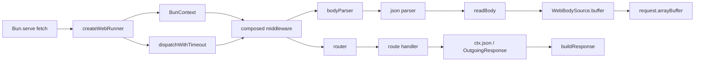
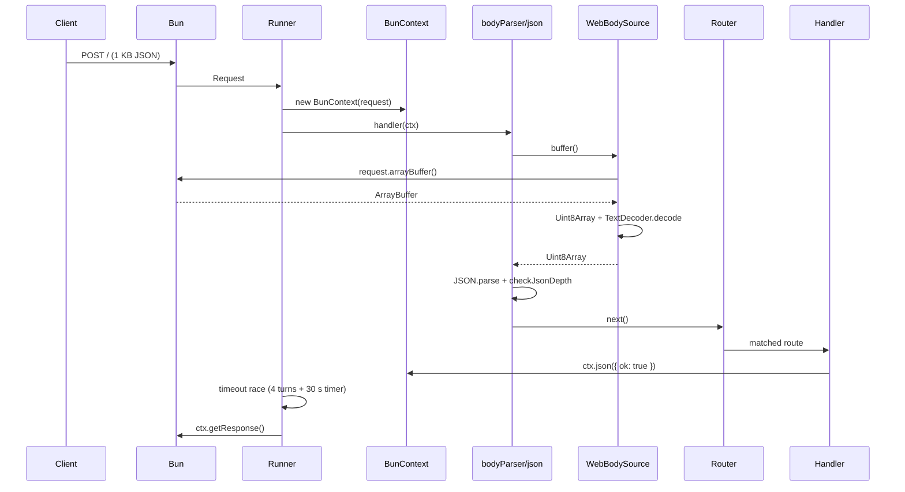

# Performance — Bun native-gap analysis

| Field            | Value                                                                 |
| ---------------- | --------------------------------------------------------------------- |
| **Report type**  | `Performance`                                                         |
| **Scope**        | Bun POST/GET request path: adapter → runner → context → body parser → router → response |
| **Date**         | 2026-10-20                                                            |
| **Reviewer(s)**  | Software engineering agent                                            |
| **Commit / ref** | `b5387bde` (`perf/bun-body-read-parity`)                              |
| **Status**       | `Draft`                                                               |
| **Related**      | `report/performance/bun-body-read-baseline.md`, RFC-043, RFC-044, `openspec/changes/bun-body-read-parity/` |

---

## Progress Tracker

**Remediation:** `[░░░░░░░░░░░░░░░░░░░░]` 0% — 0 / 6 recommendations resolved

| Rec | Addresses | Priority | Status |
| --- | --------- | -------- | ------ |
| 1   | F-02      | P0       | ⬜ Open |
| 2   | F-01      | P1       | ⬜ Open |
| 3   | F-03      | P1       | ⬜ Open |
| 4   | F-05      | P1       | ⬜ Open |
| 5   | F-04      | P2       | ⬜ Open |
| 6   | F-06      | P2       | ⬜ Open |

---

## 1. Executive Summary

NextRush's Bun POST path is not slow because of one hot function. It is slow because a
1 KB JSON request crosses more per-request layers than the native equivalent: a timeout
race, a context object graph, a buffer-based body source, a body-parser middleware, a
generic middleware composer, and a router. Each layer is individually reasonable. Their
sum is the gap.

Measured in isolation (median of five 30 000-iteration runs, separate Bun process per
variant):

- Native Bun floor (`await request.json()` + `Response.json`): **2.47–2.57 µs**
- Current NextRush runner (`full-runner`): **9.91–10.40 µs**
- Context + native `request.text()` + `JSON.parse` + response: **3.61–4.02 µs**
- Same path plus a hybrid timeout check: **4.18 µs**

The two biggest removable costs are the **buffer-based body read** (~2.3 µs over native
`request.text()`) and the **per-request timeout wrapper** (~2.5–3.0 µs on async body
requests). Flattening the parser chain and specializing the common route shape account
for most of the remainder.

Elysia 2.0.0-rc.0 was installed in a throwaway probe and measured. It is **not a
drop-in speedup**: its default runtime sits in the same band as Hono and Elysia 1.4,
and its advantage appears only when its precompile/AOT path is active. Its AOT requires
a build step. The useful conclusion is architectural, not a dependency change: a
precompiled, thin per-route handler is the lever; a different runtime package is not.

**Top findings:**

1. `WebBodySource` reads through `request.arrayBuffer()` + `Uint8Array` +
   `TextDecoder.decode`, where native `request.text()` is materially cheaper — **P0**.
2. The timeout wrapper pays a settlement promise, four microtask turns, a
   `Promise.race`, and a per-request 30 s timer on every async body request — **P1**.
3. The JSON parser is a four-`await` chain (`combined` → `json` → `readBody` →
   `buffer` → `_buffer`) around a single native read — **P1**.
4. There is no route-specialized fast path; the hello-world JSON route pays the full
   generic stack — **P1**.
5. Context and response construction cost ~1.2 µs; real, but smaller than the body and
   timeout costs — **P2**.
6. Elysia 2 RC is an RC with peer-dependency weight and no proven runtime win; do not
   adopt it as a dependency — **P2**.

---

## 2. System Understanding

A Bun request enters through `Bun.serve({ fetch: handler })`. `createWebRunner` takes the
request, resolves the boot gate, builds a `BunContext`, and dispatches through the
application's composed middleware. For a POST with a global `bodyParser()` and one
route, the chain is:

```
Bun.serve fetch
  → createWebRunner
  → BunContext construction
      method normalization, request-target scan, query parse,
      RequestInputs, WebBodySource, WebResponseBuilder + OutgoingResponse
  → app.callback() composed middleware
      → bodyParser (combined)
          → json parser
              → readBody
                  → bodySource.buffer()
                      → WebBodySource._buffer()
                          → request.arrayBuffer()
                          → new Uint8Array(...)
                      → TextDecoder.decode(...)
              → JSON.parse + checkJsonDepth
      → router middleware
          → route handler
              → ctx.json(...) records OutgoingResponse
  → runner timeout race
  → buildResponse (Headers + Response)
```

The design has good reasons. The body source is runtime-agnostic and enforces limits
before and after reading; the parser supports `rawBody`, `verify`, strict mode, and
depth limits; the middleware composer preserves ordering and `next()` semantics; the
timeout returns a 504 and aborts `ctx.signal` instead of dropping the socket. None of
these should be removed. The question is whether the **common** JSON case has to pay for
all of them on every request.

---

## 3. Architecture Overview



The general path is correct and should remain the fallback. The gap is that every
request takes it, including the common single-body-parser + single-JSON-handler shape.

---

## 4. Data Flow



---

## 5. Backend / Logic

The body parser's `json()` calls `readBody(ctx, limit)`, which calls
`ctx.bodySource.buffer(limit)`. `buffer()` performs the pre-read content-length check,
marks the source consumed, awaits `_buffer()`, performs the post-read length check, and
caches the buffer. `json()` then calls `bufferToString()` (a `TextDecoder.decode`) and
`JSON.parse`. The depth check is skipped only when the body is smaller than
`2 * (maxDepth + 1)` bytes or when `maxDepth` is `Infinity`.

The parser supports `rawBody` and `verify`, both of which genuinely need the bytes. The
fast path must not touch those cases.

The timeout wrapper (`dispatchWithTimeout` in `packages/runtime/src/web-runner.ts:118`)
attaches a settlement promise, spins up to `SETTLE_TURNS` (4) microtasks, then races a
per-request `setTimeout(30_000)`. For a body request, the body read has not settled in
four microtasks, so the timer is always armed.

---

## 6. Database / State

_Not applicable — this review covers the in-process HTTP request path; no database or
persistent state is on the measured path._

---

## 7. Frontend / API Surface

_Not applicable — server runtime only. The public API is unchanged by the recommended
internal fast paths; the route-specialized plan is RFC-gated._

---

## 8. UX

_Not applicable — no user-facing UI in scope._

---

## 9. Performance

### 9.1 Measurement method

In-process probe, 1 KB JSON body, 30 000 measured iterations after 3 000 warmup
iterations, median of five runs, one Bun process per variant. The request objects are
prebuilt outside the timed loop, so the numbers exclude `Request` construction. The
shared machine drifted 5–10% between runs; compare rows within a table, not across
tables.

This is deliberately separate from the dev-check gate. The gate's wire numbers remain
the acceptance authority; this probe exists to attribute cost to layers.

### 9.2 Stage decomposition (run A)

| Path | µs | Δ vs native |
| --- | ---: | ---: |
| Native: `await request.json()` + `Response.json` | 2.57 | — |
| `router-only`: context + router + `ctx.json`, no body read | 2.94 | +0.37 |
| `ctx-native-json`: context + native `request.json()` + `ctx.json` | 3.77 | +1.20 |
| `json-then-ctx`: native body read, then context + `ctx.json` | 3.82 | +1.25 |
| `ctx-text-json`: context + native `request.text()` + `JSON.parse` | 3.81 | +1.24 |
| `ctx-body-source`: context + `bodySource.json()` (buffer path) | 6.07 | +3.50 |
| `ctx-body-text`: context + `bodySource.text()` + `JSON.parse` | 6.21 | +3.64 |
| `body-parser`: context + body parser + `ctx.json` | 7.28 | +4.71 |
| `full-callback`: context + composed app, no timeout wrapper | 7.51 | +4.94 |
| `full-runner`: current production path | 10.08 | +7.51 |

Reading the table:

- Context + response construction adds **~1.2 µs** when a body is read
  (`json-then-ctx`/`ctx-native-json` vs native). The no-body path is only 0.37 µs
  above the native read+response floor, so the rest of the framework outside the body
  path is cheap.
- The NextRush body source costs **~2.3 µs more** than native `request.json()` or
  `request.text()` (`6.07/6.21` vs `3.77/3.81`).
- The body-parser middleware adds **~1.2 µs** over `ctx-body-source`.
- The generic composer adds **~0.2 µs** (`full-callback` vs `body-parser`).
- The timeout path adds **~2.5–3.0 µs** (`full-hybrid`/`full-runner` vs
  `full-callback`); the runner's boot gate and 404/error handling add another
  ~0.5 µs (`full-runner` vs `full-hybrid`).

### 9.3 Fast-path prototype (run B)

| Path | µs | Δ vs native |
| --- | ---: | ---: |
| Native | 2.57 | — |
| `ctx-text-json` | 4.02 | +1.45 |
| `fast-no-timeout`: context + native text + parse + response | 4.20 | +1.63 |
| `fast-hybrid`: same + four-turn check, race only if pending | 4.18 | +1.61 |
| `fast-race`: same + immediate direct race | 5.17 | +2.60 |
| `fast-immediate`: `setImmediate` check, then race | 6.05 | +3.48 |
| `full-callback` | 7.39 | +4.82 |
| `full-hybrid`: real app + hybrid timeout | 9.88 | +7.31 |
| `full-runner` | 10.40 | +7.83 |

The fast path (context + native text + parse + response + a timeout check that does not
arm a timer when the dispatch has already responded) is **~4.2 µs**, within ~0.3 µs of
the simplified no-timeout path. This is the realistic non-AOT target.

The real app path with the same hybrid timeout is **9.88 µs**: the body source and
parser layers still dominate. Native text and a route-specialized plan are needed
together, not separately.

### 9.4 Timeout primitives

| Primitive | Cost |
| --- | ---: |
| `setTimeout(30_000)` + `clearTimeout` | 198 ns |
| `setTimeout(0)` + `clearTimeout` | 227 ns |
| `setImmediate` + `clearImmediate` | 168 ns |
| `AbortSignal.timeout(30_000)` creation | 424 ns |
| `AbortSignal.timeout` + abort listener add/remove | 1 159 ns |
| `Promise.resolve()` | 33 ns |

The raw timer is not the problem. The cost is the settlement promise, the microtask
turns, the `Promise.race`, and the extra async frames around it. A shared timer wheel
(no per-request timer) is the structural fix; a direct race is the low-risk first step.

### 9.5 Wire context (directional only)

Previous dev-check run (Bun, 64 connections, 1 KB JSON, median of 3):

| Server | POST rps | GET rps |
| --- | ---: | ---: |
| NextRush | 22 657 | 33 700–34 800 |
| Hono | 31 386 | 39 200–40 400 |
| Elysia 1.4.30 | 32 925 | — |

The in-process probe's `full-runner` (23.5k rps in the same session) matches the wire
NextRush row. Use the in-process deltas for attribution; re-run the dev-check gate for
acceptance.

### 9.6 Elysia 2.0.0-rc.0 probe

Installed only in `/tmp/opencode/elysia2-probe` (aliases `elysia1`/`elysia2`; no repo
dependency). Two wire runs gave contradictory absolute rankings on this shared machine:

- Multi-server run: native 56.96k GET / 33.21k POST; Hono 48.72k / 30.99k;
  Elysia 1.4 56.98k / 33.20k; Elysia 2 RC 48.56k / 32.48k.
- Isolated-process run: native 62.25k / 38.16k; Elysia 1.4 39.84k / 25.43k;
  Elysia 1.4 with `ELYSIA_AOT=false` 29.51k / 22.33k; Elysia 2 RC 51.43k / 33.36k;
  Elysia 2 RC with `precompile: false` 41.42k / 29.51k.

The stable signal is the **within-run direction**: Elysia 1.4's default AOT path beats
`ELYSIA_AOT=false`, and Elysia 2's default precompile path beats `precompile: false`.
Elysia 2 RC's runtime is not reliably faster than Elysia 1.4 or Hono; its advantage
depends on the AOT/precompile build path. It is not a drop-in replacement.

---

## 10. Security

The body-size guarantee is the main constraint on the native-text fast path. Today
`WebBodySource._buffer` trusts an honest content-length at or below the limit, then
`buffer()` performs a post-read `buffer.length` check. A `request.text()` path cannot
measure UTF-8 bytes with `text.length` alone. The fast path must either:

1. use `Buffer.byteLength(text, 'utf8')` on runtimes where `Buffer` is available
   (guarded, no Node import), or
2. use `TextEncoder` only when `text.length * 3 > limit` (the exact upper bound for
   UTF-8 bytes per UTF-16 code unit), or
3. fall back to the buffer path when the exact byte length is not cheaply provable.

`rawBody` and `verify` must always take the buffer path. The depth check must remain;
using `text.length` for the “too small to nest” threshold is conservative because UTF-8
bytes are at least UTF-16 code units. No new secret, header, or trust boundary is
introduced.

---

## 11. Maintainability

The recommended fast paths are internal and branch on explicit conditions
(`rawBody`/`verify`/provable length). Keep them in small, named functions with the
existing parser as the fallback. Do not duplicate `JSON.parse` error handling; share a
`parseJsonText` helper. The route-specialized plan is a larger change and belongs behind
an RFC with a fallback to `app.callback()`.

---

## 12. Findings

### F-01 — Per-request timeout wrapper costs 2.5–3.0 µs on async body requests  ·  P1

- **Current situation:** `dispatchWithTimeout` creates a settlement promise, spins four
  microtasks, then races a per-request `setTimeout(30_000)`
  (`packages/runtime/src/web-runner.ts:98`, `:118`, `:144`, `:155`).
- **Impact:** A 1 KB POST pays the timer and race on every request. The clean in-process
  contrast is `full-hybrid` 9.88 vs `full-callback` 7.39 (2.49 µs); the current
  `full-runner` adds another ~0.5 µs of boot-gate/404 handling. Wire throughput loses
  roughly 10–12% (`23.5k` vs `26.4k` rps in the stage probe's 30 s vs no-timeout
  contrast).
- **Benefits of today's design:** A hung handler gets a 504 JSON response and
  `ctx.signal` is aborted; the four-turn check avoids a timer for handlers that settle
  synchronously.
- **Problems/risks:** The settlement wrapper and race are paid by every async request,
  even when the handler is healthy. The timer is created per request.
- **Alternatives:** (a) four-turn `ctx.responded` check + direct `Promise.race`;
  (b) shared timer wheel with O(1) insert/remove; (c) rely on Bun's native idle timeout
  (changes the 504 contract — reject).
- **Trade-offs:** (a) is low-risk and saves ~0.5 µs on the real path, more on the fast
  path; (b) saves ~2 µs but adds a per-adapter timer service and timeout-resolution
  semantics; (c) breaks the public timeout contract.
- **Recommendation:** Ship (a) first, measure, then evaluate (b) in a dedicated RFC.
- **Priority:** P1.
- **Migration difficulty:** Low for (a), medium for (b).

### F-02 — Buffer-based body read costs ~2.3 µs over native `request.text()`  ·  P0

- **Current situation:** `WebBodySource._buffer` uses `request.arrayBuffer()` +
  `new Uint8Array(...)` (`packages/runtime/src/body-source.ts:286`); `text()` decodes
  with `TextDecoder` (`:178`); the JSON parser calls `bufferToString` before
  `JSON.parse` (`packages/middleware/body-parser/src/parsers/json.ts:136`, `:155`).
- **Impact:** `ctx-body-source` 6.07 µs vs `ctx-native-json` 3.77 µs; `ctx-body-text`
  6.21 vs `ctx-text-json` 3.81. About 2.3 µs per POST.
- **Benefits of today's design:** One byte-oriented abstraction for Node, Bun, Deno,
  and Edge; supports `rawBody`, `verify`, streaming, and post-read limit checks.
- **Problems/risks:** The common JSON case pays for bytes it never needs; the native
  text decoder is bypassed.
- **Alternatives:** (a) native `request.text()` fast path in `WebBodySource.text()` and
  the JSON parser; (b) keep the buffer path for `rawBody`/`verify`/unprovable bodies.
- **Trade-offs:** (a) needs a byte-length check for the size limit; (b) preserves all
  current behavior and security.
- **Recommendation:** Implement (a) with a documented fallback and tests for
  content-length, chunked, over-limit, `rawBody`, `verify`, strict, and depth.
- **Priority:** P0.
- **Migration difficulty:** Low; internal behavior-preserving fast path.

### F-03 — Four-`await` parser chain around one native read  ·  P1

- **Current situation:** `combined` awaits `jsonParser` (`combined.ts:150–151`),
  `json` awaits `readBody` (`json.ts:136`), `readBody` awaits `buffer()`, and `buffer()`
  awaits `_buffer()`. The content-type header is read again after `WebBodySource`
  already read it in its constructor.
- **Impact:** The parser layer adds ~1.2 µs (`body-parser` 7.28 vs `ctx-body-source`
  6.07). Some of that is necessary validation; some is async-chain overhead.
- **Benefits of today's design:** Clear separation between parser selection, body
  reading, and byte decoding; easy to add parsers.
- **Problems/risks:** Every layer allocates a promise and yields; the duplicate
  content-type lookup is avoidable.
- **Alternatives:** A single `parseJsonBody(ctx, options)` path that reads text once,
  parses once, applies strict/depth, and returns; keep the layered functions for other
  content types.
- **Trade-offs:** Slight duplication or a shared low-level helper; must preserve error
  types and `next()` ordering.
- **Recommendation:** Flatten the JSON branch and reuse `bodySource.contentType`.
- **Priority:** P1.
- **Migration difficulty:** Low–medium.

### F-04 — Context and response construction cost ~1.2 µs  ·  P2

- **Current situation:** `WebContextBase` constructs `RequestInputs`, `WebBodySource`,
  `WebResponseBuilder`, and `OutgoingResponse` per request
  (`packages/runtime/src/web-context-base.ts:166`).
- **Impact:** `json-then-ctx` 3.82 vs native 2.57; `router-only` 2.94 vs native 2.57.
  Context + response is ~0.4–1.2 µs depending on body read.
- **Benefits of today's design:** Lazy headers/IP, one response model across adapters,
  committed/flushed lifecycle.
- **Problems/risks:** Four objects and eager field computation per request; the body
  parser re-reads content-type instead of using the body source.
- **Alternatives:** Lazy `RequestInputs`, `bodySource.contentType` reuse, method switch
  instead of `toUpperCase`, return the request target as a tuple.
- **Trade-offs:** Small savings, some complexity; do after F-01/F-02.
- **Recommendation:** Trim only the cheap, local items; do not restructure the context
  API.
- **Priority:** P2.
- **Migration difficulty:** Low.

### F-05 — No route-specialized fast path for the common JSON shape  ·  P1

- **Current situation:** Every request goes through the generic composer and body
  parser even when the stack is one global `bodyParser()` plus one JSON route.
- **Impact:** The fast prototype is 4.18 µs; the real app path is 9.88–10.40 µs. The
  generic layers account for most of the difference.
- **Benefits of today's design:** Uniform middleware semantics; one code path to reason
  about; easy to add arbitrary middleware.
- **Problems/risks:** The common case pays for generality. The gap is structural, not a
  micro-optimization.
- **Alternatives:** (a) boot-time route plan that recognizes the common shape and runs
  a specialized handler, with fallback; (b) codegen/AOT (blocked by the no-`Function()`
  policy); (c) native Bun routes (no proven win; our probe was slower).
- **Trade-offs:** (a) adds a second path and a recognition test; it must fall back for
  `rawBody`, `verify`, non-JSON, streaming, multiple middleware, and custom parsers.
  (b) is the native-like ceiling but requires an RFC and a policy change.
- **Recommendation:** Prototype (a) behind an RFC; use the fast path only when the
  boot-time stack matches exactly and every route is JSON.
- **Priority:** P1.
- **Migration difficulty:** Medium.

### F-06 — Elysia 2 RC is not a drop-in performance win  ·  P2

- **Current situation:** Elysia 2.0.0-rc.0's default runtime measured in the same band
  as Hono/Elysia 1.4 on POST; its precompile/AOT path is faster than
  `precompile: false`, but requires a build step.
- **Impact:** Adding the RC would add peer dependencies (`typebox >= 1.3.0`,
  `exact-mirror`, `openapi-types`, `@types/bun`) and an RC dependency without a proven
  runtime win.
- **Benefits of today's design:** No new dependency; the current adapter is stable.
- **Problems/risks:** The RC's AOT direction is useful evidence, but copying the package
  is not the lever.
- **Alternatives:** Use Elysia only as a reference implementation; run a separate AOT
  spike if the project wants to pursue build-time compilation.
- **Trade-offs:** A dedicated spike costs time; the non-codegen fast path captures most
  of the realistic gain.
- **Recommendation:** Do not add Elysia 2 RC as a dependency. Keep the comparison in a
  throwaway probe.
- **Priority:** P2.
- **Migration difficulty:** N/A.

---

## 13. Risks

- **Measurement risk:** The shared machine's wire numbers drift; only the in-process
  stage deltas are reliable for attribution. The dev-check gate must re-measure after
  each change.
- **Security risk:** A native-text fast path must preserve the byte limit, `rawBody`,
  and `verify` semantics. Falling back to the buffer path when the byte length is not
  provable is mandatory.
- **Behavior risk:** The timeout change must preserve the 504 response,
  `ctx.triggerTimeout()`, and the committed-response-after-timeout path.
- **Maintenance risk:** A route-specialized plan adds a second execution path; it needs
  a strict recognition predicate and a fallback test for every excluded case.

---

## 14. Recommendations

| Rec | Action | Addresses | Expected effect | Risk | Verification |
| --- | --- | --- | --- | --- | --- |
| 1 | Native `request.text()` fast path in `WebBodySource.text()` + JSON parser, with byte-length guard and buffer fallback | F-02 | −2.3 µs POST in-process | Low | body-parser tests: limit, chunked, rawBody, verify, strict, depth; Bun/Deno conformance |
| 2 | Replace settlement + 4-turn timeout with `ctx.responded` check + direct race; then evaluate a shared timer wheel | F-01 | −0.5 µs now; −2 µs with wheel | Low / medium | timeout tests: 504, signal abort, late response, no-timeout |
| 3 | Flatten the JSON parser branch; reuse `bodySource.contentType` | F-03 | −0.4–0.8 µs | Low | parser error-shape tests; 61 dev-check tests |
| 4 | Boot-time specialized route plan for the common `bodyParser + JSON route` shape, with fallback | F-05 | target 4.2–5.0 µs POST | Medium | RFC; fallback tests for every excluded shape |
| 5 | Lazy `RequestInputs`, method switch, request-target tuple | F-04 | −0.2–0.4 µs | Low | context tests; no public API change |
| 6 | Do not adopt Elysia 2 RC; keep the probe out of the repo | F-06 | avoids dependency risk | Low | N/A |

### Suggested sequence

1. **RFC/OpenSpec change** for the internal fast paths (R1–R3), preserving RFC-043/044.
2. Implement R1 + R2 + R3 together; run the dev-check wire gate and the full suite.
3. Only if the wire gate still shows a gap, prototype R4 behind an RFC.
4. Treat AOT/codegen as a separate decision; it is the only path to the native floor,
   and it is currently blocked by the no-`Function()` policy.

---

## 15. Migration Strategy

R1–R3 are internal and behavior-preserving. They do not change the public API, the
adapter contract, or the response model. They should ship as one OpenSpec change with
tests that pin the fallback conditions. R4 changes internal dispatch selection, not the
public API, but it needs an RFC because it introduces a second execution path. R6 is a
decision not to change dependencies.

No database migration, no public API version bump, and no adapter contract change is
required for R1–R3.

---

## 16. Conclusion

The Bun gap is a layering problem. Native Bun performs the same 1 KB JSON request in
~2.5 µs. NextRush spends ~2.3 µs converting bytes it could read as text, ~2.5–3.0 µs
racing a timeout it rarely needs, ~1.2 µs in parser middleware, and ~0.4–1.2 µs in
context/response construction. The first two are directly removable. The parser and
context trims are incremental. The route-specialized plan is the architectural step that
gets NextRush into the Hono/native band without code generation.

Elysia 2 RC confirms the direction — precompiled, thin handlers are fast — but it is not
a shortcut. The NextRush work is to make the common path thin while keeping the general
path correct.

---

## 17. Reproduction

The in-process probe is a throwaway harness under `/tmp/opencode/nr-probe/` (not part of
the repo). It symlinks the workspace packages into a local `node_modules/@nextrush` and
runs each variant in a separate Bun process:

```bash
cd /tmp/opencode/nr-probe
taskset -c 0-3 node micro-bench.mjs      # stage decomposition
taskset -c 0-3 node micro-fast-bench.mjs # fast-path/timeout variants
taskset -c 0-3 node timer-bench.mjs      # timer primitives
```

The Elysia probe is under `/tmp/opencode/elysia2-probe/` and uses npm aliases
(`elysia1`, `elysia2`) so no repo dependency changes are needed:

```bash
cd /tmp/opencode/elysia2-probe
taskset -c 0-3 node bench.mjs            # multi-server comparison
taskset -c 0-3 node bench-single.mjs     # isolated-process comparison
```

The authoritative gate remains:

```bash
pnpm --filter @nextrush/benchmark dev-check
```
