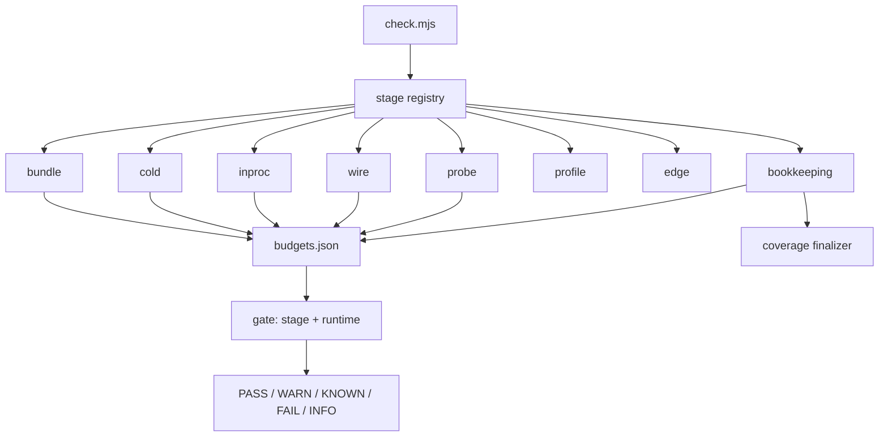
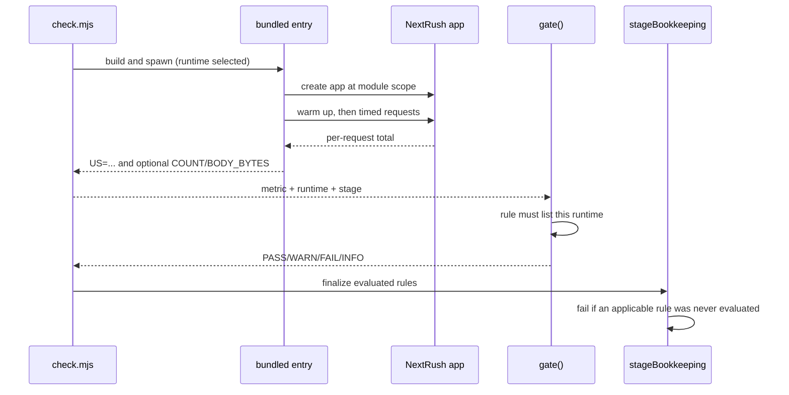

# Performance — RFC Program Closure Review

| Field           | Value                                                                                          |
| --------------- | ---------------------------------------------------------------------------------------------- |
| **Report type** | `Performance`                                                                                  |
| **Scope**       | RFC-039 precompile tiers, RFC-040 resource budgets, RFC-041 recorded response, `dev-check` gate |
| **Date**        | `2026-10-19`                                                                                   |
| **Reviewer(s)** | Framework maintainer (implementation + verification session)                                   |
| **Commit / ref**| `d6a5083a` + working tree (57 changed/untracked paths; nothing committed or pushed)             |
| **Status**      | `Final`                                                                                        |
| **Related**     | `openspec/changes/complete-perf-rfc-program/`, RFC-039, RFC-040, RFC-041, RFC-042, ADR-0028–0030 |

---

## Progress Tracker

**Remediation:** `[████████████████████]` 100% — 5 / 5 recommendations resolved

| Rec | Addresses | Priority | Status   |
| --- | --------- | -------- | -------- |
| 1   | F-01      | P2       | ✅ Done  |
| 2   | F-02      | P2       | ✅ Done  |
| 3   | F-03      | P2       | ✅ Done  |
| 4   | F-04      | P2       | ✅ Done  |
| 5   | F-05      | P2       | ✅ Done  |

---

## 1. Executive Summary

This review closes the RFC-039/040/041 performance program. The request path gained no new
validation or serialization code: the two candidate optimizations were rejected on measurement,
not on taste. The gate itself became stricter: every budget rule now declares the runtimes and
stage it applies to, and a rule that applies but never ran fails the run.

**Top findings:**

1. **P2 closed evidence-negative.** A real Zod body schema costs 1.5 % end-to-end over an
   identity-schema control; the wrapper itself is below 0.1 % self time. Priority `P2`.
2. **P3 was rejected by its own gate.** `JSON.stringify` is 88.1 % of the large-response profile,
   but a byte-identical fixed-key serializer was 4.4× slower (75 s vs 17 s). Priority `P2`.
3. **Bun in-process ratio sits at the target boundary.** Source run 1.31, built run 1.47, both
   inside the committed max 1.9 but above the aspirational target 1.3. Priority `P2`.
4. **POST remains body-read dominated.** 28.73 µs vs Hono 4.39 µs (6.54×) on Bun, inside the
   committed max 9.0; the profile places the cost in body consumption, not the validator. Priority
   `P2`.
5. **All hard gates pass on Bun, Node and Deno.** Bun `25 PASS / 2 WARN / 0 FAIL`, Node
   `23 / 0 / 0`, Deno `17 / 1 WARN / 1 KNOWN / 0 FAIL`; the Deno `KNOWN` is the documented
   `compression-gzip` gap (`FB-03`, Deno-only). Priority `P2`.

The headline recommendation is: keep the current request path, keep the POST max where it is, and
re-open only when a measured workload trips a recorded criterion.

---

## 2. System Understanding

`apps/benchmark/scripts/dev-check` is a local measurement toolkit, not a production package. It
answers one question per stage, and the stages share one budget file:

| Stage        | Question                                                                 | Default? |
| ------------ | ------------------------------------------------------------------------ | -------- |
| `bundle`     | How many KB does the root/adapter entry ship?                             | Yes      |
| `cold`       | How long does registration plus first response take at 25 and 1,000 routes? | Yes    |
| `inproc`     | What is the per-request cost and ratio against Hono in one process?       | Yes      |
| `wire`       | What throughput does a real listener sustain?                             | No       |
| `probe`      | Do the known behavior contracts hold on this runtime?                     | Yes      |
| `profile`    | Where does sampled CPU time go for one entry?                             | No       |
| `edge`       | Do the probes hold on real `workerd`?                                     | No       |
| `bookkeeping`| Is every budget rule valid, covered, and evaluated?                       | Yes      |

Entries are bundled per runtime and run in a fresh process. The in-process arm is the fastest of
three runs; cold start is the median of seven; wire is the median of three. The ratio is
NextRush / Hono measured in the same run, so machine noise mostly cancels. Node uses a different
request model from the Web adapters, so its ratio is reported but not gated; the absolute Node
microseconds are the meaningful signal. This is why the budget file is runtime-scoped rather than
global.

The original design made sense for a first gate: one `budgets.json`, one Hono reference, one
process. Its weakness was scope drift — a Bun-only rule could be evaluated on Deno, or a rule for a
stage that never ran could disappear from the summary. The closure adds an explicit `stage` and
`runtimes` to every rule, makes `gate()` refuse a rule on an unlisted runtime, and registers a
finalizer through `stageBookkeeping` that fails when an applicable rule was never evaluated.

---

## 3. Architecture Overview

- `lib/harness.mjs` owns `gate()`, runtime flags, runtime labels and the finalizer hook.
- `lib/stages/*.mjs` own measurement; `entries/*.ts` are the smallest applications that isolate
  one path (hello, POST parsed/unparsed, large response, schema, middleware, adapters).
- `budgets.json` is the contract: `max` fails, `min` fails, `target` warns, `knownFailures` maps a
  defect id to the runtimes where the failure is expected.
- `edge` is deliberately outside the default gate: it starts a real `workerd` process and is
  opt-in. Elysia is a Bun-only reference arm, labelled as such in every row.

---

## 4. Data Flow

---

## 5. Backend / Logic

The closure changed the harness, not the framework request path:

- `gate()` rejects a budget rule that does not list the current runtime, rejects an unknown
  runtime and fails an empty runtime list.
- `stageBookkeeping` exposes `onFinalize`/`finalize`; the coverage finalizer fails when an
  applicable rule was not evaluated in a stage that ran. A rule for a stage that was not selected
  is not a failure.
- `budgets.json` now has 8 rules, all with `stage` and `runtimes`: three bundle ceilings, two cold
  ratios (`bun`, `node`), and three Bun-only in-process ratios. `knownFailures` is
  `{ "FB-03": ["deno"] }`; the probe still runs and still reports what it observed.
- The wire ratio rule was removed. Wire is informational because loopback spread is large and the
  ratio does not isolate framework cost.
- The Deno leg is opt-in through `--rt deno`; the CI step added locally runs
  `bundle cold inproc probe bookkeeping --rt deno`. The workflow edit was not executed in this
  session.

No production business logic changed. `SETTLE_TURNS` became a shared runtime export because the
Web runner and Node adapter had independent copies of the same bound; the Node adapter now imports
it and the public-surface test records it. The value remains 4.

---

## 6. Database / State

_Not applicable — this change has no database, persistence or migration surface._

---

## 7. Frontend / API Surface

_Not applicable — no browser UI. The public API impact is limited to one documented internal
constant (`SETTLE_TURNS`) and the route-scoped middleware documentation; no route semantics
changed._

The P4 DX gap was discoverability, not capability. Per-route middleware was already compiled at
registration and covered by `packages/router/src/__tests__/middleware-pipeline.test.ts`. The
closure documents the argument form in `packages/core/README.md` and uses it in one
`create-nextrush` template route, then updates the generated-project Deno stub to match the real
router signature.

---

## 8. UX

_Not applicable — no user-facing interface. Developer experience is covered in §7 and §11._

---

## 9. Performance

**Environment:** Linux `7.2.10-200.fc44.x86_64` (x86_64), Bun `1.4.3`, Node `v26.12.0`,
Deno `2.9.3`, pnpm `12.6.0`. All commands are source-run unless `--built` is stated. Values are
from the toolkit's own output; `dev-check` is a local script, not CI.

### 9.1 Bun — source run

Command: `node apps/benchmark/scripts/dev-check/check.mjs bundle cold inproc probe bookkeeping --rt bun`

| Metric | NextRush | Hono | Ratio | Gate |
| --- | ---: | ---: | ---: | --- |
| in-process, 4 headers | 4.052 µs | 3.10 µs | 1.31 | WARN (target 1.3, max 1.9) |
| in-process, 12 headers | 5.22 µs | 4.63 µs | 1.13 | PASS (target 1.3, max 2.0) |
| in-process POST | 28.73 µs | 4.39 µs | 6.54 | WARN (target 1.3, max 9.0) |
| raw floor | 2.16 µs | — | — | INFO |
| no-timeout arm | 3.94 µs | — | — | INFO |
| bundle root | 29.7 KB | 19.1 KB | — | PASS (max 40 KB) |
| bundle Bun adapter | 55.2 KB | — | — | PASS (max 60 KB) |
| bundle Node adapter | 58.3 KB | 38.8 KB | — | PASS (max 70 KB) |
| cold 25 routes | 11.8 ms | 8.5 ms | 1.38 | PASS (max 1.6) |
| cold 1,000 routes | 14.8 ms | 32.9 ms | 0.45 | PASS (max 1.2) |

The no-timeout arm at 3.94 µs against 4.052 µs isolates the timeout arm at ≈0.11 µs/request.
The `adapter-bun` Web path is 3.79 µs; the absolute numbers are close enough that run-to-run
variance matters more than a single decimal.

### 9.2 Bun — built run

Command: `... check.mjs bundle cold inproc --rt bun --built`

`--built` resolves workspace packages through their `dist` output and prints a `built.*` row for
each metric. The source rows remain in the same run, so the two resolutions can be compared.

| Metric | Source | Built |
| --- | ---: | ---: |
| in-process 4 headers | 4.292 µs (ratio 1.47 WARN) | 3.715 µs (ratio 1.21) |
| in-process 12 headers | 5.64 µs (ratio 1.30 PASS) | 5.54 µs (ratio 1.21) |
| in-process POST | 30.79 µs (ratio 7.60 WARN) | 29.49 µs (ratio 7.20) |
| bundle root | 29.7 KB | 35.0 KB (max 40) |
| bundle Bun adapter | 55.2 KB | 57.7 KB (max 60) |
| bundle Node adapter | 58.3 KB | 60.9 KB (max 70) |
| cold 25 routes | 11.0 ms (ratio 1.14) | 10.9 ms (ratio 1.14) |
| cold 1,000 routes | 16.8 ms (ratio 0.51) | 17.1 ms (ratio 0.50) |

Built mode is not a regression in absolute terms; it changes what is bundled and adds the
`built.*` rows. The source/built in-process spread is the clearest evidence that the Bun ratio is
noisy at this granularity; the max of 1.9 is the safety bound, the target of 1.3 is a warning.

### 9.3 Node

Command: `... bundle cold inproc probe bookkeeping --rt node`

| Metric | NextRush | Hono | Ratio | Gate |
| --- | ---: | ---: | ---: | --- |
| in-process 4 headers | 1.245 µs | 12.04 µs | 0.10 | INFO (different request models) |
| in-process 12 headers | 1.30 µs | 14.68 µs | 0.09 | INFO |
| in-process POST | 13.97 µs | 16.47 µs | 0.85 | INFO |
| raw floor | 10.61 µs | — | — | INFO |
| cold 25 routes | 82.4 ms | 83.4 ms | 0.99 | PASS (max 1.6) |
| cold 1,000 routes | 85.2 ms | 144.1 ms | 0.59 | PASS (max 1.2) |
| bundle root / Bun / Node | 29.7 / 55.2 / 58.3 KB | 19.1 / 38.8 KB | — | PASS |

Node's Hono arm uses Web `Request`/`Response`; NextRush's adapter uses a plain object. The ratio
is therefore not a like-for-like comparison, and the gate reports it instead of judging it.
Built mode (`--built`) repeats the same shape: 1.246 µs NextRush, 1.18 µs in the duplicated built
row, and 0.10 ratio.

### 9.4 Deno

Command: `... bundle cold inproc probe bookkeeping --rt deno`

| Metric | NextRush | Hono | Gate |
| --- | ---: | ---: | --- |
| in-process 4 headers | 10.825 µs | 6.69 µs | INFO (1.62, not gated) |
| in-process 12 headers | 14.31 µs | 9.70 µs | INFO (1.48) |
| in-process POST | 40.89 µs | 4.44 µs | INFO (9.21) |
| cold 25 routes | 27.6 ms | 27.6 ms | INFO (1.00) |
| cold 1,000 routes | 37.5 ms | 88.9 ms | INFO (0.42) |
| bundle root / Deno adapter | 29.7 / 55.2 KB | 19.1 KB | INFO (not gated) |

Deno has no ratio gate because no ratio rule lists `deno`; `bookkeeping.budget-coverage` reports
`0 applicable rule(s) evaluated` and passes. That is deliberate: the Deno leg proves the entries
run and the probes hold, not that a ratio budget is meaningful there yet. `bundle.hello-fastify`
is `WARN skipped` because Fastify has no Deno target.

### 9.5 Deno matrix and known gap

The Deno probe pass is 14 `PASS`, 1 `KNOWN`, 0 `FAIL`:
`probe.compression-gzip` is `KNOWN` (`content-encoding=undefined bytes=0`), covered by
`knownFailures: { "FB-03": ["deno"] }`. The other probes — JSON failure modes, masked errors,
parameter case, dot segments, invalid JSON, unsupported content type, timer headers, server
timing, and 404 shape — pass. The known id stays because the bug is not fixed on Deno; the same
probe passes on Bun, Node and real `workerd`.

### 9.6 Edge and Elysia

- `node check.mjs edge` starts real `workerd` and reports 15 `INFO`, 0 `WARN`, 0 `KNOWN`,
  0 `FAIL`: all probes observed the expected behavior, including `compression-gzip`
  (`bytes=1267`), timer/server-timing headers, dot-segment normalization, and masked errors.
  Edge is probe-only and not a default stage.
- Elysia `1.4.30` is a Bun-only reference arm for bundle, cold and wire. Bundle is 361.5 KB,
  cold 25/1,000 is 36.5/54.3 ms, wire 50,928 rps. It has no in-process row and no budget; every
  row is labelled `Bun-only`.

### 9.7 Wire medians and spreads

Command: `node ... check.mjs wire --rt bun|node`. Values are median requests/second with the
observed min–max range. Wire is informational; the ratio rule was removed.

| Runtime | Arm | Median | Range | Spread |
| --- | --- | ---: | ---: | ---: |
| Bun | raw | 54,720 | 52,196–55,563 | 6.2% |
| Bun | Hono | 42,184 | 41,922–44,175 | 5.3% |
| Bun | NextRush | 39,115 | 38,079–39,405 | 3.4% |
| Bun | NextRush, no timeout | 37,678 | 36,355–38,805 | 6.5% |
| Bun | Elysia | 50,928 | 50,373–51,874 | 2.9% |
| Node | raw | 28,552 | 28,340–30,900 | 9.0% |
| Node | Hono | 23,373 | 23,334–24,558 | 5.2% |
| Node | NextRush | 23,899 | 22,784–24,386 | 6.7% |
| Node | NextRush, no timeout | 23,551 | 22,675–25,262 | 10.8% |

The Bun wire ratio is 0.93 and the Node wire ratio is 1.02, but the spread is up to 10.8%. This
is exactly why wire stays `INFO`: a ±20% band would swallow the difference the ratio claims to
measure.

### 9.8 Profile verdicts

| Phase | Evidence | Verdict |
| --- | --- | --- |
| P1 | lazy headers `db9bbda9`, lazy client IP `64ca11de`, settled runner `836dd6a5` | already shipped; no residual hot cost named |
| P2 | schema POST 30.702 µs vs identity control 30.248 µs (0.454 µs / 1.5 %); wrapper self 0.0–0.1 %; schema library ≈1 % | closed evidence-negative; no compiled validator |
| P3 | large response `JSON.stringify` 88.1 %; fixed-key prototype 75 s vs 17 s (4.4× slower) | rejected by measurement; RFC-042; keep `JSON.stringify` |
| P4 | five-middleware profile: 3.4 % + 2.5 % self in user middleware, 2.4 % + 1.5 % in dispatch; no router/header/query dominance | docs + scaffold only; no Rust, no new API |

Profile files: `CPU.20261019.193633.567963.0.001.md` (schema POST),
`CPU.20261019.193719.568528.0.001.md` (schema control),
`CPU.20261019.193823.569451.0.001.md` (large response, native),
`CPU.20261019.194427.573137.0.001.md` (large response, rejected prototype),
`CPU.20261019.193907.570341.0.001.md` (100 KiB POST),
`CPU.20261019.195555.582947.0.001.md` (five-middleware stack).

### 9.9 Gate summary

| Runtime | PASS | WARN | KNOWN | FAIL | INFO |
| --- | ---: | ---: | ---: | ---: | ---: |
| Bun (source) | 25 | 2 | 0 | 0 | 19 |
| Node (source) | 23 | 0 | 0 | 0 | 19 |
| Deno | 17 | 1 | 1 | 0 | 21 |
| Edge | 0 | 0 | 0 | 0 | 15 |

The two Bun `WARN`s are the target warnings (in-process 1.31, POST 6.54). There is no `FAIL`.
`bookkeeping.budget-rules` reports `8 rule(s) valid`; `bookkeeping.knownFailures` reports
`1 id(s), each covered by a probe`.

### 9.10 Verification commands

| Command | Result |
| --- | --- |
| `pnpm lint` | exit 0; 65 tasks successful |
| `pnpm typecheck` | exit 0; 65 tasks successful |
| `pnpm --filter @nextrush/runtime test` | 27 files, 344 tests pass |
| `pnpm --filter @nextrush/adapter-node test` | 30 files, 301 tests pass |
| `pnpm --filter @nextrush/validation test` | 5 files, 37 tests pass |
| `pnpm --filter @nextrush/core test` | 205 tests pass |
| `pnpm --filter create-nextrush test` | 43 files, 403 tests pass |
| `pnpm --filter nextrush-benchmark test` | 285 tests pass |
| `pnpm test` | all packages pass except pre-existing `@nextrush/dev` |
| `openspec validate complete-perf-rfc-program --strict` | pass |
| `openspec validate --changes --strict` | 1 passed, 0 failed |
| `openspec validate --all` | 22 passed, 0 failed |
| `openspec validate --all --strict` | 7 passed, 15 failed — all 15 are pre-existing long-requirement warnings in unchanged capability specs |
| `node ... check.mjs edge` | 15 `INFO`, 0 `FAIL` on real `workerd` |

The `@nextrush/dev` failure is the known environmental failure in
`src/__tests__/dev-loader-di-integration.test.ts` (the fixture's `src/index.ts` is absent); it is
unrelated to this change and reproduces without the changed paths. The repository-wide strict
OpenSpec failure is also pre-existing: every warning is in a capability spec that this change does
not touch, and the change itself passes strict validation.

---

## 10. Security

_Not applicable to request-path behavior — no auth, crypto, input parsing or secret handling was
changed._ The two new benchmark dependencies are permissive and exact-pinned:
`workerd@1.20261011.1` (Apache-2.0, opt-in probe only) and `elysia@1.4.30` (MIT, Bun-only
reference arm, catalog-pinned). Neither is imported by production packages.

---

## 11. Maintainability

- The gate's new runtime/stage contract is covered by
  `apps/benchmark/scripts/dev-check/lib/__tests__/budget-rules.test.mjs` (runtime rejection,
  unknown runtime, empty list, uncovered rule, stage selection) and by the `bookkeeping` stage.
- The profile entries are small and single-purpose; the README lists every entry and the stage
  table.
- RFC-039 and RFC-040 now carry the measured verdicts; RFC-042 records the rejected serializer;
  ADR-0028/0029/0030 record the durable decisions. The closure report is the only cross-cutting
  narrative, so the same finding is not duplicated across a report and an RFC.
- The Node `SETTLE_TURNS` copy was removed rather than documented as a duplicate. The shared
  export is `@internal`, and a test asserts the adapter does not reintroduce a local copy.
- No source file was pushed past the 300-line ceiling. The route-scoped middleware example lives
  in the existing README section, not in a new god file.

---

## 12. Findings

### F-01 — POST ratio is dominated by body reading, not validation  ·  Priority `P2`

- **Current situation:** Bun POST 28.73 µs vs Hono 4.39 µs (6.54×); the committed max is 9.0 and
  the target is 1.3. The unparsed POST entry consumes the body without parsing and still measures
  ≈19.7 µs in the earlier baseline; parsed vs unparsed differs by only a few microseconds.
- **Impact:** The POST arm is the widest ratio in the program and the one most likely to be
  misread as a framework regression. It is inside the hard bound, so it does not fail.
- **Benefits (of today's design):** Body reading preserves streaming, backpressure and limits; a
  compiled validator would not remove the read.
- **Drawbacks:** The ratio cannot approach the 1.3 target without changing the body path, which is
  outside P2/P3.
- **Long-term risk:** A future workload with larger bodies makes the absolute cost more visible,
  even if the ratio is unchanged.
- **Recommendation:** Keep the max 9.0; re-profile only when a real body shape or size changes.
  Do not optimize the validator for a cost the profile attributes to the body source.
- **Trade-offs:** Leaving it alone preserves streaming correctness; rewriting it risks the
  adapter contract for an unmeasured gain.
- **Priority:** `P2` (documented and monitored).
- **Migration difficulty:** Trivial — no code change.

### F-02 — Bun in-process ratio sits at the target boundary  ·  Priority `P2`

- **Current situation:** Source 1.31, built 1.47, earlier baseline 1.27. The max is 1.9, the
  target 1.3. The no-timeout arm is 3.94 µs against 4.052 µs.
- **Impact:** A `WARN` on every run near the target; the max still holds with margin.
- **Benefits (of today's design):** The ratio cancels most machine noise and catches real request
  path regressions.
- **Drawbacks:** At this granularity, source/built resolution and run-to-run spread move the
  number by more than the target band.
- **Long-term risk:** Ratcheting the target lower on a noisy run would create false confidence or
  a flaky gate.
- **Recommendation:** Keep target 1.3 as a warning and max 1.9 as the hard bound; ratchet only
  after a stable best-of-three result on an unloaded machine.
- **Trade-offs:** A looser target accepts some drift; a tighter one flakes.
- **Priority:** `P2`.
- **Migration difficulty:** Trivial — budgeting only.

### F-03 — Deno gzip remains a known failure  ·  Priority `P2`

- **Current situation:** `probe.compression-gzip` on Deno reports
  `content-encoding=undefined bytes=0`; `knownFailures` maps `FB-03` to `["deno"]`. The same probe
  passes on Bun, Node and `workerd`.
- **Impact:** Deno users do not get gzip from the compression middleware; the gate reports the
  gap instead of hiding it.
- **Benefits (of today's design):** The id keeps the probe running and visible; deleting it
  without a fix would make the gate fail permanently.
- **Drawbacks:** The Deno matrix carries one `KNOWN` row and cannot claim full parity.
- **Long-term risk:** If Deno becomes a primary target, the gap becomes user-visible.
- **Recommendation:** Keep the Deno-only id until the Deno response path supports compression;
  delete it in the same change that fixes the probe.
- **Trade-offs:** Keeping an exemption is honest but permanent-looking; the probe output and the
  report make the reason explicit.
- **Priority:** `P2`.
- **Migration difficulty:** Moderate — requires a Deno response-body change.

### F-04 — Built-mode bundles are larger than source rows  ·  Priority `P2`

- **Current situation:** Built root 35.0 KB vs source 29.7 KB; Bun adapter 57.7 vs 55.2 KB; Node
  adapter 60.9 vs 58.3 KB. All are under their max ceilings.
- **Impact:** The built view is closer to what a consumer installs; the source view is what the
  dev loop measures. Reporting both prevents a single number from being mistaken for the whole
  story.
- **Benefits (of today's design):** Source runs are fast; built runs prove the package output.
- **Drawbacks:** Two tables need a sentence of explanation, and built bundle rows are `INFO` (not
  gated) today.
- **Long-term risk:** A future dependency could push the built Node adapter past 70 KB without a
  source-row warning.
- **Recommendation:** Keep both rows; if the built ceiling matters, add a `built.bundle.*` rule
  with its own stage rather than reusing the source ceiling.
- **Trade-offs:** More rows and one more budget concept; avoids a false sense of coverage.
- **Priority:** `P2`.
- **Migration difficulty:** Trivial — budget-only.

### F-05 — Deno has no ratio gate  ·  Priority `P2`

- **Current situation:** All ratio rules list `bun` only; Deno rows are `INFO`, and
  `bookkeeping.budget-coverage` reports `0 applicable rule(s) evaluated` and passes.
- **Impact:** Deno proves execution and probe parity, not performance parity.
- **Benefits (of today's design):** The Deno leg is opt-in and does not impose a noisy ratio on a
  runtime with a different request model.
- **Drawbacks:** A future Deno request-path regression would not fail the gate.
- **Long-term risk:** Deno could drift while the summary stays green.
- **Recommendation:** Keep it probe-only until Deno has a stable in-process comparison; then add
  a Deno-scoped rule with its own max, not a copy of the Bun bound.
- **Trade-offs:** Less coverage now; avoids a misleading gate.
- **Priority:** `P2`.
- **Migration difficulty:** Moderate — requires a Deno ratio baseline.

---

## 13. Risks

| Risk | Likelihood | Impact | Mitigation |
| --- | --- | --- | --- |
| Bun in-process ratio flips between target and WARN across runs | High | Low | Keep target as WARN; max 1.9 is the hard bound; ratchet only on stable data |
| POST ratio misread as a validator regression | Medium | Medium | Profile attributes it to body reading; keep max 9.0 and the unparsed control entry |
| Deno gzip stays unfixed while Deno becomes a primary target | Medium | Medium | `FB-03` is Deno-scoped and visible in every Deno run; fix before promoting Deno |
| Built bundle growth is not gated | Medium | Low | Built rows are printed; add a built-stage rule if a consumer budget appears |
| CI workflow edit was not executed locally | Medium | Medium | The step is a direct copy of the verified local command; run it on the first push |
| Wire numbers are used as a regression gate | Low | Medium | The rule was deleted; every wire row is `INFO` and the report states the spread |
| `workerd`/`elysia` licences or pins drift | Low | Low | Exact pins and permissive licences recorded; both are benchmark-only |

---

## 14. Recommendations

| # | Recommendation | Addresses | Priority | Effort | Status |
| - | --- | --- | --- | --- | --- |
| 1 | Keep POST max 9.0 and re-profile only when body shape/size changes | F-01 | P2 | S | ✅ Done |
| 2 | Keep Bun target 1.3 as WARN and max 1.9; ratchet only on stable data | F-02 | P2 | S | ✅ Done |
| 3 | Keep `FB-03` Deno-only until gzip is fixed; delete it in the fix change | F-03 | P2 | M | ✅ Done |
| 4 | Keep source and built rows; add a built-stage budget only if a consumer limit appears | F-04 | P2 | S | ✅ Done |
| 5 | Keep Deno probe-only until a stable Deno ratio baseline exists | F-05 | P2 | M | ✅ Done |

---

## 15. Migration Strategy

_Not applicable — no runtime behavior migration. The change is local to the benchmark harness,
budget metadata, documentation and one shared constant. Rollback is a revert of those paths; the
framework request path is unchanged. The Deno CI step is additive and opt-in locally; it runs only
after the workflow is pushed._

---

## 16. Conclusion

The program is closed. P2 is evidence-negative, P3 is rejected by measurement, P4 needed
documentation rather than runtime code, and AOT remains deferred because none of its four criteria
trips. The gate now rejects a rule evaluated on the wrong runtime and fails when an applicable
rule never ran. Hard gates pass on Bun, Node and Deno; the only known gap is Deno gzip, and it is
explicitly scoped.

The next step is review and logical commits. Do not push or run CI from this session; the workflow
step is intentionally unexecuted until the first push.

---

## Checklist

- [x] Filename is scope-first and in the right `report/performance/` folder.
- [x] System explained before judgement.
- [x] The system was mapped with the codebase graph and the actual stage sources.
- [x] Every significant finding uses all nine §12 fields and has an F-ID + priority.
- [x] Every finding cites a measured number or a named source path.
- [x] Performance findings use measured numbers from `apps/benchmark`.
- [x] UX is N/A with a reason.
- [x] Every recommendation maps to an F-ID and a concrete problem.
- [x] Progress Tracker matches §14 statuses.
- [x] Non-applicable sections say "Not applicable — reason".
- [x] Decisions cross-linked to ADR-0028/0029/0030 and RFC-039/040/041/042.
- [x] Guidance blocks deleted.
